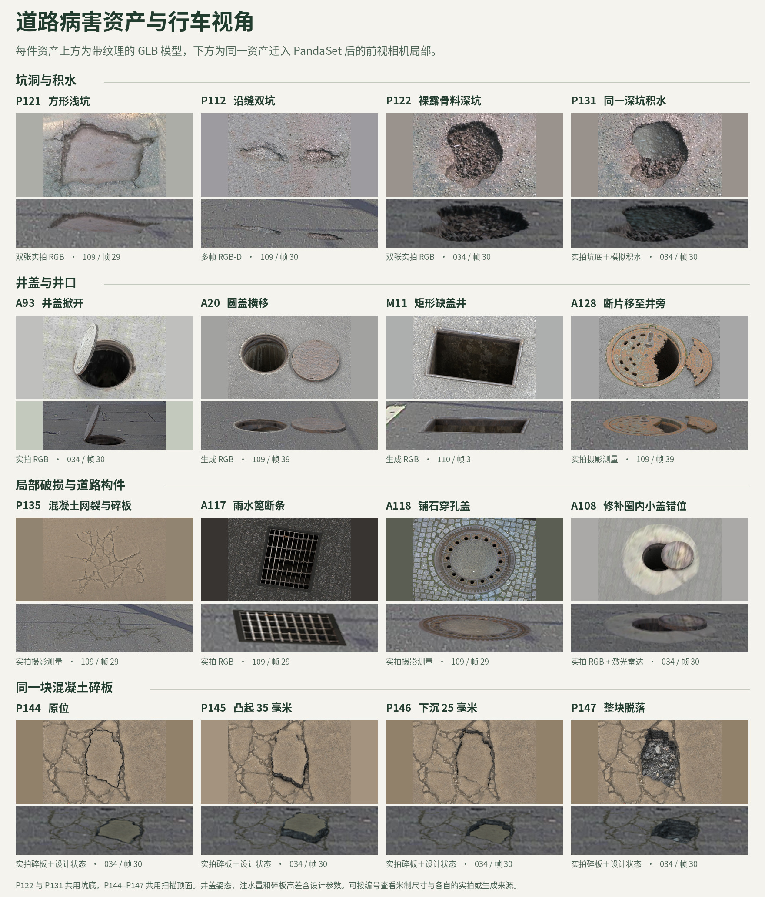

# RoadGS

RoadGS 从道路病害参考图生成米制网格和 3D Gaussian Splatting 资产，再将它们放入 PandaSet 动态道路，回放相机画面和激光雷达回波。后续开发统一从本仓库开始。

**三件实测车道坑 P577–P579**　两件长边超过一米，另一件坑内深度 P95 约十厘米。可在同一条实际车道比较前后摄回放，也可用九条有采集支撑的轮迹对照坑底和刚性车轮轴心曲线。[坑形、误差与复现](gen2hole/examples/contact-pits/README.md) · [下载模型与视频](https://github.com/Vexlc/road-hazard-reconstruction/releases/tag/contact-pits-v1.0.0)

**德文郡两处车行道连续破损**　沿纵向修补缝剥落的沥青和保留旧面层的坑群，附现场原照、透明贴图、区域标签与路面投影矩阵。[查看贴图和复现方法](gen2hole/examples/devon-road-patches/README.md)

**窄路边移开盖板的积水通信井 M576**　井内近照与道路远照相隔 62 秒，分别恢复井壁、水面、管口和行车方向上可见的围栏、盖板。附 27 帧双向行车画面和 23 个激光扫描。[照片、遮挡实验与复现](gen2hole/examples/whites-hill/README.md) · [模型与回放](https://github.com/Vexlc/road-hazard-reconstruction/releases/tag/whites-hill-v1.0.0)

**三处实测车道坑 P573–P575**　约 1.30 × 1.11 m 的扇形大坑、带浅窄分支的剥落，以及绕过残余铺装的弯曲坑床。附 344 个留出坑点的误差和 49 帧双向行车回放。[断面、照片材质与复现](gen2hole/examples/branching-pits/README.md) · [模型与视频](https://github.com/Vexlc/road-hazard-reconstruction/releases/tag/branching-pits-v1.0.0)

**洪水冲断 B4084 公路 P572**　重建倒树前方的沥青断边和路缘石，附原机位逐像素有效量程、缺测区域、正射图和假想轮迹到断边的距离。[照片与复现步骤](gen2hole/examples/cropthorne-break/README.md) · [下载发布包](https://github.com/Vexlc/road-hazard-reconstruction/releases/tag/cropthorne-break-v1.0.0)

**住宅车道上的缺盖井 M571**　现场三只锥桶和断裂井缘同框。附原机位遮挡检查、双向行车画面及两台实录激光的合成回波。[中文复现和量程文件](gen2hole/examples/broadmoor-opening/README.md) · [下载发布包](https://github.com/Vexlc/road-hazard-reconstruction/releases/tag/broadmoor-opening-v1.0.0)

**新奥尔良偏移井盖 M570**　根据一张同框原照重建盖板和井口的相对位置。附现场可见套筒、两种深度模型及前后摄合成回放。[原照、复现与遮挡比例](gen2hole/examples/midcity-cover/README.md) · [下载模型和回放](https://github.com/Vexlc/road-hazard-reconstruction/releases/tag/midcity-cover-v1.0.0)

**施工调高井盖与四处点云坑槽 A565、P566–P569**　阶梯边井盖保留了外露加强筋，四处坑槽中最深一件的标注点深度 P95 约 15.6 cm。附真实观测、三条纵向断面和前后摄 82 帧合成回放。[井盖与施工标高](gen2hole/examples/hensting-cover/README.md) · [深槽、断面与误差](gen2hole/examples/wheel-track-pits/README.md) · [下载发布包](https://github.com/Vexlc/road-hazard-reconstruction/releases/tag/roadworks-track-pits-v1.0.0)

**特伦特河洪水冲断乡道 P564**　两张现场照片配准出两端残路、五块碎板与横跨水面的裸管。附原照、网格、随视角变化的高斯水色以及在断边前停下的相机回放。[中文复现与误差](gen2hole/examples/trent-washout/README.md) · [下载成品](https://github.com/Vexlc/road-hazard-reconstruction/releases/tag/trent-washout-v1.0.0)

**浦安地震后外露的检查井筒 A563**　用现场笔长约束比例，重建约 0.63 m 的路面高差，附模型、两台实录激光的合成量程和前后摄短片。[标定与回放步骤](gen2hole/examples/uplifted-shafts/README.md) · [下载模型](https://github.com/Vexlc/road-hazard-reconstruction/releases/tag/urayasu-shaft-v1.0.0)

**错向漆线井盖、残板缺口与分层坑槽**　六件新资产保留了井盖与双黄线 52.7° 的夹角、一幅扫描中分离的两处坑区，以及积水补丁中露出的五块骨料。附 034 实拍宿主前后摄回放。[原照、模型和复现步骤](gen2hole/examples/field-rims/README.md) · [下载发布包](https://github.com/Vexlc/road-hazard-reconstruction/releases/tag/field-rims-v1.0.0)

**车行道坑洞、破损井盖与冲断路基（P546–P556，含 M552、A553）**　11 件资产含 5 份道路点云重建、3.6 m 路缘剥落、砖井缺盖、两块井盖碎片及按 10 m 断口建模的洪水冲毁路段。附原照、模型、驾驶回放、逐件误差与复建命令。[现场对照与复现指南](gen2hole/examples/lane-damage/README.md) · [下载模型和视频](https://github.com/Vexlc/road-hazard-reconstruction/releases/tag/lane-damage-v1.0.0)

**现场井口资产 M544、M545**　54 孔锈穿钢井盖与草缘敞井（实验版）。附原照、可下载的 GLB / 3DGS、封孔与遮挡对照、独立重建和车载回放命令。[图文复现指南](releases/field-chambers/README.md) · [下载成品](https://github.com/Vexlc/road-hazard-reconstruction/releases/tag/field-chambers-v1.0.1)

**两组路面散落物**　垃圾袋与倒扣周转筐、钢桶与管钳均已成对迁入 30,000 步场景。可复现有限范围内重新选点，以及全景接缝处的双目与遮挡。[复现指南](docs/36-street-clutter.md) · [指定场景前后视](https://github.com/Vexlc/road-hazard-reconstruction/releases/download/street-clutter-v1.0.0/joint-front-rear.mp4) · [Audi 实拍车尾](https://github.com/Vexlc/road-hazard-reconstruction/releases/download/street-clutter-v1.0.0/audi-front-rear.mp4)

**沉降雨篦和缺篦井口**　两组资产已迁入指定的 KITTI 联合场景。新宿主若能提供标定双目和匹配，可从米制距离重新拟合接地与遮挡。[接入与复现](docs/35-stereo-drains.md) · [指定场景的局部前后视](https://github.com/Vexlc/road-hazard-reconstruction/releases/download/stereo-drains-v1.0.0/joint-local-front-rear.mp4) · [Audi 实拍车尾](https://github.com/Vexlc/road-hazard-reconstruction/releases/download/stereo-drains-v1.0.0/audi-front-rear.mp4)

**[全仓复现手册](docs/16-reproduction-cookbook.md)**　从干净克隆开始，按输入选择重建方法，按宿主选择迁入方法。逐项对照表收录 1,576 个编号所属的 86 个系列与 35 条迁入或展示路线，列出每个系列的构建程序、配方、输入准备和操作步骤。[按系列查代码](docs/asset-code-index.md) · [20 个常见大坑分十组驶过后回看](https://github.com/Vexlc/road-hazard-reconstruction/releases/download/reproduction-2026.11.25/paired-front-to-rear.mp4)

不知道编号时，可以运行 `python3 gen2hole/gen2hole.py search 井盖`。已有目标场景时，运行 `python3 gen2hole/gen2hole.py routes 鱼眼` 查看可用的迁入程序和指南，再按路线缩小范围，例如 `python3 gen2hole/gen2hole.py search --route kitti-pair`。每条结果列出代表编号、重建代码和操作章节。[按手头材料选择复现入口](docs/16-reproduction-cookbook.md#按手头材料选入口)

**实测坑与异常井口的日照迁入**　两处约 1.17 m² 的沥青坑分别搭配错位通孔盖和缺盖井。逐路线代码表现在可直接跳到具体的迁入操作章节。[重建与测光复现](docs/34-sun-openings.md) · [Audi 驶过后的实拍车尾](https://github.com/Vexlc/road-hazard-reconstruction/releases/download/sun-openings-v1.0.0/audi-front-rear.mp4)

**实测剥落坑与原始鱼眼标定**　四处完整坑口分两组驶过，分别可在两段 KITTI 道路和 Audi 真实车尾查看。其他渲染器可以直接从原始标定和裁剪区重放相机。十二份实拍曝光的 48 个产物已逐文件复核。[重建与原始鱼眼接入](docs/33-mei-pits.md) · [Audi 驶过后回看](https://github.com/Vexlc/road-hazard-reconstruction/releases/download/mei-pits-v1.0.0/audi-front-rear.mp4)

**燃气方井与辐条圆井**　四种安装状态，每组两件。可以用逐光线的三维命中位置将同一组井盖迁入其他鱼眼或正交相机。[重建和跨渲染器迁入](docs/32-utility-covers.md) · [Audi 驶过后回看](https://github.com/Vexlc/road-hazard-reconstruction/releases/download/utility-covers-v1.0.0/audi-front-rear.mp4)

**历史 109 件生成图资产复建**　37 个坑洞、36 个缺盖井、36 个异常井盖已从干净目录用归档输入重建。218 个 GLB、PLY 与原发布文件的 SHA-256 全部相同。[下载输入和运行命令](docs/13-reproduce-and-transfer.md#重建-109-件生成-rgb-资产) · [逐件核验记录](validation/generated-rgb-replay.json)

**历史双目库已可逐文件复现**　65 件坑洞全部从原始 RGB、标注与 XYZ 重建，与发布的 130 个 GLB、PLY 哈希一致。过去存在差异的 13 件另经三个角度的原生渲染复核。[从干净克隆重跑](docs/02-asset-reconstruction.md#从干净克隆验证历史双目) · [逐件和逐帧结果](validation/stereo-replay.json)

**四处实测沥青坑**　两组双坑已放入指定 KITTI 检查点，最大的可见坑口约 1.79 m²。其他渲染器可用六个透视面的深度缓冲接入鱼眼。教程从原始采集、实车曝光与 GPU 深度三个入口分别给出可重跑的命令。[复现指南](docs/31-cube-pits.md) · [Audi 驶过后的车尾画面](https://github.com/Vexlc/road-hazard-reconstruction/releases/download/cube-pits-v1.0.0/audi-front-rear.mp4)

**道路散落货物**　纸箱、开盖工具箱、基质袋和带盖木箱分两组迁入。每个物体单独核验与实测路面的接触。四件原始网格和纹理随代码提供。[重建与迁入](docs/30-lost-cargo.md) · [Audi 实车驶过后回看](https://github.com/Vexlc/road-hazard-reconstruction/releases/download/lost-cargo-v1.0.0/audi-front-rear.mp4)

**大坑与异常井盖混合迁入**　1.23 m² 浅碗坑搭配单侧沉降填芯盖，1.06 m² 碎石坑搭配缺盖井。两组都可从前方驶近、再从真实车尾回看。其他渲染器可传入独立光线颜色和采样权重以保留遮挡边缘。[复现和鱼眼输入](docs/29-mixed-inlets.md) · [Audi 视频](https://github.com/Vexlc/road-hazard-reconstruction/releases/download/mixed-inlets-v1.0.0/audi-front-rear.mp4)

**两处实测宽坑 P256、P257 与积水态 P258**　约 1.47 和 1.42 m² 的坑床已成对放入两段 KITTI 道路及 Audi 实拍。积水可从同步双目或激光雷达的实测表面追踪近物倒影。[复建和其他渲染器接入](docs/28-roadside-reflections.md) · [Audi 车尾视频](https://github.com/Vexlc/road-hazard-reconstruction/releases/download/roadside-reflections-v1.0.0/audi-front-rear.mp4)

**实测干坑与积水坑 P252–P255**　两处真实坑床在原位置干湿互换，每次放入两个。新路面按实际坡度重算水线，同一张车尾曝光可对照有无积水。[复现与自有相机接入](docs/27-wet-pavement.md) · [Audi 驶过后回看](https://github.com/Vexlc/road-hazard-reconstruction/releases/download/wet-pavement-v1.0.0/audi-front-rear.mp4)

**断边沥青坑与粗集料碗坑 P250、P251**　两件实测坑已放入同一组 KITTI 和 Audi 道路。换用裁切或去畸变的鱼眼时，可将原始像素的光心、方向、深度和遮挡一起迁移。[重建、迁入和相机接入](docs/26-remapped-pits.md) · [Audi 驶过后回看](https://github.com/Vexlc/road-hazard-reconstruction/releases/download/remapped-pits-v1.0.0/audi-front-rear.mp4)

**两套扫描井盖、四种安装状态**　沉降填芯盖、错位十孔铸铁盖及两种缺盖井，已逐组放入指定 KITTI 场景与 Audi 道路。其他鱼眼渲染器可从逐行曝光时间和相机轨迹重放行驶中的井沿与孔口。[固定步骤与验收](docs/25-rolling-covers.md) · [Audi 驶过后回看](https://github.com/Vexlc/road-hazard-reconstruction/releases/download/rolling-covers-v1.0.0/audi-front-rear.mp4) · [KITTI 局部合成前后视](https://github.com/Vexlc/road-hazard-reconstruction/releases/download/rolling-covers-v1.0.0/joint-local-front-rear.mp4)

**两处实测沥青坑 P246、P247**　坑口面积分别为 1.43 和 0.84 m²。两件已一起迁入指定的 30,000 步场景，另有真实尾部鱼眼对照。新增路面亮度登记，可在坑底占满近景时保持颜色、标签和深度。[双坑重建与迁入](docs/24-asphalt-breakouts.md) · [驶过后的 Audi 尾部鱼眼](https://github.com/Vexlc/road-hazard-reconstruction/releases/download/asphalt-breakouts-v1.0.0/audi-front-rear.mp4)

**道路遗落物 R242–R245**　旧轮胎、钢轮圈、侧倒的周转筐和水泥袋，每次两件。原始纹理网格随库提供，可从空目录复建，并在真实车尾鱼眼或独立渲染器回放。[从零复现](docs/23-road-debris.md) · [指定 KITTI 检查点前后视](https://github.com/Vexlc/road-hazard-reconstruction/releases/download/road-debris-v1.0.0/joint-front-rear.mp4) · [Audi 实车驶过后回看](https://github.com/Vexlc/road-hazard-reconstruction/releases/download/road-debris-v1.0.0/audi-front-rear.mp4)

**两套圆井盖、四个状态**　从实扫铸铁通气盖和龟裂混凝土填芯盖重建，每组两件，包含两种敞井。可在原生 KITTI 场景或由宿主给出逐像素光线的渲染器复现。[固定版本指南](docs/22-scanned-round-covers.md) · [Audi 实车前后鱼眼](https://github.com/Vexlc/road-hazard-reconstruction/releases/download/scanned-round-covers-v1.0.0/audi-front-rear.mp4) · [联合场景同帧回放](https://github.com/Vexlc/road-hazard-reconstruction/releases/download/scanned-round-covers-v1.0.0/joint-front-rear.mp4)

**两处实测路面破损**　宽 1.76 米的片状剥落与宽 1.37 米的粗集料碗坑，共同迁入 30,000 步联合场景和三段实拍道路。两处坑沿可在不同横坡上分别贴地。[按编号复现与换宿主](docs/21-measured-pavement.md) · [Audi 驶过后的实拍后视](https://github.com/Vexlc/road-hazard-reconstruction/releases/download/measured-pavement-v1.0.0/audi-front-rear.mp4) · [联合场景前后视](https://github.com/Vexlc/road-hazard-reconstruction/releases/download/measured-pavement-v1.0.0/joint-front-rear.mp4)

**直立与倒地交通锥**　两件按接地几何成对迁入同一个 `joint.pt`，并用 Blender Cycles 的 220° 鱼眼独立核验。[模型与复现](docs/20-traffic-cones.md) · [Audi 实车前后视](https://github.com/Vexlc/road-hazard-reconstruction/releases/download/traffic-cones-v1.0.0/audi-front-rear.mp4) · [联合场景前后视](https://github.com/Vexlc/road-hazard-reconstruction/releases/download/traffic-cones-v1.0.0/joint-front-rear.mp4)

**路侧立体设施和车尾回看**　两种混凝土隔离墩、同一消防栓的两种涂层，已按每组两件迁入 KITTI-360 0000 的 30,000 步检查点。[复现指南](docs/19-roadside-props.md) · [原生前后视视频](https://github.com/Vexlc/road-hazard-reconstruction/releases/download/roadside-props-v1.0.0/joint-front-rear.mp4) · [Audi 实车鱼眼视频](https://github.com/Vexlc/road-hazard-reconstruction/releases/download/roadside-props-v1.0.0/audi.mp4)

**双联检查井与跨场景放置**　5 件实扫盖板状态，覆盖齐平、错位、单侧缺失及双侧缺失。[复现与迁入指南](docs/18-twin-hatch-transfer.md) · [车尾回看](https://github.com/Vexlc/road-hazard-reconstruction/releases/download/twin-hatch-v1.0.0/a2d2-frontleft.mp4) · [网格与三段道路视频](https://github.com/Vexlc/road-hazard-reconstruction/releases/tag/twin-hatch-v1.0.0)

**实测坑洞与异常方井**　新增 9 件资产。PandaSet 提供原生高斯检查点回放。KITTI-360 与 Audi A2D2 使用同一套网格、实拍相机及车身遮挡规则。[新资产和其他渲染器接入](docs/17-mixed-road-transfer.md) · [两个 SC-GS 鱼眼宿主的实跑对照](docs/17-mixed-road-transfer.md#直接使用-sc-gs-的鱼眼渲染结果) · [Audi 前后鱼眼视频](https://github.com/Vexlc/road-hazard-reconstruction/releases/download/mixed-road-v1.0.0/a2d2-mixed-road.mp4) · [模型及 KITTI 视频](https://github.com/Vexlc/road-hazard-reconstruction/releases/tag/mixed-road-v1.0.0)

**StreetCrafter 自驾场景重建**支持从同一个场景入口运行 3DGUT 和动态 SC-GS，按实拍时间戳导出对照视频。已配置 PandaSet 前视 055、056 和 KITTI-360 左侧鱼眼片段。[运行方式与相机模型](streetcrafter/backends/README.md)

**多视角鱼眼场景重建：** [3DGUT、SC-GS 和 Self-Cali-GS 的实拍对照](pipelines/fisheye/README.md)，含数据下载、相机转换、训练入口和留出视图评估。

**从哪里开始：** 有照片或传感器数据，先[按输入选择重建方法](docs/13-reproduce-and-transfer.md#按输入选择重建方法)；已经有模型，先[按交付物选择迁入方法](docs/13-reproduce-and-transfer.md#按交付物选择迁入方法)。有资产编号则运行 `python3 gen2hole/gen2hole.py locate P154`，把 `P154` 换成自己的编号。

**20 件车行道大坑**　新增 15 个常见的浅碗坑、轮迹长坑、连通坑和补丁边缘破损。视频逐件对照参考图、三维模型与同一实拍路段的行车效果。[模型总览](https://github.com/Vexlc/road-hazard-reconstruction/releases/download/reproduction-2026.11.25/common-pits-overview.jpg) · [20 件模型的复建输入](https://github.com/Vexlc/road-hazard-reconstruction/releases/tag/reproduction-2026.11.25) · [复建说明](docs/15-large-dry-pits.md#二十件车行道坑洞)

**新增四个车行道坑洞 P198–P201**　一个根据街道实拍重建，另外三个来自独立生成的参考图。面积最大的是 15.30 m² 的弧形断壁坑，最长的是 5.62 m 的斜向沟坑。四件均已放入 PandaSet 109 的同一车道位置。[同帧对比视频](https://github.com/Vexlc/road-hazard-reconstruction/releases/download/large-pits-v1.0.0/lane-pits-comparison.mp4) · [近景大图](docs/figures/lane-pits-overview.jpg) · [四件模型](https://github.com/Vexlc/road-hazard-reconstruction/releases/download/large-pits-v1.0.0/lane-pits-models-glb.zip) · [参考图与复现](docs/15-large-dry-pits.md#车行道上的四个坑)

**实拍大坑子模块**　P190 已按原尺度放入两段实拍道路。109 可以看阳光和电线投影，034 可以看背阴坡道上的断边。安装项目环境后可运行 `python -m gen2hole.large_pits example P201` 自动取回输入包、重建并校验文件。[109 行车视频](https://github.com/Vexlc/road-hazard-reconstruction/releases/download/large-pits-v1.0.0/p190-scene-109.mp4) · [034 行车视频](https://github.com/Vexlc/road-hazard-reconstruction/releases/download/large-pits-v1.0.0/p190-scene-034.mp4) · [同帧新旧对照](docs/figures/large-dry-pit-road.jpg) · [输入包与复现命令](docs/15-large-dry-pits.md)

**实拍大坑 P190–P197**　P190 根据护栏旁的塌坑照片重建，坑口投影面积估计为 14.2 m²。另有一个住宅车道边缘塌陷、一处湿坑和五个带深度图的路面样本。[P190 上一版车载视频](https://github.com/Vexlc/road-hazard-reconstruction/releases/download/reproduction-guide-v1.0.0/p190-v2-scene-109.mp4) · [P190 优化前后视频](https://github.com/Vexlc/road-hazard-reconstruction/releases/download/reproduction-guide-v1.0.0/p190-v2-comparison.mp4) · [八件环绕视频](https://github.com/Vexlc/road-hazard-reconstruction/releases/download/reproduction-guide-v1.0.0/p190-p197-orbits.mp4) · [参考图与模型](https://github.com/Vexlc/road-hazard-reconstruction/releases/download/reproduction-guide-v1.0.0/p190-p197-reference.jpg) · [八个 GLB](https://github.com/Vexlc/road-hazard-reconstruction/releases/download/reproduction-guide-v1.0.0/p190-p197-models.zip) · [重建与检验](docs/02-asset-reconstruction.md#从斜拍照片重建大面积坑洞)

**中文项目百科**　46 页图解从坑洞和井盖的原始观测讲到米制网格、三维高斯和车载回放，附 16 个常见问题、实跑示例与 27 组配方索引。网页版可放大图版、检索全部 1,403 个资产编号，下载后可离线阅读。[阅读 PDF](docs/encyclopedia/RoadGS-道路病害重建百科.pdf) · [下载后用浏览器打开网页版](docs/encyclopedia/index.html)

**了解重建原理**　从实拍坑洞、生成图、可动井盖到车载回放，按资产类型查阅数据来源、尺度依据、重建算法与实测误差。[道路病害资产重建详解](docs/14-reconstruction-principles.md)

**按编号复建**　运行 `python gen2hole/gen2hole.py locate <编号>` 查询输入和配方。第一次交接可用 P103 实拍裂缝，从普通电脑上的 CPU 网格到完整高斯模型逐步核验。[P103 的照片、安装命令与成品校验值](gen2hole/examples/photo-cracks/README.md)

**从 GitHub 复现**　[安装、逐资产重建与自驾场景迁移](docs/13-reproduce-and-transfer.md) · [按编号查源码和配方](catalog/reconstruction-index.json) · [可直接预览的资产与车载图版](docs/figures/road-asset-portfolio.jpg)。配方索引包含本地样例，不等于公开下载清单。各配方分别注明需要随仓库提供、按包下载或自行提供的输入。[公开下载与复建核验记录](validation/github-reproduction.json)

**[打开离线路面病害资产图谱](tools/asset_atlas/index.html)**。按编号、重建方式或病害形态查找资产，查看原图、模型斜视、米制尺寸和对应的 PandaSet 道路画面。图谱收录 831 条实拍 RGB-D、65 条实拍双目、372 件程序化、127 件生成 RGB、24 条实拍单目、6 条实拍相机加激光雷达、13 条摄影测量来源的井盖状态、4 条道路裂缝扫描重建、4 个实拍混凝土碎板状态、4 组双张实拍 RGB，以及 3 组多帧 RGB-D、4 组多帧双目重建及 5 个实拍坑底积水状态，共 1,462 条、3,915 个场景查看入口。采集帧可能来自同一处病害。六种井盖状态共用一套井体与盖面。展开任一条目的「网格高程与剖面」，可以在俯视图上取截线，读取该处的米制高度。

P154 来自一张泥水坑的实拍 RGB-D。原坑洞轮廓漏掉了倾斜联锁砖可见面积的 95.15%。补入砖顶和侧面后，留出的量程测得砖面倾角为 15.55°，导出网格为 15.65°。打开图谱可以直接点原图，比较该像素的实测高程与网格高程。两段车载前视都看得到侧面，两处选定的后视帧只看得到顶面。[实拍、量程与道路对照图](docs/figures/displaced-paver.jpg) · [逐像素量高程](http://127.0.0.1:8765/tools/asset_atlas/index.html#P154) · [重建与复核](docs/02-asset-reconstruction.md#泥水坑旁的倾斜联锁砖)

六边形井盖 A151、A152、A153、M151 来自同一张实拍。每条盖边各有一个凹口。水平错转 30° 后，盖角架在固定井框上，正上方可见井底的面积占净井口的 4.68%。沿一条实拍盖边掀至 52° 后增至 34.42%。可在同一三维机位切换四态，单独取出有材质的盖板，或在两段实拍道路上切换同帧前后视。[原照、模型与行车对照](docs/figures/hexagonal-cover.jpg) · [旋转四态模型](http://127.0.0.1:8765/tools/asset_atlas/model.html#A152) · [源图、设计值与回放依据](docs/02-asset-reconstruction.md#从单张照片重建六边形井盖)

**同位置道路资产对照**覆盖 167 件资产在三段道路上的 413 次放置。选定位置和车载照片后，可并排切换双坑、积水、井盖掀开、缺盖、断条雨水篦、路面网裂和碎板脱落，也可以把其中一栏切回原始路面。切到远处时保留相同的原图像素跨度。打开模拟雷达回波，点选同一束激光，能读出它先碰到盖板边缘还是井圈。[八件模型的近处与远处画面](docs/figures/matched-road-assets.jpg) · [打开掀盖与缺盖对照](http://127.0.0.1:8765/tools/asset_atlas/compare-road.html#group=109-01&view=front-near&a=A119&b=M118&beam=151811&zoom=1) · [实测与模拟回波图](docs/figures/matched-road-lidar.jpg) · [覆盖范围与复现](docs/02-asset-reconstruction.md#同一车载机位比较不同资产)

P142 和 P143 是两处约 9 厘米宽的实拍坑洞。双目深度在陡壁和坑底有缺口，两张以上照片从不同方向看到同一位置时，可以多恢复一部分坑面。打开三维模型，可在相同视角切换仅用距离图、加入彩照和标出高程来源的网格。留出照片同时展示改善和误差增大的位置。[实拍、模型与两段道路](docs/figures/pit-depth-completion.jpg) · [在同一截线上量坑壁](docs/figures/pit-depth-sections.jpg) · [切换三种网格](http://127.0.0.1:8765/tools/asset_atlas/model.html#P143) · [逐机位结果](docs/02-asset-reconstruction.md#用彩照补回双目深度缺口)

A138–A141、M138 展示同一块混凝土芯井盖的齐平、整圈下沉、整圈凸起、单侧下沉和沉降后缺盖。图谱中点选盖面任一位置，切换状态可读取该点相对齐平状态的高差。五态在 PandaSet 109 使用相同机位，还能点开前后视的整幅照片。[五态、米制高程及道路全景](docs/figures/cover-grade.jpg) · [交互剖面](http://127.0.0.1:8765/tools/asset_atlas/index.html#A141) · [重建与核验](docs/02-asset-reconstruction.md#井盖与路面的安装高差)

图谱中每件资产都可以点「看高斯渲染」查看原始 PLY 的静态预览。点「3DGS 与网格对照」，可旋转资产或滑动分界线，在同一机位比较盖孔、井壁和坑缘。38 件代表资产附有 114 个机位的深度差图，可按部件查看误差。[六件资产的网格、高斯与行车画面](docs/figures/gaussian-asset-comparison.jpg) · [敞井的三个核验机位](docs/figures/gaussian-shaft-depth.jpg) · [查看器与复现](docs/02-asset-reconstruction.md#原始高斯资产与网格的同机位对照)

317 件井类资产支持「铺设开孔沥青路面」。可旋转同一件资产，观察路面怎样挡住井外的地下结构，以及从井口、篦条或盖板通孔还能看到哪些部件。页面底部可切换同编号的 PandaSet 迁入前后画面。[六件井类资产的遮挡对照](docs/figures/gaussian-road-openings.jpg) · [开孔提取与验证](docs/02-asset-reconstruction.md#井类资产的开孔路面)

1,086 件坑洞、裂缝和混凝土碎板也能铺到扫描沥青上。双坑各有自己的边界，网裂保留分支，干坑与积水状态共用同一坑缘。887 条单帧 RGB-D 或双目记录采用照片标注定位坑面，其中 778 条已配对到 055、056 路段的车载前视画面。可切换迁入前后，并点开局部查看整幅道路。[坑洞迁移对照](docs/figures/gaussian-pit-roads.jpg) · [驾驶员视角与资产原貌](docs/figures/capture-pit-driving.jpg) · [几何与机位核验](docs/02-asset-reconstruction.md#坑洞与裂缝的道路边界)

P149 重建了联锁铺砖缺失后露出的坑床，P150 保留了坑内九块实拍碎片的可见面。两件都可以在同一视角切换原始纹理、部位分色与单独部位。P150 在 034 路段的前视帧中能分辨八块，在 109 路段的前视帧中能分辨九块。[原图、网格与车载部位](docs/figures/observed-pavement.jpg) · [查看碎片模型](http://127.0.0.1:8765/tools/asset_atlas/model.html#P150)

**P148 保留了一段路面上两排共 13 个凹槽。** 可旋转整组模型，也可取出其中 12 个独立槽口，查看纹理和凹深。它们来自同一张真实 RGB-D，另一机位的 10 个槽口标注用于检验。整组在两段 PandaSet 道路上均按原尺寸重放。[槽口编号、逐件网格与车载画面](docs/figures/paired-road-slots.jpg) · [打开单槽选择器](http://127.0.0.1:8765/tools/asset_atlas/model.html#P148) · [尺寸与留出帧误差](docs/02-asset-reconstruction.md#从双排凹痕提取单个槽口)

**P144–P147 是同一块混凝土碎板的四种状态。** 沿实拍网裂取出的板块约 25.0 × 47.7 厘米，可单独旋转查看。切换原位、凸起 35 毫米、下沉 25 毫米和脱落时，可以在同一条剖面读高差，也可以看同一张行车照片中露出多少断面或基层。顶面与纹理来自扫描，板厚、高差和基层采用设计值。3DGS 页面可以在同一机位切换面积采样和断边加密的 PLY。凸起态在另外八处板缝的基层深度中位误差均低于 0.42 毫米。[两种高斯采样的实图与误差](docs/figures/concrete-slab-edge-sampling.jpg) · [碎板与剖面](docs/figures/faulted-slab.jpg) · [放大同一段板缝](http://127.0.0.1:8765/tools/asset_atlas/splats.html?detail=socket#P145) · [两段实拍道路](docs/figures/faulted-slab-roads.jpg) · [旋转碎板模型](http://127.0.0.1:8765/tools/asset_atlas/model.html#P145) · [在同一车载机位切换状态](http://127.0.0.1:8765/tools/asset_atlas/compare-road.html#group=109-01&view=front-near&a=P145&b=P147&parts=1&zoom=1)

P135 是 1.75 米见方的混凝土网裂。把原图中的同一处交汇单独取出、以更密的网格重建为 P136 后，在相同的 62,055 个留出缝内像素上，相对源位移的中位绝对误差从 0.109 降至 0.040 毫米。P134 和 P137 则用同一条沥青纵缝展示材质位移与扫描法线给出的两种深度。可在三维页面关闭纹理，或查看同一位置的行车画面和可见裂缝边界。[原图、纹理与无纹理模型](docs/figures/scanned-cracks.jpg) · [网裂在两段道路上的前后视](docs/figures/scanned-crack-roads.jpg) · [同一沥青纵缝的两种深度](docs/figures/asphalt-crack-depth.jpg)

P129–P133 展示两处实拍坑底在不同注水量和道路坡度下的积水。给粗骨料深坑加入 5 升水，目标路面坡度从 5.1% 增至 14.2% 时，最大水深从 66.6 增至 84.6 毫米。图谱可在同一三维视角排空积水，查看真实坑底，也可切换同一行车帧中的干湿画面。[实拍、岸线与水深剖面](docs/figures/standing-water.jpg) · [两段道路上的积水坑](docs/figures/standing-water-roads.jpg)

铸铁盖 A125–A128 共用一份完整实拍盖面。断片占原盖金属体积的 25.8%，可切换完整、断片缺失、落入井底和移至井旁四态。在「交互三维」中点「剖开井体」，可绕到井内查看碎片。迁到两段实拍道路后，井壁和余盖在所有前后视机位都挡住了井底碎片。井旁碎片在路段 109 的前视 41 帧、后视 31 帧中可见。[井盖四态与剖视](docs/figures/fractured-iron-cover.jpg) · [道路机位与遮挡](docs/figures/fractured-cover-roads.jpg)

两张普通彩照也能恢复坑底的米制起伏。方形浅坑 P121、骨料裸露深坑 P122、弧形陡边坑 P123 和小型剥落坑 P124 均已迁入自驾道路。可在图谱中切换两张原图、查看双向匹配覆盖，再将模型剖面与保留的传感器深度逐点比较。P124 还提供三个建模时未使用的机位，其中两个可在同一截线上对照双照片模型、双目模型和传感器深度。[双照片资产与自驾道路](docs/figures/photo-parallax.jpg) · [三个留出机位的剖面与回投](docs/figures/photo-parallax-heldout.jpg)

雨水篦 A115 的 60 个孔均贯穿盖板。A117 断掉一段格条后，相邻两孔连通。A116 与 M115 展示同一井体的掀开和缺盖。铺石圆盖 A118 保留 16 个孔和盖面的实拍起伏，可在同一机位切换掀开、错位和缺盖。图谱中的「断口放大」「原机位侧壁」和完整前视画面可直接对照几何与道路外观。[矩形雨水篦图版](docs/figures/perforated-grate.jpg) · [穿孔圆盖图版](docs/figures/perforated-cobblestone.jpg)

P112 的两张近景各拍到一个坑。重建后，两个坑能在同一张留出全景中同时对齐。图谱支持切换每张近景的独立结果、融合 GLB、实测覆盖和深度误差。[双坑全景对照](docs/figures/double-pothole.jpg) · [五组坑洞实拍、模型与道路迁入](docs/figures/multiview-potholes.jpg)

[15 件生成 RGB 资产的斜视图](docs/figures/asset-diversity.jpg)展示月牙坑、双叶坑、连通坑、圆形与矩形缺盖井及多种盖板姿态。

[跨来源重建与道路对照图](docs/figures/reconstruction-evidence.jpg)展示同一 ID 的参考图、模型、中心剖面和迁入效果。实拍单目 P90 和 RGB-D 样例使用同一帧，便于对照从设计尺寸和从深度测量得到的差异。

[实拍井盖六态对照](docs/figures/photo-chamber-BD.jpg)把落座、微开、掀开、错位、移至井旁和缺盖放在同一处。下排道路裁切使用相同自驾相机、帧号和像素区域。可在图谱中切换状态和原始照片。

[三路段相机对照](docs/figures/chamber-road-transfer.jpg)覆盖同一井体的 18 次放置。[实拍裂缝图版](docs/figures/photo-cracks.jpg)展示单缝、分叉和并行交汇的模型截面与自驾相机画面。在图谱中点击「交互三维」可旋转 GLB，运行 `python scripts/serve-asset-atlas.py` 可从本地服务直接加载模型。

[实拍自驾井盖三态](docs/figures/pandaset-034-cover.jpg)从 PandaSet 034 的同一处井盖恢复外圈直径、盖面直径和落座高度。图谱中的 A104、A105、M104 对应落座、掀开和缺盖，可以切换原始相机位姿与局部配准查看留出帧，再比较三态在路段 109 同一位置的迁入画面。

[两处实拍设施的同尺度 GLB 对照](docs/figures/calibrated-road-covers.jpg)可直接比较大井盖与小型盖板。后者保留了偏心修补圈的实拍边界和激光测得的高度，支持落座、错位和缺盖。[小型盖板迁入实景](docs/figures/pandaset-109-cover.jpg)

[标定 RGB-D 井盖姿态回投](docs/figures/registered-lid-pose.jpg)展示了如何用深度直接恢复盖面朝向与位置。该图使用带已知真值的合成观测。

**生成 RGB 发布基线为 2026-11-21。** 首批 9 件和追加 100 件合计 109 件，包含 37 个坑洞、36 个缺盖井和 36 个异常井盖。它们在 034、109、110 三段实拍道路上形成 111 个原生场景、327 次放置、654 组前后视相机对照和 8,880 个雷达案例帧。资产参考图由模型生成，绝对尺寸和遮挡面采用设计值。

| 想做什么 | 本地入口 |
| --- | --- |
| 从车载截图重建横向修补带，迁移时匹配目标沥青颜色并保留断续接缝 | [P202 模型、调色与两段实拍复核](gen2hole/examples/transverse-repair/README.md) |
| 从自己的 RGB 参考图重建坑洞、敞井、掀盖或移位井盖 | [单图重建与新设计](gen2hole/docs/new-assets.md) |
| 从实拍井圈和盖面重建可动圆井盖，可选标定深度 | [可动井盖与深度测井](docs/02-asset-reconstruction.md#两张实拍重建可动圆井盖) |
| 从完整实拍盖面派生断片缺失、落井和移至井旁 | [断片输入、实体核验和道路可见性](docs/02-asset-reconstruction.md#井盖断片与井内剖视) |
| 从实拍盖板恢复真实通孔、断条与可动状态 | [雨水篦与穿孔盖板的输入和复建](docs/02-asset-reconstruction.md#从实拍盖板重建贯穿孔与断条) |
| 从对齐的彩色纹理、位移和法线重建裂缝 | [扫描输入、米制网格与剖面核验](docs/02-asset-reconstruction.md#从道路扫描重建裂缝) |
| 从实拍图和裂缝掩膜重建分支沟槽 | [裂缝示例与输入格式](docs/02-asset-reconstruction.md#从实拍裂缝与像素掩膜重建) |
| 用两张彩照、相机内参和一段已知路面长度重建凹陷 | [双照片视差重建与独立深度检查](docs/02-asset-reconstruction.md#两张彩照重建坑底起伏) |
| 从多张不同角度或局部近景合成一个坑洞资产 | [多帧 RGB-D、双目与留出帧检查](docs/02-asset-reconstruction.md#多帧实拍重建同一组坑洞) |
| 从自己的对齐 RGB、深度与掩膜重建坑洞 | [RGB-D 文件入口](docs/02-asset-reconstruction.md#自带-rgb-d-文件) |
| 看同一病害在相机、点云和剖面中的变化 | [传感器离线页与数据恢复](docs/01-downloads.md#恢复旧版离线浏览页) |
| 按编号打开新增资产的原图、GLB 和 Gaussian PLY | [100 件资产浏览页与原始输入](docs/01-downloads.md#恢复旧版离线浏览页) |
| 查看首批九件的模型与场景 | [九件资产的模型与场景索引](docs/01-downloads.md#恢复旧版离线浏览页) |
| 查阅已封存的程序化造坑路线（末批 P160–P189） | [封存记录、视频和复现入口](docs/10-factory.md#大面积坑洞) |
| 修改算法、开始实验、切回旧版 | [开发与版本管理](docs/11-development.md) |
| 查四段对话、历史版本、原目录和复现记录 | [整合来源](docs/12-integration.md) · [本次校验](validation/roadgs-2026-11-21.json) |

在项目根目录重建本地图谱索引、查看当前版本或完整校验本地交付。完整校验会读取约 58.3 GB。

~~~bash
python scripts/build-asset-atlas.py
python scripts/roadgs.py info
python scripts/roadgs.py verify
~~~

Git 保存代码、配置模板、清单和验证记录。模型、原始传感器数据、检查点、视频、环境和实验目录保存在本机。单独克隆 Git 后，需要恢复对应版本的数据目录才能打开上表中的离线页面或回放场景。[数据版本清单](catalog/roadgs-releases.json)

图谱使用本机资产与场景文件，可直接在浏览器打开。十五件资产提供固定取景的 360° 环绕，每件从自己的 GLB 渲染 24 个方向。四件双照片坑洞可用 `work/envs/assets/bin/python scripts/render-asset-orbits.py --bundle runs/rgb-parallax/series --ids P121 P122 P123 P124` 重画。A117 和 A119 可查看断条和掀盖的各侧外观。A127 和 A128 可环绕查看碎片的位置，也可直接剖开近侧井壁。省略参数可重画最初的 P13、M13、A13 和 P90。[合并后的复跑记录](validation/merged-assets-2026-11-22.json)
