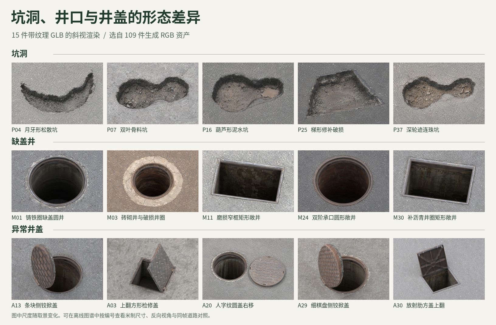

# RoadGS

RoadGS 从道路病害参考图生成米制网格和 3D Gaussian Splatting 资产，再将它们放入 PandaSet 动态道路，回放相机画面和激光雷达回波。后续开发统一从本仓库开始。

**[打开离线路面病害资产图谱](tools/asset_atlas/index.html)**。按编号、重建方式或病害形态查找资产，查看原图、模型斜视、米制尺寸和对应的 PandaSet 道路画面。图谱收录 822 条实拍 RGB-D、65 条实拍双目、342 件程序化、109 件生成 RGB、14 条实拍单目、6 条实拍相机加激光雷达、4 条摄影测量派生状态，以及 3 组多帧 RGB-D 和 2 组多帧双目重建，共 1,367 条。采集帧可能来自同一处病害。六种井盖状态共用一套井体与盖面。展开任一条目的「网格高程与剖面」，可以在俯视图上取截线，读取该处的米制高度。

雨水篦 A115 的 60 个孔均贯穿盖板。A117 断掉一段格条后，相邻两孔连通。A116 与 M115 展示同一井体的掀开和缺盖。铺石圆盖 A118 保留 16 个孔和盖面的实拍起伏，可在同一机位切换掀开、错位和缺盖。图谱中的「断口放大」「原机位侧壁」和完整前视画面可直接对照几何与道路外观。[矩形雨水篦图版](docs/figures/perforated-grate.jpg) · [穿孔圆盖图版](docs/figures/perforated-cobblestone.jpg)

P112 的两张近景各拍到一个坑。重建后，两个坑能在同一张留出全景中同时对齐。图谱支持切换每张近景的独立结果、融合 GLB、实测覆盖和深度误差。[双坑全景对照](docs/figures/double-pothole.jpg) · [五组坑洞实拍、模型与道路迁入](docs/figures/multiview-potholes.jpg)

[跨来源重建与道路对照图](docs/figures/reconstruction-evidence.jpg)展示同一 ID 的参考图、模型、中心剖面和迁入效果。实拍单目 P90 和 RGB-D 样例使用同一帧，便于对照从设计尺寸和从深度测量得到的差异。

[实拍井盖六态对照](docs/figures/photo-chamber-BD.jpg)把落座、微开、掀开、错位、移至井旁和缺盖放在同一处。下排道路裁切使用相同自驾相机、帧号和像素区域。可在图谱中切换状态和原始照片。

[三路段相机对照](docs/figures/chamber-road-transfer.jpg)覆盖同一井体的 18 次放置。[实拍裂缝图版](docs/figures/photo-cracks.jpg)展示单缝、分叉和并行交汇的模型截面与自驾相机画面。在图谱中点击「交互三维」可旋转 GLB，运行 `python scripts/serve-asset-atlas.py` 可从本地服务直接加载模型。

[实拍自驾井盖三态](docs/figures/pandaset-034-cover.jpg)从 PandaSet 034 的同一处井盖恢复外圈直径、盖面直径和落座高度。图谱中的 A104、A105、M104 对应落座、掀开和缺盖，可以切换原始相机位姿与局部配准查看留出帧，再比较三态在路段 109 同一位置的迁入画面。

[两处实拍设施的同尺度 GLB 对照](docs/figures/calibrated-road-covers.jpg)可直接比较大井盖与小型盖板。后者保留了偏心修补圈的实拍边界和激光测得的高度，支持落座、错位和缺盖。[小型盖板迁入实景](docs/figures/pandaset-109-cover.jpg)

[标定 RGB-D 井盖姿态回投](docs/figures/registered-lid-pose.jpg)展示了如何用深度直接恢复盖面朝向与位置。该图使用带已知真值的合成观测。

**生成 RGB 发布基线为 2026-11-21。** 首批 9 件和追加 100 件合计 109 件，包含 37 个坑洞、36 个缺盖井和 36 个异常井盖。它们在 034、109、110 三段实拍道路上形成 111 个原生场景、327 次放置、654 组前后视相机对照和 8,880 个雷达案例帧。资产参考图由模型生成，绝对尺寸和遮挡面采用设计值。

| 想做什么 | 本地入口 |
| --- | --- |
| 从自己的 RGB 参考图重建坑洞、敞井、掀盖或移位井盖 | [单图重建与新设计](gen2hole/docs/new-assets.md) |
| 从实拍井圈和盖面重建可动圆井盖，可选标定深度 | [可动井盖与深度测井](docs/02-asset-reconstruction.md#两张实拍重建可动圆井盖) |
| 从实拍盖板恢复真实通孔、断条与可动状态 | [雨水篦与穿孔盖板的输入和复建](docs/02-asset-reconstruction.md#从实拍盖板重建贯穿孔与断条) |
| 从实拍图和裂缝掩膜重建分支沟槽 | [裂缝示例与输入格式](docs/02-asset-reconstruction.md#从实拍裂缝与像素掩膜重建) |
| 从多张不同角度或局部近景合成一个坑洞资产 | [多帧 RGB-D、双目与留出帧检查](docs/02-asset-reconstruction.md#多帧实拍重建同一组坑洞) |
| 从自己的对齐 RGB、深度与掩膜重建坑洞 | [RGB-D 文件入口](docs/02-asset-reconstruction.md#自带-rgb-d-文件) |
| 看同一病害在相机、点云和剖面中的变化 | [离线传感器对照页](data/releases/2026-11-21/道路病害_传感器与几何增强/传感器对照.html) |
| 按编号打开新增资产的原图、GLB 和 Gaussian PLY | [100 件资产浏览页](data/releases/2026-11-21/道路病害图生三维_新增100/资产浏览.html) |
| 查看首批九件的模型与场景 | [九件资产索引](data/releases/2026-11-21/道路病害图生三维/资产与场景索引.md) |
| 修改算法、开始实验、切回旧版 | [开发与版本管理](docs/11-development.md) |
| 查四段对话、历史版本、原目录和复现记录 | [整合来源](docs/12-integration.md) · [本次校验](validation/roadgs-2026-11-21.json) |

在项目根目录重建本地图谱索引、查看当前版本或完整校验本地交付。完整校验会读取约 58.3 GB。

~~~bash
python scripts/build-asset-atlas.py
python scripts/roadgs.py info
python scripts/roadgs.py verify
~~~

Git 保存代码、配置模板、清单和验证记录。模型、原始传感器数据、检查点、视频、环境和实验目录保存在本机。单独克隆 Git 后，需要恢复对应版本的数据目录才能打开上表中的离线页面或回放场景。[数据版本清单](catalog/roadgs-releases.json)

图谱使用本机资产与场景文件，可直接在浏览器打开。P13、M13、A13、P90 提供固定取景的 360° 环绕，均从同一 GLB 渲染 24 个方向。可用 `work/envs/assets/bin/python scripts/render-asset-orbits.py` 重画。重画两张图版时运行 `work/envs/assets/bin/python scripts/render-asset-plates.py`。本次合并后的复跑结果见[验证记录](validation/merged-assets-2026-11-22.json)。
