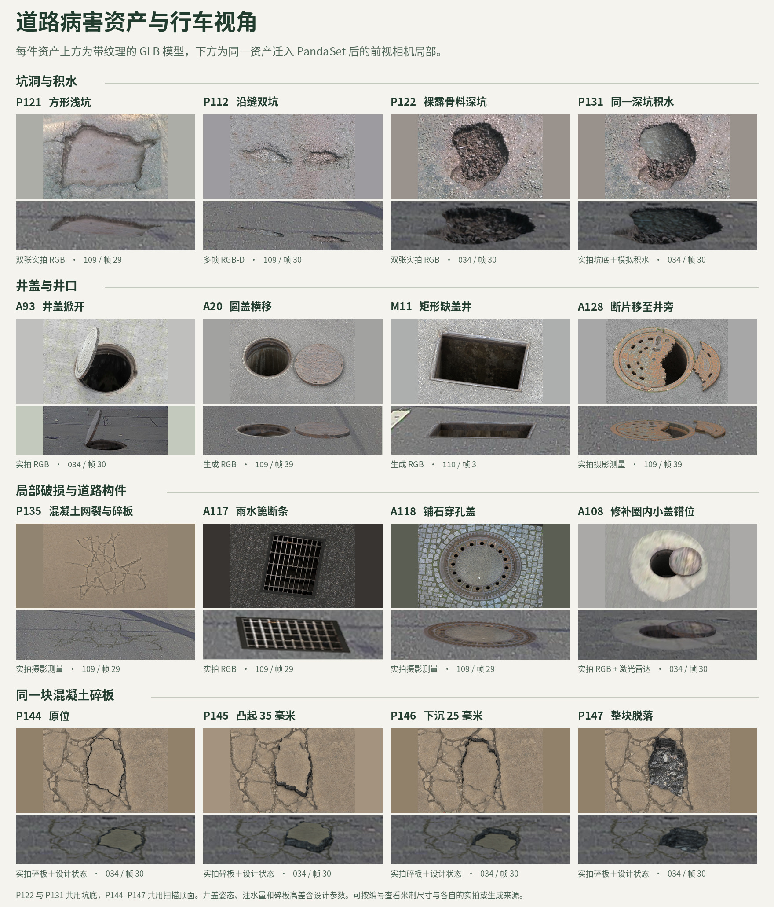
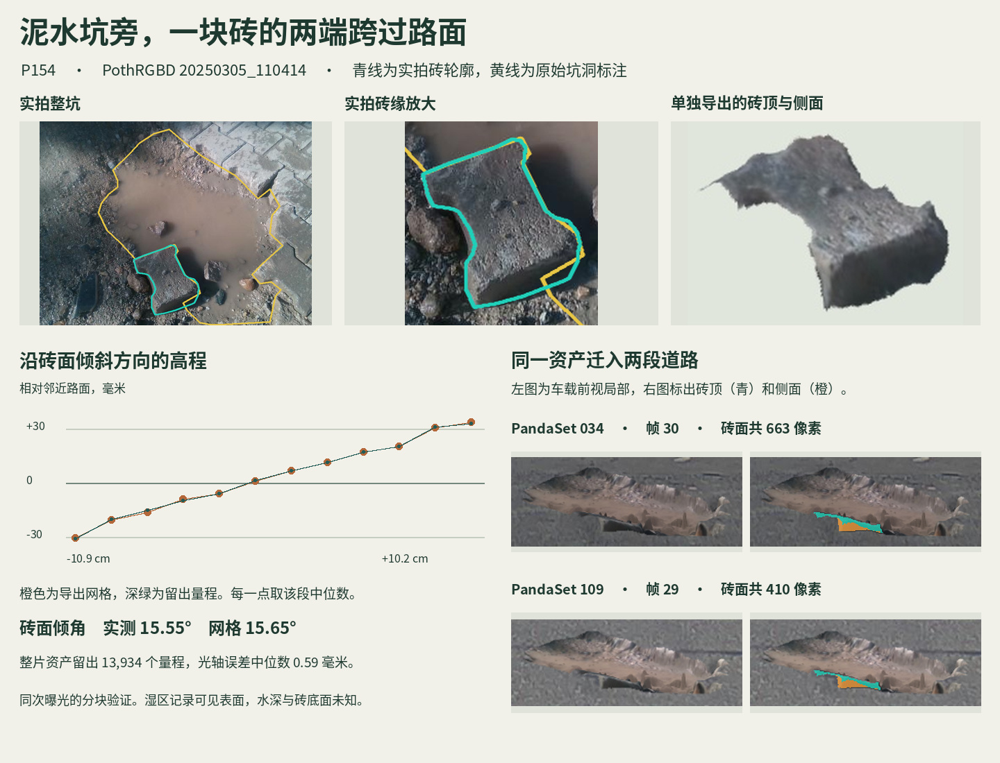
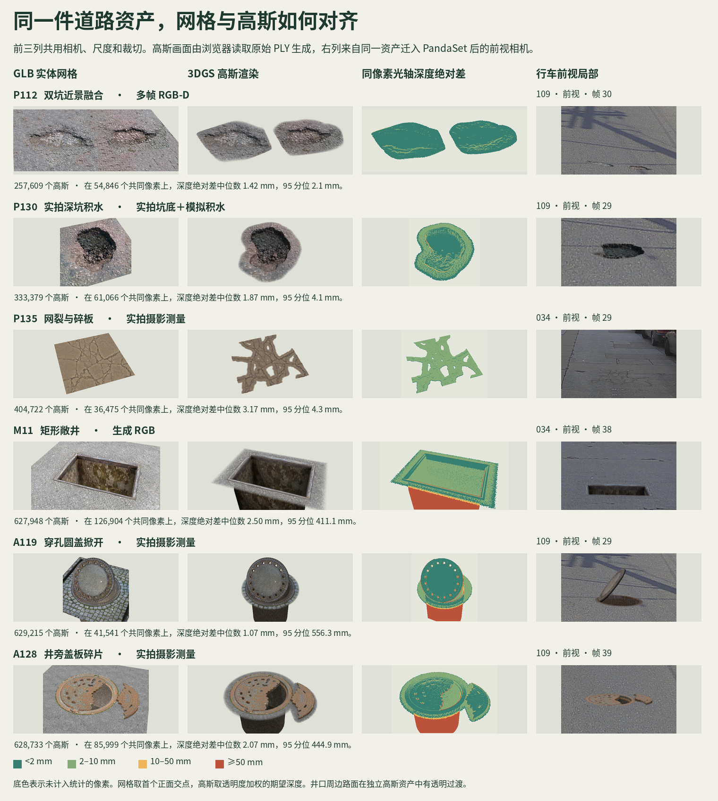

# RoadGS 道路病害资产重建详解

一张坑洞照片可以告诉我们坑沿在哪里、骨料是什么颜色。要回答“坑底比路面低多少厘米”，还需要深度、双目视差、带标尺的第二张照片，或一个明确给定的设计深度。RoadGS 将这些依据写进资产配方，再为同一件病害生成带纹理的网格、用于相机渲染的三维高斯，以及把病害嵌入道路所需的切口。最后，模型进入带有真实车辆轨迹、相机和激光雷达标定的 PandaSet 道路场景。[逐资产配方索引](../catalog/reconstruction-index.json) · [从克隆到传感器回放](13-reproduce-and-transfer.md)

## 一、资产库有多大，一个编号代表什么

截至 2026-11-24，[本地配方索引](../catalog/reconstruction-index.json)有 **1,448 个独立编号、34 个配方组**，含本地样例 P202–P204；离线图谱和百科是各自生成时的快照。一个编号对应一条可以查到构建方法的记录，不代表一次独立采集：同一处坑洞可以有多个观测帧，同一口井可以有多个状态。`P` 涵盖坑洞和路面破损，`M` 表示缺盖井，`A` 包含盖板及其姿态。划分训练集与测试集时，应按来源序列、原始帧和[共用井体](../catalog/chamber-families.json)归组。

| 索引系列 | 配方组 | 编号数 | 内容 |
| --- | ---: | ---: | --- |
| 历史实拍与设计库 | 5 | 1,199 | 65 条双目、822 条 RGB-D、120 个设计坑洞、64 个缺盖井、128 个异常井盖 |
| 可追加的米制资产工厂 | 1 | 30 | 两个种子各生成 15 件，包含程序化坑洞、缺盖井和异常盖板 |
| 生成 RGB 图生三维 | 2 | 109 | 首批 9 件和后续 100 件，合计 37 个坑洞、36 个缺盖井、36 个异常盖板 |
| 后续实拍、融合及状态派生 | 19 | 65 | 多机位坑洞、相机与 LiDAR 测井、实拍开孔盖板、扫描裂缝、碎板、积水、铺砖等 |
| 大面积程序化坑洞 | 1 | 30 | P160–P189，封存的设计配方，保留复建入口 |
| 大坑实拍、RGB-D 和生成参考图 | 4 | 13 | P190–P201，以及 [P203 路口浅剥落](02-asset-reconstruction.md#p203-路口横向剥落带)；不全是实测深度 |
| 单图横向修补带 | 1 | 1 | [P202](../gen2hole/examples/transverse-repair/README.md)，轮廓取自截图，凹深是设计值；原截图未随仓库发布 |
| 单图路缘积水坑 | 1 | 1 | [P204](02-asset-reconstruction.md#p204-路缘积水坑)，观测水线，不观测水下坑底；每段道路需要重新计算水平水面 |

**资产数、放置次数和传感器帧数应分别读取。** 例如 109 件生成图资产各放入三段道路，共 327 次放置。多件可在同一场景，因而只需保存 111 个场景检查点。每个场景回放 80 个源帧，得到 8,880 个案例帧，底层复用三段道路的 240 次原始扫描。另一个同机位比较实验收录 167 件可选资产，其中含独立的合成姿态样例 A98。这些数值回答的是不同问题。[图生基线清单](../catalog/roadgs-releases.json) · [同机位比较记录](../validation/matched-road-views.json)

## 二、原始数据来自哪里

| 来源 | 提供的观测 | 在项目中的作用和边界 |
| --- | --- | --- |
| Rui Fan 等的双目坑洞数据 | 彩色图、病害标签、与像素配准、以毫米存储的 XYZ 坐标数组 | 65 条历史记录直接从 `xyzPoints` 起步。部分序列还用于多机位融合、彩照补深和留出检验。“毫米”是存储单位，实际误差另行评估。[原始仓库](https://github.com/ruirangerfan/stereo_pothole_datasets) |
| Mustafa Yurdakul、Şakir Tasdemir 的 PothRGBD / PData | RGB、RealSense 深度、病害多边形和可配对的时间戳 | 用于 822 条历史记录和若干专题资产。公开快照有同时间戳的文件变体，项目用成员名和 SHA-256 固定所选图、深度与标签。[数据仓库](https://github.com/ymyurdakul/PData) · [论文](https://arxiv.org/abs/2505.04207) · [输入指纹](../catalog/capture-inputs.json) |
| PandaSet，Hesai 与 Scale AI | 同步道路图像、传感器位姿、原始激光点及标注 | 055/056 用于早期道路重建与资产插入，034/109/110 用于后续迁入与回放。034、109 的两处井盖还直接提供了资产本体的观测。[数据开发包](https://github.com/scaleapi/pandaset-devkit) · [宿主与依赖版本](../outputs/reproducibility/sources.json) |
| 道路与井盖的公开照片、裂缝掩膜 | Zhang 等论文图 5 的井圈与盖面、Rossini 等的裂缝照片与标签、Yokota 雨水篦照片、Stephen Craven 的六边形井盖照片 | 可见轮廓和纹理可追溯到图片。未拍到的井底、盖背或开合状态有各自的设计记录。照片作者、裁切、来源与许可按素材保留。[井圈与盖面](../gen2hole/examples/photo-chamber/survey.json) · [裂缝数据](../gen2hole/examples/photo-cracks/sources.json) · [雨水篦](../gen2hole/examples/perforated-covers/yokota/survey.json) · [六边形盖署名](../gen2hole/examples/polygon-cover/ATTRIBUTION.md) |
| ambientCG 与 Poly Haven | 实拍或摄影测量材质的底色、法线、位移等贴图 | 在程序化库中提供表面外观。在扫描专题中，同一采集的多张贴图还用于恢复盖孔、裂缝或板块顶面。不同专题对竖向幅值有各自的标定或设计约定。[程序化材质清单](../work/road_hazard_pipeline/material_sources.json) · [扫描文件与裁切记录](../gen2hole/examples/scanned-cracks/survey.json) |
| GPT Image 与项目设计配方 | 每件的俯视参考图、提示词、预期尺度、部件和姿态描述 | 构成 109 件生成 RGB 基线。源图提供轮廓和外观，配方提供米制尺度与不可见结构。坑洞可使用 Depth Anything V2 Small 给出的相对深度。[生成流程](../gen2hole/docs/pipeline.md) · [模型上游](https://github.com/DepthAnything/Depth-Anything-V2) |

GitHub 提供源码、配方、示例图与验证记录。较大的原始输入按组恢复，所需组名和校验方法见复现手册。复用第三方内容时要查对应条目的来源与许可，例如六边形盖的照片及改编模型标为 CC BY-SA 2.0，PData 固定快照的许可情况则单独记录。[数据来源说明](07-sources.md) · [按需恢复输入](13-reproduce-and-transfer.md)

## 三、如何从照片和距离恢复坑洞

### 1. 如何从一帧深度数据求得相对路面的凹深

一台朝下倾斜的相机拍摄平整路面时，画面远端的距离也会大于近端。因此不能把深度图中最大的数直接当坑深。对于 RGB-D，设像素为 `(u,v)`、光轴深度为 `Z`、焦距为 `fx,fy`、主点为 `cx,cy`。针孔反投影给出相机坐标 `X=(u−cx)Z/fx`、`Y=(v−cy)Z/fy`。Fan 双目数据已经提供逐像素 XYZ，历史脚本先由毫米换成米，省去了重新估计视差这一步。PothRGBD 历史流程采用标称焦距 462 像素和图像中心主点，标称内参的不确定性会传到尺寸估计。[双目批处理](../outputs/road_hazard_expansion/reproduction/batch_stereo.py) · [RGB-D 批处理](../outputs/road_hazard_expansion/reproduction/batch_rgbd.py)

程序在掩膜外的完好路面上迭代拟合局部平面，以平面法线为局部上方向。若单位法线 `n` 朝上、`p₀` 位于基准面，点 `p` 的相对高程是 `h=n·(p−p₀)`。坑底一般为负，翘起的砖角可能为正。程序将有效点投到局部网格，对有邻近测量支持的位置估计高度，裁去支持不足的边界，再由输入照片给三角面着色。几何、照片纹理和边界融合权重由此共享同一坐标系。[高度场与网格实现](../outputs/road_hazard_expansion/reproduction/reconstruct_pothole.py)

**P154 演示了分割对重建的实际影响。** PothRGBD 帧 `20250305_110414` 拍到泥水坑和倾斜联锁砖。原坑洞标签之外还有 13,470 个属于砖的像素。补画砖顶、外轮廓和可见侧面后，网格才保留了高出路面的砖角。在同次曝光预留的 13,934 条目标射线上，光轴深度绝对误差中位数约 0.59 mm，95 分位约 2.92 mm。留出砖顶点拟合的倾角为 15.55°，网格为 15.65°。这些结果衡量同次曝光中的几何一致性，泥水下面的坑床和砖底仍无直接观测。[输入配方](../gen2hole/examples/displaced-paver/survey.json) · [逐点验证](../validation/displaced-paver.json)

### 2. 多帧深度、双张彩照、照片补深分别解决什么问题

| 手里有什么 | 如何得到几何 | 一项可检查的结果 |
| --- | --- | --- |
| 多帧 RGB-D 或多帧双目 XYZ，P110–P114 | 用坑外完好路面的纹理与三维点估计相机间位姿，将各帧的坑沿、凹深与颜色变换到同一局部坐标。格点记录观测覆盖，照片能看到且深度一致的区域优先提供纹理。 | P112 的两张近景各只覆盖一个坑，融合后的双坑与留出全景标注的交并比（IoU，即重叠面积除以并集面积）为 0.898，单帧分别为 0.398、0.536。[融合程序](../gen2hole/multiview_pits.py) · [留出机位检验](../validation/multiview-potholes.json) |
| 两张有平移视差的 RGB、内参、掩膜、一段已知路面长度，P121–P124 | 先由坑外平面单应估计相机相对运动，已知长度确定米制尺度。再对不同候选高度比较两图局部纹理，交换机位做往返匹配。可区分双向支持和插值区域。 | 四例的输入标尺取自坑外，坑内传感器深度留作独立比较。仅原地转动相机时缺少恢复凹深的平移基线。[双照片实现](../gen2hole/photo_parallax.py) · [标尺与源帧](../gen2hole/examples/photo-parallax/survey.json) |
| 大部分有 XYZ、陡壁处缺测，P142、P143 | 保留有效距离，在缺口处沿候选高度跨机位重投影照片，用双向纹理和已有距离筛选候选值，再融合网格。每处可区分原有测距、照片补值和插值支持。 | P143 两个留出机位中，照片支持区域的中位误差分别由 7.90 降至 5.76 mm、由 4.82 升至 11.02 mm。补出更多表面也可能扩大局部误差。[补深程序](../gen2hole/pit_depth_completion.py) · [两种网格的逐帧比较](../validation/pit-depth-completion.json) |

### 3. 一张 RGB 照片能提供哪些形状和尺度依据

P90 和一个历史 RGB-D 坑洞使用同一次曝光 `20250227_135438`。RGB-D 分支读取距离数组。P90 分支只取彩照，用粗框和 GrabCut 获得坑缘，再按到坑沿的距离生成碗状剖面。配方明确给出 1.25 m 的图幅和 0.11 m 的设计深度。同一张照片由此产生两个外观相似、尺寸依据不同的模型。[P90 配方](../gen2hole/examples/real-rgb/calibration/designs.json) · [轮廓转坑面](../gen2hole/recipes/common/pavement.py)

109 件生成图资产中，坑洞分支从俯视图提取坑沿，使用相对逆深度描述起伏，利用坑外区域扣除路面趋势，再将凹陷幅度和图像跨度按配方换成米。缺盖井和异常盖板走部件拟合分支，从图中标记外框、净开口、盖边和铰点，分别构造井壁、盖板及纹理。例如 A13 的提示词预期约 55°，实际按图中投影拟合约 74.23°。0.027 m 盖厚与 1.03 m 井深采用设计值。固定源图、拟合参数与随机种子，可以重建同一套模型。[图生三维分步说明](../gen2hole/docs/pipeline.md) · [拟合实现](../gen2hole/recipes/series/fit_images.py)

## 四、井口、盖板与雨水篦如何做成可操作的三维部件

井口同时包含路面、井圈、低于路面的井壁和井底。开盖后，一条从上向下的射线还可能先碰到盖板，再碰到井壁。完整网格需要保存这些不同高度的实体表面，路面高度图只承担切口和边缘融合。生成新姿态时固定井框坐标，对独立盖板绕铰轴旋转或施加平移，缺盖状态则移除盖板。这样才能从另一侧看到盖背，也能准确判断哪一部分挡住井底。[井体与盖板实现](../gen2hole/recipes/series/chambers.py) · [提取独立盖板](../gen2hole/export_lids.py)

| 资产与编号 | 直接观测 | 建模方式与设计量 |
| --- | --- | --- |
| 可动圆井盖 A91–A95、M91 | Zhang 等论文图 5D 提供井圈、5B 提供盖面，取自两处设施 | 用各自四个平面控制点矫正透视、提取纹理，装配成同一井体的落座、微开、掀起、错位、移至井旁和缺盖六态。直径、盖厚、井深及姿态取配方值。[照片、尺寸与六态](../gen2hole/examples/photo-chamber/survey.json) |
| 道路实测井盖 A104、A105、M104 和 A107、A108、M107 | PandaSet 034/109 的可见盖面、井框边缘与邻近激光点 | 投影路面与盖面的点，拟合基准面和落座高差，多帧图像约束外径与位置。小盖板还保留偏心修补圈。掀盖、错位、缺盖是以已拟合井体为基础的派生状态。井内遮挡部分采用设计尺寸。[相机与激光拟合](../gen2hole/fit_road_cover.py) · [各设施的观测边界](../catalog/chamber-families.json) |
| 矩形雨水篦 A115–A117、M115，以及铺石圆盖 A118–A120、M118 | Yokota 实拍照片提供篦条与孔缘。ambientCG Manhole Cover 004 提供铺石盖颜色和位移 | 逐孔提取轮廓，生成盖面、背面与孔壁。矩形篦有 60 个贯穿孔，断掉一段格条后相邻孔连通。圆盖保留 16 孔，并可掀开、错位或移除。绝对尺度、厚度与遮挡部分按各配方记录。[雨水篦](../gen2hole/examples/perforated-covers/yokota/survey.json) · [铺石盖](../gen2hole/examples/perforated-covers/cobblestone/survey.json) |
| 断片铸铁盖 A125–A128，以及安装高差 A138–A141、M138 | ambientCG Manhole Cover 009/010 的完整盖面提供铸纹、孔洞或位移细节 | 前者沿指定断线切出独立碎片，比较完整、缺片、碎片落井和移至井旁。后者保留盖面通孔，控制整圈下沉、凸起或单侧沉降。源材质采集的是完整设施，损坏和安装状态由配方派生。[断片配方](../gen2hole/examples/perforated-covers/split-iron/survey.json) · [安装高差配方](../gen2hole/examples/perforated-covers/grade/survey.json) |
| 六边形凹口盖 A151–A153、M151 | Stephen Craven 的照片提供六处凹口、铸纹交点与边界 | 平面矫正后按 0.68 m 参考宽度定标，构造有厚度的闭合盖板。水平错转 30° 和沿实拍盖边掀起 52° 时，从正上方可直视井底的比例分别为 4.68% 和 34.42%。从低位车载相机看，遮挡条件会改变。[照片署名](../gen2hole/examples/polygon-cover/ATTRIBUTION.md) · [几何验证](../validation/hexagonal-cover.json) |

## 五、裂缝、碎板、铺砖、积水和程序化变体

**裂缝有两种不同的深度来源。** P101–P103 把实拍裂缝的像素掩膜转成有分支的沟槽，局部宽度决定 V 形截面，图幅、侧壁坡度和深度上限由设计给出。P134–P137 使用 Poly Haven 的沥青和混凝土扫描，通过配准的底色、位移、法线和原材质设置恢复起伏。P135 的整片网裂与 P136 的加密局部可在同一批留出像素上比较。P134 与 P137 则可对照同一条纵缝在两种竖向尺度依据下的结果。[照片与掩膜](../gen2hole/examples/photo-cracks/sources.json) · [扫描与材质设置](../gen2hole/examples/scanned-cracks/survey.json) · [道路扫描复核](../validation/scanned-cracks.json)

**破损路面需要分开保存仍在原位的部件和被移走的部件。** P144–P147 从 P135 的一圈闭合裂缝中提取一块约 25.0 × 47.7 cm 的混凝土板。扫描约束顶面，板底、断面和基层取设计值。保留同一顶面，分别生成原位、抬高 35 mm、下沉 25 mm 和脱落四态。P148 从同一张 RGB-D 恢复两排共 13 个凹槽，12 个能单独导出。P149 记录缺砖后露出的坑床，P150 保存九块实拍碎片的可见面。这些局部部件可从对应资产中查询，目录仍按原资产编号计数。[碎板配方](../gen2hole/examples/faulted-slab/survey.json) · [双排槽口](../gen2hole/examples/paired-road-slots/survey.json) · [缺砖与碎片](../gen2hole/examples/single-depth-surfaces/survey.json)

**积水要先知道坑底和重力方向。** P129–P133 以 P122 或 P113 的已重建坑床为底面，将道路坡度转换到世界竖直方向，沿连通洼地寻找最低溢出口。对给定水平水位，沿岸线裁切三角形，积分水面与坑底之间的体积，再从给定注水量反求水位。同一坑底加 5 L 水，坡度为 5.1% 和 14.2% 时最大铅直水深分别为 66.6 和 84.6 mm。导出的水面可以独立移除。这一推算依赖已知干坑几何。P154 的泥水实拍仅观测到可见表面，不能直接由该图求出水深。[水面实现](../gen2hole/recipes/series/pit_water.py) · [五个状态的体积验证](../validation/standing-water.json)

**程序化库用参数控制场景中需要比较的变化。** 历史库的 120 个坑洞来自 10 种形态 × 4 种外观 × 3 个变体。64 个缺盖井来自 4 种井形 × 4 种井沿状态 × 4 种路面。128 个异常井盖来自 4 种井形 × 8 种姿态 × 4 种路面。工厂另加 30 件，用种子和序号确定配方，使尺寸、边缘破损、铰接和材质能重复生成。扫描材质提供沥青或金属的表面细节，几何尺寸与组合由代码控制。这类资产适合在同一相机、同一位置系统比较开角或形状。[变体目录](../outputs/road_hazard_expansion/reproduction/variant_catalog.py) · [30 件工厂配方](../catalog/factory-v3-assets.json) · [追加与恢复机制](10-factory.md)

## 六、为什么要同时导出 GLB、Gaussian PLY 和路面切口

| 表示 | 保存什么 | 典型问题 |
| --- | --- | --- |
| `asset.glb` | 米制、Y 向上的三角网格，含部件、UV 和纹理，适用时含法线、粗糙度和金属度材质 | 这条射线先碰到盖边还是井壁？盖板能否独立取出？ |
| `asset.ply` | 局部 Z 向上的三维高斯，保存中心、三轴尺度、旋转、透明度和球谐颜色系数 | 从车载相机看，坑缘占几个像素？同一检查点能否重渲染？ |
| `surface.npz` | 以米表示的局部尺寸与路面场、融合权重和病害掩膜。井类还可含开口掩膜 | 宿主路面在哪里挖开，边缘需要怎样衔接？ |
| `metadata.json` 与配方 | 编号、来源、单位、设计或测量参数等，具体字段随资产系列变化 | 坑深取自哪个输入？这两个状态是否共享井体？ |

资产生成高斯时，项目从三角面采样中心，在切平面内设置两个展开方向，法线方向保持薄层。对井圈、孔缘或断边可增加采样。图生管线还按网格求环境遮蔽与直射光可见性，并拟合一阶球谐颜色。相机渲染时，高斯投影成带方向和透明度的椭圆并沿视线累积颜色。采样稀疏时，上层高斯的覆盖可能跨过狭缝，造成网格明明可见基层、高斯渲染却显得封住。碎板专题保留了普通采样和断边加密两种 PLY，用同机位深度图直接检查差异。[高斯导出](../gen2hole/recipes/common/export_splats.py) · [断边加密实验](../validation/concrete-slab-edge-sampling.json)

## 七、怎样把病害放进真实行车序列

1. **建立宿主道路。** StreetCrafter 的初始动态 3DGS 重建保存道路背景、动态目标、相机轨迹及检查点。早期 055/056 各用 80 帧前视图像、迭代训练 7,000 次。驱动资产重放的是这些场景检查点。资产自身另有一套网格和高斯。[场景构建与迁入](04-scene-insertion.md) · [StreetCrafter 上游](https://github.com/zju3dv/street_crafter)
2. **找局部路面并切口。** 用道路语义激光点估计锚点平面，取得中心 `center_world` 与三个局部基向量 `B`。对行向量有 `p_world = p_local @ B.T + center_world`。在原尺度放置资产，按掩膜和宿主高斯的空间范围清除原路面覆盖，处理接缝和道路遮挡，再合并高斯并重新载入检查点。省略道路切口时，原有路面可能挡住真实建出的坑底。[迁入入口](../gen2hole/downstream/place.py) · [道路切除实现](../scripts/hazard_factory/migrate.py)
3. **生成相机对照。** 固定原帧的位姿、内参和曝光，用场景高斯提供颜色，用物理网格提供可见轮廓、深度与部件，再把病害与同帧实拍路面合成。动态目标、已有近处前景和车身遮挡会使某些部件在该帧完全不可见。前后相机各有采样时刻，裁切图的主点须扣除裁框左、上偏移。[相机几何](../pipelines/sensors/tools/camera_geometry.py) · [前后视合成](../pipelines/sensors/tools/render_pairs.py)
4. **重放真实发出的激光束。** 保留原扫描的点行号、雷达编号和发射时间，分别求 Pandar64 与 PandarGT 的发射中心。沿原射线寻找已放置网格的最近有效交点，检查它是否通过开口以及是否被原有前景遮住。保留原始扫描和逐行增量，合成回波的强度记为 `NaN`。这里得到的是沿光束的模拟距离。相机深度记录的是光轴方向的 `Z`。[雷达增量实现](../pipelines/sensors/tools/build_returns.py) · [扫描回放](../pipelines/sensors/tools/replay.py)

**同一束光可以检验几何变化有没有真正进入场景。** 在 109 路段同一机位，原扫描行 151811 的实测距离为 8.515 m。放入掀盖 A119 时，光束先遇到盖板边缘，模拟距离 7.884 m。换成共享井体的缺盖 M118 后，光束先遇到井圈，模拟距离 8.478 m。对照中保留发射器和光束，变化可归因于盖板状态。真实湿路的反射强度、入水透射和漏检概率还需要湿态传感器观测来标定。[图像与同束回波图](figures/matched-road-lidar.jpg) · [同机位验证记录](../validation/matched-road-views.json)

## 八、如何读验证数字，以及从哪条命令开始

| 验证回答的问题 | 本项目的例子 | 数值的解释 |
| --- | --- | --- |
| 同一输入能否重建同一文件？ | 使用归档拟合参数，从克隆重建 109 件生成图资产，109 个 GLB 和 109 个 PLY 均匹配发布 SHA-256。另有 P13、A06 从 RGB 重新拟合的抽查 | 哈希一致说明运行结果可以复现。资产实际尺寸的准确度仍取决于输入和标尺。[复建报告](../validation/github-reproduction.json) |
| 三维表面能否解释没有拿来拟合的观测？ | P154 的预留深度射线、P112 的留出全景和 P143 的另一机位 | 应同时看样本数、机位是否独立、中位数和高分位误差。一个机位中留出的像素和另一次拍摄检验的是不同误差来源。[P154](../validation/displaced-paver.json) · [多机位坑洞](../validation/multiview-potholes.json) |
| 同一模型进入道路后，检查点、相机和雷达是否对得上？ | 从克隆重放 P154 的 034_154，原生场景重载最大像素差为 0。80 帧原扫描中替换了 1,918 条回波，可按坑床、砖顶与砖边核对 | 这里验证了放置尺度、重载与模拟观测的一致性。真实道路采集于病害插入之前。[重载与逐部件结果](../validation/github-reproduction.json) |

**第一次复现可从六态井盖开始。** 在仓库根目录按安装手册准备资产 Python 环境，运行下列命令。所需示例照片随 Git 提供，`--mesh-only` 只构建带纹理的网格。打开 `runs/first-cover/series/assets/raised/A93/asset.glb` 可以看到 68° 掀盖，换看 M91 则能直接检查同一井体的开口。完整 GPU、道路与传感器依赖，以及 P154 的下载和重放命令，见复现手册。[安装与完整运行步骤](13-reproduce-and-transfer.md)

~~~bash
python scripts/configure-gen2hole.py
python gen2hole/survey.py --survey gen2hole/examples/photo-chamber/survey.json \
  --mesh-only --out runs/first-cover
python gen2hole/gen2hole.py verify --run runs/first-cover
~~~

有自己的观测数据时，按[输入选择重建方法](13-reproduce-and-transfer.md#按输入选择重建方法)；已有资产时，按[所需交付物选择迁入方法](13-reproduce-and-transfer.md#按交付物选择迁入方法)。
