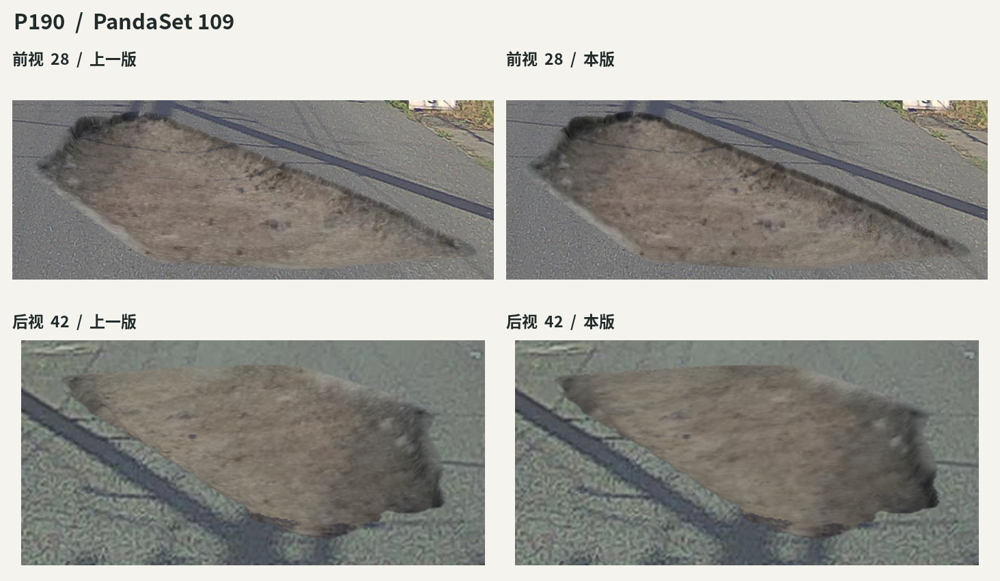

# 实拍大坑子模块

首次克隆或交接项目，请先看[资产重建与场景迁入复现手册](16-reproduction-cookbook.md)。其中列出按编号查询的方法、可下载输入、各宿主的代码入口和验收标准。

`gen2hole.large_pits` 从斜拍照片重建露出土层的路面塌坑，导出带材质的 GLB、原生 3D 高斯 PLY 和高程场，然后把同一件资产迁入标定好的实拍道路。P190 使用护栏旁塌坑的原始照片。打开 109 前视第 28 帧能看到电线阴影穿过坑床，034 前视第 27 帧则能看到背阴路面的断边。[109 行车视频](https://github.com/Vexlc/road-hazard-reconstruction/releases/download/large-pits-v1.0.0/p190-scene-109.mp4) · [034 行车视频](https://github.com/Vexlc/road-hazard-reconstruction/releases/download/large-pits-v1.0.0/p190-scene-034.mp4) · [同机位版本对照](figures/large-dry-pit-road.jpg) · [GLB](https://github.com/Vexlc/road-hazard-reconstruction/releases/download/large-pits-v1.0.0/p190.glb)



## 从 GitHub 按编号复现

本模块随主仓库发布。可从空目录克隆仓库的固定标签。

```bash
gh repo clone Vexlc/road-hazard-reconstruction -- --branch large-pits-v1.0.0 --depth 1
cd road-hazard-reconstruction
```

在 Linux 上安装项目的网格与计算环境后，在仓库根目录按编号重建。[环境安装步骤](03-environment-and-relocation.md)

```bash
python -m gen2hole.large_pits example P201
```

该命令自动下载和校验输入包，提取 P201，重建模型并核对五个成品的 SHA-256。默认输出为 `runs/reproduce-p201/series/assets/pothole/P201/`。可将编号换成 P190、P198、P199 或 P200，也可用 `--out 新目录` 指定输出位置。手动下载后传入 `--archive 文件路径` 即可离线重建。输入包已有整图和局部深度，重建发布样例时可直接使用。使用新照片需要准备其轮廓和断边并推断深度。车载回放另需 PandaSet 道路数据，中文视频标签使用 Noto Sans CJK 字体。[固定版本源码](https://github.com/Vexlc/road-hazard-reconstruction/tree/large-pits-v1.0.0) · [输入包、模型与视频下载](https://github.com/Vexlc/road-hazard-reconstruction/releases/tag/large-pits-v1.0.0) · [发布文件校验表](../gen2hole/large_pits/release-sha256.txt)

## 二十件车行道坑洞

这套合集包含原有 P190、P198–P201 和新增 P205–P219。新增的 15 件各自使用一张独立生成的沥青路面参考图。宽碗坑、车轮磨出的长坑、接缝和补丁边缘破损、相邻坑连通均保留完整坑口。参考图中标定的上缘和可见断壁与整图、局部深度一起用于建模。新增模型的坑口投影面积为 3.29–10.62 平方米，长轴为 4.1–5.6 米，坑床凹深 P95 为 11–24 厘米。这些是设计尺度下的模型尺寸。合集视频先播放新增的 15 件，再播放原有的 5 件，每件都显示参考图、建成的网格及 PandaSet 109 前后视回放。[合集视频](https://github.com/Vexlc/road-hazard-reconstruction/releases/download/remapped-pits-v1.0.0/common-20.mp4) · [20 件网格总览](https://github.com/Vexlc/road-hazard-reconstruction/releases/download/reproduction-2026.11.25/common-pits-overview.jpg) · [20 件 GLB](https://github.com/Vexlc/road-hazard-reconstruction/releases/download/remapped-pits-v1.0.0/common-20-glb.zip) · [逐件配方与模型路径](../catalog/common-pit-kit.json)

在固定版本 `reproduction-2026.11.25` 下，先依照[下载与合并步骤](16-reproduction-cookbook.md#从发布输入复建-20-个大坑)获取输入并配置环境。以下命令重建 P205，核对五个文件，再放入已配置的 PandaSet 109。要复建全部 20 件，省略首条命令最后的编号。[版本下载](https://github.com/Vexlc/road-hazard-reconstruction/releases/tag/reproduction-2026.11.25) · [新增件配方及生成提示词](../gen2hole/examples/oblique-road-pits/common-large/cases.json)

```bash
python3 scripts/rebuild-common-pits.py downloads/reproduction-2026.11.25/common-pit-inputs.zip P205
python3 -m gen2hole.large_pits drive --bundle runs/common-large-pits/P205/series --asset P205 --group 205 \
  --site 109 --out work/reproduce-common-20/scene-P205
```

## 车行道上的四个坑

四件独立模型分别放在 PandaSet 109 同一条车道、同一个位置。四格回放先从前方驶近，再从后方驶离。定格放大时四格采用同一裁切。每段单件视频另有原路面与加入坑洞的同帧对照。[同步对比视频](https://github.com/Vexlc/road-hazard-reconstruction/releases/download/large-pits-v1.0.0/lane-pits-comparison.mp4) · [近景大图](figures/lane-pits-overview.jpg) · [四件 GLB](https://github.com/Vexlc/road-hazard-reconstruction/releases/download/large-pits-v1.0.0/lane-pits-models-glb.zip)

| 编号及单件视频 | 坑形 | 坑洞参考图 | 坑口长轴 × 短轴 | 坑口投影面积 | 模型凹深 P95 |
|---|---|---|---:|---:|---:|
| [P198](https://github.com/Vexlc/road-hazard-reconstruction/releases/download/large-pits-v1.0.0/p198-scene-109.mp4) | 施工路面露出的开口 | [实拍](https://github.com/Vexlc/road-hazard-reconstruction/releases/download/large-pits-v1.0.0/P198.jpg) | 1.99 × 1.89 m | 2.79 m² | 13.5 cm |
| [P199](https://github.com/Vexlc/road-hazard-reconstruction/releases/download/large-pits-v1.0.0/p199-scene-109.mp4) | 两个相连的碎石坑 | [生成](https://github.com/Vexlc/road-hazard-reconstruction/releases/download/large-pits-v1.0.0/P199.png) | 5.02 × 2.99 m | 9.22 m² | 37.6 cm |
| [P200](https://github.com/Vexlc/road-hazard-reconstruction/releases/download/large-pits-v1.0.0/p200-scene-109.mp4) | 斜穿车道的狭长沟坑 | [生成](https://github.com/Vexlc/road-hazard-reconstruction/releases/download/large-pits-v1.0.0/P200.png) | 5.62 × 1.28 m | 5.08 m² | 33.0 cm |
| [P201](https://github.com/Vexlc/road-hazard-reconstruction/releases/download/large-pits-v1.0.0/p201-scene-109.mp4) | 弧形断壁、裸露砾石床 | [生成](https://github.com/Vexlc/road-hazard-reconstruction/releases/download/large-pits-v1.0.0/P201.png) | 5.10 × 4.13 m | 15.30 m² | 40.1 cm |

P198 使用 Jennifer Petrie 拍摄的邓巴 Lamer Street 照片，只重建前景两堆土之间能辨认的开口。坑沿在原图上仅约 186 像素宽，模型尺度和深度均由单张照片估计。其余三件分别从独立的 ImageGen 参考图推断坑形，设计长轴为 5.0、5.6 和 5.1 米。P201 的初版把坑底估得过深，终版将坑床深度先验设为 0.40 米，再沿原相机射线重新定位坑床、投射纹理。表中长短轴取最终轮廓的最小外接矩形，面积取轮廓内部。[P198 原照片](https://www.geograph.org.uk/photo/8238971) · [照片与材质署名](../gen2hole/examples/oblique-road-pits/lane-batch/SOURCES.md) · [生成提示词](../gen2hole/examples/oblique-road-pits/lane-batch/prompts.json)

复建使用约 255 MiB 的输入包，内含四张实际用于推断的参考图、各自的轮廓与断壁标注、全图与局部深度、扫描材质和校验值。已有下节所述运行环境和道路数据时，从项目根目录运行以下命令。每件的网格、高斯和高程分别保存在 `series/assets/pothole/<编号>/` 下。[四件输入包](https://github.com/Vexlc/road-hazard-reconstruction/releases/download/large-pits-v1.0.0/lane-pits-inputs.zip) · [验收结果](../validation/lane-pits-batch.json)

```bash
gh release download large-pits-v1.0.0 --pattern lane-pits-inputs.zip --dir work/large-pits-downloads
kit=work/large-pits-downloads/lane-pits-inputs.zip
echo "760976d1314eb0b9a3297308e40ea9a3113d2586b7f5014865b9a9e076726d59  $kit" | sha256sum -c -
python -m zipfile -e "$kit" work/reproduce-lane-pits/inputs
for k in P198 P199 P200 P201; do
  run="runs/reproduce-lane-pits/$k"
  python -m gen2hole.large_pits build --inputs "work/reproduce-lane-pits/inputs/$k" --out "$run"
  python -m gen2hole.large_pits drive --bundle "$run/series" --asset "$k" --group "${k#P}" \
    --site 109 --out "work/reproduce-lane-pits/review/$k/scene-109"
done
work/envs/streetcrafter/bin/python scripts/review-lane-pits.py \
  --runs runs/reproduce-lane-pits --out work/reproduce-lane-pits/review
```

## 用输入包重建

在仓库根目录运行。以下分步命令使用从本版 GitHub Release 下载的 ZIP。包中有原照片、轮廓、两幅整图深度、两幅局部深度、六张材质图及逐文件 SHA-256。网格导出使用项目的 Python 3.11 资产环境，重建和车载渲染使用 Python 3.9 计算环境。实跑环境为 RTX 4070 Ti SUPER、PyTorch 2.4.0+cu121、Open3D 0.18.0、OpenCV 4.10.0、NumPy 1.26.4 和 SciPy 1.13.1。[P190 输入包，约 56 MiB](https://github.com/Vexlc/road-hazard-reconstruction/releases/download/large-pits-v1.0.0/p190-inputs.zip) · [环境安装和换机](03-environment-and-relocation.md)

```bash
# 新机器配置一次。已有本机配置时可跳过。
python scripts/configure-gen2hole.py

gh release download large-pits-v1.0.0 --pattern p190-inputs.zip --dir work/large-pits-downloads
kit=work/large-pits-downloads/p190-inputs.zip
echo "7ba047e1decae476948f450eb0ecf8f2c41b6ee153a008e8f32c14db408b26bd  $kit" | sha256sum -c -
python -m zipfile -e "$kit" work/reproduce-p190
python -m gen2hole.large_pits build --inputs work/reproduce-p190/inputs --out runs/reproduce-p190
```

`build` 先校验输入，再在临时目录完成建模、GLB/PLY 导出和验收。目标运行目录须为新路径。输出位于 `runs/reproduce-p190/series/assets/pothole/P190/`，其中 `surface.npz` 存放以米计的高程与坑口掩膜，`asset.glb` 内嵌颜色和法线，`asset.ply` 可独立载入。生成的 `series/checks.json` 记录五个文件的摘要。[交付文件校验值](https://github.com/Vexlc/road-hazard-reconstruction/releases/download/large-pits-v1.0.0/p190-model-checks.json)

## 放入实景并回放

道路步骤需要 034 和 109 对应的 PandaSet 相机、标定、语义激光点、预处理动态掩膜和本项目的道路基础检查点。目录由 `gen2hole/config/local.json` 指定。默认直接读取原始激光点；已有 `base/<路段>/` 帧缓存时可追加 `--scans runs/paired-road-slots/sensors`。[道路数据包](01-downloads.md) · [道路场景安装和迁入](04-scene-insertion.md)

```bash
for site in 109 034; do
  python -m gen2hole.large_pits drive --bundle runs/reproduce-p190/series \
    --site "$site" --out "work/reproduce-p190/scene-$site"
done
```

每个 `scene-*` 目录含 `drive.mp4`、前后视无损原帧及合成帧、`comparison.jpg` 和逐帧的 `placement.json`。原生道路检查点在运行目录的 `series/scenes/<路段>_190/trained_model/`。视频以原始道路 RGB 为背景，根据实深遮挡和网格开口合成迁入的高斯资产。方向光、天空可见度和材质细节在回放阶段求值，独立打开 PLY 时看到的是资产本身的外观。

## 从原始照片推断深度

使用新照片时准备同一编号的两个 JSON。轮廓配方中的 `image_size` 是按照片 EXIF 方向转正后的宽高，`crop` 是全图像素坐标的左上和右下。`rim` 顺着坑沿闭合，`road_polygons` 取坑外完整路面，`exclude_polygons` 和 `overlay_segments` 标出路锥、护栏和检测线。细节配方包含两个局部视图 `insets`，以及沿同一段可见断边顺序记录的 `wall_transects`。每对坐标依次点断边上缘、下缘，P190 有 18 对。相邻点之间要沿同一段断边连续。新照片需要重新标注和推断。[P190 轮廓示例](../gen2hole/examples/oblique-road-pits/P190.json) · [局部相机、断边和材质取样配置](../gen2hole/examples/oblique-road-pits/P190-detail.json)

以下命令在当前工作区已从 JPEG 跑通，输入可直接沿用上节解压目录。换机时把推断解释器、两个源码目录和权重改为当地路径。实跑用 Python 3.11、PyTorch 2.7.0+cu128、MoGe 提交 `74fbce054ebed49800de42d0ad0e83495065719a` 和 utils3d-moge 提交 `62f09d58509485564e24d5d9f6aac9ee9ebc0c37`，权重 SHA-256 为 `280741fd09bc3f403ccff9967784c2a391b52d2c0742ae3efdb21d9f90cc1a01`。[MoGe 源码](https://github.com/microsoft/MoGe/tree/74fbce054ebed49800de42d0ad0e83495065719a) · [utils3d-moge 源码](https://github.com/EasternJournalist/utils3d-moge/tree/62f09d58509485564e24d5d9f6aac9ee9ebc0c37) · [MoGe-2 ViT-L Normal 权重](https://huggingface.co/Ruicheng/moge-2-vitl-normal/blob/main/model.pt)

```bash
src=work/reproduce-p190/inputs
PYTHONPATH=../SongYan_recon/work/deps/MoGe:../SongYan_recon/work/deps/utils3d-moge \
python -m gen2hole.large_pits prepare \
  --moge-python ../dynamic_benchmark/.venv/bin/python \
  --weights ../SongYan_recon/work/moge2/model.pt --image "$src/P190.jpg" \
  --spec "$src/outline.json" --profile "$src/profile.json" \
  --maps "$src" --pavement "$src/asphalt" --out work/p190-from-photo
python -m gen2hole.large_pits build --inputs work/p190-from-photo --out runs/p190-from-photo
```

`prepare` 也接受 `--depth-cache FILE --inset-cache FILE` 替代权重推断。重建会核对照片、全图深度使用的轮廓、局部相机和权重摘要。复用土面扫描时，配方中的 `albedo` 与 `displacement` 共同定义颗粒的颜色和起伏。沥青使用 Asphalt 031 的 4K PNG 颜色图与位移图。其他干坑可沿用这些材质，再给 `drive` 传入相应的 `--asset P编号 --group 数字`。该配方假设裸露土石和能辨认的上段断壁，积水表面有单独的建模方法。[砂砾扫描](https://polyhaven.com/a/gravelly_sand) · [碎石土扫描](https://polyhaven.com/a/stony_dirt_path) · [沥青扫描](https://ambientcg.com/view?id=Asphalt031) · [积水建模](02-asset-reconstruction.md#实拍坑底上的积水)

## 坑沿、颗粒与现场光照

1. **坑形和尺度。** 全图正向及镜像的单目深度估计用于拟合道路基准面，两幅局部图补充坑底起伏。上段断壁按每下降 1 cm 向内收 2.7 mm 的假设拟合。保留上一版的 545 × 545 高程网格，便于单独比较材质和光照。P190 的坑口估计约 6.74 × 2.70 m，面积约 14.24 m²，坑内凹深第 95 百分位约 22.8 cm。照片缺少现场尺度，遮挡处也缺少独立观察。
2. **可见表面的颜色。** 在最终网格的每个坑内纹理位置，向原相机反查第一处三角形交点，容差 1 mm。近侧坑沿、路锥和检测框挡住的区域由邻近可靠颜色平滑补全，避免将一条暗线拖过整面坑壁。971,679 个坑内纹素中有 147,505 个被几何自身遮住，有 803,051 个可从干净原图取色。纹素计数采用道路平面展开，不能直接解释为坑壁的实测面积。
3. **碎石与断面。** 颜色和微起伏共用同一组扫描坐标，依据坡度在三个正交面之间混合。陡壁能表现沿壁面的颗粒。调试时发现只追求原图误差容易让反向近景变平，最终版本保留了更多扫描颗粒，并根据相机像素覆盖的范围过滤细节。颗粒位置和微起伏幅值均为外观补全。
4. **车载画面的光照。** 使用 GLB 的材质法线、重建高度场的 16 个方位和每方位 26 个采样距离估计天空可见度。109 按该路段的太阳方向分四条射线检测遮挡，并使用道路照片测得的阴晴亮度比。034 的坑位处于背阴区域，只使用天空光。109 的太阳仰角约 50.9°，前视第 28 帧只有 13 个坑内像素达到自阴影计数阈值，画面里跨过坑床的长阴影来自原场景杆线。[光照标定记录](../gen2hole/downstream/sensors/daylight.json)

## 复核两版

```bash
python -m gen2hole.large_pits build --baseline --inputs work/reproduce-p190/inputs --out runs/reproduce-p190-v2
python -m gen2hole.large_pits drive --baseline --bundle runs/reproduce-p190-v2/series \
  --site 109 --out work/reproduce-p190/old-109
python -m gen2hole.large_pits audit --baseline runs/reproduce-p190-v2/series \
  --bundle runs/reproduce-p190/series --baseline-road work/reproduce-p190/old-109 \
  --roads work/reproduce-p190/scene-109 work/reproduce-p190/scene-034 --out work/reproduce-p190/comparison
```

| 原机位上的同一组 50,209 个有效像素 | 上一版 | 本版 |
|---|---:|---:|
| 原图与交付 GLB 的 RGB 平均绝对误差，0–255 | 8.95 | 4.30 |
| 仅比较较大色块的误差，采用 σ=2 像素的归一化平滑 | 2.56 | 0.93 |
| 逐像素 RGB 平均绝对误差的第 95 百分位 | 24.00 | 11.33 |
| 坑口与手工轮廓的交并比 | 0.9835 | 0.9835 |

这组数据检验同一机位对原照片的还原程度。两版几何摘要相同，三角形数为 591,872，高斯数为 628,562。两个实景检查点重载后的最大像素差均为 0。视频逐帧解码得到 109 共 87 帧、034 共 86 帧，均为 1440 × 810、10 fps，包含近景停留和同帧对照。107 个不同的道路相机帧中，动态物体、自车和其他受保护像素，以及模型覆盖区与抗锯齿边缘以外的像素，合成改写数均为 0。[原照与两版回投](https://github.com/Vexlc/road-hazard-reconstruction/releases/download/large-pits-v1.0.0/p190-source-comparison.jpg) · [逐项验收数据](../validation/large-dry-pit-P190.json)

本机用原 JPEG 重算全图和局部深度，两份缓存均与输入包逐字节一致。另从解压包在空目录重建，五个原生文件摘要全部一致，再用原始激光点独立回放 109，前视、后视无损帧和整段 MP4 摘要也一致。可用下列命令核对交付版最常用的两个模型文件。

```bash
cd runs/reproduce-p190/series/assets/pothole/P190
sha256sum -c <<'HASH'
aa25a5ec3ea873ef43e16b52db2234657fa58f7725efc3b8adece96a742b8d6a  asset.glb
218fce46280150d2647d37055a647c4874fc48054501ffff3db0ee4abaf6a8ea  asset.ply
HASH
```
