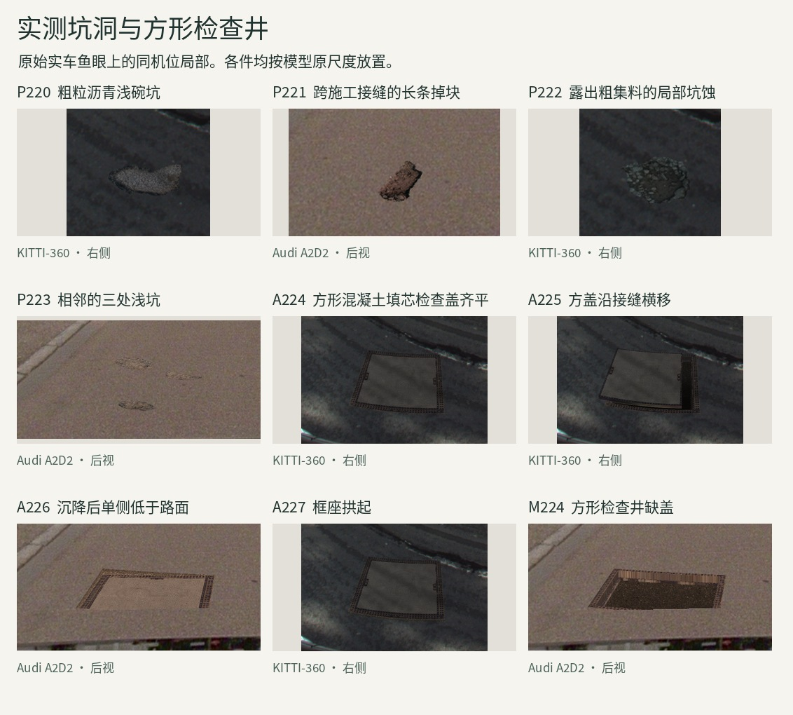
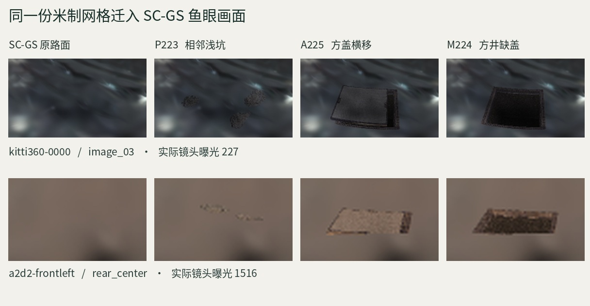

# 实测坑洞、方形检查井与跨镜头迁入

这一版从四幅有深度的道路照片重建四个坑洞，从一套方形检查井的扫描重建五种安装状态。九件资产都放入 PandaSet 并重载了独立的高斯检查点。另一条路线把同一批三角网格放进 KITTI-360 和 Audi A2D2 的世界坐标，使用原始实车镜头逐像素求交。它可以直接接收其他宿主渲染器提供的相机射线、深度和前景。[版本与模型下载](https://github.com/Vexlc/road-hazard-reconstruction/releases/tag/mixed-road-v1.0.0) · [Audi 左前与后视鱼眼](https://github.com/Vexlc/road-hazard-reconstruction/releases/download/mixed-road-v1.0.0/a2d2-mixed-road.mp4) · [KITTI 前方针孔与右侧鱼眼](https://github.com/Vexlc/road-hazard-reconstruction/releases/download/mixed-road-v1.0.0/kitti-mixed-road.mp4)

## 选择资产

| 编号 | 来源和可复核的几何 | 对应的道路异常 |
|---|---|---|
| P220 | 实测 RGB-D，坑口约 41 × 27 cm，凹深 P95 约 14 mm | 粗粒沥青表层浅碗坑 |
| P221 | 实测 RGB-D，约 63 × 20 cm，凹深 P95 约 38 mm | 跨施工接缝的长条掉块 |
| P222 | 实测 RGB-D，约 37 × 37 cm，凹深 P95 约 25 mm | 露出粗集料的局部坑蚀 |
| P223 | 实测 RGB-D，约 122 × 79 cm，凹深 P95 约 38 mm | 同一块路面上相邻的三个坑 |
| A224、A225 | 同一块约 72 × 73 cm 的实扫方盖。A225 横移 10.7 cm，另一个轴偏移 1.4 cm，由几何求第一次支承接触 | 齐平、错位并露出井口 |
| A226、A227 | A226 中心下降 2.4 cm，倾斜 3°。A227 中心抬高 2.6 cm，倾斜 0.8° | 单侧沉降、框座拱起 |
| M224 | 移除盖板，保留铸框、井壁和井底。中心垂直射线深入路面下 0.82 m | 整盖缺失 |

坑洞尺寸使用数据集标称内参。每幅图在拟合前扣留交错的原始深度块。四件成品对扣留坑内量程的 P95 误差分别约为 0.55、0.81、0.68 和 1.46 mm。这些数字衡量同一传感器、同一次曝光下的重建。方盖可见纹理和细小起伏来自实扫，绝对平面尺度按发布者给出的约 90 cm 图幅换算。盖厚、井深、隐蔽结构和异常姿态均为设计值。[RGB-D 原始数据](https://github.com/ymyurdakul/PData/tree/7596dc1c745e68b90403d7e82f89e7492fa95edc) · [ambientCG 方井扫描](https://ambientcg.com/a/ManholeCover011) · [逐件测量与渲染验收](../validation/mixed-road-transfer.json)

## 用原始输入重建九件资产

新克隆使用有仓库权限的 GitHub 账号。在仓库根目录配置[网格和计算环境](03-environment-and-relocation.md)。方井所用颜色、位移、透明度图、实体盖面标注与配方均在 Git 内。四个坑需要恢复历史的 RGB-D 原始输入包。

~~~bash
gh repo clone Vexlc/road-hazard-reconstruction -- --branch mixed-road-v1.0.0 --depth 1
cd road-hazard-reconstruction
python3 scripts/check-reproduction-index.py
python3 gen2hole/gen2hole.py locate M224
python3 scripts/packages.py fetch --group inputs-rgbd
python3 scripts/packages.py check --group inputs-rgbd
python3 scripts/packages.py restore --group inputs-rgbd
python3 scripts/configure-gen2hole.py
py=work/envs/streetcrafter/bin/python
for id in P220 P221 P222 P223; do
  "$py" gen2hole/multiview_pits.py --survey "gen2hole/examples/mixed-road/$id.json" --out "runs/mixed-road/$id" || exit 1
done
"$py" gen2hole/survey.py --survey gen2hole/examples/mixed-road/square-hatch/survey.json --out runs/mixed-road/square-hatch
~~~

每次构建写到新的运行目录。坑洞的 GLB、Gaussian PLY、切口场、材质标签在 `runs/mixed-road/<ID>/series/assets/pothole/<ID>/`，每件的扣留深度检查在该运行目录的 `evaluation/measurements.json`。方井五种状态共用 `runs/mixed-road/square-hatch/series/`，分别在 `assets/raised/<ID>/` 和 `assets/missing/M224/`。只想在自己的渲染器里使用模型时，也可以下载带 GLB、切口场和元数据的网格包。

~~~bash
kit=downloads/mixed-road-v1.0.0
gh release download mixed-road-v1.0.0 -R Vexlc/road-hazard-reconstruction -p mixed-road-meshes.zip -p SHA256SUMS --skip-existing -D "$kit"
(cd "$kit" && sha256sum --ignore-missing -c SHA256SUMS)
python3 -m zipfile -e "$kit/mixed-road-meshes.zip" work/mixed-road-meshes
(cd work/mixed-road-meshes && sha256sum -c SHA256SUMS)
~~~

## 放入 PandaSet 原生场景

先按[宿主准备](13-reproduce-and-transfer.md#迁移-p154-到-pandaset-034-并回放)恢复 034、109 的道路、原始相机和工厂输入。以下命令复现本次的分配，全部按资产原尺度放置。缺盖与异常方盖使用同一类别锚点，便于在同一位置检查井口。

~~~bash
for id in P220 P221 P222 P223 A224 A225 A226 A227 M224; do
  group=${id#?}
  case "$id" in P220|P222|A224|A226|M224) site=034 ;; *) site=109 ;; esac
  case "$id" in P*) run="runs/mixed-road/$id" ;; *) run=runs/mixed-road/square-hatch ;; esac
  if [ "$id" = M224 ]; then group=228; fi
  python3 gen2hole/downstream/place.py --bundle "$run/series" --assets "$id" --site "$site" --group "$group" --anchor-category pothole --front || exit 1
done
~~~

在每件运行目录的 `series/scenes/<道路>_<组号>/` 中查看迁入检查点 `trained_model/iteration_7000.pth`、迁入前后视频和 `scene.json`。`series/sensor_views/<道路>_<组号>/` 保存前向相机视频和类别掩膜。九组原检查点的演员与天空均保留，重载画面的最大像素差均为 0。[原生放置实现](../gen2hole/downstream/place.py)

## KITTI 和 Audi 的原始鱼眼回放

先按[环境说明](03-environment-and-relocation.md)配置数据准备和 CPU 渲染环境。此示例使用 Open3D 的 CPU 三角形求交、OpenCV、SciPy、Pillow、ImageIO、FFmpeg 与 Noto Sans CJK 字体。道路准备器按原始序列下载相机、标定、时间戳和激光点。Audi 使用左前视觉里程计与米制 LiDAR 配准。每个场景只准备一次。

~~~bash
SCGS_PYTHON="$PWD/work/envs/streetcrafter/bin/python" bash streetcrafter/backends/run.sh kitti360-0000 prepare
SCGS_PYTHON="$PWD/work/envs/streetcrafter/bin/python" bash streetcrafter/backends/run.sh a2d2-frontleft prepare
py=work/envs/streetcrafter/bin/python
"$py" scripts/render-mixed-road.py --scene kitti360-0000 --offset 2.25 --video --export-packet M224
"$py" scripts/render-mixed-road.py --scene a2d2-frontleft --offset .7 --video --export-packet M224
"$py" scripts/check-mixed-road.py --out runs/mixed-road/audit.json
~~~

在 `outputs/mixed-road/<场景>/driving.mp4` 看实车驶入与驶离。KITTI 的第二台相机在车身右侧，Audi 的第二台在车尾。完整原机位、同帧局部对照、可见部件和米制距离在 `<场景>/<资产>/<机位>/`。生成单件时用 `--ids M224` 和独立 `--out` 目录。九件合集的时长分别为 KITTI 32.1 秒、Audi 19.1 秒。视频只串接注册成功的连续曝光，镜头末端留半秒便于检查。相机原图由用户按数据源条件取得。[原始相机适配器与回放](../scripts/render-mixed-road.py) · [KITTI-360 数据](https://www.cvlibs.net/datasets/kitti-360/) · [Audi A2D2 数据](https://www.a2d2.audi/)

## 换鱼眼、换渲染器或换世界坐标

把资产放在宿主的**米制世界坐标**。准备候选点四周的道路采样、粗略路面中心、行驶方向与重力上方向。程序按地面小格取中位数，拟合路面后检查四象限覆盖、中心离采样边界的距离、斜率和残差。一个锚点可供多台相机和多个时间戳复用。下面为 Z 向上宿主示例，中心坐标和方向需替换成该宿主的实际值。

~~~bash
py=work/envs/streetcrafter/bin/python
"$py" scripts/transfer-mesh-view.py fit work/road-points.npy work/anchor.json --seed 12.4 5.3 0 --heading 1 0 0 --up 0 0 1 --radius 2.1
~~~

将宿主导出的相机曝光打成一个 NumPy NPZ。各数组必须来自同一机位、时刻、裁切和曝光。没有密集深度时可以存 `NaN` 并另给前景掩膜。量程缺失区域的遮挡覆盖取决于这些掩膜和可用测距。

| 字段 | 类型及约定 |
|---|---|
| `rgb` | `H×W×3 uint8`，RGB 顺序的宿主底图 |
| `camera_to_world` | `4×4` 右手刚体变换。相机轴为右、下、前。平移单位米 |
| `rays_camera` | `H×W×3` 单位方向，也可给 `S×H×W×3` 多重采样。裁切、镜头畸变和有效视场均应体现在真实光线上 |
| `host_range` | `H×W`，沿单位光线的径向距离，单位米。对于前向针孔，宿主若导出光轴深度 Z，则用 `Z / rays_camera[..., 2]` 换算。无穷远可用正无穷 |
| `protected` | `H×W` 或 `S×H×W` 布尔掩膜。车身、前景行人车辆、已知遮挡和标定无效区域填 True |

若宿主已经能生成标定光线，只需传上表的 NPZ。普通针孔或 OpenCV 四参数鱼眼还可以用 `--calibration camera.json` 替代 `rays_camera`。相机行遵循 COLMAP 像素中心约定，例如 `["PINHOLE",640,480,460,460,320,240]`。其他镜头按自己的标定反投影，KITTI 示例使用原始 MEI 模型。

~~~bash
"$py" scripts/transfer-mesh-view.py render work/mixed-road-meshes/M224 work/anchor.json work/view.npz outputs/my-scene/M224
~~~

使用已导出的实车数据包，可以立即对自己的接入实现做数值对照。

~~~bash
host=outputs/mixed-road/a2d2-frontleft
sample="$host/M224/rear_center"
"$py" scripts/transfer-mesh-view.py render runs/mixed-road/square-hatch/series/assets/missing/M224 "$host/anchor.json" "$sample/view.npz" work/packet-check
for name in after.png part.png range.npy; do cmp "$sample/$name" "work/packet-check/$name" || exit 1; done
~~~

当地表切口挡住地下视线，井外的井壁和井底不会穿过路面显露。显式保护区域与比目标更近的宿主前景保留原像素。输出包含 RGB、部件 ID、命中资产表面的径向量程，可用于宿主自有的成像或深度管线。当前接口支持仓库这种自带部件名、UV 纹理与切口场的资产。自有引擎若需要可训练的场景检查点，仍需实现该引擎的几何写入、路面开孔与重载。[网格求交与光照融合](../gen2hole/downstream/mesh_transfer.py) · [宿主接口](../scripts/transfer-mesh-view.py)

**已实测的边界。** 两段路分别使用实车坐标，Audi 还对每次曝光的局部路面重新配准，以校正视觉里程计的高程与倾角漂移。可见纹理来自实拍，接触位置取自几何，光照以当地路面为参照。镜面反射、湿路和强动态投影仍需要宿主提供相应材质或照明。遮挡检查含近物量程、车身轮廓以及全遮挡反例。切换车身或镜头时要重新提供车体掩膜。[本次逐项结果](../validation/mixed-road-transfer.json) · [两段实车的车身保护范围](../gen2hole/examples/mixed-road/ego-masks.json)

## 直接使用 SC-GS 的鱼眼渲染结果

源代码标签 `mixed-road-v1.0.1` 补充了独立 SC-GS 宿主的实跑案例。KITTI 的右侧鱼眼和 Audi 的后视鱼眼各使用一套训练 3,000 步的 SC-GS 点云、控制节点形变权重和该次曝光的渲染 RGB。三件资产分别是 P223 相邻浅坑、A225 横移方盖和 M224 缺盖井。下图的第一列是两套宿主本身的渲染，右边三列使用相同宿主和机位。放大图保留各自原有的渲染清晰度。[逐机位模型和检查点指纹](../validation/scgs-mesh-transfer.json)

从上文的 `mixed-road-v1.0.0` 浅克隆开始，可用下面的命令切换到带此案例的固定代码。准备好 SC-GS 环境，并先生成上文两个宿主的 `--export-packet M224` 输出。SC-GS 回放会检查已有权重。没有权重时会从准备好的道路数据训练。重新训练的底图允许有差异，资产位置、部件和量程可独立核对。[SC-GS 环境和回放入口](../streetcrafter/backends/README.md)

~~~bash
git fetch --depth 1 origin tag mixed-road-v1.0.1
git switch --detach mixed-road-v1.0.1
bash streetcrafter/backends/run.sh kitti360-0000 sc-gs 3000
bash streetcrafter/backends/run.sh a2d2-frontleft sc-gs 3000
work/envs/streetcrafter/bin/python scripts/check-scgs-mesh-transfer.py
~~~

结果在 `outputs/mixed-road/sc-gs/<场景>/<编号>/sensor-after.png`。KITTI 输出为 400 × 400，Audi 为 480 × 300。`sensor-part.png` 保存相同原生镜头网格上的部件标签。程序从 SC-GS 输出镜头的每条射线反投影到实车的遮挡记录，再在原生像素位置求交。切换底图后，四重采样数据包上的部件与径向量程在全部六例逐像素一致。这里使用 SC-GS 产生底图，并在输出阶段合成米制网格。若要继续训练已编辑的 SC-GS 点云，还需要相应的写回适配器。[可执行的独立宿主检查](../scripts/check-scgs-mesh-transfer.py)
