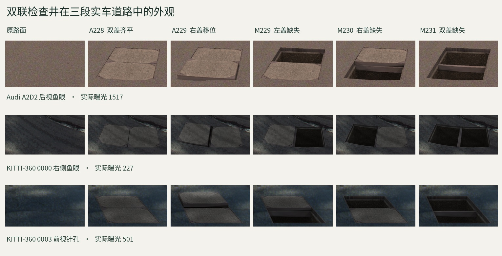
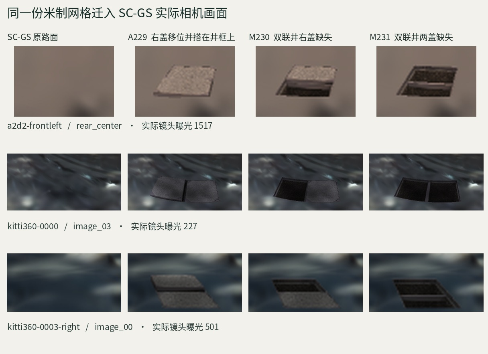

# 双联检查井重建与跨场景迁入

[下载五件米制网格与三段视频](https://github.com/Vexlc/road-hazard-reconstruction/releases/tag/twin-hatch-v1.0.0) · [Audi 左前驶入与车尾回看](https://github.com/Vexlc/road-hazard-reconstruction/releases/download/twin-hatch-v1.0.0/a2d2-frontleft.mp4) · [KITTI 城区](https://github.com/Vexlc/road-hazard-reconstruction/releases/download/twin-hatch-v1.0.0/kitti360-0000.mp4) · [KITTI 郊区](https://github.com/Vexlc/road-hazard-reconstruction/releases/download/twin-hatch-v1.0.0/kitti360-0003-right.mp4)

## 从扫描重建五件资产

原始素材为 ambientCG 对同一座双联检查井的摄影测量，保留了左右盖面各自的颜色、相对起伏、粗糙度、金属度以及中间接缝。从原始图幅量得两盖总宽 909 像素、纵向 464 像素。发布者没有给出实物尺寸，本配方采用总宽 1.30 m，按像素比例得到纵向约 0.664 m。两片各自闭合、可独立移除。中间承梁、井壁、0.84 m 井深、盖厚和异常姿态使用设计值。粗糙度和金属度写入 GLB 的材质贴图。相机回放使用照片颜色与可见天空的漫射照明。[原始扫描与 CC0 许可](https://ambientcg.com/view?id=ManholeCover007) · [配方与原始贴图](../gen2hole/examples/mixed-road/twin-hatch) · [建模代码](../gen2hole/recipes/series/twin_hatch.py)

| 编号 | 状态 | 在模型里可以检查的部件 |
|---|---|---|
| A228 | 两片齐平 | 从中缝向下可命中承梁，盖面保留两张不同的纹理区域 |
| A229 | 右片外移 48 mm | 右片底部搭在固定框边上，盖顶比齐平状态高约 53.5 mm |
| M229 | 左片缺失 | 左侧中心可见井底，右侧中心仍命中盖面 |
| M230 | 右片缺失 | 左侧中心保留盖面，右侧中心可见井底 |
| M231 | 两片缺失 | 中间承梁保留，左右开口均通向井底 |

下列命令均从仓库根目录执行。新机器先配置网格和计算两个 Python 环境。重建输入贴图已随固定标签提交。完整构建会同时输出 GLB、米制表面场、Gaussian PLY、材质标签和元数据。输出目录需为新目录。[环境配置](03-environment-and-relocation.md) · [全仓复现手册](16-reproduction-cookbook.md)

~~~bash
gh repo clone Vexlc/road-hazard-reconstruction -- --branch twin-hatch-v1.0.0 --depth 1
cd road-hazard-reconstruction
python3 scripts/configure-gen2hole.py
python3 gen2hole/gen2hole.py locate M230
py=work/envs/streetcrafter/bin/python
"$py" gen2hole/survey.py --survey gen2hole/examples/mixed-road/twin-hatch/survey.json --out runs/twin-hatch/twin
~~~

只需要在其他渲染器里使用网格时，直接解压模型包。每个编号的目录都有 `asset.glb`、`surface.npz`、`metadata.json`。GLB 为 glTF 的 Y 向上，地面场和放置接口使用本地 Z 向上，资产单位均为米。

~~~bash
kit=downloads/twin-hatch
gh release download twin-hatch-v1.0.0 -R Vexlc/road-hazard-reconstruction -p twin-hatch-meshes.zip -p SHA256SUMS -D "$kit"
(cd "$kit" && sha256sum --ignore-missing -c SHA256SUMS)
python3 -m zipfile -e "$kit/twin-hatch-meshes.zip" work/twin-hatch-meshes
(cd work/twin-hatch-meshes && sha256sum -c SHA256SUMS)
~~~

## 复现 PandaSet 原生检查点

恢复 034、109 道路、原始相机和工厂输入后执行下列循环。每件以原尺度单独写入一个场景。结果在 `runs/twin-hatch/twin/series/scenes/<道路>_<组号>/`，包括可重载的 `trained_model/iteration_7000.pth` 和原生渲染。半缺盖分别用探针检查保留盖面和暴露井口。[宿主准备](13-reproduce-and-transfer.md#迁移-p154-到-pandaset-034-并回放) · [原生迁入入口](../gen2hole/downstream/place.py)

~~~bash
set -e
for row in 'A228 034 228' 'A229 109 229' 'M229 034 229' 'M230 109 230' 'M231 034 231'; do
  read -r id site group <<< "$row"
  python3 gen2hole/downstream/place.py --bundle runs/twin-hatch/twin/series --assets "$id" --site "$site" --group "$group" --anchor-category pothole --front
done
~~~

## 回放三段实车道路

三段路各用原始标定、相机曝光、里程计和激光点。两段 KITTI 取前视针孔与右侧 MEI 鱼眼，Audi 取左前与车尾鱼眼。车身掩膜按具体序列提供。每段视频同时显示全幅、原路面和同机位的迁入局部。资产在车身遮挡后重新出现时，视频用曝光号标明两个可见片段的切换。[道路下载和标定](../streetcrafter/backends/README.md) · [回放代码](../scripts/render-mixed-road.py)

~~~bash
set -e
py=work/envs/streetcrafter/bin/python
for row in 'a2d2-frontleft 26 .7' 'kitti360-0000 26 2.25' 'kitti360-0003-right 24 .85'; do
  read -r site frame offset <<< "$row"
  SCGS_PYTHON="$PWD/$py" bash streetcrafter/backends/run.sh "$site" prepare
  OPENBLAS_NUM_THREADS=1 OMP_NUM_THREADS=2 "$py" scripts/render-mixed-road.py \
    --run runs/twin-hatch --scene "$site" --group "$frame" --offset "$offset" \
    --ids A228 A229 M229 M230 M231 --out "outputs/twin-hatch/$site" --video --export-packet M230
done
"$py" scripts/render-twin-hatch-plate.py
~~~

`--group` 为轨迹下标，`--offset` 为向相机右侧的米数。只有下载版网格时，将 `--run runs/twin-hatch` 改为 `--run work/twin-hatch-meshes`。每个场景保留 `driving.mp4`、`anchor.json` 与 `index.json`。每个机位的 `part.png` 和 `range.npy` 分别记录命中部件与米制径向距离。M230 还带独立回放的完整 `view.npz`。

## 把资产迁入自己的渲染器

1. 从宿主导出米制道路点、候选中心、行驶方向与重力反向。使用 `fit --asset` 对资产实际占地区域内的 6 × 4 个网格复核。程序会拒绝单边覆盖、路缘台阶或与候选面相差过大的地面，并记录通过位置的高度与法向修正。稀疏到无法判断时，需要更多道路采样或更换锚点。
2. 从实际宿主导出相机位姿、RGB、单位射线、前景掩膜和量程，字段见[通用数据包约定](17-mixed-road-transfer.md#换鱼眼换渲染器或换世界坐标)。镜头有效视场以标定射线和掩膜为准。镜头圆外若使用 NaN 或零向量表示无效射线，须在同一像素设置硬保护。可见区域的射线必须有限且已归一化。鱼眼跨过光轴侧面的射线、只露出一部分的物体均可参与求交。
3. 若引擎能识别前景物体，在 NPZ 中另存 `occluder_range`。它支持 H×W 或 S×H×W 米制径向距离，以 NaN 或正无穷表示未知。标记为前景的物体按与真实资产表面的距离判断遮挡，井内前景也适用。`host_range` 对可被挖除的原路面单独处理。默认路面径向容差 0.10 m，可通过 `--road-tolerance-m` 按测距精度调整。车身等硬遮挡仍由 `protected` 提供。

~~~bash
py=work/envs/streetcrafter/bin/python
asset=work/twin-hatch-meshes/M230
"$py" scripts/transfer-mesh-view.py fit work/road-points.npy work/anchor.json \
  --seed 12.4 5.3 0 --heading 1 0 0 --up 0 0 1 --radius 2.1 --asset "$asset"
"$py" scripts/transfer-mesh-view.py render "$asset" work/anchor.json work/view.npz outputs/my-scene/M230
~~~

上例中的坐标和点云需替换成自己的数据。在 KITTI 0003，车道内 0.85 m 候选由 24 个网格、547 个测点支持，地面中心下调 23.6 mm。1.55 m 候选的覆盖面与路面相差 65 mm，1.85 m 候选跨过路缘，网格高差的 P90−P10 为 118 mm，两者均被拒绝。阈值与资产尺度均以米定义，已有验证覆盖硬质铺装路面。湿面镜面反射、车辆动态投影和未观测地面仍取决于宿主提供的数据。[完整占地检查](../gen2hole/downstream/mesh_transfer.py) · [各候选位置的实际结果](../validation/twin-hatch-transfer.json)

## 独立 SC-GS 宿主与数值验收

三套 SC-GS 道路各使用独立训练 3,000 步的检查点。Audi 车尾和 KITTI 0000 右侧使用鱼眼。KITTI 0003 车道内落点在 SC-GS 收窄的右视画面里可见面积不足，该宿主使用实际前摄针孔。复用同一资产和世界锚点，将网格合成在 SC-GS 输出画面。PandaSet 的原生检查点写入见上文。[三个宿主的权重和图像指纹](../validation/twin-hatch-scgs.json)

~~~bash
set -e
py=work/envs/streetcrafter/bin/python
for site in a2d2-frontleft kitti360-0000 kitti360-0003-right; do
  bash streetcrafter/backends/run.sh "$site" sc-gs 3000
done
OPENBLAS_NUM_THREADS=1 "$py" scripts/check-scgs-mesh-transfer.py --runs runs/twin-hatch --views outputs/twin-hatch \
  --out outputs/twin-hatch/sc-gs --packet-id M230 --ids A229 M230 M231 --scenes a2d2-frontleft kitti360-0000 kitti360-0003-right
"$py" gen2hole/survey.py --survey gen2hole/examples/mixed-road/twin-hatch/survey.json --out work/twin-hatch/rebuild
OPENBLAS_NUM_THREADS=1 "$py" scripts/check-twin-hatch.py --second-bundle work/twin-hatch/rebuild/series --out runs/twin-hatch/validation.json
~~~

两次构建的 25 个文件哈希全部吻合。5 个原生场景独立重载后的最大 RGB 像素差为零。三段道路共检查 30 组迁入前后图片，6 个机位数据包均可复算出相同颜色、部件与距离。额外的合成广角边界对照中，56 个可见像素全部来自光轴后半球，其中 17 个位于图像最右一列，逐像素结果与不裁剪的全幅求交一致。已标记前景比资产近 15 mm 时完全遮挡，远 15 mm 时资产仍可见。[实测报告](../validation/twin-hatch-transfer.json)
