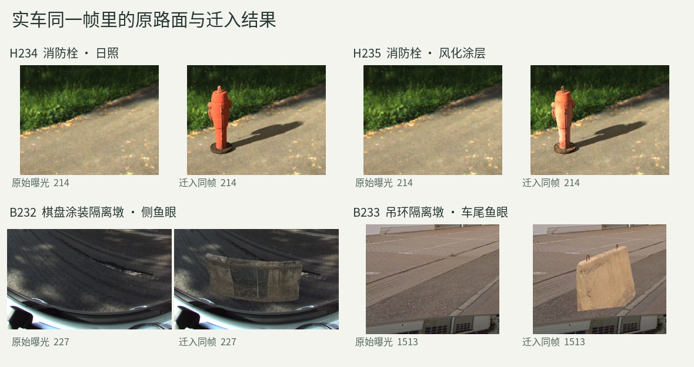

# 隔离墩、消防栓与跨场景迁入

[原生场景前视与车尾回看](https://github.com/Vexlc/road-hazard-reconstruction/releases/download/roadside-props-v1.0.0/joint-front-rear.mp4) · [Audi 左前与实车尾部鱼眼](https://github.com/Vexlc/road-hazard-reconstruction/releases/download/roadside-props-v1.0.0/audi.mp4) · [KITTI 消防栓实车视角](https://github.com/Vexlc/road-hazard-reconstruction/releases/download/roadside-props-v1.0.0/hydrant.mp4) · [KITTI 隔离墩实车视角](https://github.com/Vexlc/road-hazard-reconstruction/releases/download/roadside-props-v1.0.0/barrier.mp4)

从四个入口中选择需要的结果。

| 要得到的结果 | 所需输入 | 最短路径 |
|---|---|---|
| 在自己的三维编辑器打开资产 | 已发布的四件 GLB | 下载下文的模型包，打开编号目录内的 `asset.glb` |
| 从素材重建，并检查数值 | 18 个原始模型文件、CPU 环境 | 按下一节重建，将全部 16 个输出同发布模型逐文件比对 |
| 重建指定道路的两组 `joint.pt` | 固定 30,000 步宿主、四份模型、两个注册锚点、PyTorch | 运行原生构建步骤，仅回放需要 GPU、道路数据和联合渲染环境 |
| 接入新道路、鱼眼或其他渲染器 | 米制路面采样、同一世界坐标下的相机位姿、标定光线、深度与遮挡信息 | 使用文末的通用 `fit` 和 `render` |

## 从原始模型重建四件资产

输入为 Poly Haven 发布的三套 CC0 纹理模型。两种隔离墩来自不同模型，两个消防栓选自同一模型的两个材质版本。实现保留原三角面、UV、法线和材质图，展开节点变换，按底面射线的命中点恢复接地基准，并输出米制网格与表面采样。尺寸取自源文件。[两种隔离墩之一](https://polyhaven.com/a/concrete_road_barrier) · [带吊环隔离墩](https://polyhaven.com/a/concrete_road_barrier_02) · [消防栓](https://polyhaven.com/a/fire_hydrant) · [文件哈希、作者与节点配方](../gen2hole/examples/roadside-props/sources.json) · [重建代码](../gen2hole/roadside_props.py)

| 编号 | 外观 | 本地 X × Y × Z（米） | 三角面 |
|---|---|---|---:|
| B232 | 棋盘涂装混凝土隔离墩 | 1.545 × 0.639 × 0.831 | 60,928 |
| B233 | 裸露吊环混凝土隔离墩 | 1.565 × 0.442 × 1.112 | 23,822 |
| H234 | 红色消防栓，含盖帽和链条 | 0.275 × 0.318 × 0.799 | 43,158 |
| H235 | 相同几何，风化涂层 | 0.275 × 0.318 × 0.799 | 43,158 |

在 Linux 上从固定标签开始。下列下载仅涉及约 31 MB 的输入和模型。

~~~bash
gh repo clone Vexlc/road-hazard-reconstruction -- --branch roadside-props-v1.0.0 --depth 1
cd road-hazard-reconstruction
repo=Vexlc/road-hazard-reconstruction
tag=roadside-props-v1.0.0
kit=downloads/roadside-props
gh release download "$tag" -R "$repo" -p roadside-sources.zip -p roadside-models.zip -p SHA256SUMS -D "$kit"
(cd "$kit" && sha256sum --ignore-missing -c SHA256SUMS)
python3 -m zipfile -e "$kit/roadside-sources.zip" work/roadside-scans
python3 -m zipfile -e "$kit/roadside-models.zip" work/roadside-published
(cd work/roadside-scans && sha256sum -c SHA256SUMS)
(cd work/roadside-published && sha256sum -c SHA256SUMS)
python3 scripts/check-reproduction-index.py
python3 gen2hole/gen2hole.py locate B233
~~~

只做模型重建和通用光线回放时，可单建下面的 CPU 环境。已有项目环境可直接使用 `py=work/envs/streetcrafter/bin/python`。本次逐文件比对用 Python 3.9.23 和以下数值库版本。Ubuntu 如提示 OpenGL、OpenMP 动态库缺失，请按系统安装 `libgl1`、`libgomp1`。

~~~bash
python3.9 -m venv work/envs/roadside-cpu
py=work/envs/roadside-cpu/bin/python
"$py" -m pip install numpy==1.26.4 scipy==1.13.1 open3d==0.18.0 pillow==11.3.0 opencv-python==4.10.0.84
OPENBLAS_NUM_THREADS=1 OMP_NUM_THREADS=2 "$py" gen2hole/roadside_props.py --sources work/roadside-scans --out runs/roadside-props
"$py" scripts/check-roadside-props.py --assets-only --second work/roadside-published --out work/roadside-asset-check.json
~~~

另一种取数方式是在构建命令加 `--fetch`，从发布者逐个下载、检查字节数和 SHA-256，支持复用已验证的缓存。构建的目标目录需为新目录。每件资产包含以下文件。

| 文件 | 内容与单位 |
|---|---|
| `asset.glb` | glTF 的 Y 轴向上，单位米。含颜色、切线空间法线与 PBR 材质 |
| `surface.npz` | 本地 Z 轴向上。含顶面高度、与地面实际接触的区域，以及 96 个方向积分得到的天空遮挡率 |
| `samples.npz` | 面积加权的可重复 Sobol 表面采样。含米制位置、法线、基色、遮挡/粗糙度/金属度通道与平均点距 |
| `metadata.json` | 来源、许可、尺寸、接地误差、三角面数和三个资产文件的 SHA-256 |

## 迁入指定的 30,000 步原生场景

宿主为 `runs/streetgs-joint/kitti360-0000/30000/joint.pt`。一组放 H234 与 B232，另一组放 H235 与 B233。每组在同一段道路上放一个消防栓和一个隔离墩，分别用实测路肩与路侧锚点。发布已包含两个完整的新检查点，也可以按以下命令重建。首次安装使用项目计算环境和联合渲染环境。[环境安装](03-environment-and-relocation.md) · [联合渲染依赖和固定上游版本](../streetcrafter/joint/README.md#配置联合渲染环境) · [写入及重载实现](../streetcrafter/joint/roadside_pairs.py)

~~~bash
py=work/envs/streetcrafter/bin/python
host=runs/streetgs-joint/kitti360-0000/30000
basekit=downloads/reproduction-2026.11.25
gh release download reproduction-2026.11.25 -R Vexlc/road-hazard-reconstruction -p kitti360-0000-30000.pt -p SHA256SUMS --skip-existing -D "$basekit"
(cd "$basekit" && sha256sum --ignore-missing -c SHA256SUMS)
mkdir -p "$host"
if [ ! -e "$host/joint.pt" ]; then cp "$basekit/kitti360-0000-30000.pt" "$host/joint.pt"; fi
cmp "$basekit/kitti360-0000-30000.pt" "$host/joint.pt"
"$py" streetcrafter/joint/roadside_pairs.py build --views gen2hole/examples/roadside-props/anchors
~~~

在仅含版本源码的独立目录里，使用同一计算环境、从发布输入包和原始宿主重新构建，两份检查点均与发布文件逐字节相同。两个 `$host/roadside-props/<组号>/joint.pt` 都能独立重载。构建自检核对原背景 79,605 个高斯的位置、旋转、尺度和透明度，逐张量核对动态对象。程序追加采样得到的新高斯，并调整已测地面接收区域内的背景颜色。每次放置的源模型、锚点及检查点哈希保存在同目录 `placement.json`。以下命令生成原始道路、两组前后视和同帧对比视频。复用 `ROADSIDE_ANCHORS` 可切换为下一节从原图和点云重新拟合的锚点目录。

~~~bash
bash scripts/scene.sh joint kitti360-0000 prepare 30000
bash scripts/scene.sh joint kitti360-0000 render 30000
bash scripts/scene.sh joint kitti360-0000 roadside-props 30000
~~~

视频在 `outputs/roadside-props/joint-front-rear.mp4`。上排是原前视相机，下排是装在车后位置、向后俯视的虚拟相机，每排左侧为原场景、右侧为加入设施后的同一帧。原前视 48 帧与发布宿主基准的最大通道误差为 0。后视超出部分训练视角，会看到原宿主路面和车辆拉伸；同帧左列可区分宿主缺陷和迁入效果。若需直接取已构建的场景，下载 [H234 与 B232](https://github.com/Vexlc/road-hazard-reconstruction/releases/download/roadside-props-v1.0.0/H234-B232-joint.pt) 或 [H235 与 B233](https://github.com/Vexlc/road-hazard-reconstruction/releases/download/roadside-props-v1.0.0/H235-B233-joint.pt)，按组号放在以上路径，并用该版 `SHA256SUMS` 校验下载文件。

## 从实车原始曝光重新拟合与回放

先按 KITTI-360、Audi A2D2 的使用条件准备原始图像、里程计、标定和点云。仓库的数据准备器支持按片段取数。此处使用项目计算环境、ImageIO/FFmpeg 与 Noto Sans CJK 字体。KITTI 原图使用左前针孔和右侧 MEI 镜头，Audi 使用左前与车尾鱼眼。每个实车视频按资产分别回放，原生视频的每个检查点同时含两件资产。[数据准备入口](../streetcrafter/backends/README.md) · [曝光与放置代码](../scripts/render-mixed-road.py)

~~~bash
py=work/envs/streetcrafter/bin/python
for site in kitti360-0000 a2d2-frontleft; do
  SCGS_PYTHON="$PWD/$py" bash streetcrafter/backends/run.sh "$site" prepare
done
out=outputs/roadside-props
"$py" scripts/fit-roadside-light.py --out work/roadside-light.json
"$py" scripts/render-mixed-road.py --run runs/roadside-props --scene kitti360-0000 --group 12 --offset 4 --support-radius 1.15 --seed-lift .12 --lighting work/roadside-light.json --ids H234 H235 --out "$out/hydrant" --export-packet H234 --video
"$py" scripts/render-mixed-road.py --run runs/roadside-props --scene kitti360-0000 --group 26 --offset 1.95 --ids B232 B233 --out "$out/barrier" --export-packet B232 --video
"$py" scripts/render-mixed-road.py --run runs/roadside-props --scene a2d2-frontleft --group 26 --offset 2.10 --ids B232 B233 --out "$out/audi" --export-packet B233 --video
~~~

每段路在输出目录保存 `anchor.json`、`index.json`、`driving.mp4` 及逐件、逐机位的最佳帧。消防栓的太阳方向用三帧里同一路标的顶点、底部与影尖三角化，最大重投影误差 3.11 像素。根据附近实拍草地明暗估计直射占比 0.871。隔离墩使用实测路面曝光和漫射接触阴影。公共材质图随 GLB 保留，此处的光照是漫射近似。KITTI 前视按同步左右图估计并交叉检查视差；其他实车机位使用已注册的近处非地面激光回波与车身掩膜，稀疏激光可能漏掉细前景。[三帧标注](../gen2hole/examples/roadside-props/kitti-sun-observations.json) · [估光代码](../scripts/fit-roadside-light.py)

| 实验位置 | 采样轨迹与资产外包矩形的最小净距 |
|---|---:|
| KITTI 消防栓 | 2.702 m |
| KITTI 隔离墩 | 0.318 m |
| Audi 隔离墩 | 0.416 m |

净距按车体中心前移自标定坐标原点 1.00 m、车长 5.10 m、宽 2.06 m 的矩形估算，每隔至多 7.5 cm 采样，设定保留 12 cm。此处车体外形及中心偏移是实验假设。换车型应使用该车的实测中心轨迹和外形，结果仅覆盖已采样的行程。[轨迹与立体匹配实现](../gen2hole/downstream/prop_registration.py)

## 换一个鱼眼或宿主渲染器

从宿主导出同一曝光的 RGB、米制相机位姿和每个像素的单位光线。接入只依赖光线与量程，可以用于照片、网格渲染或神经渲染底图。相机局部轴为右、下、前；`camera_to_world` 为 4 × 4 刚体变换。新宿主的 `fit` 需要自己的道路采样和候选位置。下例数值仅用于说明参数格式。车体中心轨迹是 N × 3 的世界坐标，单位米。若省略 `--trajectory`，输出锚点只记录地面支持。照明 JSON 可包含 `road_srgb`、世界坐标的 `sun_world` 和 `direct_fraction`；缺少日照观测时默认按漫射光处理，缺少曝光参考时以 sRGB 100 近似。

~~~bash
py=work/envs/streetcrafter/bin/python
"$py" scripts/transfer-mesh-view.py fit work/new-road/points.npy work/new-road/anchor.json --seed 12 5 0 --heading 1 0 0 --up 0 0 1 --radius 2.1 --asset runs/roadside-props/B232 --trajectory work/new-road/vehicle-centers.npy --vehicle-width 2.06 --vehicle-length 5.10 --clearance .12
"$py" scripts/transfer-mesh-view.py render runs/roadside-props/B232 work/new-road/anchor.json work/new-road/view.npz work/new-road/result
~~~

`view.npz` 的必需数组是 `rgb`（H × W × 3 uint8）、`camera_to_world`、`host_range`（H × W，沿光线的米，未知用正无穷）和 `protected`（车身、无效像素等的布尔掩膜）。镜头可以提供 `rays_camera`（H × W × 3 或 S × H × W × 3），也可以传入 `--calibration` 的针孔或 OpenCV 鱼眼标定。自定义镜头直接提供标定射线。正前方深度图需先换为径向量程。可选 `occluder_range` 标出有证据的前景，`receiver_mask` 限定阴影的地面接收区域。程序默认按测量到的附近地面置信度投影阴影，前方更近的宿主物体能遮挡资产或阴影。

输出有 `after.png`、`part.png`、`range.npy` 和 `shadow.npy`。仅有阴影的像素部件为 0、资产量程为 NaN，原道路可保留自己的几何距离。阴影数值代表线性光照损失比例。接地和清空道路使用不同的掩膜，立体设施只接地。可用真实导出的数据包核对适配器。

~~~bash
v=outputs/roadside-props/hydrant/H234/image_03
"$py" scripts/transfer-mesh-view.py render runs/roadside-props/H234 outputs/roadside-props/hydrant/anchor.json "$v/view.npz" work/roadside-portable
for f in after.png part.png range.npy shadow.npy; do cmp "$v/$f" "work/roadside-portable/$f" || exit 1; done
~~~

## 在独立 SC-GS 底图和原生检查点上验收

先在对应环境生成两段道路的 3,000 步 SC-GS 图像，再用上面的实车数据包检查。此路线使用 SC-GS 的传感器输出，将网格投到每条相机光线上；上一节的原生联合场景路线则直接修改检查点。脚本在 SC-GS 自己的鱼眼像素网格上执行第二次求交，并记录宿主点云、形变权重和帧哈希。[SC-GS 环境](../streetcrafter/backends/README.md) · [复核实现](../scripts/check-scgs-mesh-transfer.py)

~~~bash
for site in kitti360-0000 a2d2-frontleft; do
  bash streetcrafter/backends/run.sh "$site" sc-gs 3000
done
py=work/envs/streetcrafter/bin/python
out=outputs/roadside-props
"$py" scripts/check-scgs-mesh-transfer.py --runs runs/roadside-props --view-dir "$out/hydrant" --out "$out/scgs-hydrant" --packet-id H234 --ids H234 H235 --scenes kitti360-0000
"$py" scripts/check-scgs-mesh-transfer.py --runs runs/roadside-props --view-dir "$out/audi" --out "$out/scgs-barrier" --packet-id B233 --ids B232 B233 --scenes a2d2-frontleft
"$py" scripts/review-roadside-props.py
"$py" scripts/check-roadside-props.py --second work/roadside-published --out work/roadside-transfer-check.json
~~~

在本次固定材料和环境下，四件资产的 16 个文件重新构建后逐字节一致。六份实车视图包的 RGB、部件、资产量程和阴影逐像素一致。独立 SC-GS 鱼眼原尺寸下，两种消防栓各命中 411 像素，Audi 车尾的两种隔离墩分别命中 2,530、3,282 像素。自动检查也覆盖关闭地面接收区、设置近处前景和车辆轨迹穿过物体的情况。原生两组各重载 48 帧前视和 48 帧后视。跨机器重新训练底图可能改变 RGB，复用发布宿主可隔离这项差异。[实际验收数据](../validation/roadside-props-transfer.json) · [验收脚本](../scripts/check-roadside-props.py) · [全仓复现手册](16-reproduction-cookbook.md)
