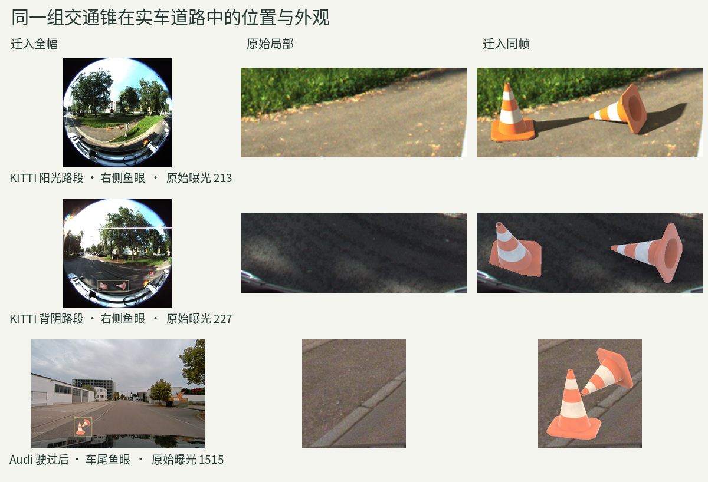
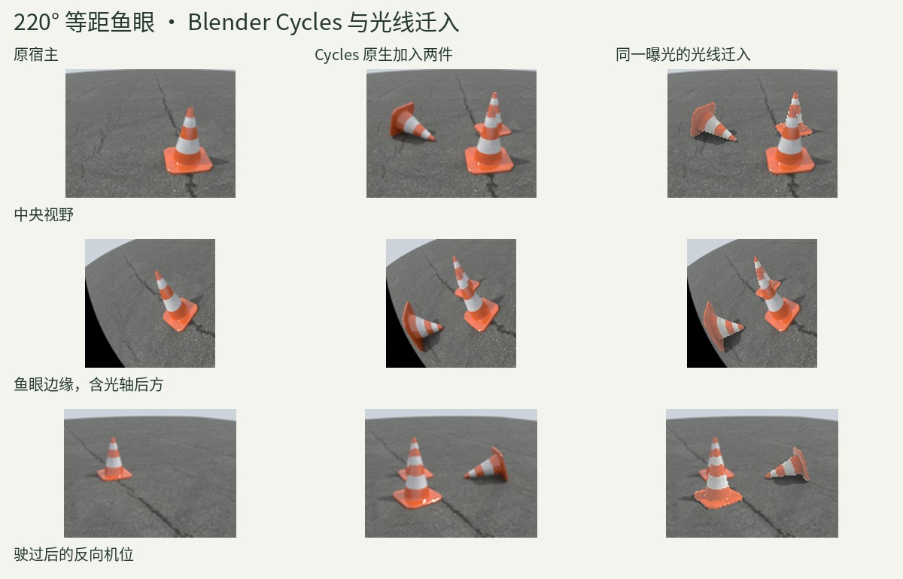

# 成对交通锥、车尾回看与 220° 鱼眼迁入

[联合场景前视和虚拟后视视频](https://github.com/Vexlc/road-hazard-reconstruction/releases/download/traffic-cones-v1.0.0/joint-front-rear.mp4) · [Audi 实车前后鱼眼视频](https://github.com/Vexlc/road-hazard-reconstruction/releases/download/traffic-cones-v1.0.0/audi-front-rear.mp4) · [KITTI 阳光路段](https://github.com/Vexlc/road-hazard-reconstruction/releases/download/traffic-cones-v1.0.0/kitti-sun.mp4) · [KITTI 背阴路段](https://github.com/Vexlc/road-hazard-reconstruction/releases/download/traffic-cones-v1.0.0/kitti-shade.mp4)

## 从原始模型重建并成对放置

C236 是直立交通锥，C237 是它的侧倒状态。原始带纹理模型由 hinndia 发布，Khronos 的 glTF 示例提供了带反光条的材质版本。整锥约高 0.519 m，方底边长约 0.420 m。仓库保留完整上游示例，由重建器选取其中一个交通锥。绝对尺寸沿用发布模型；倒地姿态由几何估算。原图、网格、反射纹理和校验值已随固定标签提交。[模型来源、许可和修改说明](../gen2hole/examples/traffic-cones/ATTRIBUTION.md) · [输入哈希](../gen2hole/examples/traffic-cones/source.json)

重建器在凸包上寻找能支撑侧倒锥体的接触面，以均匀薄壳估算重心。最终锥轴与竖直方向夹角为 110.82°，底座边缘与靠近锥尖的部位同时接地，估计重心的投影位于支撑多边形内约 9.4 cm。重建器按每个顶点的可见天空比例处理空腔阴影，并将原模型的反射材质保留在 GLB 中。白天的相机回放用介质反射近似天空反光与阳光高光；夜间车灯的逆反射效果尚未实测。[姿态求解](../gen2hole/traffic_cones.py) · [表面与光照](../gen2hole/downstream/prop_lighting.py)

以下命令从仓库根目录运行。CPU 环境可使用 Python 3.9.23、NumPy 1.26.4、SciPy 1.13.1、Open3D 0.18.0、Pillow 11.3.0、OpenCV 4.10.0.84。环境已安装时可将 `py` 指向项目的 `work/envs/streetcrafter/bin/python`。[CPU 环境配置](19-roadside-props.md#从原始模型重建四件资产)

~~~bash
gh repo clone Vexlc/road-hazard-reconstruction -- --branch traffic-cones-v1.0.0 --depth 1
cd road-hazard-reconstruction
python3 gen2hole/gen2hole.py locate C237
py=work/envs/roadside-cpu/bin/python
src=gen2hole/examples/traffic-cones
"$py" gen2hole/traffic_cones.py --out runs/traffic-cones
"$py" gen2hole/roadside_layout.py runs/traffic-cones "$src/layout.json" runs/traffic-cones/C236-C237
"$py" scripts/check-traffic-cones.py --assets-only --out work/traffic-cone-assets.json
~~~

两个单件和布局各自含 `asset.glb`、`surface.npz`、`samples.npz` 和 `metadata.json`。布局名 C236-C237 代表这两件同时出现。编辑 `layout.json` 可以替换资产、平移和转向。每个实例需要唯一的 `id`，`xy_m` 为局部地面坐标，`heading_deg` 绕局部 Z 轴转动。组合器核查资产指纹和外包轮廓的重叠，对同一局部支撑面上的整组几何重新计算投影、相互遮挡和天空可见性。跨台阶、不同坡面或相距很远的物体应分别拟合锚点。[布局参数](../gen2hole/examples/traffic-cones/layout.json) · [组合代码](../gen2hole/roadside_layout.py)

## 用现成的非高斯相机包复现

发布包里有三个 Cycles 相机视图、拟合好的锚点和原生物体编号、距离、RGB 参考图。在 CPU 上可从下载直接运行，省去安装 Blender 和下载车载数据。只想看模型时解压模型包即可。

~~~bash
kit=downloads/traffic-cones
gh release download traffic-cones-v1.0.0 -R Vexlc/road-hazard-reconstruction -p paired-models.zip -p cycles-packets.zip -p SHA256SUMS -D "$kit"
(cd "$kit" && sha256sum --ignore-missing -c SHA256SUMS)
python3 -m zipfile -e "$kit/paired-models.zip" work/traffic-models
python3 -m zipfile -e "$kit/cycles-packets.zip" work/traffic-cameras
(cd work/traffic-models && sha256sum -c SHA256SUMS)
(cd work/traffic-cameras && sha256sum -c SHA256SUMS)
py=work/envs/roadside-cpu/bin/python
"$py" scripts/transfer-mesh-view.py render work/traffic-models/C236-C237 work/traffic-cameras/anchor.json work/traffic-cameras/left-edge.npz work/traffic-edge
"$py" scripts/transfer-mesh-view.py road-points work/traffic-road.npy work/traffic-cameras/center.npz work/traffic-cameras/left-edge.npz
~~~

如已按上一节从原始模型重建，运行 `"$py" scripts/check-traffic-cones.py --assets-only --second work/traffic-models --out work/traffic-check.json` 可将 12 个本地重建文件与发布包逐个核对 SHA-256。

第一条回放输出 `after.png`、`part.png`、`range.npy` 和 `shadow.npy`。第二条将已标注且有深度的路面像素反投影为米制世界点云。接入其他渲染器时，用它自己的 `camera_to_world`、单位相机光线和深度包替换示例，再将点云交给 `fit --asset ...`。相机轴是右、下、前。每个包使用一种深度约定。

| 字段 | 含义 |
|---|---|
| `host_range` | 相机原点沿单位光线到表面的正距离，米 |
| `host_z` | 光学坐标中的**有符号** Z，米。光轴后方为负；接近 90° 时径向距离更可靠。GPU 非线性深度缓冲需由宿主先解码 |
| `receiver_mask` | 注册到相同像素或子像素的布尔路面标签；点云仅取有效、有深度、可见的路面 |
| `protected`、`occluder_range` | 车身或无效像素掩膜，以及可选的前景径向距离 |
| `rgb`、`rays_camera`、`camera_to_world` | RGB 为 uint8，光线为 H×W×3 或 S×H×W×3，位姿为右手米制刚体矩阵 |

深度未知用正无穷表示。每个子像素可提供独立深度，单张 H×W 深度图也可供所有子像素共用。位于前方和后方的物体共用沿光线的米制距离排序。[数据包实现](../gen2hole/downstream/host_depth.py) · [通用拟合与迁入入口](../scripts/transfer-mesh-view.py)

## 在 Blender Cycles 中独立复核

此控制场景用一张真实沥青材质、一件已存在的交通锥和两件新增交通锥。地面旋转并平移到新的世界坐标。Cycles 先渲染宿主，再原生加入两件网格，分别导出 220° 等距鱼眼 RGB、物体编号和径向距离。迁入程序只从前两个宿主视角的地面深度拟合锚点，第三个机位移到组合后方验收。用下面的命令可从零生成控制场景。[Blender 官方鱼眼相机说明](https://docs.blender.org/manual/en/4.2/render/cycles/object_settings/cameras.html) · [Cycles 场景代码](../scripts/render-cone-cycles.py)

~~~bash
# 首次在 Linux 上安装独立渲染环境
python3.11 -m venv work/envs/assets
work/envs/assets/bin/python -m pip install bpy==4.2.0 numpy==1.26.4 scipy==1.17.1
work/envs/assets/bin/python scripts/render-cone-cycles.py
work/envs/roadside-cpu/bin/python scripts/check-cone-cycles.py
~~~

| 机位 | 两件资产轮廓 IoU | 共同命中像素径向误差 P95 | 遮挡实测 |
|---|---:|---:|---|
| 中央视角 | 1.0000 | 0.151 mm | 已存在的前景遮住 267 个迁入像素 |
| 220° 鱼眼边缘 | 0.9994 | 0.139 mm | 1,184 个命中像素位于光轴后方，前景遮住 354 个像素 |
| 驶过后反向观察 | 1.0000 | 0.115 mm | 新增物体遮住原宿主第三个锥的 192 个像素 |

以上毫米误差衡量已知控制几何与光线的数值一致性。实车素材另受标定、路面采样和曝光误差影响。在保持相同内壁遮光和场景照明的情况下，加入介质反光后，三个视角的物体内部 RGB 平均绝对误差分别从 27.58、26.83、31.25 降至 18.92、19.86、15.86（8 位色阶）。该数值比较保留了不同渲染器的外观差异。[像素与距离验收记录](../validation/traffic-cones.json)

## 回放三处实车放置

先按数据源使用条件准备 KITTI-360 0000 和 Audi A2D2 的原始标定、图像、点云及里程计。命令里复用相机物理尺寸和上一批记录的太阳方向标注。Audi 原有的车尾保护区留有较宽余量。本例用 16 帧校正固定的车尾轮廓，向路面留 6 像素保护带；另外 16 帧独立拟合后，轮廓相差至多 1 像素。第 1515 帧恢复了原粗掩膜遮住的 2,455 个交通锥像素。换相机要重新测量该机位的轮廓。[实车数据准备](19-roadside-props.md#从实车原始曝光重新拟合与回放) · [车身轮廓拟合](../scripts/fit-ego-edge.py)

~~~bash
py=work/envs/streetcrafter/bin/python
src=gen2hole/examples/traffic-cones
out=outputs/traffic-cones
for site in kitti360-0000 a2d2-frontleft; do
  SCGS_PYTHON="$PWD/$py" bash streetcrafter/backends/run.sh "$site" prepare
done
"$py" scripts/fit-roadside-light.py --out work/traffic-sun.json
"$py" scripts/fit-ego-edge.py work/data/a2d2-frontleft/rear_center work/traffic-audi-mask.json --seed gen2hole/examples/mixed-road/ego-masks.json --scene a2d2-frontleft --sensor rear_center --guard 6 --smooth-arc
common=(--run runs/traffic-cones --ids C236-C237 --export-packet C236-C237 --video)
"$py" scripts/render-mixed-road.py "${common[@]}" --scene kitti360-0000 --group 12 --offset 4 --support-radius 1.15 --seed-lift .12 --lighting work/traffic-sun.json --out "$out/sun"
"$py" scripts/render-mixed-road.py "${common[@]}" --scene kitti360-0000 --group 26 --offset 1.77 --out "$out/urban"
"$py" scripts/render-mixed-road.py "${common[@]}" --scene a2d2-frontleft --group 26 --offset 1.92 --ego-mask work/traffic-audi-mask.json --out "$out/audi"
~~~

KITTI 两个输出含前视针孔与右侧鱼眼，Audi 含左前与车尾鱼眼。按长 5.10 m、宽 2.06 m 的车体矩形及本例中心轨迹估算，三处最小净距分别为 2.496 m、0.144 m、0.281 m。切换车辆时请替换实测车体中心轨迹及尺寸。接地检查覆盖整组的支撑范围。

## 写入指定的 joint.pt 并从车尾回看

先恢复原始 30,000 步宿主以及联合渲染环境，并生成 48 帧基准前视。放置只需单件模型、已烘焙的双件布局与固定锚点。准备和回放按下列命令进行。[取回原始宿主与环境](19-roadside-props.md#迁入指定的-30000-步原生场景) · [直接下载成对检查点](https://github.com/Vexlc/road-hazard-reconstruction/releases/download/traffic-cones-v1.0.0/C236-C237-joint.pt)

~~~bash
export OPENBLAS_NUM_THREADS=1 OMP_NUM_THREADS=2
py=work/envs/streetcrafter/bin/python
root=runs/streetgs-joint/kitti360-0000/30000/traffic-cones
out=outputs/traffic-cones
opts=(--assembly C236-C237 --site sun --assets runs/traffic-cones --views gen2hole/examples/traffic-cones/anchors --out "$root" --renders "$out/joint")
"$py" streetcrafter/joint/roadside_pairs.py build "${opts[@]}"
bash scripts/scene.sh joint kitti360-0000 prepare 30000
bash scripts/scene.sh joint kitti360-0000 render 30000
gut="${OFFICIAL_ROOT:-$(cd ../.. && pwd)/01_official}/3dgrut"
PYTHONPATH="$gut" PATH="$gut/.venv/bin:$PATH" CUDA_HOME="${CUDA_HOME:-/usr/local/cuda}" "$gut/.venv/bin/python" streetcrafter/joint/roadside_pairs.py render "${opts[@]}"
"$py" scripts/review-roadside-props.py --views "$out" --pairs C236-C237 --joint-only
"$py" scripts/check-traffic-cones.py --out work/traffic-check.json
~~~

场景在 `$root/C236-C237/joint.pt`，视频在 `$out/joint-front-rear.mp4`。两件新增设施在同一个原生检查点里。上排为前视，下排为虚拟后视，每排左侧保留原始宿主作对照。虚拟后方有原宿主的近处背景拉伸；需要看实拍后视时使用页面开头的 Audi 视频。全套复核的输入和产物指纹见[验收记录](../validation/traffic-cones.json)。
