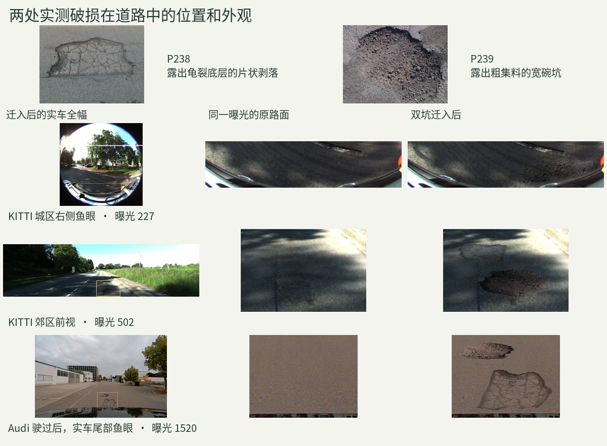

# 两处实测路面破损的成对迁入

[指定 joint.pt 的前视和虚拟后视视频](https://github.com/Vexlc/road-hazard-reconstruction/releases/download/measured-pavement-v1.0.0/joint-front-rear.mp4) · [Audi 实车前后鱼眼](https://github.com/Vexlc/road-hazard-reconstruction/releases/download/measured-pavement-v1.0.0/audi-front-rear.mp4) · [KITTI 城区](https://github.com/Vexlc/road-hazard-reconstruction/releases/download/measured-pavement-v1.0.0/kitti-urban.mp4) · [KITTI 郊区](https://github.com/Vexlc/road-hazard-reconstruction/releases/download/measured-pavement-v1.0.0/kitti-suburb.mp4)

| 资产 | 原始采集 | 坑口长宽 | 坑内凹深 P95 | 留出深度 P95 误差 |
|---|---|---:|---:|---:|
| P238 露出龟裂底层的片状剥落 | PothRGBD 20250305_021453 | 1.76 × 0.99 m | 6.77 cm | 2.26 mm |
| P239 露出粗集料的宽碗坑 | PothRGBD 20250305_124804 | 1.37 × 1.25 m | 7.24 cm | 1.37 mm |

两处破损来自不同的道路曝光。尺寸由数据集的标称内参和毫米深度换算，迁入时使用原始尺度。拟合前扣留交错的 4 × 4 深度块，分别包含 10,879 和 19,240 个有效坑内像素。上表误差衡量同一曝光下的几何插值；另外还用不同相机与已知三维表面对迁入做了独立复核。[原始 PothRGBD 数据](https://github.com/ymyurdakul/PData/tree/7596dc1c745e68b90403d7e82f89e7492fa95edc) · [逐件输入指纹与验收结果](../validation/measured-pavement.json)

## 从原始 RGB-D 重建两处破损

先克隆固定标签，需要有该私有仓库的读取权限。以下 Bash 命令从克隆根目录执行。[完整资产与计算环境](03-environment-and-relocation.md) · [按编号定位全部系列](16-reproduction-cookbook.md)

~~~bash
gh repo clone Vexlc/road-hazard-reconstruction -- --branch measured-pavement-v1.0.0 --depth 1
cd road-hazard-reconstruction
python3 scripts/check-reproduction-index.py
python3 gen2hole/gen2hole.py locate P238
python3 scripts/packages.py fetch --group inputs-rgbd
python3 scripts/packages.py check --group inputs-rgbd
python3 scripts/packages.py restore --group inputs-rgbd
python3 scripts/configure-gen2hole.py
py=work/envs/streetcrafter/bin/python
src=gen2hole/examples/measured-pavement
export OPENBLAS_NUM_THREADS=1 OMP_NUM_THREADS=2
for id in P238 P239; do
  "$py" gen2hole/multiview_pits.py --survey "$src/$id.json" --out "runs/measured-pavement/$id" || exit 1
done
"$py" scripts/check-measured-pavement.py --assets-only --out work/measured-pits.json
~~~

每件结果位于 `runs/measured-pavement/<ID>/series/assets/pothole/<ID>/`。GLB 提供贴图网格，PLY 与 `splat_material.npz` 提供原生高斯和材质分组，`surface.npz` 保存米制高度、破损轮廓与测深覆盖。重建命令需要一个新的输出目录。采集和原始数据使用条件沿用 PothRGBD 发布方说明。[重建代码](../gen2hole/multiview_pits.py) · [配方和布局](../gen2hole/examples/measured-pavement)

## 在 CPU 上先跑通一次迁入

用下面的下载包即可在普通 Linux CPU 上回放独立渲染器的曝光。运行环境可用 Python 3.9、NumPy 1.26.4、SciPy 1.13.1、Open3D 0.18.0、Pillow 11.3.0 和 OpenCV 4.10.0.84。[CPU 环境安装](19-roadside-props.md#从原始模型重建四件资产)

~~~bash
tag=measured-pavement-v1.0.0
kit=downloads/measured-pavement
gh release download "$tag" -R Vexlc/road-hazard-reconstruction -p P238.zip -p P239.zip -p crown-cameras.zip -p SHA256SUMS -D "$kit"
(cd "$kit" && sha256sum --ignore-missing -c SHA256SUMS)
for id in P238 P239; do
  python3 -m zipfile -e "$kit/$id.zip" work/measured-models
  (cd "work/measured-models/$id" && sha256sum -c SHA256SUMS) || exit 1
done
python3 -m zipfile -e "$kit/crown-cameras.zip" work/crown
(cd work/crown && sha256sum -c SHA256SUMS)
py=work/envs/roadside-cpu/bin/python
src=gen2hole/examples/measured-pavement
"$py" scripts/transfer-mesh-view.py render "$src/crown-layout.json" work/crown/anchor.json work/crown/edge.npz work/crown-edge --asset-root work/measured-models
~~~

结果在 `work/crown-edge`。打开 `after.png` 看迁入外观，`instance.png` 的 1 和 2 依次对应布局文件的两个实例，`part.png` 给出命中部件，`range.npy` 为沿实际相机光线的米制距离。每个子像素独立取最近交点，再合成像素颜色。只想验证原始输入重建时，在上一节的核验命令上加 `--reference-models work/measured-models`，可与发布包的十个资产文件逐字节比对。在独立源码目录中已从两次采集重建了这十个文件，从相机包重拟合了锚点并重放了三个鱼眼视角。各视角的颜色、实例、部件和距离，以及从模型包重建的原生双坑检查点，均与发布结果逐字节一致。

## 接入自己的鱼眼或其他渲染器

准备相同坐标系下的米制相机位姿、单位光线、原始颜色和宿主深度。用 `receiver_mask` 指明能被开口替换的路面，用 `occluder_range` 或 `protected` 保留前景。鱼眼超过 180° 时可传径向距离，或与光线 Z 分量同号的轴向深度。对相机光学平面附近的射线使用径向距离。[相机数据包各字段](20-traffic-cones.md#用现成的非高斯相机包复现)

下面从包内前两个宿主视角取回路面，重新计算两处支撑面，再渲染未参与拟合的反向机位。示例里的 `frame.json` 给出本控制场景的布局原点近似值、米制世界前向和上向。接入自己的场景时要替换这三项。布局里的 `xy_m` 是相对于拟合原点沿前向和左向的米数，`heading_deg` 为该坑沿局部法线的转角。

~~~bash
py=work/envs/roadside-cpu/bin/python
src=gen2hole/examples/measured-pavement
"$py" scripts/transfer-mesh-view.py road-points work/crown-road.npy work/crown/center.npz work/crown/edge.npz --stride 2
read -r -a frame < <(python3 -c 'import json; d=json.load(open("work/crown/frame.json")); print(*d["seed"],*d["heading"],*d["up"])')
"$py" scripts/transfer-mesh-view.py fit work/crown-road.npy work/crown-refit.json --seed "${frame[@]:0:3}" --heading "${frame[@]:3:3}" --up "${frame[@]:6:3}" --radius .85 --asset "$src/crown-layout.json" --asset-root work/measured-models
"$py" scripts/transfer-mesh-view.py render "$src/crown-layout.json" work/crown-refit.json work/crown/rear.npz work/crown-rear --asset-root work/measured-models
~~~

每处开口独立核对坑沿周围的道路采样和坡面，并保存自己的世界中心、局部坐标轴、支撑格数及残差。当前实现拒绝支撑过于稀疏、跨离散台阶，以及两处开口凸包相交的放置。对于包含完整相邻沥青的连续实测网格，用坑床与坑沿的第一个真实交点判断可见性；对于缺盖井，保留井口截面和井内深度的判断。原始光线与三角形求交也决定纹理在每个像素内覆盖的区域，远处的粗粒沥青和斜视裂纹会随镜头分辨率过滤。[多处开口的放置和遮挡](../gen2hole/downstream/pavement_layout.py) · [纹理采样](../gen2hole/downstream/pavement_texture.py)

## 重跑三段实车道路与车尾回看

先按数据使用条件准备 KITTI-360 两段与 Audi A2D2 的同步相机、点云、里程计及标定。放置的两件资产始终共用同一世界时间线。KITTI 使用前视和侧向鱼眼，Audi 使用左前和实际尾部鱼眼。[道路准备说明](19-roadside-props.md#从实车原始曝光重新拟合与回放)

~~~bash
py=work/envs/streetcrafter/bin/python
src=gen2hole/examples/measured-pavement
out=outputs/measured-pavement
export OPENBLAS_NUM_THREADS=1 OMP_NUM_THREADS=2
for site in kitti360-0000 kitti360-0003-right a2d2-frontleft; do
  SCGS_PYTHON="$PWD/$py" bash streetcrafter/backends/run.sh "$site" prepare || exit 1
done
opts=(--run runs/measured-pavement --layout "$src/layout.json" --group 26 --export-packet P238-P239 --video)
"$py" scripts/render-mixed-road.py "${opts[@]}" --scene kitti360-0000 --offset 1.4 --out "$out/kitti"
"$py" scripts/render-mixed-road.py "${opts[@]}" --scene kitti360-0003-right --offset .45 --out "$out/suburb"
"$py" scripts/render-mixed-road.py "${opts[@]}" --scene a2d2-frontleft --offset -.5 --ego-mask gen2hole/examples/traffic-cones/audi-body.json --out "$out/audi"
"$py" scripts/review-measured-pavement.py
"$py" scripts/check-pavement-texture.py --out "$out/texture.json"
~~~

每段的 `driving.mp4` 含全幅和迁入前后局部，`index.json` 列出两个坑同时可见的原始曝光。`anchor.json` 可供其他共用同一米制世界坐标的相机直接回放。实拍遮挡受激光点的密度、实际车身掩膜和里程计误差影响。上述位置和支撑面只适用于各自的路段。

## 写入原生联合检查点

准备指定的 30,000 步原始 KITTI 检查点、相机轨迹和基准前视帧。克隆内提供已经实测登记的两个锚点，可直接提取发布模型并构建。新场景需重新拟合锚点。[原始宿主下载与渲染环境](19-roadside-props.md#迁入指定的-30000-步原生场景) · [直接下载双坑 joint.pt](https://github.com/Vexlc/road-hazard-reconstruction/releases/download/measured-pavement-v1.0.0/P238-P239-joint.pt)

~~~bash
py=work/envs/streetcrafter/bin/python
src=gen2hole/examples/measured-pavement
root=runs/streetgs-joint/kitti360-0000/30000/measured-pavement
out=outputs/measured-pavement
export OPENBLAS_NUM_THREADS=1 OMP_NUM_THREADS=2
bash scripts/scene.sh joint kitti360-0000 prepare 30000
bash scripts/scene.sh joint kitti360-0000 render 30000
"$py" streetcrafter/joint/pavement_pair.py "$src/layout.json" work/measured-models "$src/anchors/kitti.json" "$root"
gut="${OFFICIAL_ROOT:-$(cd ../.. && pwd)/01_official}/3dgrut"
native=(--assembly P238-P239 --site kitti --out "$root" --renders "$out/joint")
CUDA_HOME="${CUDA_HOME:-/usr/local/cuda}" PYTHONPATH="$gut" PATH="$gut/.venv/bin:$PATH" "$gut/.venv/bin/python" streetcrafter/joint/roadside_pairs.py render "${native[@]}"
"$py" scripts/review-roadside-props.py --views "$out" --pairs P238-P239 --joint-only
"$py" scripts/check-pavement-native.py --out "$out/native-comparison.json"
~~~

原生输出在 `$root/P238-P239/joint.pt`，视频在 `$out/joint-front-rear.mp4`。两处坑沿相距约 0.67 m。对于延伸出坑沿的路面高斯，沿主轴分割并保留开口外的子高斯，再填入实测坑床。在同一检查点上与整颗删除相比，坑口投影凸包外另留 10 像素缓冲，前视可比较的 23 帧中，缓冲外变动超过 8 个色阶的像素累计由 17,266 降到 7,070。虚拟后视的 15 帧由 1,325,947 降到 479,808。原宿主在虚拟车尾附近有背景拉伸，坑外仍能看到部分编辑痕迹。真实尾部镜头见 Audi 视频。[原生双坑迁入](../streetcrafter/joint/pavement_pair.py) · [高斯分割与光密度](../streetcrafter/joint/pavement_splats.py)

要复核整颗删除的对照，向同一建场命令加 `--ground-method whole` 并换用独立的输出目录。按上面的渲染命令将其回放到另一个 `--renders` 目录，再运行 `scripts/check-pavement-native.py --whole <该回放目录> --out outputs/measured-pavement/native-comparison.json`。

## 独立复核冠形路面

Blender Cycles 在道路两侧分别切出真实网格区域。两处支撑面的法线相差 8.46°，宿主还含一段独立的凸起遮挡物。渲染器分别输出原始路面、放入网格后的实体编号和径向深度。迁入端只用前两台相机的原始路面拟合，在第三台相机反向检查两个实测坑。三视角、两实例的轮廓 IoU 最低为 0.9986，已匹配像素的径向误差 P95 均低于 0.12 mm。边缘机位有 740 个坑内像素在相机光轴后方。这些几何误差仅针对已知的 Cycles 控制场景。[独立场景构建](../scripts/render-pavement-cycles.py) · [逐机位验收代码](../scripts/check-pavement-cycles.py)

~~~bash
# 首次配置 bpy 4.2.0 的方式见上一批交通锥指南
work/envs/assets/bin/python scripts/render-pavement-cycles.py
py=work/envs/streetcrafter/bin/python
out=outputs/measured-pavement
"$py" scripts/check-pavement-cycles.py
"$py" scripts/check-measured-pavement.py --texture "$out/texture.json" --native-comparison "$out/native-comparison.json" --out work/measured-full-check.json
~~~

实车纹理检查对三段路、六个原始机位的十二个“机位与资产”组合取样。每个像素另投 64 条光线，分别命中原始三角形并采样纹理，用其平均值检验四子像素的回放。本次加权平均绝对误差从 3.00 降至 1.09 个 8 位色阶，逐项结果记录在 `appearance.weighted`。这个数值衡量斜视与缩小时的纹理采样误差。实车原位置没有这两件破损，缺少可用于绝对外观打分的实拍真值。[bpy 环境](20-traffic-cones.md#在-blender-cycles-中独立复核) · [完整验收](../validation/measured-pavement.json)
