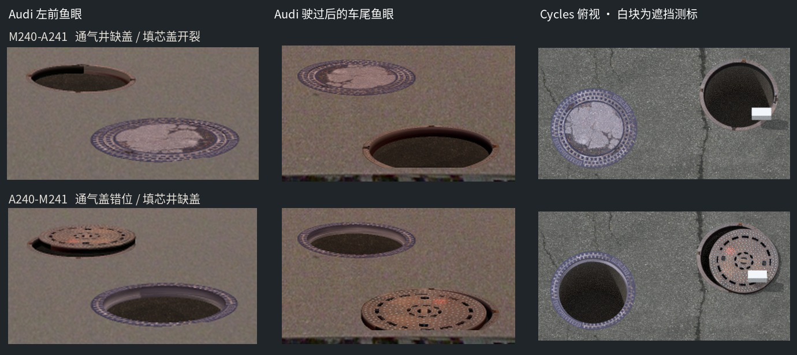

# 实扫圆井盖、缺盖井与跨相机迁入

同一路段有两套独立布局，每次迁入两件。先看 Audi 实车鱼眼中的接近和驶离。KITTI 联合场景视频把原路面和迁入结果并排显示，方便判断车尾背景已有的拉伸。[Audi 前后鱼眼](https://github.com/Vexlc/road-hazard-reconstruction/releases/download/scanned-round-covers-v1.0.0/audi-front-rear.mp4) · [指定 joint.pt 的前视与虚拟后视](https://github.com/Vexlc/road-hazard-reconstruction/releases/download/scanned-round-covers-v1.0.0/joint-front-rear.mp4) · [模型、相机样例及检查点](https://github.com/Vexlc/road-hazard-reconstruction/releases/tag/scanned-round-covers-v1.0.0)

| 编号 | 盖板和井口 | 几何依据 |
|---|---|---|
| A240 | 铸铁盖平移约 9.3 cm；内外两圈共 24 个可透视的排水孔 | 从注册颜色、相对位移分出可见孔口；盖底首次接触固定井座或路面后确定高度 |
| M240 | 同一井圈，盖板完全缺失 | 盖面估计直径 0.658 m；配方设定井深 0.63 m |
| A241 | 落座的混凝土填芯盖，表面有裂纹和剥蚀 | 裂纹来自原扫描；保留颜色、相对起伏、粗糙度、金属度和法线 |
| M241 | 同一填芯盖缺失，保留固定铁圈 | 盖面估计直径 0.675 m；配方设定井深 0.72 m |

尺寸依据是发布者给出的整幅扫描覆盖宽度以及图中的盖板接缝。井壁、井底、盖厚和异常安装姿态使用显式设计尺寸。裸露的井座立面另取铸铁纹理，避免把俯拍井圈花纹沿井壁拖长。[原始数据与边界标注](../gen2hole/examples/scanned-round-covers/SOURCES.md)

## 从扫描重建四个状态

固定标签可避免后续修改配方影响结果。以下为 Linux Bash 命令，从仓库根目录执行。私有仓库的下载需要已登录且有读取权限的 GitHub 账号。只想迁入成品可以直接从下一节开始。[重建环境](03-environment-and-relocation.md) · [全仓按系列查代码](asset-code-index.md)

~~~bash
gh repo clone Vexlc/road-hazard-reconstruction -- --branch scanned-round-covers-v1.0.0 --depth 1
cd road-hazard-reconstruction
python3 scripts/check-reproduction-index.py
python3 gen2hole/gen2hole.py locate M240
python3 scripts/configure-gen2hole.py
src=gen2hole/examples/scanned-round-covers
py=work/envs/streetcrafter/bin/python
export OPENBLAS_NUM_THREADS=1 OMP_NUM_THREADS=2
for scan in 005 008; do
  "$py" gen2hole/survey.py --survey "$src/$scan/survey.json" --out "runs/scanned-round-covers/$scan" || exit 1
done
~~~

构建器要求每个输出目录是新目录。运行结束会显示每个系列已核验两件资产。输出位于 `runs/scanned-round-covers/<扫描号>/series/assets/<missing 或 raised>/<编号>/`。其中 `asset.glb` 是带 PBR 材质的米制网格，`asset.ply` 是原生 Gaussian，`splat_material.npz` 保存与 PLY 对齐的材质和路面标签，`surface.npz` 同时给出盖板最上层与移除盖板后的高度，`metadata.json` 记录来源、尺寸和盖板姿态。重建可直接使用随仓库提供的扫描通道。[重建入口](../gen2hole/survey.py) · [孔口提取](../gen2hole/recipes/series/trace_grate.py) · [井座、盖板与高程](../gen2hole/recipes/series/perforated_cover.py)

如要从发布者的原 ZIP 复原输入，运行以下命令。准备脚本先验证两份原档的 SHA-256，再生成通道和孔口掩膜。可以在同一环境逐文件对照随库输入。

~~~bash
mkdir -p work/round-scans
for n in 005 008; do
  file="ManholeCover${n}_1K-PNG.zip"
  curl -fL --retry 3 "https://ambientcg.com/get?file=$file" -o "work/round-scans/$file" || exit 1
done
"$py" "$src/prepare.py" work/round-scans --out work/round-inputs
for f in work/round-inputs/*/*.png; do cmp "$f" "$src/${f#work/round-inputs/}" || exit 1; done
~~~

## 直接使用模型与校验和

~~~bash
repo=Vexlc/road-hazard-reconstruction
tag=scanned-round-covers-v1.0.0
kit=downloads/$tag
gh release download "$tag" -R "$repo" -p '*.zip' -p SHA256SUMS --skip-existing -D "$kit"
(cd "$kit" && sha256sum --ignore-missing -c SHA256SUMS)
for id in A240 M240 A241 M241; do
  python3 -m zipfile -e "$kit/$id.zip" work/round-models
  (cd "work/round-models/$id" && sha256sum -c SHA256SUMS) || exit 1
done
python3 -m zipfile -e "$kit/host-cameras.zip" work/round-host
(cd work/round-host && sha256sum -c SHA256SUMS)
~~~

若也执行了扫描重建，可用同一下载包核对重建文件。五个文件均参加比较。

~~~bash
for path in runs/scanned-round-covers/*/series/assets/*/*; do
  id=${path##*/}
  for f in asset.glb asset.ply metadata.json splat_material.npz surface.npz; do
    cmp "$path/$f" "work/round-models/$id/$f" || exit 1
  done
done
~~~

## 两件一组写入指定的 KITTI 联合检查点

原宿主位于 `runs/streetgs-joint/kitti360-0000/30000/joint.pt`。先按场景文档取得 KITTI 原始相机与标定、获取固定宿主，并安装官方联合渲染环境。宿主 SHA-256 为 `0a1ed5554d10ee6948ad0ef4920b7a64e33c7005b39baba2aaafde441f86d0a8`。构建需要宿主的相机轨迹和已渲染基准帧，以便提取目标道路的颜色和光照。若仅需加载成品，Release 中有两份可独立重载的检查点。[原始宿主下载](19-roadside-props.md#迁入指定的-30000-步原生场景) · [官方渲染环境](../streetcrafter/joint/README.md#配置联合渲染环境)

~~~bash
py=work/envs/streetcrafter/bin/python
src=gen2hole/examples/scanned-round-covers
base=runs/streetgs-joint/kitti360-0000/30000
out=outputs/scanned-round-covers
export OMP_NUM_THREADS=2 OPENBLAS_NUM_THREADS=1
bash scripts/scene.sh joint kitti360-0000 prepare 30000
bash scripts/scene.sh joint kitti360-0000 render 30000
gut="${OFFICIAL_ROOT:-$(cd ../.. && pwd)/01_official}/3dgrut"
for pair in M240-A241 A240-M241; do
  "$py" streetcrafter/joint/pavement_pair.py "$src/$pair.json" work/round-models "$src/anchors/$pair-kitti.json" "$base/scanned-round-covers" || exit 1
  CUDA_HOME="${CUDA_HOME:-/usr/local/cuda}" PYTHONPATH="$gut" PATH="$gut/.venv/bin:$PATH" "$gut/.venv/bin/python" streetcrafter/joint/roadside_pairs.py render --assembly "$pair" --site kitti --out "$base/scanned-round-covers" --renders "$out/joint" || exit 1
done
"$py" scripts/review-roadside-props.py --views "$out" --pairs M240-A241 A240-M241 --joint-only
~~~

输出为 `$base/scanned-round-covers/<组号>/joint.pt` 和 `$out/joint-front-rear.mp4`。每个新检查点各自从同一原始宿主开始；放置记录在同目录 `placement.json`。前视和虚拟后视每组各 48 帧。KITTI 原场景在虚拟车尾附近已有纹理拉伸。[原生迁入实现](../streetcrafter/joint/pavement_pair.py) · [同帧回放与视频](../scripts/review-roadside-props.py)

## 从实车相机和点云重新拟合

先按数据源条件准备 KITTI-360 0000 与 Audi A2D2 的同步相机、标定、里程计和点云，再执行下列命令。KITTI 使用前视及右侧鱼眼。Audi 使用左前及真实尾部鱼眼，保留车身掩膜。每组始终使用同一对固定世界位置。[实车数据准备](19-roadside-props.md#从实车原始曝光重新拟合与回放)

~~~bash
py=work/envs/streetcrafter/bin/python
src=gen2hole/examples/scanned-round-covers
out=outputs/scanned-round-covers
for site in kitti360-0000 a2d2-frontleft; do
  SCGS_PYTHON="$PWD/$py" bash streetcrafter/backends/run.sh "$site" prepare || exit 1
done
for pair in M240-A241 A240-M241; do
  common=(--run work/round-models --layout "$src/$pair.json" --video --export-packet "$pair" --group 26)
  "$py" scripts/render-mixed-road.py "${common[@]}" --scene kitti360-0000 --offset 1.4 --out "$out/$pair/kitti" || exit 1
  "$py" scripts/render-mixed-road.py "${common[@]}" --scene a2d2-frontleft --offset -.5 --ego-mask gen2hole/examples/traffic-cones/audi-body.json --out "$out/$pair/audi" || exit 1
done
~~~

要把两组接成同一条视频，运行 `"$py" scripts/review-round-covers.py`。结果位于 `$out/audi-front-rear.mp4` 和 `$out/kitti-front-side.mp4`。

每个站点的 `driving.mp4` 给出接近与驶离，`index.json` 列出有效曝光和车身保护区内的修改数。两个状态共用来源时仍有不同的 GLB 和高程指纹，放错模型或沿用另一布局的锚点会被拒绝。换道路要重新拟合每件资产的支撑面并检查整个占地。[布局与整块占地检查](../gen2hole/downstream/pavement_layout.py)

## 换鱼眼、正交相机或其他宿主

输入相机包为 NPZ。世界系和相机平移使用米，相机坐标为右、下、前。基本字段为 `rgb`、`camera_to_world`、`protected`、单位方向 `rays_camera`，以及 `host_range` 或 `host_z` 二选一。建议另给可替换道路 `receiver_mask` 与已知前景的径向距离 `occluder_range`；缺少可靠道路深度时可改用同坐标系的路面点云拟合。宿主需自己提供真实标定与尺度。[字段和遮挡约定](20-traffic-cones.md#用现成的非高斯相机包复现) · [光线入口](../scripts/transfer-mesh-view.py)

对于非共心镜头，可提供 `ray_origins_camera`，表示每条光线在参考相机系中的起点，单位为米，形状为 H×W×3 或 S×H×W×3。省略时所有光线从相机中心出发。世界系命中点为 `R @ (origin + range * direction) + translation`。`host_z` 表示命中点在参考相机系里的有符号 Z；径向距离为 `(host_z - origin.z) / direction.z`。接近光学地平线时请使用径向距离。`occluder_range` 同样从各自的光线起点量起。此固定标签对行间运动需要预先注册。后续版本可直接接收逐行曝光时间与相机轨迹。[运动鱼眼接入与验收](https://github.com/Vexlc/road-hazard-reconstruction/blob/rolling-covers-v1.0.0/docs/25-rolling-covers.md)

以下命令只需 CPU 和上一节的下载包。正交机位中各像素光线平行、起点不同。用它恢复米制路面，再从未参与拟合的 220° 后向鱼眼重放。样例的拟合种子和朝向来自控制场景；自己的场景要使用自己的世界系与落点。

~~~bash
py=work/envs/roadside-cpu/bin/python
src=gen2hole/examples/scanned-round-covers
for pair in M240-A241 A240-M241; do
  cam=work/round-host/$pair
  "$py" scripts/transfer-mesh-view.py road-points "$cam/road.npy" "$cam/ortho.npz" --stride 3 || exit 1
  read -ra f < <(python3 -c 'import json,sys; j=json.load(open(sys.argv[1])); print(*j["seed"],*j["heading"],*j["up"])' work/round-host/frame.json)
  "$py" scripts/transfer-mesh-view.py fit "$cam/road.npy" "$cam/refit.json" --seed "${f[@]:0:3}" --heading "${f[@]:3:3}" --up "${f[@]:6:3}" --radius 1.05 --asset "$src/$pair.json" --asset-root work/round-models || exit 1
  cmp "$cam/anchor.json" "$cam/refit.json" || exit 1
  for v in ortho rear; do
    dest="outputs/round-replay/$pair/$v"
    "$py" scripts/transfer-mesh-view.py render "$src/$pair.json" "$cam/refit.json" "$cam/$v.npz" "$dest" --asset-root work/round-models || exit 1
    (cd "$dest" && sha256sum -c "$OLDPWD/$cam/$v.sha256") || exit 1
  done
done
~~~

在固定版本 CPU 环境可逐字节核对输出。若自己安装 Blender 的 bpy 4.2.0，可从头渲染原始路面、挖开的路面、两件 GLB 和独立遮挡物，再比较原生部件 ID 与径向距离。两组正交俯视都能看到敞井井底；实车驶离曝光中井沿遮住了井底，仍可辨认井壁。这些机位验证了几何与遮挡，实拍道路缺少加装资产后的同位置外观真值。[最小 CPU 环境](19-roadside-props.md#从原始模型重建四件资产) · [bpy 环境](20-traffic-cones.md#在-blender-cycles-中独立复核) · [独立建场](../scripts/render-round-cover-cycles.py) · [逐部件验收](../scripts/check-round-cover-cycles.py)

~~~bash
work/envs/assets/bin/python scripts/render-round-cover-cycles.py
OPENBLAS_NUM_THREADS=1 OMP_NUM_THREADS=2 work/envs/streetcrafter/bin/python scripts/check-round-cover-cycles.py
~~~

## 已复核的范围

固定环境、独立源码目录、空资产输出目录。两份原始 ZIP 重制的 14 个 PNG、四件模型的 20 个文件、两份原生 `joint.pt`、两个重新拟合的锚点和四个回放的 16 个产品均逐字节吻合。在原版后向鱼眼与正交测试的八个“视角 × 资产”组合中，井圈、井壁、井底、盖面及盖边的可见标签与原生 Cycles 一致，已匹配标签像素的径向距离 P95 最大误差约 0.037 mm。这个误差仅描述已知控制几何。两段实车路面中，车身保护区域的像素修改数为零。[逐资产哈希、场景、像素及深度结果](../validation/scanned-round-covers.json)

放置检查同时考虑移出井圈的盖板。两座井的固定孔口之间即使有空隙，盖板跨过另一件的占地仍会被拒绝。同一平路控制点上，将铸铁盖朝相邻井移出后，中心距离 0.797 m 的组合被拒绝，0.850 m 的组合通过。道路坡度、点云覆盖和车辆视角变化时，需要重新拟合与回放验证。
