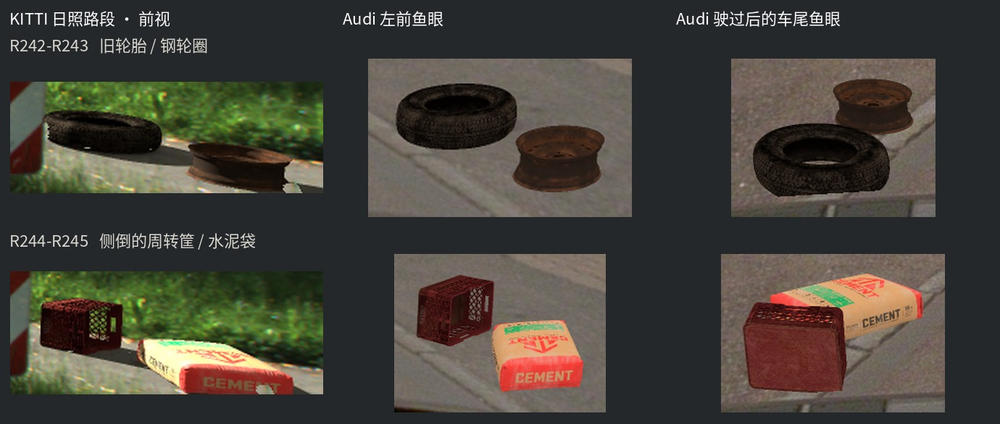

# 道路遗落物的重建、成对迁入与鱼眼复现

R242–R245 是两组成对放置的常见道路遗落物。一个场景放平躺的轮胎和轮圈，另一个放侧倒的周转筐和水泥袋。KITTI 的两份新检查点都从同一个 30,000 步原宿主生成。Audi 使用实车左前与尾部鱼眼曝光，KITTI 联合场景使用前视与虚拟后视。[Audi 驶过后回看](https://github.com/Vexlc/road-hazard-reconstruction/releases/download/road-debris-v1.0.0/audi-front-rear.mp4) · [指定 joint.pt 前后对照](https://github.com/Vexlc/road-hazard-reconstruction/releases/download/road-debris-v1.0.0/joint-front-rear.mp4) · [全部发布文件](https://github.com/Vexlc/road-hazard-reconstruction/releases/tag/road-debris-v1.0.0)

## 从原始网格重建并成组

原始数据为 Poly Haven 发布的四份 CC0 纹理网格。全部 20 个原文件随标签提供，读取时逐个核验字节数及 SHA-256。新资产沿用发布尺寸，通过支撑凸包找稳定落地姿态。接触计算采用 0.8 mm 邻域，重心采用按表面积加权的近似。两件布局分别指定平面位移和朝向，构建时检查占地相交。[来源、作者与授权](../gen2hole/examples/road-debris/SOURCES.md) · [接地、材质和采样](../gen2hole/road_debris.py) · [成组代码](../gen2hole/roadside_layout.py) · [两份布局与原始数据](../gen2hole/examples/road-debris)

| 编号 | 物件 | 落地后 X × Y × 高度（米） | 原几何三角面 |
|---|---|---|---:|
| R242 | 平放旧轮胎 | 0.600 × 0.600 × 0.165 | 2,880 |
| R243 | 锈蚀钢轮圈 | 0.405 × 0.405 × 0.150 | 16,440 |
| R244 | 侧倒塑料周转筐 | 0.264 × 0.408 × 0.298 | 18,320 |
| R245 | 落地水泥袋 | 0.462 × 0.700 × 0.180 | 844 |

以下命令在 Linux Bash 中运行。已有仓库时，在新目录检出固定标签即可。模型和鱼眼回放均可在 CPU 上运行。验证环境为 Python 3.9.23，Open3D 的 Linux 运行库包含 libGL 与 libgomp。

~~~bash
gh repo clone Vexlc/road-hazard-reconstruction -- --branch road-debris-v1.0.0 --depth 1
cd road-hazard-reconstruction
python3 scripts/check-reproduction-index.py
python3 gen2hole/gen2hole.py locate R242
python3.9 -m venv work/envs/roadside-cpu
py=work/envs/roadside-cpu/bin/python
"$py" -m pip install numpy==1.26.4 scipy==1.13.1 open3d==0.18.0 pillow==11.3.0 opencv-python==4.10.0.84
bash scripts/reproduce-road-debris.sh assets
~~~

构建入口要求空的目标目录。四个单件和两个组合均位于 `runs/road-debris/<编号或组号>/`。每个目录产出四个文件。米制 `asset.glb` 保存网格、UV 和 PBR，`surface.npz` 保存接触区域与高度，`samples.npz` 包含原生 Gaussian 使用的表面位置、几何法线及着色法线，`metadata.json` 保存尺寸、来源和校验值。GLB 采用 Y 向上，迁入局部坐标采用 Z 向上。若要从发布者核验输入，可运行 `"$py" gen2hole/road_debris.py --fetch --sources work/fetched-debris --out runs/fetched-debris`。[分步命令入口](../scripts/reproduce-road-debris.sh)

### 下载成品和比对模型

~~~bash
repo=Vexlc/road-hazard-reconstruction
tag=road-debris-v1.0.0
kit=downloads/$tag
gh release download "$tag" -R "$repo" -p '*.zip' -p SHA256SUMS --skip-existing -D "$kit"
(cd "$kit" && sha256sum --ignore-missing -c SHA256SUMS)
python3 -m zipfile -e "$kit/debris-models.zip" work/debris-models
python3 -m zipfile -e "$kit/cycles-cameras.zip" work/debris-cameras
(cd work/debris-models && sha256sum -c SHA256SUMS)
(cd work/debris-cameras && sha256sum -c SHA256SUMS)
for f in work/debris-models/R*/*; do
  cmp "$f" "runs/road-debris/${f#work/debris-models/}" || exit 1
done
~~~

仅使用成品时可跳过 `assets` 和最后一段 `cmp`，在继续前运行 `export DEBRIS_MODELS=work/debris-models`。用已有解释器时可设置 `DEBRIS_CPU_PYTHON`、`DEBRIS_NATIVE_PYTHON` 或 `DEBRIS_BLENDER_PYTHON`。脚本内的命令均从仓库根目录运行。

## 在指定的 KITTI 联合场景驶过后回看

`joint-build` 需要原始检查点和带 CPU PyTorch 的项目环境。两组分别使用随库提供的城市路段和日照路段锚点。每个锚点带宿主坐标、道路支撑范围、光照、行车净距与对应资产文件指纹。原宿主 SHA-256 为 `0a1ed5554d10ee6948ad0ef4920b7a64e33c7005b39baba2aaafde441f86d0a8`。以下命令先在暂存目录下载，再由校验通过的文件建立本地宿主。[项目环境](03-environment-and-relocation.md) · [原生构建与重载](../streetcrafter/joint/roadside_pairs.py)

~~~bash
base=runs/streetgs-joint/kitti360-0000/30000
kit=downloads/reproduction-2026.11.25
gh release download reproduction-2026.11.25 -R Vexlc/road-hazard-reconstruction -p kitti360-0000-30000.pt -p SHA256SUMS --skip-existing -D "$kit"
(cd "$kit" && sha256sum --ignore-missing -c SHA256SUMS)
mkdir -p "$base"
if [ ! -e "$base/joint.pt" ]; then cp "$kit/kitti360-0000-30000.pt" "$base/joint.pt"; fi
echo "0a1ed5554d10ee6948ad0ef4920b7a64e33c7005b39baba2aaafde441f86d0a8  $base/joint.pt" | sha256sum -c - || exit 1
bash scripts/reproduce-road-debris.sh joint-build
~~~

输出在 `$base/road-debris/<组号>/joint.pt`，同目录的 `placement.json` 记录资产与原宿主哈希、路面阴影和实例。可用发布版的两份 `*-joint.pt` 直接重载或用 `cmp` 对照。回放需先准备固定 KITTI 轨迹、数据和官方 3dgrut 环境。以下两组各回放 48 个轨迹时刻，输出 `outputs/road-debris/joint-front-rear.mp4`。[环境、原数据及轨迹](19-roadside-props.md#迁入指定的-30000-步原生场景) · [官方联合渲染环境](../streetcrafter/joint/README.md#配置联合渲染环境)

~~~bash
bash scripts/scene.sh joint kitti360-0000 prepare 30000
bash scripts/scene.sh joint kitti360-0000 render 30000
bash scripts/reproduce-road-debris.sh joint-render
~~~

## 使用真实前后鱼眼和道路点云

实车数据和标定按数据集的下载条件准备。KITTI 使用同步双目、右侧鱼眼、Velodyne 和轨迹。Audi 使用对应曝光时刻的标定、里程计及点云，保护车身可见区域。每组在两个 KITTI 位置和一个 Audi 位置分别重新拟合道路，最小行车净距为 0.199 m。日照路段从原场景立柱及影端拟合太阳方向和直射比例。[实车准备与目录约定](19-roadside-props.md#从实车原始曝光重新拟合与回放) · [实车迁入](../scripts/render-mixed-road.py) · [日光估计](../scripts/fit-roadside-light.py)

~~~bash
for site in kitti360-0000 a2d2-frontleft; do
  SCGS_PYTHON="$PWD/work/envs/streetcrafter/bin/python" bash streetcrafter/backends/run.sh "$site" prepare || exit 1
done
bash scripts/reproduce-road-debris.sh physical
~~~

结果在 `outputs/road-debris/<组号>/<sun、urban 或 audi>/`。`index.json` 记录原曝光哈希、帧号、裁剪位置及可见像素，各相机子目录包含同帧原图、迁入图、部件标签、距离、地面阴影及可移植相机包。Audi 车尾选用车辆驶过锚点后的真实曝光。原生 KITTI 的虚拟后视在训练覆盖较弱处有背景拉伸，视频提供同机位原宿主对照。[KITTI 日照路段](https://github.com/Vexlc/road-hazard-reconstruction/releases/download/road-debris-v1.0.0/kitti-sun-front-side.mp4) · [KITTI 城市路段](https://github.com/Vexlc/road-hazard-reconstruction/releases/download/road-debris-v1.0.0/kitti-urban-front-side.mp4)

## 更换鱼眼相机或渲染器

下载的相机包来自独立 Blender Cycles 路面。可以只用相机包和模型验证迁入，无需安装 Blender 或获取实车数据。前视和侧缘深度用于拟合，后视作为留出机位。命令重新生成两个锚点，并核对六次回放的颜色、可见部件、径向距离与阴影共 24 个文件。

~~~bash
bash scripts/reproduce-road-debris.sh replay
~~~

适配新宿主需要同一米制世界中的相机姿态、标定和路面观测。每帧 NPZ 提供 `rgb`、`protected`、`camera_to_world`、`rays_camera`，以及 `host_range` 或 `host_z`。相机轴向为右、下、前。使用自定义逐像素方向可以覆盖超过 180° 的视场；非共心相机再提供 `ray_origins_camera`。提供真实可接收阴影的道路掩膜 `receiver_mask`、独立前景的径向距离 `occluder_range`。有遮挡的像素比较同一条光线的距离。若提供轨迹，按自己的车宽和车长拟合净距。[完整输入约定](22-scanned-round-covers.md#换鱼眼正交相机或其他宿主) · [通用光线入口](../scripts/transfer-mesh-view.py)

~~~bash
# 下列变量使用新宿主自己的数据。site.json 记录世界系 seed、heading、up，均为三元素数组。
py=work/envs/roadside-cpu/bin/python
mesh=runs/road-debris/R242-R243
site=work/my-site
read -ra frame < <(python3 -c 'import json,sys; j=json.load(open(sys.argv[1])); print(*j["seed"], *j["heading"], *j["up"])' "$site/site.json")
"$py" scripts/transfer-mesh-view.py road-points "$site/road.npy" "$site/front.npz" "$site/edge.npz"
"$py" scripts/transfer-mesh-view.py fit "$site/road.npy" "$site/anchor.json" --seed "${frame[@]:0:3}" --heading "${frame[@]:3:3}" --up "${frame[@]:6:3}" --radius 1.5 --asset "$mesh" --lighting "$site/light.json" --trajectory "$site/vehicle-centres.npy" --vehicle-width 2.06 --vehicle-length 5.10
"$py" scripts/transfer-mesh-view.py render "$mesh" "$site/anchor.json" "$site/rear.npz" "$site/rear-replay"
~~~

`light.json` 给出 `road_srgb`（0–255）、`sun_world`（指向光源的单位向量）和 `direct_fraction`（0–1）。上例拟合半径与车辆尺寸为示例值。新宿主需要用自己的测量值；只想先回放光线几何可省略光照和车辆轨迹参数。若几何、接地或采样文件变化，重新构建布局并拟合锚点。

实车 KITTI 的 `--surveyed-depth` 对有双目观测的前视估计道路法向误差，在采样支撑充足处重新判定返回点是否属于路面。便携包可提供标量 `receiver_band_m` 启用相同计算。算法还限制沿光线误差不超过三个局部网格间距，同时保留独立的前景遮挡。阈值取决于深度传感器及本地道路拟合质量。[遮挡与支撑计算](../gen2hole/downstream/prop_registration.py)

## 独立核验与适用范围

具备 bpy 4.2.0 的环境可从 GLB 重新建场并生成 Cycles 的原生物体编号、距离和材质法线，再复核透明孔口、遮挡测标以及鱼眼视场边缘。[Blender 环境](20-traffic-cones.md#在-blender-cycles-中独立复核) · [独立建场](../scripts/render-debris-cycles.py) · [逐视角比较](../scripts/check-debris-cycles.py)

~~~bash
bash scripts/reproduce-road-debris.sh cycles
~~~

- 两组、三个 220° 机位、四种物件。12 项物体轮廓 IoU 最低 0.9990，匹配像素的距离误差 P95 最大 0.029 mm。836 个被物体轮廓包围、从孔洞看到道路的像素全部保留。误差对应已知控制场景。
- 在 11,930 个物体内部像素中，切线空间法线与 Cycles 着色法线的平均夹角误差由 3.69° 降至 1.87°。周转筐的单独后视从 5.30° 升至 5.84°，细网格和斜视下的高频细节仍有差异。
- 实车日照路段第 206 帧，手工圈出的路面有 751 个预期强阴影像素。相对无遮挡预测，阴影损失超过一半的像素由 434 降至 42。前景路牌标注区有 4,315 个像素，物体覆盖为零，43 个像素仍有至多 1 个 8 位色阶的变化。实拍路面的检验依据是原曝光、实测深度与可见边界；没有加入这些物件后的同机位实拍真值。[像素标注](../gen2hole/examples/road-debris/visibility.json) · [实车遮挡核验](../scripts/check-debris-visibility.py) · [完整数值和逐文件 SHA-256](../validation/road-debris.json)

干净源码目录复验逐字节通过四个单件与两个组合的 24 个文件、两个重新拟合的锚点、六个相机回放的 24 个产品，以及两份原生检查点。旧版交通锥的四个相机产品和一个原生检查点也与其发布版相同。替换布局或修改 Gaussian 采样后，借用原锚点的负例均按预期被拒绝。
