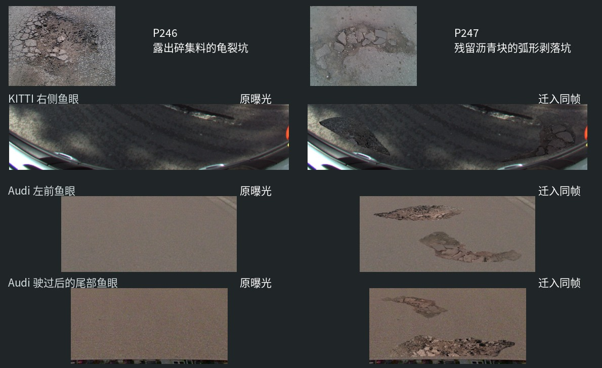

# 两处实测沥青坑的近景与鱼眼迁入

P246 和 P247 一起放入指定的 KITTI 30,000 步联合场景。Audi 用真实左前和车尾鱼眼拍摄的道路作为宿主。车尾视频末尾另停留 2.5 秒，左右分别显示两处坑洞在同一曝光中的原路面和迁入效果。[Audi 驶过后回看](https://github.com/Vexlc/road-hazard-reconstruction/releases/download/asphalt-breakouts-v1.0.0/audi-front-rear.mp4) · [指定 joint.pt 前后视](https://github.com/Vexlc/road-hazard-reconstruction/releases/download/asphalt-breakouts-v1.0.0/joint-front-rear.mp4) · [KITTI 实车前视和侧鱼眼](https://github.com/Vexlc/road-hazard-reconstruction/releases/download/asphalt-breakouts-v1.0.0/kitti-front-side.mp4)

## 从两份实拍 RGB-D 重建

| 资产 | 源曝光 | 坑口面积 | 坑口最小外接矩形 | 坑内凹深 P95 | 留出测深误差 P95 |
|---|---|---:|---:|---:|---:|
| P246 露出碎集料的龟裂坑 | 20250305_135325 | 1.43 m² | 1.54 × 1.25 m | 8.69 cm | 2.44 mm |
| P247 带残留沥青块的弧形剥落坑 | 20250305_122119 | 0.84 m² | 1.67 × 0.87 m | 5.56 cm | 1.87 mm |

重建使用源 RGB、毫米深度、轮廓标注和标称内参。P246 和 P247 在拟合前分别留出了 13,582、9,170 个坑内有效像素，用于在同一次曝光上检验几何插值。尺度沿用采集，没有放大。[源数据与文件指纹](../gen2hole/examples/asphalt-breakouts/SOURCES.md) · [重建入口](../gen2hole/multiview_pits.py) · [逐件测量](../validation/asphalt-breakouts.json)

在有权读取私有仓库的账号下，从固定标签开始。以下 Bash 命令均从仓库根目录执行。只看视频可以直接打开上方链接。

~~~bash
gh repo clone Vexlc/road-hazard-reconstruction -- --branch asphalt-breakouts-v1.0.0 --depth 1
cd road-hazard-reconstruction
python3 scripts/check-reproduction-index.py
python3 gen2hole/gen2hole.py locate P246
repo=Vexlc/road-hazard-reconstruction
tag=asphalt-breakouts-v1.0.0
kit=downloads/$tag
gh release download "$tag" -R "$repo" -p '*.zip' -p SHA256SUMS --skip-existing -D "$kit"
(cd "$kit" && sha256sum --ignore-missing -c SHA256SUMS)
python3 -m zipfile -e "$kit/captures.zip" work/asphalt-captures
python3 -m zipfile -e "$kit/fisheye-cameras.zip" work/asphalt-cameras
(cd work/asphalt-captures && sha256sum -c SHA256SUMS)
(cd work/asphalt-cameras && sha256sum -c SHA256SUMS)
for id in P246 P247; do
  python3 -m zipfile -e "$kit/$id.zip" "work/asphalt-published/$id"
  (cd "work/asphalt-published/$id" && sha256sum -c SHA256SUMS) || exit 1
done
~~~

`captures.zip` 只含两次曝光用到的六个原始成员和来源说明。三个小 ZIP 保留原始成员名与内容，每个角色仍对照全仓采集索引核验。准备项目的网格和计算环境后执行以下命令。目标资产目录需为新目录。[环境配置与安装](03-environment-and-relocation.md) · [固定版本分步脚本](../scripts/reproduce-asphalt-breakouts.sh)

~~~bash
python3 scripts/configure-gen2hole.py
bash scripts/reproduce-asphalt-breakouts.sh assets
for id in P246 P247; do
  for f in asset.glb asset.ply metadata.json splat_material.npz surface.npz; do
    cmp "runs/asphalt-breakouts/$id/series/assets/pothole/$id/$f" "work/asphalt-published/$id/$id/$f" || exit 1
  done
done
~~~

使用成品可跳过重建，建一个平铺模型目录并在后续命令中指定它。已有重建结果时，后续步骤会直接使用 `runs/asphalt-breakouts`。

~~~bash
mkdir -p work/asphalt-models
for id in P246 P247; do
  ln -sfn "$(realpath "work/asphalt-published/$id/$id")" "work/asphalt-models/$id"
done
export PIT_MODELS=work/asphalt-models
~~~

## 在指定的 joint.pt 和真实道路中回放

先按原宿主指南获取 `runs/streetgs-joint/kitti360-0000/30000/joint.pt` 并核对 SHA-256。两坑独立拟合路面，坑沿间距约 0.82 m。构建依赖交通场景的原始相机、相机轨迹与基准渲染，回放使用固定的 3dgrut 环境。[宿主下载及环境](19-roadside-props.md#迁入指定的-30000-步原生场景) · [原生迁入实现](../streetcrafter/joint/pavement_pair.py)

~~~bash
bash scripts/scene.sh joint kitti360-0000 prepare 30000
bash scripts/scene.sh joint kitti360-0000 render 30000
bash scripts/reproduce-asphalt-breakouts.sh joint-build
bash scripts/reproduce-asphalt-breakouts.sh joint-render
~~~

新检查点位于 `runs/streetgs-joint/kitti360-0000/30000/asphalt-breakouts/P246-P247/joint.pt`。可以下载发布页的 `P246-P247-joint.pt` 做逐字节比较。原生视频为同一段 48 个轨迹时刻的前视与虚拟后视，车尾背景保留了宿主自身在训练覆盖不足处的拉伸。

另在 KITTI 和 Audi 实拍道路上重新拟合。生成带中文字幕的视频需可用的系统字体 `/usr/share/fonts/opentype/noto/NotoSansCJK-Regular.ttc`（Debian/Ubuntu 包 `fonts-noto-cjk`）。脚本先为每个传感器选一张两坑都能看清的宽视野曝光，从两坑以外的可见沥青登记材质亮度，再重放整个行车片段。每个相机有独立的测量结果。原帧号、车辆掩膜、部件标注、径向距离与校准相机包保存在 `outputs/asphalt-breakouts/<kitti 或 audi>/`。[真实数据准备](19-roadside-props.md#从实车原始曝光重新拟合与回放) · [实车驱动](../scripts/render-mixed-road.py)

~~~bash
for site in kitti360-0000 a2d2-frontleft; do
  SCGS_PYTHON="$PWD/work/envs/streetcrafter/bin/python" bash streetcrafter/backends/run.sh "$site" prepare || exit 1
done
bash scripts/reproduce-asphalt-breakouts.sh drive
~~~

## 在自有鱼眼或其他渲染器登记路面亮度

使用发布相机包可在 CPU 上跑通。先由前视和侧缘鱼眼的米制深度恢复路面并拟合两处坑座，再用这两张宽视野曝光登记亮度。后视镜头全程留出。脚本分别重放两套宿主。第一套只用颜色和几何，第二套使用另一种沥青并提供漫反射底色。每套逐字节核对三个机位的颜色、部件标签、实例标签和径向距离。[最小 CPU 环境](19-roadside-props.md#从原始模型重建四件资产)

~~~bash
PIT_CPU_PYTHON="$PWD/work/envs/roadside-cpu/bin/python" bash scripts/reproduce-asphalt-breakouts.sh replay
~~~

换场景时，先用自己的布局、米制道路点、种子、朝向和向上方向运行 `road-points` 和 `fit`。相机包提供 `rgb`、`camera_to_world`、`protected`、标定光线、`host_range` 或 `host_z`。建议一并提供遮挡距离和可替换道路掩膜。鱼眼可提供任意有效单位光线，非共心镜头另给 `ray_origins_camera`。至少选一张能看到各个坑口外围真实沥青的参考曝光；可联合多张同一相机响应和光照条件下的曝光。[相机字段与几何拟合](22-scanned-round-covers.md#换鱼眼正交相机或其他宿主)

~~~bash
py=work/envs/roadside-cpu/bin/python
site=work/my-road
models=${PIT_MODELS:-runs/asphalt-breakouts}
"$py" scripts/transfer-mesh-view.py calibrate-pavement "$site/layout.json" "$site/anchor.json" "$site/appearance.json" "$site/wide.npz" "$site/side.npz" --asset-root "$models"
"$py" scripts/transfer-mesh-view.py render "$site/layout.json" "$site/appearance.json" "$site/close-fisheye.npz" "$site/close-replay" --asset-root "$models"
~~~

模型在各个坑的局部米制平面中汇总完整沥青上的观测，等权统计空间格子，估计线性 RGB 曝光和缓变明暗。周边格子能预测彼此的明暗残差时，额外保存一张 25 × 25 的光照图。重放时依据实际三维命中位置读取。这样即使近景只剩坑床，颜色、标注和深度都能保留。孔内历史车道线会随原路面移除。跨天气或明显改变相机曝光时需重新登记。局部硬阴影完全落在孔内、周围没有对应明暗证据时，外圈观测无法恢复它的精确形状。[登记与材质计算](../gen2hole/downstream/pavement_appearance.py) · [通用相机接口](../scripts/transfer-mesh-view.py)

如果新渲染器能输出**不含光照的漫反射底色**，可在每份参考相机包中添加 `road_albedo_srgb`。它必须与 `rgb` 像素对齐，形状为 H × W × 3，类型为 uint8，使用 sRGB 编码。渲染器输出的线性底色需要先转为 sRGB。拟合时用原道路曝光与宿主底色估计光照，再应用于资产。只有真实照片时可省略此字段，所有参考包应采用同一种输入方式。此时外观登记假设坑边两种沥青的反射率相近。重放新机位时不再需要底色通道。[参考包读取与拟合](../gen2hole/downstream/pavement_appearance.py) · [从 Cycles 导出底色](../scripts/render-pavement-cycles.py)

## 可重复的几何和外观检验

~~~bash
bash scripts/reproduce-asphalt-breakouts.sh cycles
# 完成 drive 和 cycles 后可再做原始实车近景裁切试验
work/envs/streetcrafter/bin/python scripts/check-asphalt-breakouts.py
# 在原生宿主路面上做一次独立的标线干预测试
work/envs/streetcrafter/bin/python scripts/check-asphalt-native.py
~~~

- **真实曝光裁切。** 四个机位、两个坑共八个只含坑床的局部，共 7,608 个像素。原方法因无法在近景中估计周边亮度而失去全部标签。登记后 7,608 个像素全部保留，去除裁图最外侧一像素后，RGB 和径向深度都与同一完整画面逐像素一致。
- **独立鱼眼。** Cycles 从另一套几何与材料管线生成两坡路面、两坑、前景遮挡物和可移除白漆。三台 220° 相机的六组实例轮廓 IoU 最低为 0.9971，匹配点的距离误差 P95 最大约 0.11 mm。侧缘有 423 个命中在光轴后方。两种完整路面对照在坑底的差异为零。原生材料一致的控制场景中，276 个原白漆像素上的平均 RGB 误差从 10.81 降至 5.11 个 8 位色阶，留出的后视从 11.69 降至 5.13。这些是控制场景的误差，真实道路缺少放入同一物件后的实拍真值。
- **更换宿主沥青。** 第二套 Cycles 场景使用不同材质。留出后视在标线范围的 RGB 平均绝对误差只靠宽视野照片登记时为 24.20 个色阶，加入宿主底色后为 10.82，前视和侧缘分别从 22.93、22.68 降到 13.75、15.29。两套登记都完全去除了坑底的旧白漆。单帧旧方法在前视和侧缘对参考颜色的误差更低，但给原路面加漆会改变它生成的坑底。
- **原生 Gaussian。** 给原始路面中即将被切掉的区域加白色标记，原方法中有 14,363 和 6,239 个坑床 Gaussian 的颜色变化超过一个色阶。采用周围路面登记后，两件的坑床 Gaussian 颜色在干预前后完全一致。
- **干净目录复现。** 从小型采集包重建两件的 10 个模型文件，从两种宿主的相机包重新拟合四个几何与亮度登记文件、重放 24 个相机产品，并重建原生检查点，均与本版发布文件逐字节一致。旧版 P238–P239 的四个后视回放产品和原生检查点也通过同样的回归核对。[逐文件及逐视角验收结果](../validation/asphalt-breakouts.json) · [独立 Cycles 场景](../scripts/render-pavement-cycles.py) · [近景与白漆试验](../scripts/check-asphalt-breakouts.py)
