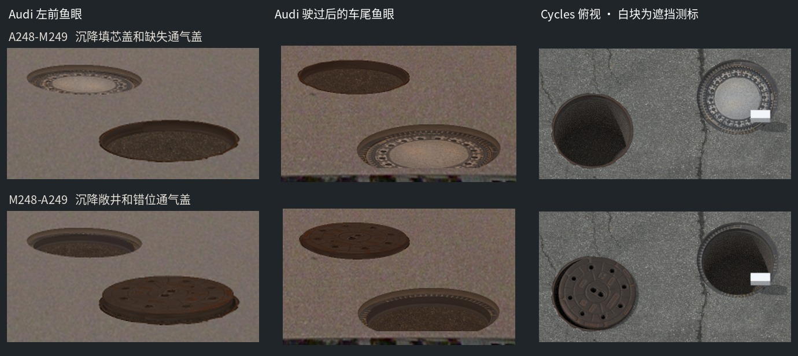

# 沉降井盖、错位井盖与行驶中的鱼眼

每次向指定的 KITTI 30,000 步场景迁入两件。第一组是沉降的填芯盖与缺失的通气盖（A248–M249），第二组是沉降后缺盖的井口与错位的十孔铁盖（M248–A249）。Audi 用标定的真实左前和车尾鱼眼曝光做迁入对照。[Audi 驶过后实拍回看](https://github.com/Vexlc/road-hazard-reconstruction/releases/download/rolling-covers-v1.0.0/audi-front-rear.mp4) · [KITTI 同机位局部合成回放](https://github.com/Vexlc/road-hazard-reconstruction/releases/download/rolling-covers-v1.0.0/joint-local-front-rear.mp4) · [原始检查点的直接渲染](https://github.com/Vexlc/road-hazard-reconstruction/releases/download/rolling-covers-v1.0.0/joint-front-rear.mp4)

## 从扫描重建四件资产

| 状态 | 盖面和井座 | 可验证的几何 |
|---|---|---|
| A248 / M248 | 灰色填芯盖连井圈整体下沉 / 同座缺盖 | 估计盖径 0.669 m，设计下沉量 38 mm，井深 0.64 m。近景可见混凝土立边。 |
| A249 / M249 | 褐色十孔铁盖轻微移位 / 同座缺盖 | 估计盖径 0.716 m，水平位移 46.8 mm。十个可透视孔总面积约 129 cm²，设计井深 0.68 m。 |

盖面来自两份真实扫描。盖径由发布的平面范围与可见接缝推算；安装状态、盖厚、井壁和井底按配方设计。003 的暗色小凹窝保留扫描外观，006 的孔口则具有三维通孔与实体孔壁。[原始通道、孔洞依据与材料来源](../gen2hole/examples/rolling-covers/SOURCES.md) · [资产和相机的逐项记录](../validation/rolling-covers.json)

以下为 Linux Bash 命令，从固定标签开始。每个模型 ZIP 都可单独使用，三个核心产物分别是用于网格渲染的 asset.glb、用于 Gaussian 放置的 asset.ply 与米制高度和边界 surface.npz。只看视频可以打开页首链接。

~~~bash
gh repo clone Vexlc/road-hazard-reconstruction -- --branch rolling-covers-v1.0.0 --depth 1
cd road-hazard-reconstruction
python3 scripts/check-reproduction-index.py
python3 gen2hole/gen2hole.py locate A249
tag=rolling-covers-v1.0.0
kit=downloads/$tag
gh release download "$tag" -R Vexlc/road-hazard-reconstruction -p '*.zip' -p SHA256SUMS --skip-existing -D "$kit"
(cd "$kit" && sha256sum --ignore-missing -c SHA256SUMS)
for id in A248 M248 A249 M249; do
  python3 -m zipfile -e "$kit/$id.zip" work/rolling-models
  (cd "work/rolling-models/$id" && sha256sum -c SHA256SUMS) || exit 1
done
python3 -m zipfile -e "$kit/host-cameras.zip" work/rolling-cameras
(cd work/rolling-cameras && sha256sum -c SHA256SUMS)
~~~

从扫描重建请先安装网格与计算环境。仓库已包含两套输入通道，直接执行以下命令。第一次构建使用空输出目录。若从上游 ZIP 开始，可将两个原档以 ManholeCover003_1K-PNG.zip 和 ManholeCover006_1K-PNG.zip 放在同一目录，执行 `work/envs/streetcrafter/bin/python gen2hole/examples/rolling-covers/prepare.py <原档目录> --out work/scan-check`，再对照随库 PNG。[固定依赖和本机路径配置](03-environment-and-relocation.md) · [重建与回放脚本](../scripts/reproduce-rolling-covers.sh)

~~~bash
python3 scripts/configure-gen2hole.py
bash scripts/reproduce-rolling-covers.sh assets
for folder in runs/rolling-covers/*/series/assets/*/*; do
  for file in asset.glb asset.ply surface.npz splat_material.npz metadata.json; do
    cmp "$folder/$file" "work/rolling-models/${folder##*/}/$file" || exit 1
  done
done
~~~

## 迁入 KITTI 检查点并回看

原宿主为 `runs/streetgs-joint/kitti360-0000/30000/joint.pt`，SHA-256 为 `0a1ed5554d10ee6948ad0ef4920b7a64e33c7005b39baba2aaafde441f86d0a8`。准备轨迹和原始基准帧后，可用发布模型运行；若上一节已重建，省略 COVER_MODELS 即使用构建结果。两个固定锚点随仓库提供，井圈边缘间距约 0.63 m。[宿主、标定及 GPU 环境](19-roadside-props.md#迁入指定的-30000-步原生场景) · [原生建场](../streetcrafter/joint/pavement_pair.py)

~~~bash
export COVER_MODELS=work/rolling-models
bash scripts/scene.sh joint kitti360-0000 prepare 30000
bash scripts/scene.sh joint kitti360-0000 render 30000
bash scripts/reproduce-rolling-covers.sh joint-build
bash scripts/reproduce-rolling-covers.sh joint-render
bash scripts/reproduce-rolling-covers.sh joint-local
~~~

检查点写入原宿主同级的 `rolling-covers/<组号>/joint.pt`，可同 Release 里的两份 `*-joint.pt` 比较。每组 48 个轨迹时刻均有前视和虚拟后视。直接渲染会保留原宿主车尾附近的纹理拉伸；分裂跨越井沿的大 Gaussian 还会改变远处原路面的颜色。局部合成使用同一时刻的原生基准和迁入渲染，沿标定光线查找井口、外侧 18 cm 修补带和凸出盖面，仅在这一区域合成原生变化。井口内部沿用迁入检查点的原始像素。合成前核查原宿主指纹、放置姿态、各机位标定和各帧 RGB 指纹。这一步生成独立的视频，直接打开检查点仍能看到原始渲染的外溢。[局部回放实现](../streetcrafter/joint/local_pavement_replay.py) · [米制修补范围](../gen2hole/downstream/pavement_support.py)

在 KITTI-360 与 Audi 原始照片上复跑时，先准备实车数据，再运行 `bash scripts/reproduce-rolling-covers.sh drive`。脚本从同步点云重新拟合两组锚点，先登记各相机的路面亮度，再保留车身和前景重放。KITTI 使用前视与侧鱼眼，Audi 使用左前与车尾鱼眼。生成的 `outputs/rolling-covers/audi-front-rear.mp4` 包含两组的驶过与驶离，每组末尾保留 2.5 秒车尾同一曝光的原图与迁入局部。中文视频字幕依赖 fonts-noto-cjk。[实车数据的准备命令](19-roadside-props.md#从实车原始曝光重新拟合与回放)

## 接入逐行读出的鱼眼或其他渲染器

先用发布相机包在 CPU 上运行。脚本从独立正交机位的米制深度拟合井座并登记外观，随后才读取后向鱼眼。它根据每一行曝光的时间戳恢复相机位姿，分别重放从上到下和从下到上的曝光。两组的颜色、部件、实例和径向距离共 16 个输出都有 SHA-256。[最小 CPU 环境](19-roadside-props.md#从原始模型重建四件资产)

~~~bash
COVER_MODELS=work/rolling-models COVER_CPU_PYTHON="$PWD/work/envs/roadside-cpu/bin/python" bash scripts/reproduce-rolling-covers.sh replay
~~~

换用自己的宿主时，相机包提供 RGB、单位光线或镜头标定、米制深度、保护掩膜和世界坐标。另给 H 个或 S × H 个 int64 纳秒曝光中点 `row_time_ns`，按图像的实际行序排列。轨迹 NPZ 的 `time_ns` 为严格递增的 N 个 int64 纳秒时间戳，`camera_to_world` 是 N × 4 × 4 的光学相机到世界的刚体矩阵，平移单位为米。两份数据使用同一时钟。若原轨迹来自车体，先乘传感器外参；去畸变或裁图后，光线和曝光时刻须对应输出像素。若已有各行的实测姿态，可直接在相机包给 `camera_to_world_rows`（H × 4 × 4 或 S × H × 4 × 4）。

~~~bash
py=work/envs/roadside-cpu/bin/python
site=work/new-road
"$py" scripts/transfer-mesh-view.py register-readout "$site/rear-timed.npz" "$site/trajectory.npz" "$site/rear-registered.npz"
"$py" scripts/transfer-mesh-view.py render "$site/layout.json" "$site/appearance.json" "$site/rear-registered.npz" "$site/rear-result" --asset-root work/rolling-models
~~~

新道路要先用自己的米制路面点、前进及向上方向执行 road-points、fit 和 calibrate-pavement，得到上例的 appearance.json。相机间平移使用线性插值，旋转沿最短弧插值，程序拒绝轨迹两端以外的行时间。host_z 是该行瞬时相机系中的有符号 Z，host_range 是沿该行光线从其自身光心起算的径向米数。非共心镜头可给逐像素起点 ray_origins_camera；遮挡深度 occluder_range 也从该起点计算。快速运动和长曝光还可能产生行内拖影，该接口重放的是行曝光中点的几何。[井座与光照拟合命令](24-asphalt-breakouts.md#在自有鱼眼或其他渲染器登记路面亮度) · [行位姿计算](../gen2hole/downstream/camera_readout.py) · [量程和坐标约定](../gen2hole/downstream/host_depth.py)

## 独立验收与适用范围

安装 bpy 4.2.0 后可用 `bash scripts/reproduce-rolling-covers.sh cycles` 从头生成控制场景。Cycles 独立渲染 220° 后向鱼眼的八个相机时刻，再按行拼成曝光。设定读出时间 24 ms、车速 12.5 m/s、角速度 25°/s，分别测试两个读出方向。只向迁入器提供两端的有时标相机姿态，另六个时刻的原生姿态用于核对插值。正交机位与原始后视另有独立遮挡物、部件 ID 和米制距离。[独立建场](../scripts/render-round-cover-cycles.py) · [逐行验收](../scripts/check-rolling-covers.py)

- 八组“实例 × 读出方向”中，使用曝光中部的单个位姿时，部件与原生渲染逐像素相符的比例为 77.16%–88.26%。逐行登记后各组均超过 99.90%，已匹配部件的径向误差 P95 均小于 0.03 mm。这个误差仅描述给定几何、内参和运动轨迹的控制场景。
- 两种缺盖井在独立俯视下能看到井底。驶离后的斜视里，井沿遮住井底，仍看得到井壁。实拍道路缺少放置同一物件后的照片真值，实车片段使用数据集提供的常规标定；新增逐行功能在独立相机包上验证。
- 两组原生前后视共 192 帧。局部合成在定义的三维修补区以外逐像素保留基准图像，完整保留孔内原生像素。逐行控制场景另外核对了 7,393 个原生井盖或井口像素和 8,732 个远处道路采样。前者都完整保留迁入渲染，后者都完整保留基准。原生直出与局部合成视频都可下载。[所有检查点和视频](https://github.com/Vexlc/road-hazard-reconstruction/releases/tag/rolling-covers-v1.0.0)

干净源码目录复跑了 14 个扫描通道和掩膜、四件资产的 20 个模型文件、四个几何与外观登记文件、16 个运动鱼眼输出和两个原生检查点，均与发布文件逐字节一致。上一版双坑在两种路面材质下的 24 个相机输出也通过了回归核对。
