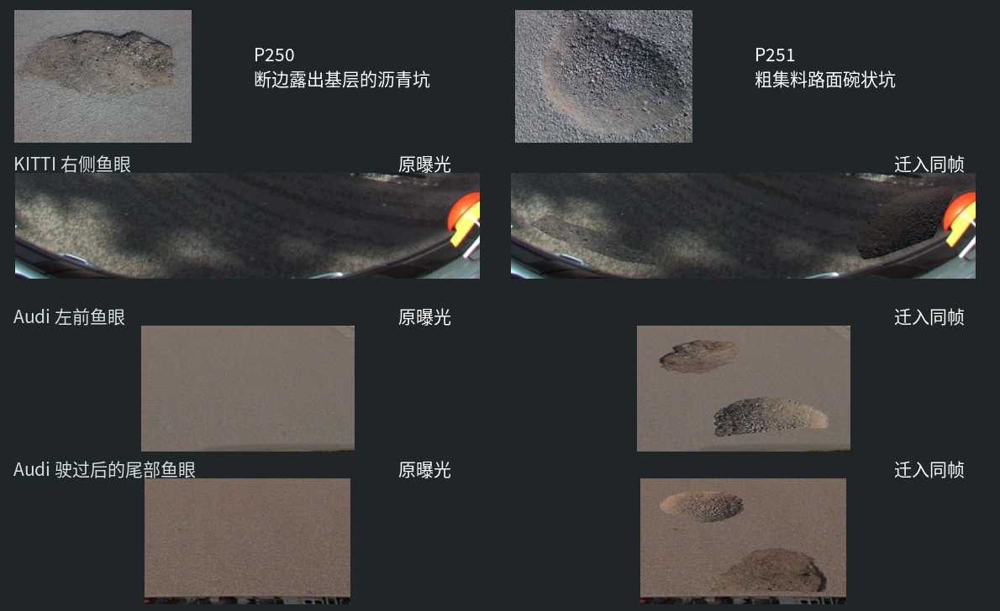

# 断边沥青坑、粗集料碗坑与鱼眼重采样

P250 和 P251 来自两处实拍道路破损，已按原尺度一起放入 KITTI-360 0000 的 30,000 步联合场景。Audi 的左前和车尾来自两台实车相机。车尾第 1518 帧同时看到两个坑，视频在末尾停留 2.5 秒，方便对照迁入前后的同一次曝光。[Audi 驶过后回看](https://github.com/Vexlc/road-hazard-reconstruction/releases/download/remapped-pits-v1.0.0/audi-front-rear.mp4) · [KITTI 检查点局部合成回放](https://github.com/Vexlc/road-hazard-reconstruction/releases/download/remapped-pits-v1.0.0/joint-local-front-rear.mp4) · [检查点直接渲染](https://github.com/Vexlc/road-hazard-reconstruction/releases/download/remapped-pits-v1.0.0/joint-front-rear.mp4)

## 从实拍深度重建两件资产

| 编号 | 估计坑口面积 | 坑口外接矩形 | 相对路面凹深 P95 | 留出深度像素数 | 深度绝对误差 P95 |
|---|---:|---:|---:|---:|---:|
| P250 断边露底坑 | 1.10 m² | 1.64 × 0.87 m | 49 mm | 11,389 | 1.64 mm |
| P251 粗集料碗坑 | 0.91 m² | 1.27 × 0.93 m | 77 mm | 18,095 | 1.15 mm |

留出深度来自同一次曝光。拟合前移除分块选中的深度，保留照片颜色与标注。面积依据拟合坑口投影和数据集标称内参，外接矩形两边长用于判断能否放进目标道路。[采集成员和尺度](../gen2hole/examples/remapped-pits/SOURCES.md) · [重建代码](../gen2hole/multiview_pits.py) · [指标和文件 SHA-256](../validation/remapped-pits.json)

以下命令从拥有仓库读取权限的 Linux 账号运行。只看成品时可直接解开两个模型包。每件含米制 GLB、Gaussian PLY、高度与边界、材质及元数据。

~~~bash
set -e
repo=Vexlc/road-hazard-reconstruction
tag=remapped-pits-v1.0.0
gh repo clone "$repo" -- --branch "$tag" --depth 1
cd road-hazard-reconstruction
python3 scripts/check-reproduction-index.py
python3 gen2hole/gen2hole.py locate P250
kit=downloads/$tag
gh release download "$tag" -R "$repo" -D "$kit" --skip-existing -p captures.zip -p P250.zip -p P251.zip -p SHA256SUMS
(cd "$kit" && sha256sum --ignore-missing -c SHA256SUMS)
python3 -m zipfile -e "$kit/captures.zip" work/remapped-captures
(cd work/remapped-captures && sha256sum -c SHA256SUMS)
for id in P250 P251; do
  python3 -m zipfile -e "$kit/$id.zip" work/remapped-models
  (cd "work/remapped-models/$id" && sha256sum -c SHA256SUMS)
done
~~~

按环境指南安装网格与传感器计算环境，然后在同一检出目录执行下面的命令。构建时使用空的运行目录。每件的五个模型文件都能与发布包比较，留出误差另写入各件的 evaluation/measurements.json。[环境安装与换机](03-environment-and-relocation.md) · [全部阶段的脚本](../scripts/reproduce-remapped-pits.sh)

~~~bash
python3 scripts/configure-gen2hole.py
bash scripts/reproduce-remapped-pits.sh assets
for id in P250 P251; do
  model=runs/remapped-pits/$id/series/assets/pothole/$id
  for f in asset.glb asset.ply metadata.json splat_material.npz surface.npz; do
    cmp "$model/$f" "work/remapped-models/$id/$f"
  done
done
~~~

## 成对放进指定场景并回看

先按全仓手册的 KITTI 小节取回原始 joint.pt，按联合渲染环境安装原生后端，执行 prepare 和 render 准备道路和基准帧。宿主 SHA-256 应为 `0a1ed5554d10ee6948ad0ef4920b7a64e33c7005b39baba2aaafde441f86d0a8`。[宿主、环境与准备命令](16-reproduction-cookbook.md#kitti-360-双坑与后视) · [两处路面支撑和放置姿态](../gen2hole/examples/remapped-pits/kitti.json)

~~~bash
export PIT_MODELS=work/remapped-models
bash scripts/reproduce-remapped-pits.sh joint-build
gh release download "$tag" -R "$repo" -D "$kit" --skip-existing -p P250-P251-joint.pt
(cd "$kit" && sha256sum --ignore-missing -c SHA256SUMS)
cmp runs/streetgs-joint/kitti360-0000/30000/remapped-pits/P250-P251/joint.pt "$kit/P250-P251-joint.pt"
bash scripts/reproduce-remapped-pits.sh joint-render
bash scripts/reproduce-remapped-pits.sh joint-local
~~~

两种检查点视频都展示同一条轨迹的 48 个前视和 48 个虚拟后视。局部合成以原生前后帧为输入，保留坑内渲染及坑沿外 18 cm 过渡带。本组在该区域以外的像素变化数为 0，坑口内对直接渲染的最大通道误差为 0。宿主虚拟后视的原路面仍可见拉伸。[原生建场代码](../streetcrafter/joint/pavement_pair.py) · [局部像素合成](../streetcrafter/joint/local_pavement_replay.py)

重做实车迁入时，按实车数据指南准备 KITTI-360 的前视和右侧鱼眼、Audi 的左前和尾部鱼眼。命令为每段道路重新拟合两处路面并用各机位原始曝光登记亮度。两段道路可分别执行，省略站名会依次执行两个站点。Audi 运行结束后还会用四条子光线复核裁切并旋转过的真实车尾画面。同帧有 15,727 个坑内像素，整个裁片的 RGB、部件、实例和径向距离与原机位对应采样逐像素一致。实拍宿主缺少同位置真实放坑后的对照照片。[实车数据和标定准备](19-roadside-props.md#从实车原始曝光重新拟合与回放) · [实车迁入实现](../scripts/render-mixed-road.py)

~~~bash
bash scripts/reproduce-remapped-pits.sh drive kitti
bash scripts/reproduce-remapped-pits.sh drive audi
~~~

## 接入重采样的相机

裁图、缩放、旋转或去畸变会改变像素与原始曝光行的对应关系。同一输出行可能取自多个拍摄时刻。先把原始传感器的行曝光中点与轨迹对齐，再带着每条光线的原始光心、方向、径向距离、前景遮挡及保护掩膜一起重采样。相机包继续使用同一个世界坐标系，静态曝光可以直接 remap-camera。[相机包字段与逐行登记](25-rolling-covers.md#接入逐行读出的鱼眼或其他渲染器) · [重采样实现](../gen2hole/downstream/camera_remap.py)

`source_xy.npy` 由宿主提供，是 Hout × Wout × 2 的逆映射，最后一维按源图列 x、行 y 排列，左上像素中心为 (0, 0)。工具采用最近像素，半像素处取较大索引，保留源像素的全部子光线。越界和非有限位置填黑并保护，距离记为无穷。原相机使用有符号 host_z 时，在各条源光线的瞬时坐标系中先转成从其光心起算的径向米数。输出相机包已含光线及需要的起点，渲染时直接读取。目标画面采用双线性滤波或其他 ISP 滤波时，可先在原始相机栅格迁入，再将完成的 RGB 按设备的同一滤波流程变换。标签与深度需保留各自的可见性约定。

~~~bash
py=work/envs/roadside-cpu/bin/python
site=work/my-road
"$py" scripts/transfer-mesh-view.py register-readout "$site/raw-timed.npz" "$site/trajectory.npz" "$site/registered.npz"
"$py" scripts/transfer-mesh-view.py remap-camera "$site/registered.npz" "$site/source_xy.npy" "$site/rectified.npz"
"$py" scripts/transfer-mesh-view.py render gen2hole/examples/remapped-pits/layout.json "$site/appearance.json" "$site/rectified.npz" "$site/result" --asset-root work/remapped-models
~~~

上例的 appearance.json 须用本路段的米制道路点、车道前进方向、向上方向和参考照片生成。按顺序运行 road-points、fit、calibrate-pavement，再传给 render。新道路应重新选择两个落点，确保坑沿外有完整路面支撑。[自有宿主拟合与亮度登记的命令](24-asphalt-breakouts.md#在自有鱼眼或其他渲染器登记路面亮度)

## 只用 CPU 重跑鱼眼验收

控制实验使用 M248 缺盖井和 A249 错位井盖。井沿与窄孔能检验一个像素的位姿偏差。输入包括经登记的原始 220° 鱼眼曝光及 Cycles 独立渲染的部件和径向距离。覆盖两种读出方向、旋转后缩放裁切、倾斜的直线投影去畸变。在这八个“模型 × 读出方向 × 逆映射”组合里，错误地为一整行分配中心像素的位姿，部件一致率为 75.62%–97.21%。保留源光线位姿后各组达到 99.91% 以上，匹配部件的距离误差 P95 均低于 0.028 mm。这些是已知几何和轨迹下的控制结果。[控制实验源码](../scripts/check-camera-remap.py) · [逐机位数值](../validation/remapped-pits.json)

~~~bash
gh release download "$tag" -R "$repo" -D "$kit" --skip-existing -p remap-oracle.zip
(cd "$kit" && sha256sum --ignore-missing -c SHA256SUMS)
python3 -m zipfile -e "$kit/remap-oracle.zip" work/remap-oracle
(cd work/remap-oracle && sha256sum -c SHA256SUMS)
coverkit=downloads/rolling-covers-v1.0.0
gh release download rolling-covers-v1.0.0 -R "$repo" -D "$coverkit" --skip-existing -p M248.zip -p A249.zip -p SHA256SUMS
(cd "$coverkit" && sha256sum --ignore-missing -c SHA256SUMS)
for id in M248 A249; do
  python3 -m zipfile -e "$coverkit/$id.zip" work/remap-covers
  (cd "work/remap-covers/$id" && sha256sum -c SHA256SUMS)
done
PIT_CPU_PYTHON="$PWD/work/envs/roadside-cpu/bin/python" bash scripts/reproduce-remapped-pits.sh optics
~~~

最小 CPU 环境仅需上一版锁定的 Python 3.9、NumPy、SciPy、Open3D、Pillow 和 OpenCV。结果在 outputs/remapped-pits/optics/check.json，各机位目录另存 RGB、实例、部件和径向距离。从零生成独立真值时，先运行上一版的 cycles 阶段，再给 check-camera-remap.py 追加 `--from-cycles outputs/rolling-covers`。这一步需另行安装 bpy 4.2.0。[CPU 安装命令](19-roadside-props.md#从原始模型重建四件资产) · [Cycles 建场和原生检测](25-rolling-covers.md#独立验收与适用范围)

本版在独立源码目录复用已安装的依赖、实车数据及基准宿主，从空的资产和渲染输出目录执行。两件的十个模型文件、迁入后的 joint.pt、两段实车视频、两种 KITTI 检查点视频，以及 192 张原生与局部合成的前后视 PNG 均与基准逐字节相同。四个运动鱼眼控制机位的 RGB、部件、实例和径向量程共 16 个文件也逐项核对了 SHA-256。
