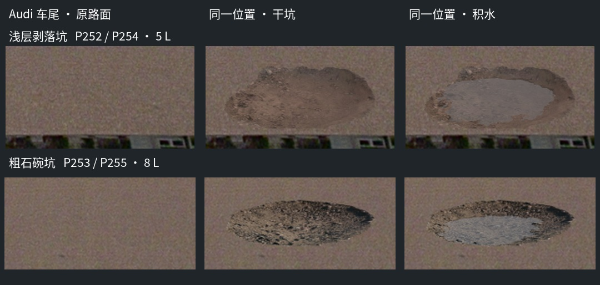

# 实测坑洞、逐坡积水与成对迁入

P252–P255 来自两处真实沥青坑。第一组放入浅干坑和积水碗坑，第二组在同一对位置放入积水浅坑和干碗坑。Audi 车尾第 1519 帧提供相同曝光和裁片，可直接看出水线和反光的变化。[Audi 前视与真实车尾](https://github.com/Vexlc/road-hazard-reconstruction/releases/download/wet-pavement-v1.0.0/audi-front-rear.mp4) · [KITTI 检查点前视与虚拟后视](https://github.com/Vexlc/road-hazard-reconstruction/releases/download/wet-pavement-v1.0.0/joint-local-front-rear.mp4)

| 想复现的结果 | 下载内容 | 所需环境 |
|---|---|---|
| 看干湿坑驶过后的效果 | `audi-front-rear.mp4` 或 `joint-local-front-rear.mp4` | 视频播放器 |
| 自己旋转模型、检查 KITTI 水线 | `kitti-models.zip` | GLB 查看器 |
| 验证新渲染器的逐像素迁入 | `crown-meshes.zip`、`host-cameras.zip` | Python 3.9 和 CPU 光线回放环境 |
| 从源照片重建所有干湿状态 | `captures.zip`，库内已有三个宿主的落点 | 网格与 Gaussian 构建环境 |
| 重建两份联合检查点 | `kitti-models.zip`、原始宿主与基准帧 | 联合场景环境。文件校验可用两份发布的 `*-joint.pt` |
| 从实车原始序列重选位置并拍视频 | 上述模型或重建输入，加 KITTI-360、Audi A2D2 道路数据 | 实车数据、标定、Open3D 与视频编码环境 |

从固定标签进入。下面各节沿用这些变量，命令在仓库根目录执行。需要哪些附件就下载哪些，每次新增附件后可重跑校验。[本次全部附件](https://github.com/Vexlc/road-hazard-reconstruction/releases/tag/wet-pavement-v1.0.0)

~~~bash
set -e
repo=Vexlc/road-hazard-reconstruction
tag=wet-pavement-v1.0.0
gh repo clone "$repo" -- --branch "$tag" --depth 1
cd road-hazard-reconstruction
kit=downloads/$tag
get() { gh release download "$tag" -R "$repo" -D "$kit" --skip-existing "$@"; }
check() { (cd "$kit" && sha256sum --ignore-missing -c SHA256SUMS); }
unpack() { python3 -m zipfile -e "$kit/$1" "$2" && (cd "$2" && sha256sum -c SHA256SUMS); }
get -p SHA256SUMS
python3 scripts/check-reproduction-index.py
python3 gen2hole/gen2hole.py locate P254
~~~

## 先用 CPU 复现三个鱼眼机位

按实车资产指南创建 CPU 环境。模型包里是两份适用于该实验坡面的网格，输入包里有三个已标定的相机曝光、射线、距离、遮挡与光照采样。执行后用发布时的 SHA-256 校验三套 RGB、部件、实例和径向距离共十二个文件。解压不同 ZIP 时各用一个目录，保留各自的 SHA256SUMS。[CPU 环境与固定依赖](19-roadside-props.md#从原始模型重建四件资产) · [阶段脚本](../scripts/reproduce-wet-pavement.sh)

~~~bash
get -p crown-meshes.zip -p host-cameras.zip
check
unpack crown-meshes.zip work/wet-control
unpack host-cameras.zip work/wet-cameras
WET_CPU_PYTHON=work/envs/roadside-cpu/bin/python WET_MODELS=work/wet-control \
  bash scripts/reproduce-wet-pavement.sh replay
~~~

三个 220° 鱼眼机位分别覆盖画面中部、光轴外缘和车后区域。独立 Cycles 水面对象索引共覆盖 610 个像素，与通用渲染器的水面部件及所属实例全部吻合。对应像素的径向距离误差 P95 最大为 0.062 mm。其中浅坑在这个陡坡上几乎排空，三个机位合计只分辨出它的一个水面像素。光学另用原生玻璃和五个入射角校验，最大反射率绝对误差为 0.00019。另将两组真实车尾曝光各自的水面裁片旋转 90°，用原曝光的四条子光线重放，检查反光、部件、实例和径向距离。实车曝光没有同位置真实注水后的照片作为真值。[独立几何与光学验收](../scripts/check-wet-pavement.py) · [逐机位与逐状态数值](../validation/wet-pavement.json)

## 重建两处实测坑床

| 干坑 → 积水状态 | 投影坑口面积 | 坑口外接矩形 | 凹深 P95 | 留出深度数量 / 误差 P95 |
|---|---:|---:|---:|---:|
| P252 → P254 边缘磨圆的浅层剥落 | 0.77 m² | 1.14 × 0.84 m | 73 mm | 10,933 / 1.69 mm |
| P253 → P255 粗石裸露的碗坑 | 1.25 m² | 1.42 × 1.12 m | 81 mm | 18,580 / 1.43 mm |

每个坑从一张配准 RGB、毫米深度和坑口掩膜恢复。只在拟合前留出的同次曝光深度块上计算误差。真实观测提供坑底几何和纹理，面积依赖原数据标称相机参数。复建采用空的运行目录，可通过 WET_MODELS 指定新目录。[两份采集的来源与尺度](../gen2hole/examples/wet-pavement/SOURCES.md) · [网格、深度与 Gaussian 环境](03-environment-and-relocation.md) · [重建代码](../gen2hole/multiview_pits.py)

~~~bash
get -p captures.zip
check
unpack captures.zip work/wet-captures
python3 scripts/configure-gen2hole.py
bash scripts/reproduce-wet-pavement.sh beds
~~~

每个新建的 `runs/wet-pavement/beds/<编号>/series/assets/pothole/<编号>/` 有 GLB、PLY、元数据、材质索引和米制高度场。同一级 series 下的 calibration 和 references 会在重算水面时使用。各件留出结果位于其运行目录的 evaluation/measurements.json。

## 按每处落点重建水面

两处先用干模型检查坑口占地、完整支撑、相互重叠及各自坡面。再按当地重力、注水点和水量沿连通坑床求水平水面。水到边界先溢流，入口直接通往下坡边界时整份水流出。当前模型适用静止、单个连通盆地的积水，遇到需要跨鞍部分配水量的多盆地会报告该条件。新路面应从干坑床重新求解，输出的锚点会校验源模型、注水参数和重力。[逐坡放置代码](../gen2hole/seat_water.py) · [容量、边界溢流和三角形裁切](../gen2hole/recipes/series/pit_water.py)

~~~bash
bash scripts/reproduce-wet-pavement.sh seat kitti audi
bash scripts/reproduce-wet-pavement.sh crown-seat
~~~

KITTI 采用世界 +Z。Audi 的视觉里程计坐标系采用参考时刻车身向上作为重力近似。有 IMU 的新车可显式传入重力反方向。P254 输入 5 L，KITTI 与 Audi 上的水面分别为 0.395、0.416 m²，在控制路面 12.17% 坡上仅留 3.1 mL。P255 输入 8 L，在上述两段实路的水面分别为 0.571、0.575 m²。水量和光学衰减均采用实验设置。

若已准备实车数据，可以由原始点云重新得到两份落点。在新的模型输出目录中，从 beds 阶段开始运行下列流程，避免和以上已建结果重名。[实车数据准备](19-roadside-props.md#从实车原始曝光重新拟合与回放)

~~~bash
export WET_MODELS=runs/wet-resurvey
bash scripts/reproduce-wet-pavement.sh beds
bash scripts/reproduce-wet-pavement.sh survey kitti audi
WET_SURVEYS=outputs/wet-pavement/survey bash scripts/reproduce-wet-pavement.sh seat kitti audi
bash scripts/reproduce-wet-pavement.sh drive kitti audi
bash scripts/reproduce-wet-pavement.sh review
unset WET_MODELS
~~~

`outputs/wet-pavement/audi-front-rear.mp4` 展示两组实际左前和车尾曝光，并各停留 2.5 秒比较原图和迁入结果。KITTI 的实拍视频 `kitti-front-side.mp4` 提供前视与右侧鱼眼。需要复做独立原生对照时，在默认目录完成 beds、seat 和 crown-seat，再执行 `bash scripts/reproduce-wet-pavement.sh cycles`，网格环境需要可导入 bpy 4.2。该步骤重渲染水面、独立玻璃测量和遮挡场景，结果写入 verification.json。[实车渲染](../scripts/render-mixed-road.py) · [Cycles 水面亮度对照](../scripts/render-water-interface.py)

## 迁入指定的 KITTI 检查点

依照联合场景章节恢复 `runs/streetgs-joint/kitti360-0000/30000/joint.pt` 和基准帧。宿主 SHA-256 为 `0a1ed5554d10ee6948ad0ef4920b7a64e33c7005b39baba2aaafde441f86d0a8`。下面直接使用已解算的 KITTI 成品。两种布局各写自己的新检查点。[宿主恢复与联合渲染环境](16-reproduction-cookbook.md#kitti-360-双坑与后视) · [原生高斯迁入](../streetcrafter/joint/pavement_pair.py)

~~~bash
get -p kitti-models.zip -p 'P*-joint.pt'
check
unpack kitti-models.zip work/wet-ready
export WET_MODELS=work/wet-ready
bash scripts/reproduce-wet-pavement.sh joint-build
base=runs/streetgs-joint/kitti360-0000/30000/wet-pavement
for pair in P252-P255 P254-P253; do
  cmp "$base/$pair/joint.pt" "$kit/$pair-joint.pt"
done
bash scripts/reproduce-wet-pavement.sh joint-render
bash scripts/reproduce-wet-pavement.sh joint-local
unset WET_MODELS
~~~

原生检查点使用静态水面颜色和单独采样的水面高斯。前视和虚拟车尾各 48 帧，原宿主对虚拟后视支撑较弱，个别背景有拉伸。局部合成在坑口和 18 cm 过渡带以外保留原始像素。要观察随视角变化的水面反射与折射，可看 Audi 实拍或运行通用相机回放。[原生后视直接渲染](https://github.com/Vexlc/road-hazard-reconstruction/releases/download/wet-pavement-v1.0.0/joint-front-rear.mp4) · [局部合成前后视](https://github.com/Vexlc/road-hazard-reconstruction/releases/download/wet-pavement-v1.0.0/joint-local-front-rear.mp4)

## 接入自己的道路或鱼眼渲染器

宿主提供同一世界坐标系的米制道路点或带标定和道路标签的深度曝光、每像素光线、位姿、前景遮挡及保护掩膜。先登记滚动快门或去畸变逆映射，再对道路拟合、重新注水、登记曝光、渲染。下面的 shell 数组需改成自己路段的落点、车道方向、局部向上和重力反方向。修改两份布局的 xy_m 与 heading_deg 时，同一落点的 id、位姿、顺序要一致。[相机包字段、深度和外参](24-asphalt-breakouts.md#在自有鱼眼或其他渲染器登记路面亮度) · [逐行曝光和鱼眼重采样](26-remapped-pits.md#接入重采样的相机)

~~~bash
py=work/envs/streetcrafter/bin/python
site=work/my-road
src=gen2hole/examples/wet-pavement
beds=runs/wet-pavement/beds
dry="$src/P252-P253.json"
wet="$src/P254-P253.json"
placed="$site/seated"
seed=(10 0 0)
heading=(1 0 0)
up=(0 0 1)
gravity=(0 0 1)
"$py" scripts/transfer-mesh-view.py road-points "$site/road.npy" "$site/front.npz" "$site/side.npz"
"$py" scripts/transfer-mesh-view.py fit "$site/road.npy" "$site/dry.json" --asset "$dry" --asset-root "$beds" \
  --seed "${seed[@]}" --heading "${heading[@]}" --up "${up[@]}" --gravity-up "${gravity[@]}" --radius 2.1
"$py" gen2hole/seat_water.py "$dry" "$site/dry.json" "$wet" "$beds" "$placed"
"$py" scripts/transfer-mesh-view.py calibrate-pavement "$wet" "$placed/anchor.json" "$site/appearance.json" \
  "$site/front.npz" "$site/side.npz" --asset-root "$placed"
"$py" scripts/transfer-mesh-view.py render "$wet" "$site/appearance.json" "$site/rear.npz" "$site/rear-result" --asset-root "$placed"
~~~

曝光登记用同一相机响应、相近光照的参考画面。不同相机可分别登记各自的 appearance.json。要得到方向相关的积水外观，在目标曝光 NPZ 同时提供下列三个字段。程序按反射方向查询环境，按折射方向追踪坑床，近处坑壁优先。超出实测角域的方向回退到坑床颜色，无采样包时显示导出的静态水面材质。远景使用方向采样，近处交通参与者的反射视差仍是近似。[光学实现](../gen2hole/downstream/pavement_water.py)

| 字段 | 布局及单位 |
|---|---|
| `reflection_rays_world` | N × 3，世界系单位向量，从位置指向被观测环境 |
| `reflection_srgb` | N × 3，uint8，同一次曝光或已对齐环境图中的 sRGB |
| `reflection_radius_deg` | 标量，可靠采样的角半径，0° < 半径 ≤ 45°；实车示例为 2° |

输出 after.png、part.png、instance.png 和 range.npy。部件 4 对应水面，距离从每条光线自身的光心起算，单位米。新宿主可从固定 CPU 包中读取一个曝光，核对字段与轴约定，再替换自己的相机、深度和环境光。
