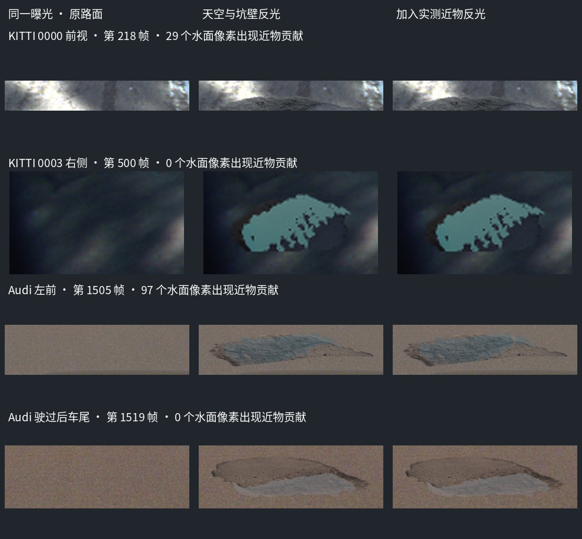
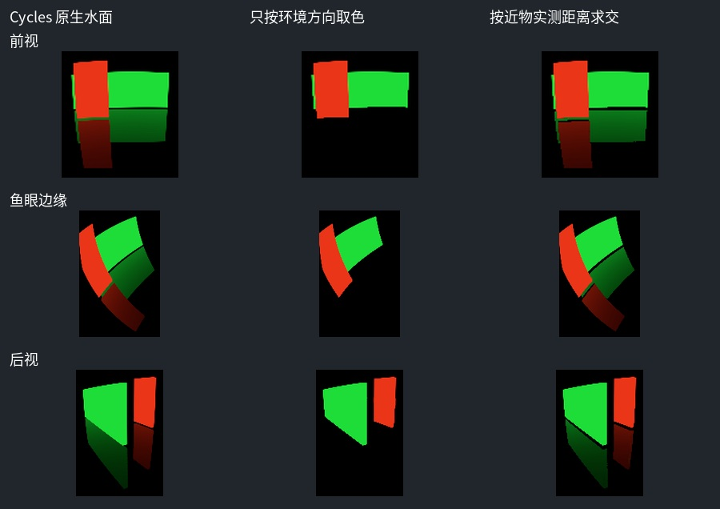

# 两处实测宽坑、三段道路与近物倒影

P256 是碎边露出集料的宽浅坑。P257 是一侧堆有碎石的椭圆坑，注入 9 L 水得到 P258。每次迁入 P256 和 P258 两件。KITTI-360 0000 使用指定的 30,000 步联合检查点，另在 KITTI-360 0003 乡间道路及 Audi 街道的真实曝光上回放。[两件的原始采集和宿主来源](../gen2hole/examples/roadside-reflections/SOURCES.md) · [固定版本和全部附件](https://github.com/Vexlc/road-hazard-reconstruction/releases/tag/roadside-reflections-v1.0.0)

| 想看什么 | 视频 |
|---|---|
| 车驶过后，从实拍尾部鱼眼回看，并停留对照同帧原图 | [Audi 前视与真实车尾](https://github.com/Vexlc/road-hazard-reconstruction/releases/download/roadside-reflections-v1.0.0/audi-front-rear.mp4) |
| 指定 joint.pt 的前视和虚拟后视 | [局部合成](https://github.com/Vexlc/road-hazard-reconstruction/releases/download/roadside-reflections-v1.0.0/joint-local-front-rear.mp4) · [检查点直接渲染](https://github.com/Vexlc/road-hazard-reconstruction/releases/download/roadside-reflections-v1.0.0/joint-front-rear.mp4) |
| 两条 KITTI 路段各自的实拍前视和侧面鱼眼 | [0000 城区](https://github.com/Vexlc/road-hazard-reconstruction/releases/download/roadside-reflections-v1.0.0/kitti-0000-front-side.mp4) · [0003 乡间](https://github.com/Vexlc/road-hazard-reconstruction/releases/download/roadside-reflections-v1.0.0/kitti-0003-front-side.mp4) |

## 拿到固定版本

从有权限的 GitHub 账号在 Bash 中执行。下文的目录相对于仓库根目录。每个 ZIP 单独解压，以保留自己的校验清单。

~~~bash
set -e
repo=Vexlc/road-hazard-reconstruction
tag=roadside-reflections-v1.0.0
gh repo clone "$repo" -- --branch "$tag" --depth 1
cd road-hazard-reconstruction
kit=downloads/$tag
get() { gh release download "$tag" -R "$repo" -D "$kit" --skip-existing "$@"; }
check() { (cd "$kit" && sha256sum --ignore-missing -c SHA256SUMS); }
unpack() { python3 -m zipfile -e "$kit/$1" "$2" && (cd "$2" && sha256sum -c SHA256SUMS); }
get -p SHA256SUMS
python3 scripts/check-reproduction-index.py
python3 gen2hole/gen2hole.py locate P258
~~~

## 从原始采集重建两件大坑

| 坑床 | 坑口面积 | 坑口外接矩形 | 相对路面的凹深 P95 | 留出深度像素数 / 误差 P95 |
|---|---:|---:|---:|---:|
| P256 碎边宽浅坑 | 1.47 m² | 1.43 × 1.25 m | 55 mm | 15,642 / 1.83 mm |
| P257 椭圆碎石坑 | 1.42 m² | 1.48 × 1.16 m | 47 mm | 17,445 / 1.47 mm |

各取一份实拍 RGB、毫米深度与标注。坑口面积按局部路面投影估计，验证深度来自同次曝光拟合前留出的像素块。建模需要网格和 Gaussian 两套环境。原始输入、运行目录及解释器可通过阶段脚本里的 REFLECTION_CAPTURES、REFLECTION_MODELS、REFLECTION_PYTHON 指定。重建和逐坡注水使用新的输出目录。[环境安装](03-environment-and-relocation.md) · [阶段入口](../scripts/reproduce-roadside-reflections.sh) · [留出验证与模型 SHA-256](../validation/roadside-reflections.json)

~~~bash
get -p captures.zip
check
unpack captures.zip work/reflector-captures
python3 scripts/configure-gen2hole.py
bash scripts/reproduce-roadside-reflections.sh beds
~~~

检查 `runs/roadside-reflections/beds/<编号>/series/assets/pothole/<编号>/` 的 asset.glb、asset.ply、surface.npz、splat_material.npz 及 metadata.json。后续换道路时保留同一运行目录里的 calibration 与 references。

## 在三段道路逐处注水并回看

先用干坑测定两个落点的支撑面，再以 P257 的实测几何、目标重力和注水点求水线。在三段道路的目标落点均留住了 9 L 水。水面面积随道路变为 0.563 m²（KITTI 0000）、0.791 m²（KITTI 0003）和 0.574 m²（Audi）。KITTI 用世界 +Z，Audi 用参考时刻车身向上估计重力。对其他车辆可输入 IMU 的重力反方向。[干湿布局及三个落点](../gen2hole/examples/roadside-reflections) · [稳态容量和溢流规则](27-wet-pavement.md#按每处落点重建水面)

~~~bash
bash scripts/reproduce-roadside-reflections.sh seat urban avenue audi
~~~

重做实车拍摄，按实车数据指南准备标定、原图、点云、时间戳和 rig。0003 取 drive 0003 第 480–543 帧，数据目录为 `work/data/kitti360-0003-right`，登记目录为 `work/streetcrafter-rig/kitti360-0003-right`。0000 和 Audi 沿用各自的序列。以下命令重新测量落点，并在同一机位比较天空与坑壁反光、加入实测近物反光后的效果。要改位置，在相同的新布局上先 survey，再设 `REFLECTION_SURVEYS=outputs/roadside-reflections/survey`，在新模型目录中完成 beds 和 seat。[0003 多相机数据入口](../streetcrafter/backends/README.md) · [实车数据和环境](19-roadside-props.md#从实车原始曝光重新拟合与回放)

~~~bash
bash scripts/reproduce-roadside-reflections.sh survey urban avenue audi
for site in urban avenue audi; do
  cmp "outputs/roadside-reflections/survey/$site/anchor.json" "gen2hole/examples/roadside-reflections/anchors/$site.json"
done
bash scripts/reproduce-roadside-reflections.sh drive urban avenue audi
bash scripts/reproduce-roadside-reflections.sh review
~~~

实拍 KITTI 前视用同步双目的左右一致性和当帧 LiDAR，侧面与 Audi 鱼眼用当帧 LiDAR。每个采样面的顶点保留实拍颜色，注册时检查镜头方向及车身遮挡。LiDAR 采样仅连接像面距离不超过 24 像素、世界边长不超过 0.40 m 的三角形。镜面光线从水面交点出发，比较岸壁与可见实测面的距离。实车片中已被近物占用的方向也会从天空采样中剔除。KITTI 城区前视所选帧有 29 个水面像素因实测近物发生变化，Audi 左前有 97 个。乡间侧视和 Audi 车尾所选帧的近物贡献为零，其水线、折射坑底和天空反光仍可见。实车没有同地点真实注水后的照片作为对照，稀疏深度覆盖之外的近物颜色不可观测。[实车测量和回放](../scripts/render-mixed-road.py) · [逐机位消融核验](../scripts/review-roadside-reflections.py)

## 复建指定的联合检查点

恢复原始 `runs/streetgs-joint/kitti360-0000/30000/joint.pt` 和基准帧，安装原生后端。SHA-256 应为 `0a1ed5554d10ee6948ad0ef4920b7a64e33c7005b39baba2aaafde441f86d0a8`。已按该处坡度解算的两件模型均在 kitti-models.zip。[准备原始宿主和基准帧](16-reproduction-cookbook.md#kitti-360-双坑与后视)

~~~bash
get -p kitti-models.zip -p P256-P258-joint.pt
check
unpack kitti-models.zip work/reflector-models
export REFLECTION_MODELS=work/reflector-models
bash scripts/reproduce-roadside-reflections.sh joint-build
cmp runs/streetgs-joint/kitti360-0000/30000/roadside-reflections/P256-P258/joint.pt "$kit/P256-P258-joint.pt"
bash scripts/reproduce-roadside-reflections.sh joint-render
bash scripts/reproduce-roadside-reflections.sh joint-local
unset REFLECTION_MODELS
~~~

原生检查点新增两件资产，水面使用烘焙颜色。两段前后视各含 48 次曝光，视频把同一时刻的机位并排展示。局部合成保留坑外原始画面。逐光线的近物倒影由下节的 CPU 相机渲染与实拍回放提供。

## 把自己的深度和相机接进来

先按上一专题的步骤，用自己的米制路面、干坑床、落点与重力生成湿坑模型、anchor 和按传感器登记的 appearance.json。下面将宿主的实测表面登记到同一世界坐标系。原始观测可以来自另一台相机，需要标定到同一坐标系，曝光与光照响应也需一致。[自有道路落点及相机包](27-wet-pavement.md#接入自己的道路或鱼眼渲染器) · [近物网格构建与查询](../gen2hole/downstream/metric_reflection.py)

每份参考 NPZ 需要 uint8 RGB、米制 camera_to_world、单位 rays_camera、protected，以及 host_range 或带符号的 host_z。新增的 reflector_labels 与深度对齐，0 表示跳过，正整数标出同一实测表面。工具在每个深度样本自身的光心处反投影，只连接同标签的有效近邻，保留被原机位看见的面朝向，过滤遮挡和掠射角下缺乏支撑的三角形。滚动读出的相机先按曝光时间登记。可附上其他机位补足遮挡区。对移动物体只使用同时刻或已经运动补偿的观测。

~~~bash
py=work/envs/roadside-cpu/bin/python
site=work/my-road
"$py" scripts/transfer-mesh-view.py reflection-mesh "$site/front-labelled.npz" "$site/reflectors.npz" \
  --additional-view "$site/side-labelled.npz" --stride 2 --max-edge-m .35
"$py" scripts/transfer-mesh-view.py render gen2hole/examples/roadside-reflections/pair.json \
  "$site/appearance.json" "$site/rear.npz" "$site/result" --asset-root "$site/seated" \
  --reflection-mesh "$site/reflectors.npz"
~~~

引擎也可直接提供 `reflector_vertices_world`（N × 3，世界米制坐标）、`reflector_triangles`（M × 3，零基顶点索引）和 `reflector_srgb`（N × 3，uint8）。三角形按朝向观测者的正面绕序排列。颜色是已观测出射颜色，对强烈随方向变化的反射物，仍须宿主提供适合该方向的观测。三个字段可放入单独文件或嵌入目标相机包。天空等远处光照另用方向采样。鱼眼裁切和旋转会保持世界系反射面。渲染结果的部件、实例和量程始终描述第一可见表面。

## 在 CPU 上核验实拍回放和独立光学对照

安装上游指南列出的 Python 3.9、NumPy、SciPy、Pillow、OpenCV 与 Open3D。只看真实曝光时，下载 kitti-models.zip 和 urban-exposure.zip 即可。下列命令同时重放实拍和独立控制实验。[固定 CPU 环境](19-roadside-props.md#从原始模型重建四件资产)

~~~bash
get -p kitti-models.zip -p urban-exposure.zip -p fisheye-control.zip
check
unpack kitti-models.zip work/reflector-models
unpack urban-exposure.zip work/reflector-exposure
unpack fisheye-control.zip work/reflector-control
export REFLECTION_CPU_PYTHON=work/envs/roadside-cpu/bin/python
REFLECTION_MODELS=work/reflector-models bash scripts/reproduce-roadside-reflections.sh replay
bash scripts/reproduce-roadside-reflections.sh optics
~~~

replay 用真实曝光逐字节检查 RGB、部件、实例和径向距离，并用同一实际坑壁检查遮挡顺序。测试反射面在坑壁前时，两种颜色的最大通道差为 51，移动到壁后降至 0。在非共心光线和百万米地图坐标下，结果相同。[岸壁遮挡测试](../scripts/check-reflected-bank.py)

optics 从七次已知标定的深度曝光重建近、远两块挡板，用另外三台 220° 鱼眼曝光与原生 Cycles 水面比较。六组倒影区域的交并比为 90.05%–96.68%，独立图像内部像素的线性 RGB 误差 P95 最大为 0.0021。边缘相机中有 2,006 个匹配像素的光线位于光轴后半球。控制实验采用发光挡板与吸光底面，使倒影与折射容易区分。结果写入 `outputs/roadside-reflections/optics/check.json`。若想重新生成参考图，安装 bpy 4.2 后执行 `bash scripts/reproduce-roadside-reflections.sh cycles`。[Cycles 场景与材质](../scripts/render-roadside-reflection-control.py) · [CPU 原生对照](../scripts/check-roadside-reflections.py)

