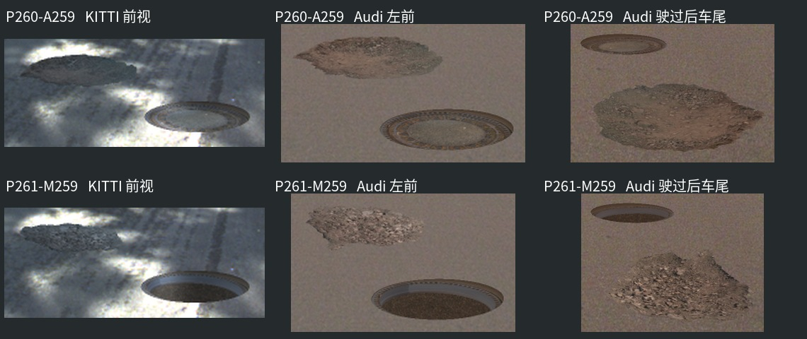

# 实测大坑与异常检查井成对迁入

| 同一段路每次放两件 | 实测坑床 | 检查井状态 |
|---|---|---|
| P260 + A259 | 椭圆浅碗状坑，坑口 1.23 m²，约 1.40 × 1.17 m，深度 P95 为 89 mm | 十六孔填芯盖单侧沉降，扫描中一个孔位被局部遮挡 |
| P261 + M259 | 露出碎石的宽口坑，坑口 1.06 m²，约 1.48 × 0.98 m，深度 P95 为 100 mm | 同一井圈移除盖板，保留座面、井壁和设计井底 |

实际车尾画面在每组驶过后停留 2.5 秒，可同时对照原曝光与迁入图。指定 KITTI 检查点的后视是由车后虚拟机位渲染。KITTI 原始侧鱼眼在这段轨迹中没有两件都完全避开有效像面或车身遮罩边缘的候选帧，视频仍保留完整可见片段。[Audi 真实车尾](https://github.com/Vexlc/road-hazard-reconstruction/releases/download/mixed-inlets-v1.0.0/audi-front-rear.mp4) · [KITTI 原始前视与侧鱼眼](https://github.com/Vexlc/road-hazard-reconstruction/releases/download/mixed-inlets-v1.0.0/kitti-front-side.mp4) · [指定场景局部合成前后视](https://github.com/Vexlc/road-hazard-reconstruction/releases/download/mixed-inlets-v1.0.0/joint-local-front-rear.mp4) · [原生前后视](https://github.com/Vexlc/road-hazard-reconstruction/releases/download/mixed-inlets-v1.0.0/joint-front-rear.mp4)

## 从固定版本开始

在有仓库读取权限的 Bash 环境执行。常规环境、原始 KITTI 及 Audi 宿主、原生 GPU 后端各有独立准备步骤。只用 CPU 检查已发布曝光可直接跳到下文的 CPU 章节。[环境与目录](03-environment-and-relocation.md) · [纯 CPU 环境安装](19-roadside-props.md#从原始模型重建四件资产) · [全部附件](https://github.com/Vexlc/road-hazard-reconstruction/releases/tag/mixed-inlets-v1.0.0)

~~~bash
set -e
repo=Vexlc/road-hazard-reconstruction
tag=mixed-inlets-v1.0.0
gh repo clone "$repo" -- --branch "$tag" --depth 1
cd road-hazard-reconstruction
kit=downloads/$tag
src=gen2hole/examples/mixed-inlets
get() { gh release download "$tag" -R "$repo" -D "$kit" --skip-existing "$@"; }
unpack() { python3 -m zipfile -e "$kit/$1" "$2" && (cd "$2" && sha256sum -c SHA256SUMS); }
check() { (cd "$kit" && sha256sum --ignore-missing -c SHA256SUMS); }
get -p SHA256SUMS
python3 scripts/check-reproduction-index.py
python3 gen2hole/gen2hole.py locate M259
~~~

## 从实拍输入重建大坑与扫描井盖

两个坑分别使用一份配准 RGB、光学深度和原始标注。拟合前留出的深度块同属一次曝光。P260 在 9,508 个留出坑内像素上深度误差 P95 为 4.00 mm，P261 在 9,657 个像素上为 2.41 mm。井盖按扫描的近似画幅定标，外径约 0.696 m。配方设定井圈中心下沉 26 mm、倾斜 3.2° 和井深 0.62 m。十六个孔位中有一处被遮挡，两个剩余的缝隙各自贯通，细条仍在盖面。几何检查从原扫描选取的十七个暗区分别打射线，再检查该细条和盖面中心。[采集和设计尺寸](../gen2hole/examples/mixed-inlets/SOURCES.md) · [坑床重建](../gen2hole/multiview_pits.py) · [活动盖板与固定井筒](../gen2hole/survey.py)

~~~bash
get -p captures.zip -p models.zip
check
unpack captures.zip work/inlet-captures
unpack models.zip work/inlet-models
python3 scripts/configure-gen2hole.py
py=work/envs/streetcrafter/bin/python
src=gen2hole/examples/mixed-inlets
"$py" "$src/prepare.py" work/inlet-captures/ManholeCover004_1K-PNG.zip --out work/inlet-scan-check
for f in work/inlet-scan-check/*.png; do cmp "$f" "$src/004/${f##*/}"; done
bash scripts/reproduce-mixed-inlets.sh assets
for d in runs/mixed-inlets/*/series/assets/*/*; do
  for f in asset.glb asset.ply surface.npz splat_material.npz metadata.json; do
    cmp "$d/$f" "work/inlet-models/${d##*/}/$f"
  done
done
~~~

## 迁入实车与指定检查点

两种布局的每件资产均独立拟合局部支撑面，并检查孔口间距、网格和高程场指纹。按实车指南恢复 KITTI-360 0000 和 Audi 原始标定、rig、时间戳、照片及 LiDAR。drive 先获取参考路面曝光，再按同机位登记外观。查看数据位于 outputs/mixed-inlets。前视或回看帧优先选两件都避开图像边缘和车身遮罩的曝光；退回片段内最佳可用帧时，index.json 中的 unclipped_preview 为 false。[两组布局和固定落点](../gen2hole/examples/mixed-inlets) · [实车数据准备](19-roadside-props.md#从实车原始曝光重新拟合与回放) · [实拍核验代码](../scripts/review-mixed-inlets.py)

~~~bash
bash scripts/reproduce-mixed-inlets.sh drive
bash scripts/reproduce-mixed-inlets.sh review
for pair in P260-A259 P261-M259; do
  cmp "outputs/mixed-inlets/reference/$pair/kitti/anchor.json" "$src/anchors/$pair-kitti.json"
done
~~~

指定宿主为 runs/streetgs-joint/kitti360-0000/30000/joint.pt，SHA-256 为 0a1ed5554d10ee6948ad0ef4920b7a64e33c7005b39baba2aaafde441f86d0a8。每组输出到该目录下的 mixed-inlets/组名/joint.pt。先按前文下载 models.zip，恢复原始宿主及基准帧。两组各有 48 帧前视和 48 帧虚拟后视。原生图可能出现检查点重采样带来的远处差异，joint-local 用三维支撑范围限定改动，两组前后视在支撑范围外的改动均为零。[原宿主和帧准备](16-reproduction-cookbook.md#kitti-360-双坑与后视) · [原生场景迁入](../streetcrafter/joint/pavement_pair.py)

~~~bash
get -p 'P*-joint.pt'
check
export INLET_MODELS=work/inlet-models
bash scripts/reproduce-mixed-inlets.sh joint-build
for pair in P260-A259 P261-M259; do
  cmp "runs/streetgs-joint/kitti360-0000/30000/mixed-inlets/$pair/joint.pt" "$kit/$pair-joint.pt"
done
bash scripts/reproduce-mixed-inlets.sh joint-render
bash scripts/reproduce-mixed-inlets.sh joint-local
unset INLET_MODELS
~~~

## 用 CPU 回放真实曝光与独立鱼眼

以下只需 Python、NumPy、SciPy、OpenCV、Pillow 和 Open3D。四件模型、相机包和核验输入来自固定附件。replay 检查八个实车曝光的 RGB、部件、实例和径向量程，共 32 个逐文件校验和。optics 从宿主量程重新拟合落点和外观，对照独立 Cycles 的真实网格光线交点。模型路径、原始采集、输出、相机包和解释器可通过阶段脚本中的 INLET 变量覆盖。[阶段脚本](../scripts/reproduce-mixed-inlets.sh) · [逐项数值和文件 SHA-256](../validation/mixed-inlets.json)

~~~bash
get -p models.zip -p real-cameras.zip -p fisheye-control.zip
check
unpack models.zip work/inlet-models
unpack real-cameras.zip work/inlet-exposures
unpack fisheye-control.zip work/inlet-cameras
export INLET_MODELS=work/inlet-models
export INLET_CPU_PYTHON=work/envs/roadside-cpu/bin/python
bash scripts/reproduce-mixed-inlets.sh replay
bash scripts/reproduce-mixed-inlets.sh optics
~~~

## 在其他鱼眼或渲染器保留遮挡边缘

宿主相机先提供世界米制坐标与 pose、单位像素光线、前景量程和保护遮罩。原始照片可继续使用单张 rgb。若渲染器还能导出同一像素的多个独立采样，可把每条光线的颜色和响应一起登记。以下字段使用 NumPy NPZ，S 表示采样数。[通用相机包约定](26-remapped-pits.md#接入重采样的相机) · [相机接口](../scripts/transfer-mesh-view.py) · [光学采样和颜色合成](../gen2hole/downstream/host_exposure.py)

| 字段 | 数据及坐标 |
|---|---|
| rgb | H × W × 3，uint8 sRGB。与下述采样在线性光空间加权后编码的结果每通道最多相差 1 个量化级 |
| sample_rgb | S × H × W × 3，每条宿主光线被替换之前的 uint8 sRGB，顺序和 rays_camera 一致 |
| sample_weights | 可省略以使用等权。可用 S 个固定权重，也可给 S × H × W。有限、非负，每个像素至少一个正权重，逐像素归一化 |
| 遮挡与量程 | protected、occluder_range 与宿主深度可逐光线填写。被遮挡的光线保留其原颜色。零权重光线不参与可见实例、最近距离或颜色 |
| 其他相机 | 支持每条光线独立的光心、带符号的光轴深度、逐行姿态和视图重映射。最终颜色在线性空间合成后编码回 sRGB |

同一个 layout 在新宿主上先从可信路面点拟合锚点，再登记参考曝光。后处理已调色或色调映射的输出，需由宿主导出满足上述响应关系的输入。实车片未提供子光线独立颜色，使用真实整像素曝光。下面使用你自己的 host 文件；位置、行驶方向和向上方向均以该宿主的世界坐标填写。

~~~bash
py=$INLET_CPU_PYTHON
src=gen2hole/examples/mixed-inlets
layout=$src/P261-M259.json
site=work/my-road
"$py" scripts/transfer-mesh-view.py road-points "$site/road.npy" "$site/survey.npz" --stride 3
"$py" scripts/transfer-mesh-view.py fit "$site/road.npy" "$site/anchor.json" \
  --seed 0 0 0 --heading 1 0 0 --up 0 0 1 --radius 1.4 --asset "$layout" --asset-root work/inlet-models
"$py" scripts/transfer-mesh-view.py calibrate-pavement "$layout" "$site/anchor.json" "$site/appearance.json" \
  "$site/survey.npz" --asset-root work/inlet-models
"$py" scripts/transfer-mesh-view.py render "$layout" "$site/appearance.json" "$site/rear.npz" "$site/result" --asset-root work/inlet-models
~~~

独立控制使用两组真实网格和 220° 鱼眼，在镜头前放一根细杆。仅将细杆朝向相机的出射色从琥珀色切为青色，保留照明，独立渲染宿主与迁入图，再对照颜色变化。两种机位、四件资产共有 354 个同时看见细杆和病害的边缘像素。按资产及机位分组，线性 RGB 颜色变化的平均绝对误差在 0.0020–0.0045 之间。用已合成宿主颜色近似每条剩余光线时，同一指标为 0.122–0.140。覆盖与原生实例的最低 IoU 为 99.89%。这些数值来自固定的控制场景。若要从头生成独立参考图，安装 bpy 4.2 后指定新的 INLET_CAMERAS 目录，执行 `bash scripts/reproduce-mixed-inlets.sh cycles`。[原生 Cycles 场景](../scripts/render-inlet-control.py) · [跨引擎检查](../scripts/check-inlet-sampling.py)
