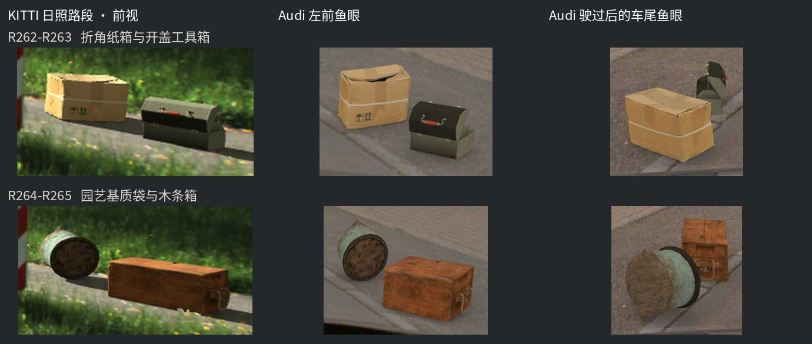

# 道路散落货物的重建与成对迁入

R262–R265 分为两组，一组是折角纸箱和开盖工具箱，另一组是侧倒基质袋和带盖木箱。KITTI 两组各用指定的 30,000 步检查点独立迁入，视频左边显示原道路，右边显示迁入结果。Audi 使用前后两台实车相机，驶过后停留 2.5 秒，可逐件查看同帧原图与合成图。[KITTI 原生前视和虚拟后视](https://github.com/Vexlc/road-hazard-reconstruction/releases/download/lost-cargo-v1.0.0/joint-front-rear.mp4) · [Audi 实拍前后鱼眼](https://github.com/Vexlc/road-hazard-reconstruction/releases/download/lost-cargo-v1.0.0/audi-front-rear.mp4)

## 从原始网格重建四件散落物

在 Linux 上运行以下命令。四件资产的 20 个原文件均在 Git 中。这一阶段使用 CPU，复现环境为 Python 3.9、Open3D 0.18 和系统的 libGL、libgomp。[输入来源和署名](../gen2hole/examples/lost-cargo/SOURCES.md) · [按编号重建](../gen2hole/road_debris.py) · [组合几何与材质](../gen2hole/roadside_layout.py)

~~~bash
gh repo clone Vexlc/road-hazard-reconstruction -- --branch lost-cargo-v1.0.0 --depth 1
cd road-hazard-reconstruction
python3 scripts/check-reproduction-index.py
python3 gen2hole/gen2hole.py locate R263
python3.9 -m venv work/envs/roadside-cpu
py=work/envs/roadside-cpu/bin/python
"$py" -m pip install numpy==1.26.4 scipy==1.13.1 open3d==0.18.0 pillow==11.3.0 opencv-python==4.10.0.84
bash scripts/reproduce-lost-cargo.sh assets
~~~

输出在 `runs/lost-cargo/assets/`，含四个单件和两个成组目录。每个目录有 `asset.glb`、`surface.npz`、`samples.npz` 和 `metadata.json`。GLB 使用米制 Y-up，迁入空间使用米制 Z-up。单件记录源文件校验和、落地旋转与支撑余量。姿态计算用壳面面积估算重心，取距最低点 0.8 mm 内的顶点确定支撑。工具箱盖的父节点旋转会同时带动提手和搭扣。两个组合分别烘焙互相遮挡后的天空可见度。[网格节点和接触阴影](../gen2hole/roadside_props.py) · [两组配方](../gen2hole/examples/lost-cargo)

复跑 `assets` 请指定新的空目录，例如 `CARGO_MODELS=runs/cargo-second bash scripts/reproduce-lost-cargo.sh assets`。若要重新向发布者下载原始数据，运行以下命令，程序会核对固定的文件长度和 SHA-256。

~~~bash
"$py" gen2hole/road_debris.py --recipe gen2hole/examples/lost-cargo/sources.json --sources work/cargo-original --fetch --out runs/cargo-from-publisher
~~~

## 在 CPU 上复现前后视、实例和距离

相机包包含每组的 KITTI 实拍前视、Audi 实拍车尾，以及独立 Blender Cycles 220° 鱼眼的前方、边缘、后方和近景。可从网格和相机包直接重放。每个视角核对合成图、实例、部件、径向距离和阴影五个文件。检查脚本同时用前方、侧缘和后方三个合成机位的宿主路面深度重拟合锚点，并验证整体占地检查会放过的三种情况：单件局部缺测、5.5 cm 台阶、支点单独缺测。逐件检查会拒绝这三类落点。[相机回放与检查代码](../scripts/check-cargo-replay.py)

~~~bash
tag=lost-cargo-v1.0.0
kit=downloads/$tag
gh release download "$tag" -R Vexlc/road-hazard-reconstruction -D "$kit" -p cargo-camera-packets.zip -p SHA256SUMS --skip-existing
(cd "$kit" && sha256sum --ignore-missing -c SHA256SUMS)
python3 -m zipfile -e "$kit/cargo-camera-packets.zip" work/cargo-packets
(cd work/cargo-packets && sha256sum -c SHA256SUMS)
bash scripts/reproduce-lost-cargo.sh replay
~~~

结果在 `outputs/lost-cargo/replay/<组号>/<相机组>/<视角>/`。前面的 `assets` 若使用自定义路径，后续命令需沿用 `CARGO_MODELS`。独立重算 Cycles 原生参照需安装带 bpy 的环境，然后执行 `bash scripts/reproduce-lost-cargo.sh cycles`。Blender 还会独立导入原始 glTF 并核对层级变换后的全部顶点，包括工具箱提手与搭扣。原生渲染提供对象索引、距离和材质法线，测量接缝和鱼眼边缘的误差。[Blender 环境与鱼眼验证](23-road-debris.md) · [各机位验证数值](../validation/lost-cargo.json)

## 迁入指定的 KITTI 检查点

以下命令校验原始宿主，在两组各自的目录写入新检查点。构建依赖项目 PyTorch 环境，重载视频还需要 KITTI 原始轨迹、官方 3dgrut 及其 CUDA 扩展。用于这两次构建的落点、照明、车身净距和资产指纹已经随 Git 提供。[准备宿主环境与轨迹](19-roadside-props.md#迁入指定的-30000-步原生场景) · [原生迁入和重载代码](../streetcrafter/joint/roadside_pairs.py) · [复现脚本](../scripts/reproduce-lost-cargo.sh)

~~~bash
base=runs/streetgs-joint/kitti360-0000/30000
mkdir -p "$base"
if [ ! -f "$base/joint.pt" ]; then
  gh release download reproduction-2026.11.25 -R Vexlc/road-hazard-reconstruction -p kitti360-0000-30000.pt -O "$base/joint.pt"
fi
echo "0a1ed5554d10ee6948ad0ef4920b7a64e33c7005b39baba2aaafde441f86d0a8  $base/joint.pt" | sha256sum -c - || exit 1
bash scripts/reproduce-lost-cargo.sh joint-build
bash scripts/reproduce-lost-cargo.sh joint-render
~~~

输出为 `$base/lost-cargo/{R262-R263,R264-R265}/joint.pt` 及各自的 `placement.json`。两组均包含全部 48 个轨迹时刻。前视与虚拟后视合并为 `outputs/lost-cargo/joint-front-rear.mp4`。真实驾驶合成需准备两段 KITTI 实拍输入和 Audi 左前、车尾相机及各自的点云，再运行 `bash scripts/reproduce-lost-cargo.sh physical`。同次重新测量的锚点可用 `CARGO_ANCHORS=outputs/lost-cargo bash scripts/reproduce-lost-cargo.sh joint-build` 传入。[实车输入和光照](23-road-debris.md) · [完整发布附件](https://github.com/Vexlc/road-hazard-reconstruction/releases/tag/lost-cargo-v1.0.0)

## 换路面或鱼眼相机

选一个能同时托住两件物体的路面位置。先检查整体占地，再从组合网格中按实例提取距底部 6 mm 内的顶点，分别拟合周围的路面。每件至少要有覆盖四个象限的 16 个实测网格，接触顶点到独立支撑面的最大距离以及路面格点残差 P90 均须在 20 mm 内。此外还检查每处承重点半径 10.5 cm 内的实测高度，并在相邻的 10 cm 网格中寻找连续出现的 4 cm 以上高差。跨台阶或某一件脚下缺测时应换位置。倾斜但连续的路面可随整体锚点转动。两侧需要不同支撑平面的地点不适用这一组合。[支撑判定实现](../gen2hole/downstream/cargo_support.py)

自有宿主需要 `road.npy`（世界系米制 N×3 路面点），一个靠近路面的种子、行车朝向和向上方向。下例假定局部坐标原点恰在落点，X 沿车行、Z 向上。实际项目须代入本宿主的值。可通过 `--trajectory vehicle-centres.npy` 加入整车包络检查，参数为车辆中心的世界坐标轨迹。前后相机使用同一个注册锚点。

~~~bash
model=runs/lost-cargo/assets/R262-R263
"$py" scripts/transfer-mesh-view.py fit road.npy work/my-anchor.json --asset "$model" --seed 0 0 0 --heading 1 0 0 --up 0 0 1 --radius 1.5 --lighting light.json
"$py" scripts/transfer-mesh-view.py render "$model" work/my-anchor.json rear-view.npz outputs/my-cargo-rear
~~~

`light.json` 可直接从相机包的 `R262-R263/cycles/light.json` 查看字段，实际光照应按宿主标定。相机包包含 uint8 RGB、刚体 `camera_to_world`、逐像素有效域，以及有单位的深度。其他渲染器可导出每像素单位光线，非共心镜头还可给出每条光线在相机系的米制原点。鱼眼后半球应给径向距离。将同一包输入 CPU 回放即可对照宿主像素。实拍道路的材料和阴影属于合成估计，真实接地位置也受路面测量精度限制。[相机字段与深度约定](22-scanned-round-covers.md) · [多采样和前景遮挡](29-mixed-inlets.md)
