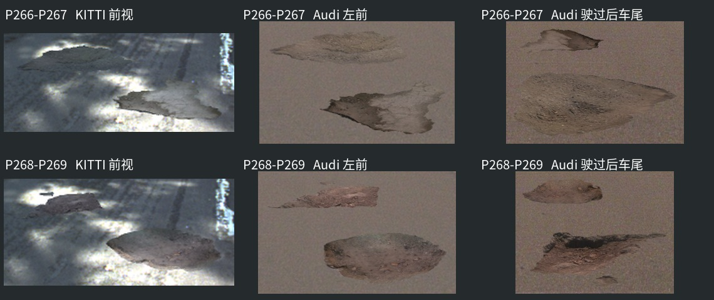

# 四处实测沥青坑的重建与六面鱼眼迁入

每次向 KITTI-360 0000 的 30,000 步场景放两个坑。想看驶过后的效果，Audi 视频先给左前鱼眼，再切到真实车尾并停留 2.5 秒。KITTI 的指定检查点提供原生前视和虚拟后视，另有按三维支撑范围合成的版本。左右画面可对照原道路与迁入结果。[Audi 实拍前后视](https://github.com/Vexlc/road-hazard-reconstruction/releases/download/cube-pits-v1.0.0/audi-front-rear.mp4) · [KITTI 局部前后视](https://github.com/Vexlc/road-hazard-reconstruction/releases/download/cube-pits-v1.0.0/joint-local-front-rear.mp4) · [KITTI 原生前后视](https://github.com/Vexlc/road-hazard-reconstruction/releases/download/cube-pits-v1.0.0/joint-front-rear.mp4) · [KITTI 实拍前视与右侧鱼眼](https://github.com/Vexlc/road-hazard-reconstruction/releases/download/cube-pits-v1.0.0/kitti-front-side.mp4)

| 成组 | 资产与采集特征 | 可见坑口面积 | 平面长 × 宽 | 坑内深度 P95 |
|---|---|---:|---:|---:|
| 第一组 | P266 黄褐色集料外露的宽浅坑 | 1.79 m² | 1.67 × 1.48 m | 103 mm |
| 第一组 | P267 碎边沥青坑 | 0.88 m² | 1.53 × 0.93 m | 60 mm |
| 第二组 | P268 一侧较陡的红褐色坑 | 0.92 m² | 1.54 × 1.04 m | 117 mm |
| 第二组 | P269 坑缘露出碎集料的碗状坑 | 1.09 m² | 1.27 × 1.13 m | 90 mm |

面积由网格的病害掩膜积分，长宽取坑口的最小外接矩形，深度相对于邻接路面。P267 的下沿靠近原图底边。P268 的标注抵达原图左边界，其面积只覆盖观测范围，迁入后有一段较直的边缘。数据集提供毫米深度，使用标称相机内参，尺寸为估计值。[原始采集、标注及尺寸依据](../gen2hole/examples/cube-pits/SOURCES.md) · [各件的测量与校验值](../validation/cube-pits.json)

## 下载与准备

在 Linux 上从有读取权限的 GitHub 账号执行下列 Bash 命令。四个压缩包均含逐文件 SHA-256，版本附件另附总清单。只需看视频可直接使用上方链接。[全部附件](https://github.com/Vexlc/road-hazard-reconstruction/releases/tag/cube-pits-v1.0.0)

~~~bash
set -e
repo=Vexlc/road-hazard-reconstruction
tag=cube-pits-v1.0.0
gh repo clone "$repo" -- --branch "$tag" --depth 1
cd road-hazard-reconstruction
kit=downloads/$tag
src=gen2hole/examples/cube-pits
get() { gh release download "$tag" -R "$repo" -D "$kit" --skip-existing "$@"; }
unpack() { python3 -m zipfile -e "$kit/$1" "$2" && (cd "$2" && sha256sum -c SHA256SUMS); }
check() { (cd "$kit" && sha256sum --ignore-missing -c SHA256SUMS); }
get -p SHA256SUMS
python3 scripts/check-reproduction-index.py
python3 gen2hole/gen2hole.py locate P269
~~~

## 从五份原始曝光重建四个坑

准备项目网格与计算环境，再运行下列命令。captures.zip 是建模输入，models.zip 用于对照输出，也可以直接用于后面的 CPU 回放。每件的五个产物为纹理 GLB、Gaussian PLY、道路与坑床高度场、采样材质和元数据。[环境安装与迁机](03-environment-and-relocation.md) · [重建代码](../gen2hole/multiview_pits.py) · [四份建模配方与两份布局](../gen2hole/examples/cube-pits)

~~~bash
get -p captures.zip -p models.zip
check
unpack captures.zip work/cube-captures
unpack models.zip work/cube-models
python3 scripts/configure-gen2hole.py
bash scripts/reproduce-cube-pits.sh assets
for dir in runs/cube-pits/*/series/assets/*/*; do
  diff -qr "$dir" "work/cube-models/${dir##*/}"
done
~~~

P266、P267、P268 在拟合前预留同一曝光中的 4 × 4 深度块，留出坑内像素数分别为 9,694、12,764、7,671。用导出的网格对照这些原始距离，绝对误差 P95 分别为 4.90、1.52、4.73 mm。P269 使用另一个机位验收，第二张的深度和坑床颜色均未用于建模。80,921 个共同可见坑内像素的距离误差中位数为 20.84 mm、P95 为 62.14 mm，轮廓 IoU 为 0.835。跨机位误差同时包含注册和几何误差，图像细纹理的跨视角一致性也较弱。[重投影与留出记录](../validation/cube-pits.json)

## 只用 CPU 重放实拍曝光

这一节从 models.zip、real-cameras.zip 开始，无需训练道路。复现时使用 Linux、Python 3.9 和 Open3D 0.18。逐一核对两组在 KITTI 前视、右侧鱼眼、Audi 左前和真实车尾的结果，共八个相机包、32 个输出。输出在 outputs/cube-pits/replay 下，各机位生成 after.png、part.png、instance.png 和米制 range.npy。[回放入口](../scripts/transfer-mesh-view.py) · [逐目验收脚本](../scripts/reproduce-cube-pits.sh)

~~~bash
python3.9 -m venv work/envs/roadside-cpu
export CUBE_CPU_PYTHON="$PWD/work/envs/roadside-cpu/bin/python"
"$CUBE_CPU_PYTHON" -m pip install numpy==1.26.4 scipy==1.13.1 open3d==0.18.0 pillow==11.3.0 opencv-python==4.10.0.84
get -p models.zip -p real-cameras.zip
check
unpack models.zip work/cube-models
unpack real-cameras.zip work/cube-exposures
export CUBE_MODELS=work/cube-models
bash scripts/reproduce-cube-pits.sh replay
~~~

## 迁入同一检查点并从车尾回看

先按指南恢复原始检查点、基准帧、官方 3dgrut CUDA 环境和 KITTI 轨迹。每组使用独立落点记录、资产 SHA-256 和姿态。joint-build 产生两份检查点，joint-render 从头重载，每组输出 48 帧前视及 48 帧虚拟后视。joint-local 在原生视频的三维支撑范围内保留重渲染像素，范围以外使用基准图。合成视频在 outputs/cube-pits/local/joint-front-rear.mp4。[准备原始检查点和帧](16-reproduction-cookbook.md#kitti-360-双坑与后视) · [原生后端与环境](19-roadside-props.md#迁入指定的-30000-步原生场景) · [检查点迁入实现](../streetcrafter/joint/pavement_pair.py)

~~~bash
base=runs/streetgs-joint/kitti360-0000/30000
echo "0a1ed5554d10ee6948ad0ef4920b7a64e33c7005b39baba2aaafde441f86d0a8  $base/joint.pt" | sha256sum -c -
get -p 'P*-joint.pt'
check
bash scripts/reproduce-cube-pits.sh joint-build
for pair in P266-P267 P268-P269; do
  cmp "$base/cube-pits/$pair/joint.pt" "$kit/$pair-joint.pt"
done
bash scripts/reproduce-cube-pits.sh joint-render
bash scripts/reproduce-cube-pits.sh joint-local
~~~

要从实车序列重新估计外观、生成实拍前后视视频，先恢复 KITTI 与 A2D2 的相机、LiDAR 和车辆标定，再运行下面两步。KITTI 前视和 Audi 的两台相机均有两处坑完整可见的曝光。KITTI 右侧鱼眼的最佳曝光有边缘裁切。实际车尾两组各有 19 帧同时看得见两个坑。[实车输入与标定安装](19-roadside-props.md#从实车原始曝光重新拟合与回放) · [车身与画幅检查](../scripts/review-mixed-inlets.py)

~~~bash
bash scripts/reproduce-cube-pits.sh drive
bash scripts/reproduce-cube-pits.sh review
~~~

独立检出目录中复用了已安装环境和宿主采集，从空输出目录重跑这两组。20 个模型文件、32 个实拍回放产物、两个检查点、四个视频均与发布件逐字节一致。原生和局部两条路线共核对 384 帧前后视。[复现记录](../validation/cube-pits.json)

## 将六面深度缓冲接入其他鱼眼宿主

适用于同一时间、同一光心的六台 90° 正方形透视相机，目标镜头可单独旋转。已有逐像素光线与米制径向距离时可直接传给 render。各光线具有独立起点或曝光时刻的相机，请使用逐光线原点或逐行位姿接口。[六面转换](../gen2hole/downstream/cube_camera.py) · [非共心鱼眼](22-scanned-round-covers.md) · [逐行相机](25-rolling-covers.md) · [多采样颜色与权重](29-mixed-inlets.md)

| 包与字段 | 宿主应输出的内容 |
|---|---|
| faces.npz 的 rgb、device_depth、depth_valid | 6 × N × N，RGB 另有 3 个通道。颜色为 uint8 sRGB，每面首行在上。深度为浮点窗口深度 [0, 1]，显式 bool 有效位区分背景与远平面。 |
| near_m、far_m、reversed_z | 米制正近裁面，远裁面可为正无穷，布尔值标记反向 Z。投影使用标准透视深度。宿主若输出 NDC [-1, 1]，先换算为窗口深度。 |
| face_to_cube、camera_to_world | 六个 3 × 3 右手旋转，列为各面的右、下、前方向，顺序与缓存相同。cube 和 lens 分别提供米制 4 × 4 相机到世界变换。 |
| receiver_mask、occluder_mask | 与六面缓存对齐的布尔实测路面、前景遮挡。两者互斥，只有路面样本参与路面锚点拟合。 |
| lens.npz 的 rays_camera、protected | H × W × 3 或 S × H × W × 3 的单位方向、空间对齐的保护区。光线可以越过镜头的 90° 平面。 |
| 可选 cube_texel、sample_weights | 如实记录最近邻采样的整数三元组（面序号、列、行），逐光线给出。省略时按方向计算最近纹素，硬件边界取整可能命中相邻纹素。多光线可传 S 或 S × H × W 的响应权重，颜色在线性空间积分。 |

下面可直接用下载的参照场景试跑。optics 依次转换两个机位，从宿主路面深度反投影并拟合锚点，再渲染两个网格。复核依据为 OpenGL 的硬件深度、对象编号及独立世界位置通道。四个机位中，坑沿跨过立方体接缝，侧向机位还观察到镜头后半球的坑床。实例 IoU 最低 0.9982，宿主距离最大偏差 1.34 mm，前景遮住的 1,590 个坑洞像素均保持原色。[独立验收](../scripts/check-cube-pits.py) · [各机位结果](../validation/cube-pits.json)

~~~bash
get -p cubemap-control.zip
check
unpack cubemap-control.zip work/cube-cameras
CUBE_MODELS=work/cube-models bash scripts/reproduce-cube-pits.sh optics
~~~

接自己的场景时，分别导出前后机位的 faces.npz 与 lens.npz，然后用同一个道路世界坐标系拟合两件资产。以下命令假定场景种子在原点、X 沿道路、Z 向上。将种子、车行方向和上方向换成实际测量值。radius 的单位是米。实车可追加 --trajectory 并传入 N × 3 的车辆中心轨迹，按车身长宽进行净距检查。不同路面应重新拟合光照与每件的支撑面。[路面注册与布局](../gen2hole/downstream/pavement_layout.py)

~~~bash
tool=scripts/transfer-mesh-view.py
layout=$src/P266-P267.json
for cam in front rear; do
  "$CUBE_CPU_PYTHON" "$tool" from-cube "$cam/faces.npz" "$cam/lens.npz" "work/$cam.npz"
done
"$CUBE_CPU_PYTHON" "$tool" road-points work/road.npy work/front.npz work/rear.npz --stride 3
"$CUBE_CPU_PYTHON" "$tool" fit work/road.npy work/anchor.json --asset "$layout" --asset-root "$CUBE_MODELS" --seed 0 0 0 --heading 1 0 0 --up 0 0 1 --radius 2
for cam in front rear; do
  "$CUBE_CPU_PYTHON" "$tool" render "$layout" work/anchor.json "work/$cam.npz" "outputs/my-pits/$cam" --asset-root "$CUBE_MODELS"
done
~~~

要从头生成对照输入，使用 Linux EGL 驱动与下列环境。GL 阶段独立读取 GLB，在 384 × 384 的六个面渲染普通有限远平面和反向无限远平面，投到 416 × 416 的 222° 等距鱼眼。不同 GPU/驱动的栅格化与浮点取整可能略有差别，用 optics 检查该设备生成的一组图。[OpenGL 渲染代码](../scripts/render-cube-pits.py) · [ModernGL 上下文接口](https://moderngl.readthedocs.io/en/stable/reference/context.html)

~~~bash
python3.11 -m venv work/envs/cubegl
work/envs/cubegl/bin/python -m pip install moderngl==5.12.0 glcontext==3.0.0 trimesh==5.2.1 scipy==1.17.1 numpy==1.26.4 pillow==13.0.0
CUBE_CAMERAS=work/cube-fresh bash scripts/reproduce-cube-pits.sh gl
CUBE_CAMERAS=work/cube-fresh bash scripts/reproduce-cube-pits.sh optics
~~~
