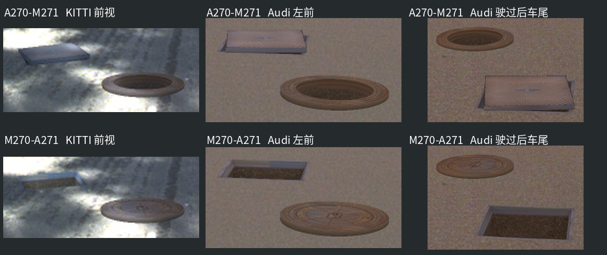

# 燃气方井与辐条圆井的四种状态

同一段路每次迁入两件。第一组是转过 8°、四角架在井框上的燃气方盖，旁边是圆盖缺失、井圈略高于路面的敞井。第二组移除方盖，装回圆盖，便于对照盖面、边缘高度与井内遮挡。两组在 Audi 车尾各有 19 帧同时看见两件资产，影片驶过后在车尾视角停留 2.5 秒。[Audi 真实前后鱼眼](https://github.com/Vexlc/road-hazard-reconstruction/releases/download/utility-covers-v1.0.0/audi-front-rear.mp4) · [指定 KITTI 检查点的局部前后视](https://github.com/Vexlc/road-hazard-reconstruction/releases/download/utility-covers-v1.0.0/joint-local-front-rear.mp4) · [原生前后视](https://github.com/Vexlc/road-hazard-reconstruction/releases/download/utility-covers-v1.0.0/joint-front-rear.mp4) · [KITTI 实拍前视与右侧鱼眼](https://github.com/Vexlc/road-hazard-reconstruction/releases/download/utility-covers-v1.0.0/kitti-front-side.mp4)

| 资产 | 盖与框 | 尺度和状态 |
|---|---|---|
| A270、M270 | 带 FERNGAS 字样与菱格面的方盖，固定框和承托台单独建模 | 盖宽 0.60 m、厚 39 mm，设计井深 0.67 m。A270 错转后露出部分井口，M270 露出全部净开口。 |
| A271、M271 | 带辐条、型号字样和宽井圈的圆井 | 盖直径 0.49 m，设计井深 0.61 m。井框中心高出路面 28 mm，坡角 1.6°。M271 保留隆起井圈与井壁。 |

盖面颜色、法线、相对位移、粗糙度和金属度来自 ambientCG 的两套 CC0 材料。发布者标记制作方式为 Approximation，未提供实测尺寸。盖面字样与纹路来自素材，绝对尺寸、安装异常和地下结构均为设计值。实车画面记录的是原道路，相机标定和点云用于迁入。[材料出处、原件哈希和尺寸依据](../gen2hole/examples/utility-covers/SOURCES.md)

## 下载固定版本

从这里开始，以下命令在同一个 Bash 会话和克隆目录中执行。只看视频可用本节命令；CPU 回放可直接跳到[CPU 回放步骤](#用-cpu-重放真实曝光和独立渲染)。

~~~bash
set -e
repo=Vexlc/road-hazard-reconstruction
tag=utility-covers-v1.0.0
gh repo clone "$repo" -- --branch "$tag" --depth 1
cd road-hazard-reconstruction
kit=downloads/$tag
get() { gh release download "$tag" -R "$repo" -D "$kit" --skip-existing "$@"; }
check() { (cd "$kit" && sha256sum --ignore-missing -c SHA256SUMS); }
unpack() { python3 -m zipfile -e "$kit/$1" "$2" && (cd "$2" && sha256sum -c SHA256SUMS); }
get -p SHA256SUMS
~~~

只看驶过效果时执行以下两行，然后打开 downloads/utility-covers-v1.0.0 下的 MP4。

~~~bash
get -p audi-front-rear.mp4 -p joint-local-front-rear.mp4
check
~~~

## 从原始材质重建两种井盖

在 Linux 中按环境说明安装网格环境和计算环境。材料包内含上游原 ZIP，准备脚本核对来源哈希后原样恢复各通道。新输出目录默认是 runs/utility-covers，各资产各有 GLB、Gaussian PLY、高度场、材质采样与元数据。[环境准备](03-environment-and-relocation.md) · [材质解包](../gen2hole/examples/utility-covers/prepare.py) · [建模入口](../gen2hole/survey.py) · [盖、井壁与承托几何](../gen2hole/recipes/series/perforated_cover.py)

~~~bash
get -p materials.zip -p models.zip
check
unpack materials.zip work/utility-originals
unpack models.zip work/utility-models
python3 scripts/configure-gen2hole.py
bash scripts/reproduce-utility-covers.sh assets
for d in runs/utility-covers/*/series/assets/*/*; do
  diff -qr "$d" "work/utility-models/${d##*/}"
done
~~~

A270 的刚体盖板先按指定角度旋转，再用固定框、承台及路面求井盖下表面的第一处接触。投影中心须落在共面支点包围的区域内。本例中心到支撑边界的最小余量为 0.294 m。用 M270 的独立网格按 3 mm 间距打射线，四个象限分别检测到 446、453、453、446 个承托格点，另有 733 个格点从盖角缝隙直接看到井底。[几何检查及三个机位](../scripts/check-utility-positions.py) · [逐件记录](../validation/utility-covers.json)

## 用 CPU 重放真实曝光和独立渲染

已有 models.zip 即可跳到本节。建立 Python 3.9 的 CPU 环境后，先重放八份实拍曝光并逐文件核对合成 RGB、部件、实例与径向距离。再重放六份独立的 Cycles 位置缓冲，包括两组布局各自的正交、侧向鱼眼和车尾方向的虚拟鱼眼。所有输入采用统一世界坐标。[统一复现脚本](../scripts/reproduce-utility-covers.sh)

~~~bash
python3.9 -m venv work/envs/roadside-cpu
export UTILITY_CPU_PYTHON="$PWD/work/envs/roadside-cpu/bin/python"
"$UTILITY_CPU_PYTHON" -m pip install numpy==1.26.4 scipy==1.13.1 open3d==0.18.0 pillow==11.3.0 opencv-python==4.10.0.84
get -p models.zip -p real-cameras.zip -p position-buffers.zip
check
unpack models.zip work/utility-models
unpack real-cameras.zip work/utility-exposures
unpack position-buffers.zip work/utility-buffers
export UTILITY_MODELS=work/utility-models
bash scripts/reproduce-utility-covers.sh replay
bash scripts/reproduce-utility-covers.sh optics
~~~

输出在 outputs/utility-covers/replay 与 optics，后者含 check.json 和 bearing.json。位置缓冲与独立原生深度通道的最大距离差为 0.0025 mm；两组共 1,460 个前景遮挡像素均保留原色。每组侧向鱼眼在镜头后半球验证了 1,235 个资产像素。上述数值衡量同一数字场景中两个渲染实现的配准精度。各角度的井底、部件与距离结果见报告。需要从 GLB 重新生成这些原生通道时，在项目的 bpy 环境运行以下命令。[Cycles 独立宿主与实际开孔](../scripts/render-round-cover-cycles.py) · [原生距离与部件验收](../validation/utility-covers.json)

~~~bash
UTILITY_BUFFERS=work/utility-fresh bash scripts/reproduce-utility-covers.sh cycles
UTILITY_BUFFERS=work/utility-fresh bash scripts/reproduce-utility-covers.sh optics
~~~

## 迁入指定检查点并驶过后回看

按道路环境说明准备原始 KITTI-360 轨迹、基准帧和官方 3dgrut CUDA 后端。两组共用原始宿主，各自生成一份新检查点。模型从本地重建目录或上节的 UTILITY_MODELS 读取。[原始模型和帧](16-reproduction-cookbook.md#kitti-360-双坑与后视) · [安装原生后端](19-roadside-props.md#迁入指定的-30000-步原生场景) · [两组落点与朝向](../gen2hole/examples/utility-covers)

~~~bash
base=runs/streetgs-joint/kitti360-0000/30000
echo "0a1ed5554d10ee6948ad0ef4920b7a64e33c7005b39baba2aaafde441f86d0a8  $base/joint.pt" | sha256sum -c -
get -p '*-joint.pt'
check
bash scripts/reproduce-utility-covers.sh joint-build
for pair in A270-M271 M270-A271; do cmp "$base/utility-covers/$pair/joint.pt" "$kit/$pair-joint.pt"; done
bash scripts/reproduce-utility-covers.sh joint-render
bash scripts/reproduce-utility-covers.sh joint-local
~~~

原生前视及虚拟后视每组各 48 帧。局部版本以三维井口、盖板及邻接区域限定改动，输出为 outputs/utility-covers/local/joint-front-rear.mp4。要从实车原序列生成视频，先恢复 KITTI 与 Audi 原曝光、时间戳、标定及 LiDAR，再执行以下命令。KITTI 右侧鱼眼两组均有部分裁切，Audi 的前、后预览均可完整看见两件。[实车输入准备](19-roadside-props.md#从实车原始曝光重新拟合与回放)

~~~bash
bash scripts/reproduce-utility-covers.sh drive
bash scripts/reproduce-utility-covers.sh review
~~~

在共享已安装解释器、原始道路数据的干净检出目录中，重新生成的 20 个模型文件、两个检查点、384 张原生及局部回放帧和四个完整 MP4 均与发布基准逐字节一致。八份真实曝光的 32 个产物逐文件一致，另从 GLB 重新渲染了六个独立机位。旧的逐行曝光和六面深度入口也进行了回归复核。[验收数据](../validation/utility-covers.json)

## 将其他渲染器的三维命中位置接入鱼眼

许多渲染器可为可见表面输出 XYZ。逐光线将 XYZ 与相机起点、方向配准，即可得到米制径向距离。曲面投影、正交相机或逐行曝光也可使用这一入口。输入是未经颜色映射的浮点位置。像素边缘有多条光线时应输出每条光线命中的独立位置。跨前景与背景混合后的单个 XYZ 会落在实际表面之间。[位置缓冲转换](../gen2hole/downstream/host_position.py) · [逐行位姿](25-rolling-covers.md) · [逐采样颜色和权重](29-mixed-inlets.md)

| 字段 | 格式与坐标 |
|---|---|
| surface_position、position_valid | H × W × 3 或 S × H × W × 3 的浮点 XYZ，每条光线一个命中；布尔有效位区分缺测与坐标原点。缺测像素保留宿主画面。 |
| world_from_position | 可选 4 × 4 矩阵，输入点经它映射到与相机相同的米制世界。允许平移、轴交换、左右手翻转与统一单位换算，例如毫米乘 0.001。省略即使用世界米制 XYZ。 |
| rgb、protected、camera_to_world | H × W × 3 uint8 sRGB、宿主保护区和相机到右手米制世界的刚体位姿。相机系为右、下、前。 |
| rays_camera、ray_origins_camera | H × W × 3 或逐光线的单位方向，可额外提供相机系米制起点。相机标定 JSON 可通过 --calibration 替代显式方向。 |
| receiver_mask、occluder_mask | 互斥的已观测路面与前景布尔标签。前者用于拟合支撑，后者在迁入时提供遮挡。 |
| camera_to_world_rows、sample_rgb、sample_weights | 可选逐行位姿、逐光线颜色及相对曝光权重。时间戳应先与车辆轨迹注册。 |

下例使用随包提供的真实 Cycles 导出数据，在 CPU 上重新拟合锚点并回看同一组井盖。脚本把场景原点平移到地图量级坐标，并用左手系毫米位置通道检验单位与坐标轴。换宿主时应重测种子、道路朝向和向上方向，使用目标场景的光照与车身轨迹。前后相机共用布局锚点。[宿主接口与锚点拟合](../scripts/transfer-mesh-view.py)

~~~bash
tool=scripts/transfer-mesh-view.py
pair=A270-M271
src=work/utility-buffers/$pair
layout=gen2hole/examples/utility-covers/$pair.json
for cam in ortho rear; do
  "$UTILITY_CPU_PYTHON" "$tool" from-position "$src/$cam/input.npz" "work/$cam.npz"
done
"$UTILITY_CPU_PYTHON" "$tool" road-points work/road.npy work/ortho.npz --stride 3
read -ra frame < <("$UTILITY_CPU_PYTHON" -c 'import numpy as n,sys; a=n.load(sys.argv[1]); print(*a[:3,3],*a[:3,0],*a[:3,2])' "$src/road-frame.npy")
"$UTILITY_CPU_PYTHON" "$tool" fit work/road.npy work/utility-anchor.json --seed "${frame[@]:0:3}" --heading "${frame[@]:3:3}" --up "${frame[@]:6:3}" --radius 1.05 --asset "$layout" --asset-root "$UTILITY_MODELS"
"$UTILITY_CPU_PYTHON" "$tool" render "$layout" work/utility-anchor.json work/rear.npz outputs/my-utility-rear --asset-root "$UTILITY_MODELS"
~~~

程序逐条检查有效 XYZ 到对应光线的横向距离。默认容差 1 mm；遇到错误时先核对行序、轴向、单位、相机时刻及浮点精度。远离世界原点时，优先导出相机附近的局部位置，并在 world_from_position 中给出双精度平移。仅有六张透视深度面时，可使用已有的立方体入口。[六面深度转鱼眼](31-cube-pits.md#将六面深度缓冲接入其他鱼眼宿主)
