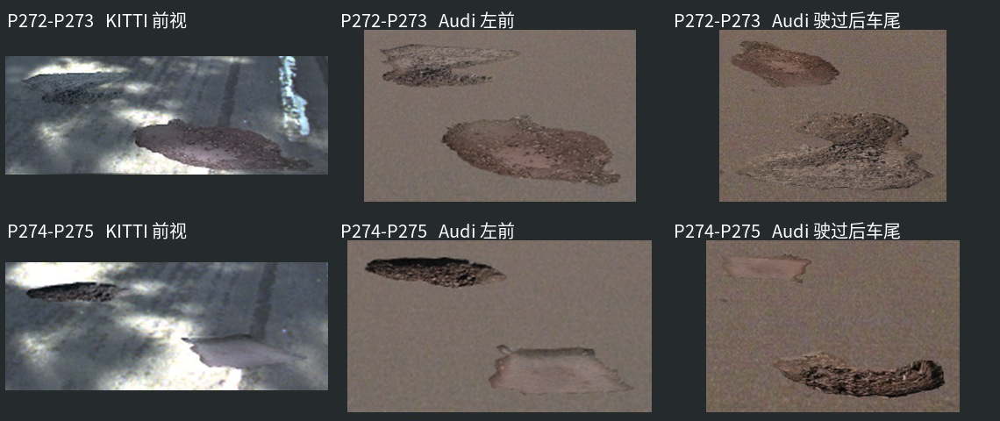

# 四处实测剥落坑与原始鱼眼标定迁入

四处路面破损按两件一组迁入三段实车道路。第一组坑口分别约 1.04 和 0.92 m²；第二组示范较小的陡边碎石坑与浅陷坑。Audi 影片从左前驶近，过坑后切到真实车尾曝光并停留 2.5 秒。[Audi 驶过后回看](https://github.com/Vexlc/road-hazard-reconstruction/releases/download/mei-pits-v1.0.0/audi-front-rear.mp4) · [指定 KITTI 检查点的局部前后视](https://github.com/Vexlc/road-hazard-reconstruction/releases/download/mei-pits-v1.0.0/joint-local-front-rear.mp4) · [第二段 KITTI 道路的前视与侧鱼眼](https://github.com/Vexlc/road-hazard-reconstruction/releases/download/mei-pits-v1.0.0/kitti-0003-front-side.mp4)

| 资产 | 原图特征 | 可见面积 | 长 × 宽 | 坑内深度 P95 |
|---|---|---:|---:|---:|
| P272 | 中部保留沥青脊的双叶剥落坑 | 1.04 m² | 1.42 × 1.08 m | 62 mm |
| P273 | 碎石底的长条轮迹坑 | 0.92 m² | 1.55 × 0.83 m | 76 mm |
| P274 | 陡边粗碎集料坑 | 0.34 m² | 0.82 × 0.56 m | 68 mm |
| P275 | 直边围成的浅陷坑 | 0.29 m² | 0.69 × 0.57 m | 29 mm |

面积由坑口网格掩膜积分，长宽取坑口最小外接矩形。原始轮廓完整落在图内。绝对尺寸依据毫米深度与数据集的标称内参估算。实车视频中的路面、曝光、标定与车辆轨迹来自目标道路，坑来自另处采集的三维模型。真实阴影和碎石颜色会随采集光照而变。[六份原始曝光、标定和成像依据](../gen2hole/examples/mei-pits/SOURCES.md) · [各件误差和图像记录](../validation/mei-pits.json)

## 下载固定版本

以下命令在同一 Linux Bash 会话运行，源码和发布附件均公开。每个 ZIP 内有逐文件 SHA-256，版本附件另附总校验表。[全部附件](https://github.com/Vexlc/road-hazard-reconstruction/releases/tag/mei-pits-v1.0.0)

~~~bash
set -e
repo=Vexlc/road-hazard-reconstruction
tag=mei-pits-v1.0.0
gh repo clone "$repo" -- --branch "$tag" --depth 1
cd road-hazard-reconstruction
kit=downloads/$tag
get() { gh release download "$tag" -R "$repo" -D "$kit" --skip-existing "$@"; }
check() { (cd "$kit" && sha256sum --ignore-missing -c SHA256SUMS); }
unpack() { python3 -m zipfile -e "$kit/$1" "$2" && (cd "$2" && sha256sum -c SHA256SUMS); }
get -p SHA256SUMS
python3 scripts/check-reproduction-index.py
~~~

## 从六份采集重建四处实测坑

先安装仓库使用的网格环境与计算环境。重建会生成纹理 GLB、Gaussian PLY、高度场、材质采样和元数据。成品在 runs/mei-pits，测量记录在每件的 evaluation 目录。[环境准备](03-environment-and-relocation.md) · [重建程序](../gen2hole/multiview_pits.py) · [组别与重建配方](../gen2hole/examples/mei-pits)

~~~bash
get -p captures.zip -p models.zip
check
unpack captures.zip work/mei-captures
unpack models.zip work/mei-models
python3 scripts/configure-gen2hole.py
bash scripts/reproduce-mei-pits.sh assets
for d in runs/mei-pits/*/series/assets/*/*; do diff -qr "$d" "work/mei-models/${d##*/}"; done
~~~

P272、P273 建模前留出同帧深度块，在 10,331 和 6,431 个坑内像素上，距离误差 P95 分别为 1.87 和 4.30 mm。P274、P275 的留出数据是另一张实拍曝光，轮廓 IoU 为 0.930 和 0.889，深度误差 P95 为 14.65 和 15.10 mm。跨机位结果也包含相机配准误差。[原始曝光和测量记录](../validation/mei-pits.json)

## 在 CPU 上复放三段道路

从下载一节开始即可跳到这里。无需训练道路。models.zip 提供资产，compact-cameras.zip 提供实拍裁剪区、原始相机标定、子像素位置、深度、保护区与放置姿态。六次成组行驶各留两个机位，共十二份曝光。CPU 逐一重放并核对 RGB、部件、实例和米制径向距离的哈希。[打包与验收代码](../scripts/check-mei-pits.py)

~~~bash
python3.9 -m venv work/envs/roadside-cpu
export MEI_CPU_PYTHON="$PWD/work/envs/roadside-cpu/bin/python"
"$MEI_CPU_PYTHON" -m pip install numpy==1.26.4 scipy==1.13.1 open3d==0.18.0 pillow==11.3.0 opencv-python==4.10.0.84
get -p models.zip -p compact-cameras.zip -p forward-control.zip
check
unpack models.zip work/mei-models
unpack compact-cameras.zip work/mei-exposures
unpack forward-control.zip work/mei-controls
export MEI_MODELS=work/mei-models
bash scripts/reproduce-mei-pits.sh replay
bash scripts/reproduce-mei-pits.sh optics
~~~

图像和逐文件结果在 outputs/mei-pits/replay，独立投影对照在 outputs/mei-pits/optics/check.json。相同曝光的十二份 NPZ 合计从 212.5 MB 降为 10.8 MB，减少 94.9%。两种表示的 48 个输出文件逐字节一致。标定文件和版本说明另存。

## 迁入指定检查点并驶过后回看

按道路环境指南恢复基准权重、第 200–247 帧、相机轨迹及官方 3dgrut 后端。每对坑各自借用原始宿主新建检查点，运算目录为 runs/streetgs-joint/kitti360-0000/30000/mei-pits。两对各有 48 帧前视和 48 帧虚拟后视。[宿主和输入帧](16-reproduction-cookbook.md#kitti-360-双坑与后视) · [原生渲染环境](19-roadside-props.md#迁入指定的-30000-步原生场景) · [原生全画面视频](https://github.com/Vexlc/road-hazard-reconstruction/releases/download/mei-pits-v1.0.0/joint-front-rear.mp4)

~~~bash
base=runs/streetgs-joint/kitti360-0000/30000
echo "0a1ed5554d10ee6948ad0ef4920b7a64e33c7005b39baba2aaafde441f86d0a8  $base/joint.pt" | sha256sum -c -
get -p '*-joint.pt'
check
bash scripts/reproduce-mei-pits.sh joint-build
for pair in P272-P273 P274-P275; do cmp "$base/mei-pits/$pair/joint.pt" "$kit/$pair-joint.pt"; done
bash scripts/reproduce-mei-pits.sh joint-render
bash scripts/reproduce-mei-pits.sh joint-local
~~~

要从实车数据重新选帧并生成视频，先恢复 KITTI-360 的 0000 和 0003 两段原图、标定、LiDAR、轨迹与 Audi A2D2 的前后传感器。执行下列命令后，outputs/mei-pits 下生成三份行驶视频。每个站点独立拟合落点和道路曝光。KITTI 0000 的右侧近景有裁切，0003 段的前、侧预览里两件均完整可见。Audi 真正车尾中两件同时出现的候选曝光分别有 19 和 18 帧。[恢复原始实车数据](19-roadside-props.md#从实车原始曝光重新拟合与回放) · [第二段 KITTI 轨迹和帧范围](28-roadside-reflections.md) · [0000 实拍前侧视视频](https://github.com/Vexlc/road-hazard-reconstruction/releases/download/mei-pits-v1.0.0/kitti-front-side.mp4)

~~~bash
bash scripts/reproduce-mei-pits.sh drive
bash scripts/reproduce-mei-pits.sh review
bash scripts/reproduce-mei-pits.sh pack
~~~

在本机的干净源码目录中，使用相同解释器、原道路数据和基准检查点，从空输出目录重建了四件资产。20 个模型文件、两个迁入检查点、384 张原生及局部前后视帧、五个 MP4 均与基准逐字节一致。独立重新生成的四份正投影栅格也一致。[复现范围及逐件记录](../validation/mei-pits.json)

## 用原始标定接入自己的鱼眼图像

已知宿主相机标定和米制路面后，可直接提供原始 MEI YAML，也可使用项目支持的 PINHOLE 或 OPENCV_FISHEYE JSON 相机行。下面的命令使用第二段 KITTI 道路，输出 after.png、part.png、instance.png 和 range.npy。只需 CPU 回放步骤中的模型、相机包和环境。[相机接口](../gen2hole/downstream/mei_camera.py) · [放置与渲染入口](../scripts/transfer-mesh-view.py)

~~~bash
pair=P272-P273
src=work/mei-exposures/$pair/avenue
"$MEI_CPU_PYTHON" scripts/transfer-mesh-view.py render "gen2hole/examples/mei-pits/$pair.json" "$src/appearance.json" "$src/image_03/view.npz" outputs/my-mei-pair --calibration "$src/image_03/calibration.yaml" --asset-root "$MEI_MODELS"
~~~

| 输入 | 和原始感光面的对应关系 |
|---|---|
| MEI YAML | 包含原图宽高、xi、gamma1/gamma2/u0/v0、k1/k2/p1/p2。使用零斜切、非负 xi 的模型。原图左上像素中心坐标为 (0, 0)。|
| sensor_window_xywh | 可选四个整数，依次为原图中的左、上、宽、高。省略时采用整个感光面。RGB 高宽须与裁剪区一致。 |
| sample_offsets_px | 可选 S × 2 数组，(dx, dy) 相对于每个原始像素中心，每轴在 ±0.5 像素内。省略即一个中心样本。重采样、缩放或去畸变图像可按[显式像素映射](26-remapped-pits.md)接入。 |
| 宿主数据 | RGB、camera_to_world、protected，以及 host_range 或有符号 host_z。车体、暗角、无成像区由宿主保护区标出。有单独的物体量程时提供 occluder_range。可提供逐行位姿与逐样本权重。 |
| 原始位置或路面点云 | 若宿主提供每条光线命中的 XYZ，可先用 from-position 加同一份 --calibration 转为径向距离。有实测点云时按[拟合局部道路和两件资产](32-utility-covers.md#将其他渲染器的三维命中位置接入鱼眼)为新道路生成自己的锚点。 |

反投影先解径向及切向畸变，再选与光轴连通的可见镜面解。无有效解或无法验证畸变单调性的像素进入保护区。确认几何可投影的像素仍可能被车身或遮光罩遮住，故真实车体和遮光掩膜需保留。YAML 应与形成该图的传感器对应。接入不同传感器时需重新校验其有效视场与标定精度。

独立验收用 OpenCV 的 C++ omnidir 将三维网格顶点正投影进原始实拍裁剪区，再用 EGL/OpenGL 逐三角形计算遮挡及深度。四次右鱼眼曝光的实例 IoU 均超过 0.997，距离误差 P95 最大 0.092 mm，结果反映同一数字网格的两种渲染算法。左右原始镜头还各抽查 40,000 个像素，有效域与独立镜面边界投影一致。两侧合计覆盖 14,486 个镜头后半球的有效样点。[独立前向渲染器](../scripts/render-mei-control.py) · [按机位记录](../validation/mei-pits.json)

从 GLB 重新计算参考栅格时，需单独的 Python 3.11 环境和可创建 OpenGL 3.3 上下文的 EGL 驱动。以下版本已用于本例。

~~~bash
python3.11 -m venv work/envs/mei-control
export MEI_CONTROL_PYTHON="$PWD/work/envs/mei-control/bin/python"
"$MEI_CONTROL_PYTHON" -m pip install numpy==1.26.4 scipy==1.17.1 pillow==13.0.0 trimesh==5.2.1 opencv-contrib-python-headless==4.10.0.84 moderngl==5.12.0 glcontext==3.0.0
MEI_CALIBRATIONS=work/mei-controls/calibration MEI_CONTROLS=work/mei-fresh bash scripts/reproduce-mei-pits.sh control
MEI_CONTROLS=work/mei-fresh bash scripts/reproduce-mei-pits.sh optics
~~~
