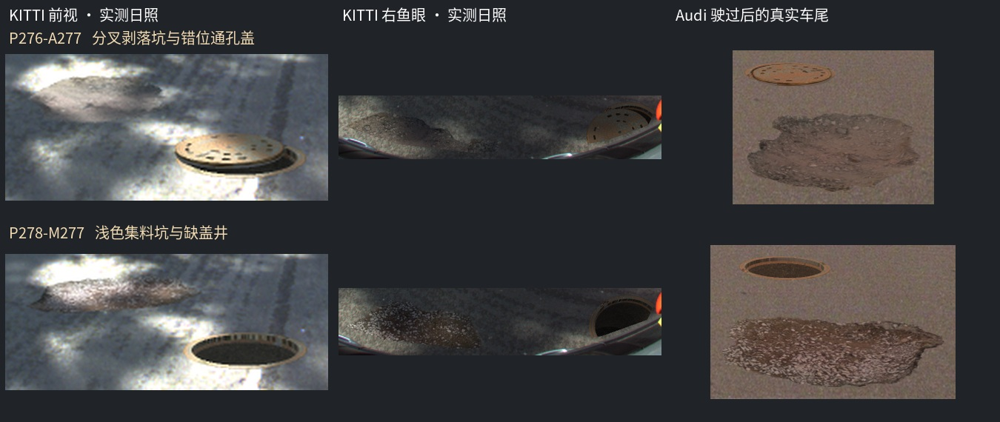

# 实测沥青坑、错位通孔盖与缺盖井的成对迁入

两组资产都已放进 KITTI-360 0000 的 30,000 步联合场景。要看车驶过以后，Audi 影片从左前鱼眼切到实拍车尾，最后停留在同一帧的原路面与迁入结果。KITTI 联合场景另提供虚拟后视。[Audi 真实车尾视频](https://github.com/Vexlc/road-hazard-reconstruction/releases/download/sun-openings-v1.0.0/audi-front-rear.mp4) · [联合场景局部前后视](https://github.com/Vexlc/road-hazard-reconstruction/releases/download/sun-openings-v1.0.0/joint-local-front-rear.mp4) · [KITTI 前视与右鱼眼](https://github.com/Vexlc/road-hazard-reconstruction/releases/download/sun-openings-v1.0.0/kitti-front-side.mp4)

| 布局 | 坑口面积和深度 | 井口 |
|---|---|---|
| P276-A277 | 分叉边缘的剥落坑约 1.17 m²，坑内深度 P95 为 85 mm | 盖面有 14 个贯穿孔，盖板整体偏移约 12.5 cm，露出一侧井口。 |
| P278-M277 | 浅色集料坑约 1.17 m²，坑内深度 P95 为 64 mm | 保留同款井圈、井壁和井底，取走整块井盖。 |

两个坑来自不同的 RGB-D 实测轮廓。A277 与 M277 共用同一份原始盖面扫描，盖径、井深与异常姿态来自设计尺寸。KITTI 右鱼眼近景可见车体遮住部分井沿。整个检查点的后视画质受原宿主训练视角覆盖影响。[原始输入及尺度来源](../gen2hole/examples/sun-openings/SOURCES.md) · [逐件验收](../validation/sun-openings.json)

## 下载与校验

以下命令在同一 Linux Bash 会话、仓库根目录执行。源码固定在 sun-openings-v1.0.1，模型和相机附件固定在 sun-openings-v1.0.0。可从公开发布页直接下载附件。[固定发布](https://github.com/Vexlc/road-hazard-reconstruction/releases/tag/sun-openings-v1.0.0)

~~~bash
set -e
repo=Vexlc/road-hazard-reconstruction
tag=sun-openings-v1.0.0
gh repo clone "$repo" -- --branch sun-openings-v1.0.1 --depth 1
cd road-hazard-reconstruction
kit=downloads/$tag
get() { gh release download "$tag" -R "$repo" -D "$kit" --skip-existing "$@"; }
check() { (cd "$kit" && sha256sum --ignore-missing -c SHA256SUMS); }
unpack() { python3 -m zipfile -e "$kit/$1" "$2" && (cd "$2" && sha256sum -c SHA256SUMS); }
get -p SHA256SUMS
python3 scripts/check-reproduction-index.py
python3 gen2hole/gen2hole.py locate A277 --route pavement-sun
~~~

## 从原始采集和扫描重建四件资产

先准备网格与 Gaussian 计算环境，再运行下列命令。网格、PLY、材质、米制高度场和元数据写入各个编号目录，每件五个文件。重建结果用固定成品逐文件对照。[环境安装](03-environment-and-relocation.md) · [坑洞重建代码](../gen2hole/multiview_pits.py) · [井盖与井体重建代码](../gen2hole/survey.py) · [配方与布局](../gen2hole/examples/sun-openings)

~~~bash
get -p captures.zip -p models.zip
check
unpack captures.zip work/opening-captures
unpack models.zip work/opening-models
python3 scripts/configure-gen2hole.py
bash scripts/reproduce-sun-openings.sh assets
for d in runs/sun-openings/*/series/assets/*/*; do diff -qr "$d" "work/opening-models/${d##*/}"; done
~~~

P276、P278 建模前分别留出同帧 11,887 和 10,746 个坑内深度像素。相对留出深度的绝对误差 P95 为 2.21 和 2.95 mm。井盖扫描给出孔形与纹理，配方给定 0.62 m 盖径、0.54 m 井深。A277 通孔总面积约 111 cm²。这两种井口可用来比较移位和整盖缺失。[留出记录与模型指纹](../validation/sun-openings.json)

## 只用 CPU 复现实拍曝光

已有成品模型时可从下载一节直接进入这里。模型包和相机包足以重放两组资产的 KITTI 前视、右鱼眼、Audi 左前与车尾。输出目录 outputs/sun-openings/replay 中每份曝光都有 after.png、part.png、instance.png 和以米为单位的 range.npy。命令会检查全部 32 个文件的哈希。[相机回放与光照验收程序](../scripts/check-opening-sun.py)

~~~bash
python3.9 -m venv work/envs/roadside-cpu
export OPENING_CPU_PYTHON="$PWD/work/envs/roadside-cpu/bin/python"
"$OPENING_CPU_PYTHON" -m pip install numpy==1.26.4 scipy==1.13.1 open3d==0.18.0 pillow==11.3.0 opencv-python==4.10.0.84
get -p models.zip -p compact-cameras.zip -p light-control.zip
check
unpack models.zip work/opening-models
unpack compact-cameras.zip work/opening-exposures
unpack light-control.zip work/opening-controls
export OPENING_MODELS=work/opening-models
bash scripts/reproduce-sun-openings.sh replay
bash scripts/reproduce-sun-openings.sh control
~~~

独立对照由 Blender 的 BVH 从 GLB 直接发射光线，两种太阳高度分别照到错位盖和缺盖井，另外加入外部遮阴。对照固定灰色漫反射材质和环境项，排除了人工遮阴边界的过渡带。21,706 个表面样点中，21,705 个的 RGB 最大通道误差在 2/255 以内。这个数值衡量相同几何的直接光计算。实拍场景的验证另外记录原路面留出格、保护区和几何输出。若要从头生成独立对照，在网格环境安装 bpy 4.2.0、trimesh 5.2.1 及其依赖后运行以下两步。[几何阴影与实拍路面结果](../validation/sun-openings.json)

~~~bash
OPENING_CONTROLS=work/opening-fresh bash scripts/reproduce-sun-openings.sh oracle
OPENING_CONTROLS=work/opening-fresh bash scripts/reproduce-sun-openings.sh control
~~~

## 迁入指定检查点并驶过后回看

基准宿主为 runs/streetgs-joint/kitti360-0000/30000/joint.pt。先恢复其轨迹、原帧、标定和官方渲染环境。原生 Gaussian 渲染使用井口邻近路面的曝光。下节的方向性日照用于实拍与其他宿主的网格渲染。保留这两条入口便于分别检查新权重和逐像素遮挡。[基准检查点与输入帧](16-reproduction-cookbook.md#kitti-360-双坑与后视) · [3dgrut 运行环境与车型数据](19-roadside-props.md#迁入指定的-30000-步原生场景) · [成对写入代码](../streetcrafter/joint/pavement_pair.py)

~~~bash
base=runs/streetgs-joint/kitti360-0000/30000
echo "0a1ed5554d10ee6948ad0ef4920b7a64e33c7005b39baba2aaafde441f86d0a8  $base/joint.pt" | sha256sum -c -
get -p '*-joint.pt'
check
bash scripts/reproduce-sun-openings.sh joint-build
for pair in P276-A277 P278-M277; do cmp "$kit/$pair-joint.pt" "$base/sun-openings/$pair/joint.pt"; done
bash scripts/reproduce-sun-openings.sh joint-render
bash scripts/reproduce-sun-openings.sh joint-local
~~~

每组新检查点各有 48 帧前视与 48 帧虚拟后视。输出分别为 outputs/sun-openings/joint-front-rear.mp4 和 outputs/sun-openings/local/joint-front-rear.mp4。后者使用原生底图并保留局部资产支撑范围。[原生全画面影片](https://github.com/Vexlc/road-hazard-reconstruction/releases/download/sun-openings-v1.0.0/joint-front-rear.mp4)

重跑实车影片需真实 KITTI 与 Audi 数据、相机位姿、点云和相机保护区。准备完成后运行下列命令。可选 `drive audi P278-M277` 只重跑指定的一组。末尾的 pack 重新导出实拍紧凑相机包。[实车输入与标定恢复](17-mixed-road-transfer.md#kitti-和-audi-的原始鱼眼回放) · [执行脚本](../scripts/reproduce-sun-openings.sh)

~~~bash
bash scripts/reproduce-sun-openings.sh drive
bash scripts/reproduce-sun-openings.sh review
bash scripts/reproduce-sun-openings.sh pack
~~~

## 把日照登记到其他宿主

1. 用宿主提供的路面点、重力和车行方向拟合两个资产的落点。输出的布局锚点绑定资产和米制坐标。宿主可给出针孔或鱼眼标定，也可提供每条光线的方向及独立起点。[拟合新落点和鱼眼输入](21-measured-pavement.md#接入自己的鱼眼或其他渲染器) · [逐光线位置缓冲](32-utility-covers.md#将其他渲染器的三维命中位置接入鱼眼)
2. 在原始无资产道路上选同种沥青的日照和阴影区域，记录两个原始 sRGB 三元组。太阳方向指向光源，使用该宿主的世界坐标。每个相机分别登记。不同曝光或太阳位置需要重新测量。KITTI 示例保留了原帧哈希、取样坐标和三帧立柱的观测依据。[测光配方](../gen2hole/examples/sun-openings/kitti-sun.json) · [方向拟合](../scripts/fit-roadside-light.py)
3. 把这些量传给 calibrate-pavement，再从生成的锚点渲染待测机位。输入为原始曝光、米制距离、相机姿态和保护区。具有宿主阴影通道的渲染器可在 NPZ 中提供 `sun_visibility`，形状为 H×W 或 S×H×W，0 为完全遮阴，1 为完全直射。从三维位置缓冲转换或按像素重映射时，这一通道与原始各子光线一起传递。宿主标签可用 `receiver_mask` 指定可替换的路面，`occluder_range` 保存单独的前景量程。[宿主通用入口](../scripts/transfer-mesh-view.py) · [直接光实现](../gen2hole/downstream/pavement_sun.py)

以下命令直接用发布包复现 KITTI 右鱼眼的一组。把四个输入换成新宿主的布局、锚点、曝光和标定即可复用。传入显式 rays_camera 时省略 --calibration。

~~~bash
pair=P276-A277
recipe=gen2hole/examples/sun-openings
cam=work/opening-exposures/$pair/kitti/image_03
mkdir -p work/opening-survey
python3 - <<'PY'
import json
from pathlib import Path
s = json.loads(Path("gen2hole/examples/sun-openings/kitti-sun.json").read_text())
Path("work/opening-survey/light.json").write_text(json.dumps(dict(s["sensors"]["image_03"], sun_world=s["sun_world"])))
PY
"$OPENING_CPU_PYTHON" scripts/transfer-mesh-view.py calibrate-pavement "$recipe/$pair.json" "$recipe/anchors/$pair-kitti.json" work/opening-survey/anchor.json "$cam/view.npz" --calibration "$cam/calibration.yaml" --sun-survey work/opening-survey/light.json --asset-root "$OPENING_MODELS"
"$OPENING_CPU_PYTHON" scripts/transfer-mesh-view.py render "$recipe/$pair.json" work/opening-survey/anchor.json "$cam/view.npz" outputs/my-opening --calibration "$cam/calibration.yaml" --asset-root "$OPENING_MODELS"
cmp outputs/my-opening/after.png "outputs/sun-openings/replay/$pair/kitti/image_03/after.png"
~~~

登记在每件资产的局部路面上使用 5 cm 网格。井内各点向太阳投射光线，同时检查穿出路面的位置与盖板、井圈的遮挡。实拍坑床保留采集到的纹理和局部阴影。离测量范围较远时沿用周边路面曝光。KITTI 两个机位、两组布局的 5,912 个留出格上，直射比例的平均绝对误差为 0.018–0.027，同次采样使用单一中位值时为 0.062–0.113。原图中不同材质、过曝、自动曝光变化都会影响这个估计。Audi 的这段道路采用邻近沥青的曝光登记。[全部机位的实际记录](../validation/sun-openings.json)

本机从干净源码和固定输入重新构建了 20 个新资产文件、两个独立检查点。四段 MP4、八份实拍曝光的 32 个输出，以及两个检查点的 384 张原生和局部前后视结果都与第一次输出逐字节一致。
