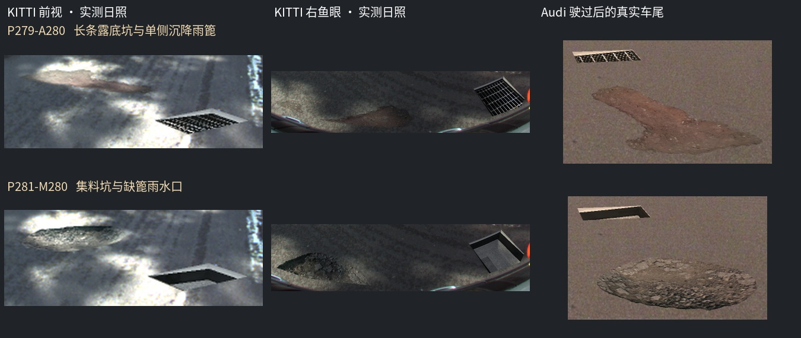

# 实测坑与沉降、缺篦雨水口的成对迁入

在同一个 KITTI-360 0000 的 30,000 步场景中，每次放一个坑和一个雨水口。先看驶近，再看车辆通过后的虚拟后视。Audi 影片另用原车的后摄像头拍摄道路，末尾停留在迁入前后的同一帧。[指定场景局部前后视](https://github.com/Vexlc/road-hazard-reconstruction/releases/download/stereo-drains-v1.0.0/joint-local-front-rear.mp4) · [指定场景全画面](https://github.com/Vexlc/road-hazard-reconstruction/releases/download/stereo-drains-v1.0.0/joint-front-rear.mp4) · [Audi 实拍前后视](https://github.com/Vexlc/road-hazard-reconstruction/releases/download/stereo-drains-v1.0.0/audi-front-rear.mp4)

| 布局 | 实测坑口 | 井口状态 |
|---|---|---|
| P279-A280 | 长条形露底，面积 0.90 m²，外接矩形约 1.81 × 0.84 m，坑内深度 P95 为 44 mm | 60 个贯穿孔的钢格栅随井框单侧沉降 |
| P281-M280 | 圆弧破边和粗集料，面积 0.98 m²，外接矩形约 1.12 × 1.09 m，坑内深度 P95 为 82 mm | 同款井框缺篦，保留支座、井壁和井底 |

两处坑来自不同的 RGB-D 采集。雨篦由一张实物照片恢复外观和开孔，参考宽度、井深及安装状态采用配方尺寸。三段实车分别重新拟合路面和曝光。同一组布局在不同路段的世界坐标各自独立。[采集来源与单位](../gen2hole/examples/stereo-drains/SOURCES.md) · [逐件观测与哈希](../validation/stereo-drains.json)

## 从固定版本开始

以下为 Linux Bash 命令。任选一节下载所需附件。ZIP 保留内部逐文件指纹，外层 SHA256SUMS 包含视频及两个场景检查点。先用有仓库读取权限的账号登录 GitHub CLI。[全部附件](https://github.com/Vexlc/road-hazard-reconstruction/releases/tag/stereo-drains-v1.0.0)

~~~bash
set -e
tag=stereo-drains-v1.0.0
repo=Vexlc/road-hazard-reconstruction
gh auth status
gh repo clone "$repo" -- --depth 1 --branch "$tag"
cd road-hazard-reconstruction
kit="$PWD/downloads/$tag"
mkdir -p "$kit"
get() {
  for name in "$@"; do gh release download "$tag" -R "$repo" -D "$kit" --skip-existing -p "$name"; done
  (cd "$kit" && sha256sum --ignore-missing -c SHA256SUMS)
}
unpack() { python3 -m zipfile -e "$kit/$1" "$2" && (cd "$2" && sha256sum --quiet -c SHA256SUMS); }
get SHA256SUMS models.zip
unpack models.zip work/drain-models
python3 scripts/check-reproduction-index.py
python3 gen2hole/gen2hole.py locate A280 --route stereo-rays
~~~

## 从两次坑洞采集和格栅照片重建

按仓库环境说明安装网格和计算环境。运行器默认使用 work/envs/streetcrafter/bin/python，构建器的两个解释器由 configure-gen2hole.py 写入本机配置。坑洞读取原始 ZIP 中的彩色、毫米深度和轮廓，预留同帧深度块。井口读取仓库中的照片派生图和 60 孔掩膜。四件成品每件含 GLB、Gaussian PLY、高度场、材质与元数据。[环境与迁移](03-environment-and-relocation.md) · [坑洞重建](../gen2hole/multiview_pits.py) · [井口重建](../gen2hole/survey.py) · [两组配方](../gen2hole/examples/stereo-drains)

~~~bash
get captures.zip
unpack captures.zip work/drain-captures
python3 scripts/configure-gen2hole.py
bash scripts/reproduce-stereo-drains.sh assets
for d in runs/stereo-drains/*/series/assets/*/*; do diff -qr "$d" "work/drain-models/${d##*/}"; done
~~~

## 在 CPU 上重放实车与双目实验

在标准 Linux x86-64 环境安装 Python 3.9、libGL 和 libgomp。下列步骤只读发布模型、曝光或双目观测。第一项验收用三段车载序列的 12 份曝光逐字节核对 RGB、部件、实例和米制距离，共 48 个文件。第二项从匹配点三角化，重新拟合每件资产的接地和曝光，再检验前景遮挡。[运行器](../scripts/reproduce-stereo-drains.sh) · [验收程序](../scripts/drain_stereo_checks.py)

~~~bash
python3.9 -m venv work/envs/drain-cpu
export DRAIN_CPU_PYTHON="$PWD/work/envs/drain-cpu/bin/python"
"$DRAIN_CPU_PYTHON" -m pip install numpy==1.26.4 scipy==1.13.1 pillow==11.3.0 open3d==0.18.0 opencv-python==4.10.0.84
get compact-cameras.zip stereo-inputs.zip
unpack compact-cameras.zip work/drain-exposures
unpack stereo-inputs.zip work/drain-stereo
export DRAIN_MODELS=work/drain-models
bash scripts/reproduce-stereo-drains.sh replay
bash scripts/reproduce-stereo-drains.sh stereo-check
~~~

KITTI 0000 第 217 帧、0003 第 500 帧使用同步校验后的左右针孔原图计算双向 SGBM 匹配。同帧激光单独投影作对照。12,667 个有效路面点的两段径向绝对误差中位数分别为 14.1、14.5 cm，P95 为 36.6、45.2 cm。只传入相同水平布点、行车方位、世界竖直方向和比原路面高 6 cm 的初值，重新拟合后，各资产中心与原激光路面基准相差 2.5–3.8 cm，法向差低于 0.8°。有纹理的两段路面支持全部四件的占地；其他路面须按自己的标定和点云重新检查。

另外四组 Cycles 构图使用有基线、方向不同的 220° 等距鱼眼，镜头前有一根窄横杆。对应点来自独立位置通道的投影，因此这项实验衡量给定对应关系后的几何与可见性。四组中资产原生可见像素均有匹配，逐实例轮廓 IoU 最低 0.9992，横杆覆盖像素保持原样。两段真实双目的匹配误差见上段；本次真实鱼眼重放使用原车相机标定。各项数值的分母与匹配覆盖率保存在验收文件。[逐曝光指标](../validation/stereo-drains.json) · [独立鱼眼构图](../scripts/render-drain-stereo.py)

## 从已标定双目接入新宿主

每只相机给出米制 camera_to_world，光学轴为右、下、前，rgb 为 H×W×3 的 uint8，protected 为逐像素或逐采样布尔值。可提供原始针孔、OpenCV 鱼眼或 MEI 标定及图像裁剪窗口；也可直接提供单位 rays_camera 和逐光线起点 ray_origins_camera。带逐行运动的相机先用 register-readout 登记行时间。两台相机可以有不同的姿态、分辨率和裁剪窗口；它们需要在同一世界坐标系观察同一时刻的静态表面。

matches.npz 中 right_xy 为每个主图像素对应的副图浮点 (x,y)，原点为副图裁剪后左上像素中心；match_valid 为布尔数组。可选 left_xy 是反向图，以主图裁剪坐标表示。每个光学采样层独立匹配。光线起点间的基线必须以米给出。三角化剔除负距离、弱视差、越界、受保护的插值邻点及双向不一致；副图浮点位置在单位光线场内插值。路面接地使用主图 receiver_mask；已标注的前景可用 occluder_mask。匹配缺失的区域保留原始 RGB。以下命令用包内 KITTI 图运行同一条入口。[输入格式及实现](../gen2hole/downstream/host_stereo.py) · [命令行](../scripts/transfer-mesh-view.py)

~~~bash
cam=work/drain-stereo/kitti
tool=scripts/transfer-mesh-view.py
out=outputs/my-stereo
pair=P279-A280
layout="gen2hole/examples/stereo-drains/$pair.json"
"$DRAIN_CPU_PYTHON" "$tool" from-stereo "$cam/primary.npz" "$cam/secondary.npz" "$cam/matches.npz" "$out/host.npz" --primary-calibration "$cam/primary.json" --secondary-calibration "$cam/secondary.json"
"$DRAIN_CPU_PYTHON" "$tool" road-points "$out/road.npy" "$out/host.npz" --stride 2
read -ra axes <<< "$(python3 -c 'import json,sys; a=json.load(open(sys.argv[1]))[sys.argv[2]]; x,y,z=a["center_world"]; b=a["basis_columns"]; print(x,y,z+0.06,b[0][0],b[1][0],0,0,0,1)' "$cam/survey.json" "$pair")"
"$DRAIN_CPU_PYTHON" "$tool" fit "$out/road.npy" "$out/anchor.json" --seed "${axes[@]:0:3}" --heading "${axes[@]:3:3}" --up "${axes[@]:6:3}" --radius 1.35 --asset "$layout" --asset-root "$DRAIN_MODELS"
"$DRAIN_CPU_PYTHON" "$tool" calibrate-pavement "$layout" "$out/anchor.json" "$out/appearance.json" "$out/host.npz" --asset-root "$DRAIN_MODELS"
"$DRAIN_CPU_PYTHON" "$tool" render "$layout" "$out/appearance.json" "$out/host.npz" "$out/result" --asset-root "$DRAIN_MODELS"
~~~

换宿主时用目标道路的近似布点、方向与重力替换 axes，按目标车速、相机间同步和清晰度检查匹配。弱纹理、反光、运动前景或严重失配会留下空洞。可加入另一帧已配准的路面点来补齐占地支撑；fit 在支撑不足时会报告失败。此接口只消费匹配，任意未校正鱼眼仍需适合其镜头的匹配器。实拍 KITTI 示例里的 SGBM 适用于已校正双目。

## 复现指定联合场景与其他实车

从下方基础检查点指南恢复 joint.pt，并运行 prepare 和 render 生成 work/streetcrafter-rig/kitti360-0000 的标定、位姿和原始基准帧。安装原生 GPU 渲染环境。在本仓库的 base 下分别生成两个检查点，每个检查点渲染 48 帧前视和 48 帧虚拟后视。局部版本重用原生宿主底图，保留足迹周边的真实路面。完整后视受原场景在车尾方向的训练覆盖限制。[基础检查点与输入帧](16-reproduction-cookbook.md#kitti-360-双坑与后视) · [GPU 环境](19-roadside-props.md#迁入指定的-30000-步原生场景)

~~~bash
base=runs/streetgs-joint/kitti360-0000/30000
echo "0a1ed5554d10ee6948ad0ef4920b7a64e33c7005b39baba2aaafde441f86d0a8  $base/joint.pt" | sha256sum -c -
get P279-A280-joint.pt P281-M280-joint.pt
bash scripts/reproduce-stereo-drains.sh joint-build
for pair in P279-A280 P281-M280; do cmp "$kit/$pair-joint.pt" "$base/stereo-drains/$pair/joint.pt"; done
bash scripts/reproduce-stereo-drains.sh joint-render
bash scripts/reproduce-stereo-drains.sh joint-local
~~~

从原车数据重新生成三段实拍迁入需要对应的 RGB、标定、车辆位姿和点云。drive 可按路段或单组运行，例如 drive avenue P281-M280。cycles 另需网格环境的 bpy 4.2.0、trimesh 5.2.1；随后运行 stereo-inputs，需要前面 drive 的锚点、cycles 的双目真值、原始左右帧与独立激光扫描。以下命令分别生成影片、紧凑曝光和双目检验输入。[实车数据准备](17-mixed-road-transfer.md#kitti-和-audi-的原始鱼眼回放) · [KITTI 0000 前视和右鱼眼](https://github.com/Vexlc/road-hazard-reconstruction/releases/download/stereo-drains-v1.0.0/kitti-front-side.mp4) · [KITTI 0003 前视和右鱼眼](https://github.com/Vexlc/road-hazard-reconstruction/releases/download/stereo-drains-v1.0.0/kitti-0003-front-side.mp4)

~~~bash
bash scripts/reproduce-stereo-drains.sh drive
bash scripts/reproduce-stereo-drains.sh review
bash scripts/reproduce-stereo-drains.sh pack
bash scripts/reproduce-stereo-drains.sh cycles
bash scripts/reproduce-stereo-drains.sh stereo-inputs
bash scripts/reproduce-stereo-drains.sh stereo-check
~~~

本版在干净源码目录中从采集重新构建，20 个资产文件、两个联合检查点、384 张原生及局部前后视画面、五段视频均与发布基准逐字节一致。独立重跑实车匹配及 Cycles 后，六份双目观测的输入也逐文件一致。上述新宿主接入示例的四项输出与批处理验收一致。
