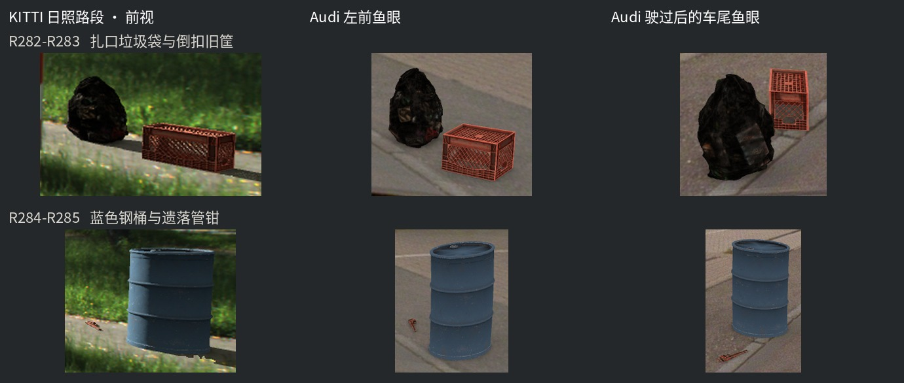
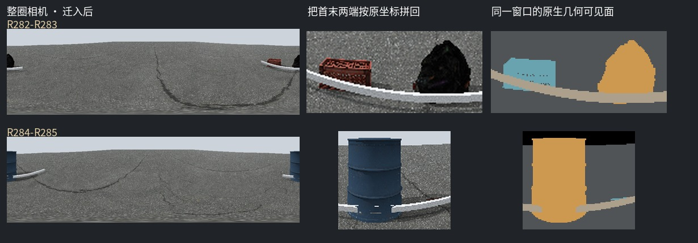

# 路面散落物的接地、车尾回看与全景迁入

四件常见物体分两次放入 KITTI-360 0000 的 30,000 步联合检查点。KITTI 影片左侧是原场景，右侧是成对迁入结果，下排为虚拟后视。Audi 影片在驶过后切换到实车尾部相机，最后保留同帧局部对照。[指定场景前后视](https://github.com/Vexlc/road-hazard-reconstruction/releases/download/street-clutter-v1.0.0/joint-front-rear.mp4) · [Audi 实拍车尾](https://github.com/Vexlc/road-hazard-reconstruction/releases/download/street-clutter-v1.0.0/audi-front-rear.mp4) · [KITTI 街道鱼眼](https://github.com/Vexlc/road-hazard-reconstruction/releases/download/street-clutter-v1.0.0/kitti-urban-front-side.mp4) · [KITTI 日照路段](https://github.com/Vexlc/road-hazard-reconstruction/releases/download/street-clutter-v1.0.0/kitti-sun-front-side.mp4)

| 布局 | 资产与尺度 | 接地方式 |
|---|---|---|
| R282-R283 | 高 57.5 cm 的扎口垃圾袋，长 48.1 cm 的红色周转筐 | 袋底着地，周转筐倒扣，保留格孔与提手 |
| R284-R285 | 高 93.0 cm 的蓝色钢桶，长 40.5 cm、落地厚约 3.5 cm 的管钳 | 钢桶直立，管钳侧放，分别检查底圈和钳体支点 |

几何、颜色及法线使用原作者发布的米制模型。模型姿态、组合、车辆轨迹旁的位置由本仓库设定。前视和车尾曝光分别使用目标相机和宿主道路；KITTI 虚拟后视的背景画质受原检查点训练视角覆盖影响。[原始模型与署名](../gen2hole/examples/street-clutter/SOURCES.md) · [逐曝光与几何记录](../validation/street-clutter.json)

## 克隆与下载

使用有私有仓库读取权限的 GitHub 账号，在同一 Linux Bash 会话执行。源码中有原始网格和纹理，已有环境可直接重建。成品、相机输入和视频在固定 Release 中。ZIP 内还有逐文件 SHA-256。[版本附件](https://github.com/Vexlc/road-hazard-reconstruction/releases/tag/street-clutter-v1.0.0)

~~~bash
set -e
repo=Vexlc/road-hazard-reconstruction
tag=street-clutter-v1.0.0
gh auth status
gh repo clone "$repo" -- --branch "$tag" --depth 1
cd road-hazard-reconstruction
kit="$PWD/downloads/$tag"
mkdir -p "$kit"
get() {
  for f in "$@"; do gh release download "$tag" -R "$repo" -p "$f" --skip-existing -D "$kit"; done
  (cd "$kit" && sha256sum --ignore-missing -c SHA256SUMS)
}
unpack() { python3 -m zipfile -e "$kit/$1" "$2" && (cd "$2" && sha256sum --quiet -c SHA256SUMS); }
get SHA256SUMS models.zip
unpack models.zip work/clutter-models
python3 scripts/check-reproduction-index.py
python3 gen2hole/gen2hole.py locate R284 --route bounded-cargo-seat
~~~

## 从原始模型重建四件散落物

安装 Linux 的 libGL、libgomp 和 Python 3.9。转入本地坐标后，按单件形状选择支撑面，将原始顶点、纹理、法线、粗糙度和金属度写入 GLB，并输出后端使用的表面采样、接触面及元数据。再按配方组成两组，共六个模型目录，每个四个文件。assets 需要新的输出目录，重复试验可设置 CLUTTER_MODELS 指向另一目录。[构建程序](../gen2hole/road_debris.py) · [组合程序](../gen2hole/roadside_layout.py) · [四件源模型指纹与姿态](../gen2hole/examples/street-clutter/sources.json)

~~~bash
python3.9 -m venv work/envs/roadside-cpu
export CLUTTER_CPU_PYTHON="$PWD/work/envs/roadside-cpu/bin/python"
"$CLUTTER_CPU_PYTHON" -m pip install numpy==1.26.4 scipy==1.13.1 open3d==0.18.0 pillow==11.3.0 opencv-python==4.10.0.84
bash scripts/reproduce-street-clutter.sh assets
for d in runs/street-clutter/assets/*; do diff -qr "$d" "work/clutter-models/${d##*/}"; done
~~~

## 重放真实道路和指定检查点

仅在 CPU 上重放 12 份曝光时，使用下面的命令。每份以真实相机的针孔或鱼眼标定、裁剪窗口和子采样恢复光线。执行器核对合成 RGB、物体部件、实例编号、径向距离和地面阴影五项输出，共 60 个文件。[实拍曝光打包与验收](../scripts/check-clutter-transfer.py)

~~~bash
export CLUTTER_MODELS=work/clutter-models
get road-cameras.zip
unpack road-cameras.zip work/clutter-packets
bash scripts/reproduce-street-clutter.sh replay
~~~

从原始道路和检查点重新渲染时，按已有场景说明准备 KITTI 0000 第 200–247 帧、Audi 实车图像和激光扫描、标定与位姿，以及 3DGUT、SC-GS 环境。指定宿主需运行 prepare 和 render 生成 rig 和基准帧。physical 会在三处宿主重新拟合并编码实拍对照。两个新 joint.pt 放在原宿主旁各自的子目录，每组分别有 48 帧前视和 48 帧虚拟后视。[原始联合检查点及输入帧](16-reproduction-cookbook.md#kitti-360-双坑与后视) · [联合 GPU 环境](../streetcrafter/joint/README.md#配置联合渲染环境) · [实拍鱼眼数据](17-mixed-road-transfer.md#kitti-和-audi-的原始鱼眼回放)

~~~bash
base=runs/streetgs-joint/kitti360-0000/30000
echo "0a1ed5554d10ee6948ad0ef4920b7a64e33c7005b39baba2aaafde441f86d0a8  $base/joint.pt" | sha256sum -c -
get R282-R283-joint.pt R284-R285-joint.pt
bash scripts/reproduce-street-clutter.sh physical
bash scripts/reproduce-street-clutter.sh joint-build
for pair in R282-R283 R284-R285; do cmp "$kit/$pair-joint.pt" "$base/street-clutter/$pair/joint.pt"; done
bash scripts/reproduce-street-clutter.sh joint-render
~~~

## 在允许范围内重新选择落点

适用于有逐件支撑信息的立体组合。输入为米制世界坐标的 N×3 路面点、同一坐标系的车辆中心轨迹、起始位置、行车方向和重力反向。--placement-search-m 给出用户允许的最大平面位移。算法先检查原位，按距离由近到远尝试间距至多 10 cm 的候选点；每次重拟合占地、复查每件最低支点，沿整条车辆轨迹检查车体外包矩形的净距。同距时优先沿车行方向平移。范围内找不到可用点会报错。可从锚点 placement_search 读取实际位移、失败原因与允许半径。[搜索与度量](../gen2hole/downstream/cargo_placement.py) · [支点和路缘台阶检查](../gen2hole/downstream/cargo_support.py)

Audi 钢桶在初始位置触发了 20 mm 接地误差门槛。在允许的 0.5 m 范围内，沿道路平移约 0.10 m 后通过检查。钢桶及管钳支点相对附近测距的最大高差分别为 16.2 和 12.8 mm，车体外包矩形与组合最近相距 29.8 cm。六个实际布点的最小净距为 25.6 cm。位移范围内还应由宿主给出合适的路肩或作业区；这项检验只使用提供的道路证据和轨迹。

~~~bash
bash scripts/reproduce-street-clutter.sh seat-check
~~~

seat-check 会在带倾角、几百万米世界坐标偏移的路面上测试两组模型。原始车体净距 7.5 cm，给定 2.5 cm 允许位移时两组均被拒绝；给定 25 cm 时实际移动 10 cm，净距达到 17.5 cm。接入自己的宿主时，下面是同一入口的命令形式。seed、heading、up 的三个值都用目标宿主的世界坐标替换，road.npy 需仅含已确认路面，trajectory.npy 为按时间排序的车辆中心线。

~~~bash
"$CLUTTER_CPU_PYTHON" scripts/transfer-mesh-view.py fit my-host/road.npy my-host/seat.json \
  --asset "$CLUTTER_MODELS/R284-R285" --trajectory my-host/trajectory.npy \
  --seed 15 -7 0 --heading 1 0 0 --up 0 0 1 --radius 1.35 \
  --vehicle-width 2.06 --vehicle-length 5.10 --clearance .12 --placement-search-m .5
~~~

## 全景相机接缝与远背景

这里的宿主为全经纬度等距柱状投影，镜头 JSON 写成 `["EQUIRECTANGULAR", 原图宽, 原图高]`。光学坐标向右、向下、向前。中心列朝前，左右边缘朝后，上边缘为天顶。原生 sensor_window_xywh 支持横跨接缝，子采样偏移以原始像素计。只有覆盖一整圈的观测会将首末列用于双目插值，局部窗口的两个外边界独立。没有明确全景标定的拼接或非共心相机，可先用宿主提供的逐光线方向和起点接入。[相机定义](../gen2hole/downstream/spherical_camera.py) · [双目输入和米制单位](35-stereo-drains.md#从已标定双目接入新宿主)

可信渲染器可用布尔 empty_space_mask 明确标出射线直至背景都未命中的像素。空背景有无限远距离，可以显示前方真实存在的物体；这项标记与有限深度、有效匹配、路面和前景标签互斥。匹配失败、超出标定区域、车身及未知区域继续保留原图。把无效深度当成天空会造成错误遮挡，实车不提供这项证据时应省略。

双目在地平线附近容易因视差过小而丢失物体轮廓。宿主有配准到主相机的独立量程时，可在主图 NPZ 加入可选浮点数组 `supplemental_range_m`，形状为 H×W 或 S×H×W。数值是从各采样光线起点沿光线到首个表面的距离（米），缺测用 NaN。仅当双目失败且光线允许编辑时才使用补充值。它必须与同次曝光、像素和子采样对齐，与已确认空背景互斥。输出 `supplemental_range_used` 记录实际采用补充量程的位置。只有相机图像时可省略这两个可选输入，保留缺测位置的原图。

~~~bash
get panoramas.zip
unpack panoramas.zip work/clutter-panoramas
bash scripts/reproduce-street-clutter.sh pano-check
~~~

独立 Blender Cycles 从原始 GLB 渲染横跨接缝的四个机位。双目对应点来自独立位置通道的投影，这项实验检验给定对应关系时的三角化和遮挡。849 个距离小于 8 m 的主图样点在副图插值时跨过首末列，四个机位各自的接缝量程绝对误差 P95 均小于 0.08 mm。整圈与跨缝裁剪共比较 428,640 个像素，部件和实例逐像素一致。全部 RGB 通道中有一个相差一个 8 位灰阶。

钢桶所在的两个机位仅用有限双目量程时，原生可见桶体的覆盖率分别为 88.70% 和 88.52%。使用 Cycles 迁入前的空背景标记后，分别恢复 538 和 656 个可见桶体像素。在地平线附近，从宿主原始路面另外导出 ≥4 m 的量程条带，四舍五入到 0.1 m，分别补回 94 和 391 个可见桶体像素。最后两个机位的覆盖率达到 99.30% 和 99.62%。前景遮挡杆与剩余未知区域保留宿主曝光。这里的量程来自控制场景，实拍道路的验证使用上节的相机包。[逐机位接缝误差、覆盖率和独立几何对照](../validation/street-clutter.json)

如需从头生成几何对照，在网格环境安装 bpy 4.2.0、trimesh 5.2.1 及依赖，然后运行下列命令。可用 CLUTTER_BLENDER_PYTHON 指定该解释器。[独立构图](../scripts/render-clutter-panorama.py) · [全景验收实现](../scripts/clutter_panorama.py)

~~~bash
bash scripts/reproduce-street-clutter.sh panorama
bash scripts/reproduce-street-clutter.sh pano-inputs
bash scripts/reproduce-street-clutter.sh pano-check
~~~
