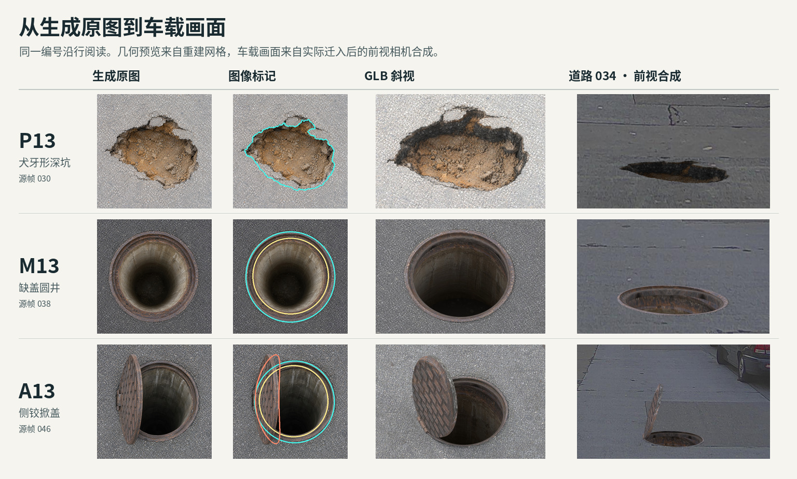

# Gen2Hole · 用生成图重建路面病害资产

给定一张 GPT Image 生成的垂直俯视图和一组米制设计尺寸，这个项目可以重建坑洞、缺盖窨井、掀起或移位的井盖。每件资产都有带材质的 **GLB 网格**、沿同一网格表面采样的 **3D Gaussian Splatting PLY**，以及用于切开宿主路面的高度与掩膜。PandaSet 道路迁入、相机合成和激光雷达回放可以接在资产导出之后运行。

**[统一资产图谱](../tools/asset_atlas/index.html)** 可以按实例比较生成参考、三维视角与同帧道路迁入。实拍单目粗框重建的例子见[实拍批次](examples/real-rgb/)与[轮廓评估](../validation/rgb-box-P90.json)。

## 从哪开始

| 想做的事 | 入口 |
|---|---|
| 理解生图、拟合、分件建模、贴图和高斯采样 | [重建方法与逐阶段输入输出](docs/pipeline.md) |
| 设计一个新病害并从头重建 | [新资产操作说明](docs/new-assets.md) · [三类设计样例](examples/new-batch/calibration/designs.json) |
| 从实拍深度、双目点云或程序化配方重建 | [本仓库的五类重建入口](../docs/02-asset-reconstruction.md) |
| 查找 11 月 18、19、21 日旧实验的源码、输入和清理记录 | [历史文件去向与核验](../docs/12-integration.md#11-月-22-日清理后的入口) |
| 浏览 37 个坑洞、36 口缺盖井、36 件异常井盖 | [首批 9 件](published/道路病害图生三维/资产与场景索引.md) · [新增 100 件离线浏览页](published/道路病害图生三维_新增100/资产浏览.html) · [统一编号与文件指纹](catalog/assets.json) |
| 看同一处病害在相机和雷达中的对应关系 | [离线传感器对照页](published/道路病害_传感器与几何增强/传感器对照.html) · [本次重建的道路视频](runs/demo/series/sensor_views/034_13/front_after.mp4) |

## 复现一个完整案例

在仓库的 `gen2hole/` 目录执行。`P13`、`M13`、`A13` 是同一道路组合里的三件资产。第一条命令可查看提示词、原图和成品位置。第二条从已保存的生成原图重算坑洞深度、轮廓及井盖拟合，保留当时的人工修订，并渲染两个 GLB 视角。

~~~bash
python gen2hole.py show A13
python gen2hole.py build P13 M13 A13 --from-images --preview --out runs/my-13
python gen2hole.py verify --run runs/my-13
~~~

`runs/my-13/series/assets/` 下按类别和 ID 分目录。掀盖的最终高斯在 `raised/A13/asset.ply`，切口在同目录的 `surface.npz`。去掉 `--from-images` 可复用随项目保存的相对深度和最终拟合。只需要网格时加 `--mesh-only`。首批同样接受短编号，如 `python gen2hole.py build P02 --out runs/my-p02`，结果进入 `pilot/`。

继续将这三件资产放进路段 034，生成同帧前后画面和类别掩膜，再从两台雷达的原始射线求交。每次构建或仿真使用新的输出目录。

~~~bash
python downstream/place.py --bundle runs/my-13/series --site 034 --group 13 --front
python downstream/replay.py --bundle runs/my-13/series --case 034_13 --frame 36 --png runs/my-13/replay
python downstream/simulate.py --run runs/my-13 --out runs/my-13/sensors
~~~

要重建现有两批的全部 109 件资产，运行 `python gen2hole.py build --all --out runs/all-109`。程序按原编号选择配方，分别写入 `pilot/` 和 `series/`。`python gen2hole.py list` 可用于挑选任意子集。

## 已运行的样例

| 编号 | GPT Image 原图 | 本项目重建的网格 | 本项目重建的 3DGS | 高斯数 |
|---|---|---|---|---:|
| P13 · 犬牙形深坑 | [PNG](inputs/series/references/P13.png) | [GLB](runs/demo/series/assets/pothole/P13/asset.glb) | [PLY](runs/demo/series/assets/pothole/P13/asset.ply) | 579,675 |
| M13 · 双阶承口圆井 | [PNG](inputs/series/references/M13.png) | [GLB](runs/demo/series/assets/missing/M13/asset.glb) | [PLY](runs/demo/series/assets/missing/M13/asset.ply) | 628,361 |
| A13 · 侧铰掀盖 | [PNG](inputs/series/references/A13.png) | [GLB](runs/demo/series/assets/raised/A13/asset.glb) | [PLY](runs/demo/series/assets/raised/A13/asset.ply) | 629,230 |
| P02 · 首批积水车辙坑 | [PNG](inputs/pilot/references/wet.png) | [GLB](runs/pilot-example/pilot/assets/pothole/P02_wet_wheel_track/asset.glb) | [PLY](runs/pilot-example/pilot/assets/pothole/P02_wet_wheel_track/asset.ply) | 467,745 |

前三件从 RGB 重算，P02 从保存的深度和标注重建。四件的 GLB 和 PLY 都与各自发布文件的 SHA-256 一致。[三件核验记录](runs/demo/series/checks.json) · [首批核验记录](runs/pilot-example/pilot/checks.json)

在新建的 `034_13` 场景中，三件资产写盘重载后的近景像素最大差均为 0。前视行车序列共 40 帧，另生成前、后相机各 3 组同帧裁切。80 帧实测扫描中，7,767 条回波被几何命中替换。[场景放置](runs/demo/series/scenes/034_13/scene.json) · [冷启动回放](runs/demo/replay.json) · [相机核验](runs/demo/sensors/checks/camera_audit.json) · [雷达核验](runs/demo/sensors/checks/scan_audit.json)

## 数据、环境和来源

- **项目内的输入**包含 109 张不同的主图、3 张共享补图、两版校准、37 份坑洞相对深度，以及匹配的 Depth Anything V2 Small 权重。`recipes/` 保存建模实现，`downstream/` 保存道路与传感器入口。
- **历史交付**通过 `published/` 链接到本仓库的 `data/releases/2026-11-21/`，包括 109 件成品、场景检查点、视频及完整传感器包。项目内的原图重建使用 `inputs/` 和 `models/`。`python gen2hole.py audit --published` 可核对全部主图、提示词、共用补图、权重与 218 个发布 GLB/PLY。
- **本机环境**集中配置在 [config/local.json](config/local.json)。单件资产重建只使用对应 Python 环境和本项目输入。道路迁入另外读取原 StreetCrafter 工程、PandaSet 和 v3 道路标定。换机器时按[环境与数据依赖](docs/pipeline.md#运行环境)指定路径。
- **来源**为 2026-11-21 的 RoadGS 实验，三批本机交付分别是首批九件、扩充一百件和传感器增强。[参考对话](codex://threads/01a1fbd8-09fd-7520-8a6a-c2301267dee6) · [原始交付目录](published/) · [首批图像和模型来源记录](inputs/pilot/calibration/provenance.json)
