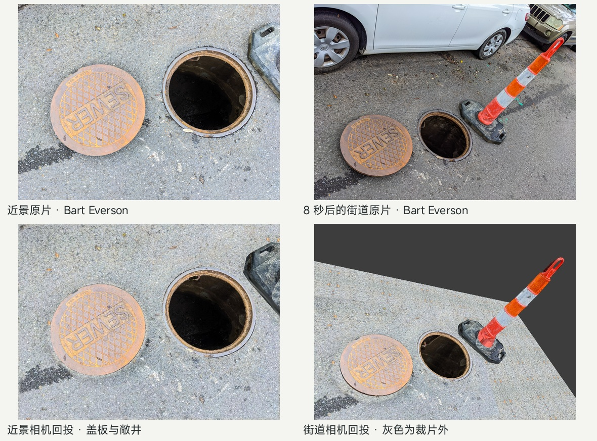
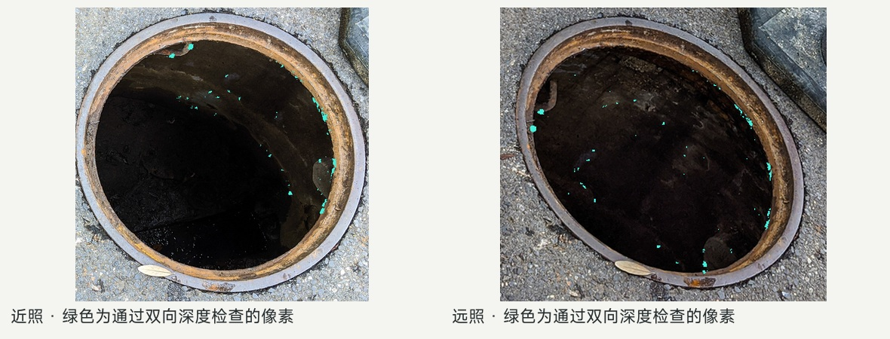
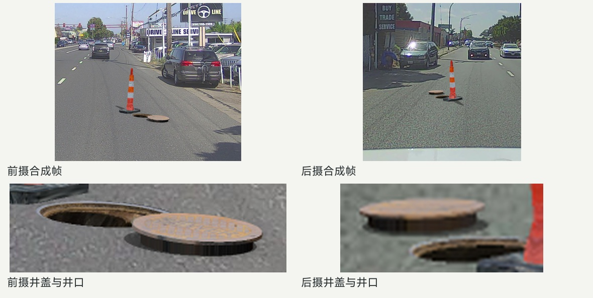

# M585 · 新奥尔良亚历山大街移开的污水井盖

同一处敞井的两张现场照片相隔 8 秒。近照能读到盖板上的 **SEWER** 字样，也能看到井内锈蚀的踏步。远照交代了盖板、井口、警示柱和路旁停放车辆的位置。Bart Everson 于 2020 年 9 月 20 日拍摄了这两张照片。模型保留了盖板偏置、露出的铸铁承口、警示柱提手孔和底座的两个搬运孔。[近景原片](https://commons.wikimedia.org/wiki/File:SEWER_-_Open_Manhole_-_New_Orleans_September_2020.jpg) · [街道原片](https://commons.wikimedia.org/wiki/File:Open_Manhole_-_New_Orleans_September_2020.jpg) · [下载模型及复现输入](https://github.com/Vexlc/road-hazard-reconstruction/releases/download/alexander-opening-v1.0.0/M585.zip)

## 直接复用

|文件|内容与用法|
|---|---|
|`M585/asset.glb`|现场组合。地面、移开的盖板、井圈、踏步及带底座的警示柱都可按节点名选取。渲染版含补全的井壁和封底。|
|`M585/opening.glb`|移走盖板后的敞井与警示柱。盖板原先的位置露出沥青。这一状态由现场模型派生。|
|`M585/cover.glb`、`M585/marker.glb`|可独立摆放的锈蚀盖板和警示柱。原点分别在盖板中心正下方的路面和警示柱基座中心的路面。两件均保留现场朝向。|
|`M585/bounded.glb`|用于检查能被照片约束的结构。保留盖板顶面及薄边、井圈、踏步和警示柱，移除井壁补全、光学封底和盖下推测的支撑。|
|`M585/asset.ply`、`splat_material.npz`|现场组合的 519,239 个一阶球谐高斯及其材质、部件和天空可见度。更换盖板状态请使用相应 GLB。|
|`M585/surface.npz`、`stereo.npz`|前者给出 5 mm 网格上的俯视首交和部件号。后者给出两张原片各自的逐像素深度假设、筛选掩码、匹配分数及图像窗口偏移。|
|`views/detail-rays.npz`、`views/street-rays.npz`|两个现场机位的 800 × 600 首交量程、部件以及对受约束网格单独求交的量程。|

模型单位为米。网格采用 glTF 的 Y 向上，摄影求解、NPZ、PLY 采用局部 Z 向上。将 `metadata.json` 的 `lid_center_m` 的前两项与零高程组合，即可得到盖板回装偏移。警示柱使用 `marker.base_origin_m`。把局部向量 `(x,y,z)` 改写为 `(x,z,-y)`，即可用作 GLB 平移。回装后，从街道机位比较 33,647 个盖板像素和 23,177 个警示柱像素的量程，P99 差异均小于 0.001 mm。对盖板中心垂直投射射线，移盖版本的首交为沥青。[数值核验](validation/quality.json)

## 从现场照片复现

1. 以 1600 × 1200 为标注及匹配坐标系。原片保留在 `references/` 中，程序校验 SHA-256。两张照片都带有 27 mm 的等效焦距，求解使用该值和图像对角线估计像素焦距。分别沿井圈外缘、井口内缘和盖板外缘提取轮廓，轮廓拟合隔四点留出一点。[标注和原图摘要](survey.json) · [边缘提取](observe.py)
2. 通过 RootSIFT 双向比对取得 1,155 对候选特征，按固定顺序留出五分之一。先以井盖、井口以外的路面对应求平面映射，再解两台相机姿态、井圈和盖板平面。取井圈外径 **0.64 m** 为尺度假设。近、远机位中心间距约 0.92 m。203 对经路面一致性筛选的留出点，跨视角回投中位误差 0.74 px。盖板上能通过同类筛选的留出点为 4 对，中位误差 3.37 px。[匹配提取](match.py) · [几何求解](geometry.py)
3. 在该尺度下，拟合盖板直径约 0.56 m，盖板中心相对井圈中心的水平偏移约 **0.73 m**。两中心的高程差约 7.6 cm。这个差值包括盖板的摆放姿态、地面参考平面和标定误差。盖下遮挡处用内缩支撑补全，未取得盖板厚度或反面铸筋的实测值。锈迹、铸字和交叉纹来自近照的透视校正纹理。
4. 用两个机位分别勾画井内踏步可见的折弯段。求一条水平中心线，使公共弯角向另一幅图像回投后靠近相应线段。得到踏步中心约在路面下 **0.59 m**，公共弯角到对侧折线的回投均方根误差约 6.15 px。向井壁补出两台相机能看到踏步所必需的空间，避免井壁遮掉这一细节。截面半径 11 mm 为建模假设。警示柱则从街道照片提取彩条、锥身截面、提手及底座槽孔，背向相机的漆面参考可见侧颜色补全。[踏步与警示柱](fixtures.py)
5. 在两个井口的公共可见范围，以 7.5 mm 高程间距双向扫描暗处纹理。要求归一化相关峰值、与竞争峰的差距和 23 mm 以内的往返高程一致性。近照和街道照片分别有 1,061、386 个像素通过筛选。它们集中在承口、弯角和少量有辨识度的井壁纹理处。深处只有稀疏匹配，补全井壁与近照候选高程的绝对差中位数约 3.4 cm，P90 约 91 cm。整个井壁按推测表面处理。**井底深度未知**，完整渲染里的 1.48 m 是封底参数。[双向搜索](stereo.py) · [网格及高斯导出](build.py)

井圈轮廓的交并比在近照和街道机位分别为 0.976、0.963，盖板分别为 0.983、0.968。与原片比较可检查视角和遮挡。两处新增视角还比较了高斯与网格的量程。发布前从独立源码目录重新提取特征、深度和模型，包内 10 个核心文件的 SHA-256 与首轮一致。[检查代码](check.py) · [文件指纹](validation/rebuild.json)

已验证的环境为 Linux、Python 3.9 和 CUDA。只查看或导入 GLB 时，下载模型包即可。以下命令从源码生成资产与核验视图。

~~~bash
git clone --depth 1 --branch alexander-opening-v1.0.0 https://github.com/Vexlc/road-hazard-reconstruction.git
cd road-hazard-reconstruction
python3.9 -m venv .venv
source .venv/bin/activate
KIT="$PWD/releases/field-chambers"
python -m pip install -r "$KIT/requirements.txt"
python -m pip install torch==2.4.0 torchvision==0.19.0 --index-url https://download.pytorch.org/whl/cu121
python -m pip install gsplat==1.4.0
export PYTHONPATH="$KIT/gen2hole/downstream:$KIT/gen2hole/downstream/sensors:$KIT/gen2hole/recipes/common:$KIT/gen2hole/recipes/series"
export OPENBLAS_NUM_THREADS=1 OMP_NUM_THREADS=2
D=gen2hole/examples/alexander-opening
B=build-alexander
mkdir -p "$B"
python "$D/build.py" "$B/models/model" "$B/stereo.npz"
python "$D/check.py" "$B/models" "$B/views"
~~~

首次构建会生成双向深度文件；之后同一标定的构建可复用它。修改原片、轮廓、匹配或尺度后，请使用新的输出路径重新求解。若要重新提取特征，可运行 `python "$D/match.py" "$B/repeated-matches.npz"`。常规构建读取仓库固定的 `matches.npz`。模型写入 `$B/models/model/series/assets/missing/M585/`。

## 迁入实录车道

在 PandaSet 109 选择一个世界坐标安装点，复用实录车辆和相机位姿、道路语义、前景遮挡与采样时刻。根据宿主的太阳方向和天空遮挡计算警示柱与盖板投在宿主路面的阴影。前摄 4 帧、后摄 9 帧使用同一安装变换。两侧代表帧的首交量程均重新从发布网格核验。[相机检查](validation/camera.json) · [回放视频与激光包](https://github.com/Vexlc/road-hazard-reconstruction/releases/download/alexander-opening-v1.0.0/camera-lidar.zip) · [PandaSet 数据入口](https://github.com/scaleapi/pandaset-devkit)

~~~bash
raw=/path/to/raw/109
masks=/path/to/processed/109/dynamic_masks/all
for side in front back; do
  python "$KIT/scripts/render-road-distress.py" "$raw" "$masks" "$B/models" "$B/drive/$side" \
    --shot 15 --pixel 1190 925 --yaw-deg 15 --camera "${side}_camera" --semantic-occlusion \
    --focus-group 5 185 188 --relief-daylight gen2hole/examples/gervis-rupture/daylight.json M585
done
python gen2hole/examples/lane-damage/check_drive.py "$B/models" "$raw" "$B/drive" "$B/camera.json" --ids M585
python "$D/beams.py" "$B/models" "$B/drive" "$raw" "$B/lidar"
python "$D/figures.py" "$B/views" "$B/drive" "$B/figures"
python "$D/pack_release.py" "$B/models" "$B/views" "$B/drive" "$B/lidar" "$B/release"
(cd "$B/release" && sha256sum -c SHA256SUMS)
~~~

在 10 个通过交通间距检查的扫描窗口中，39,232 条候选射线有 1,252 条可替换原始路面回波。854 条命中警示柱，160 条命中盖板及可见薄边，66 条命中井圈，123 条命中推测的盖下支撑，49 条命中补全井壁。对于地下交点，回放先检查射线穿过路面的位置是否在井圈内。这组车载光束没有命中踏步；原机位的图像射线能分辨它。[逐扫描报告](validation/lidar.json) · [激光回放](beams.py)

`visual_range_m` 保存完整模型的回放量程，`bounded_range_m` 将上述 172 条依赖补全的量程置为 NaN。其余 37,980 条沿用原始记录，组件编号列 `inserted_part` 为零。5 为铸铁承口，185 为盖板，186 为补全井壁，187 为踏步，188 为警示柱，189 为光学封底，190 为推测的盖下支撑。原始行号、传感器编号、时间与局部射线均随包提供。

两张现场照片 © Bart Everson，按 CC BY 2.0 发布。摄影派生资产保留该署名和许可。修改包括双视角配准、描边、几何拟合、材质提取、未见区域补全和移除盖板的派生状态。PandaSet 宿主数据适用其原始条款。[摄影许可](https://creativecommons.org/licenses/by/2.0/) · [近景出处](https://commons.wikimedia.org/wiki/File:SEWER_-_Open_Manhole_-_New_Orleans_September_2020.jpg) · [街道出处](https://commons.wikimedia.org/wiki/File:Open_Manhole_-_New_Orleans_September_2020.jpg)
