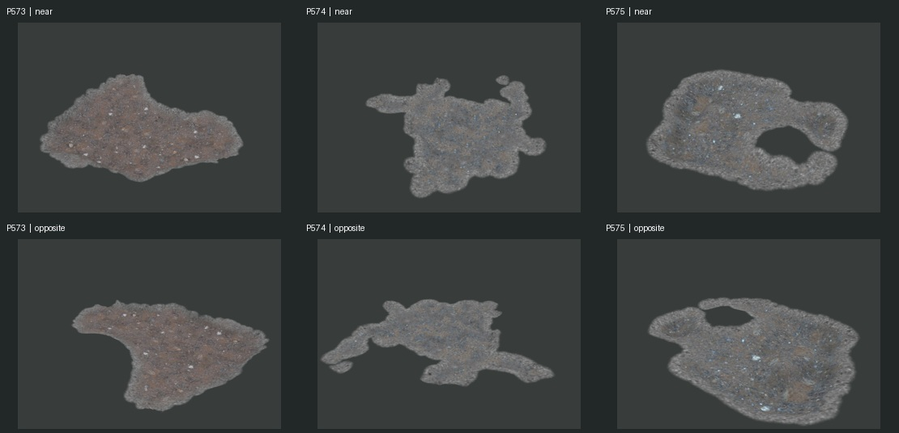
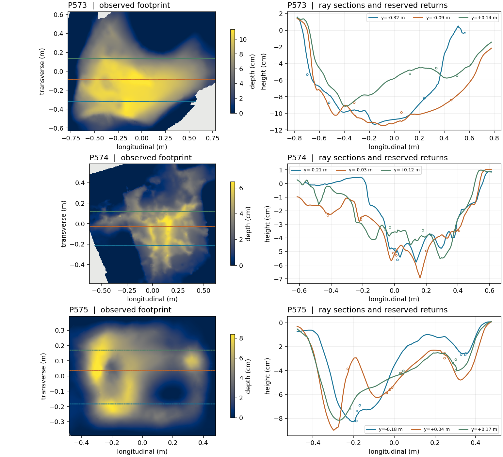
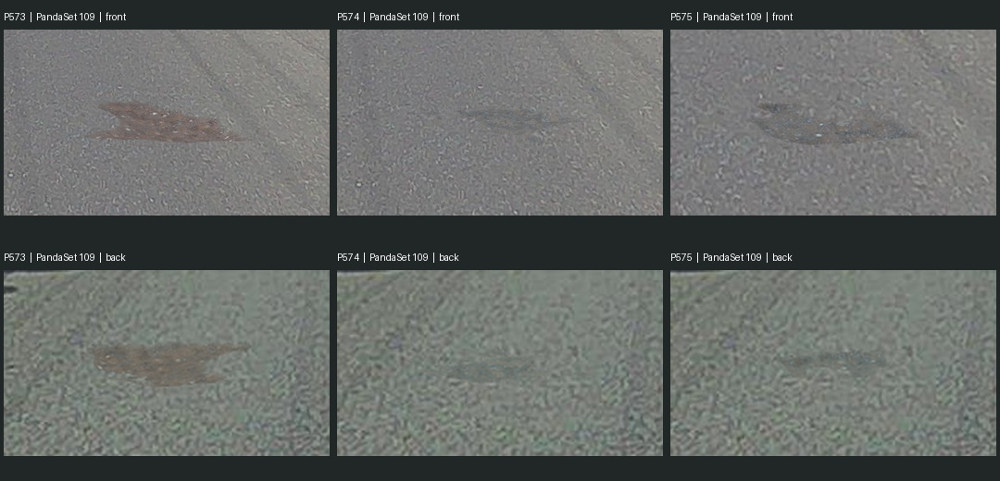

# P573–P575 · 扇形大坑、分支剥落与环绕残余铺装的坑床

三件资产分别取自 PointPSSN 的三份道路点云，每份有 5,000 个 XYZ 测点与逐点病害标注。下面给出实测形状、未参与构建的点与最终网格之间的误差，以及在同一道路位置搭配前后摄像头回放的结果。可分别下载单件模型，直接打开包内 `asset.glb`。[发布与下载](https://github.com/Vexlc/road-hazard-reconstruction/releases/tag/branching-pits-v1.0.0) · [采集项目](https://github.com/5rexi/PointPSSN/tree/1e4c122811066798db1dc0767a159dce05e48383) · [论文](https://doi.org/10.1016/j.eswa.2025.129833)

|编号与采集记录|标注点外接长 × 宽|坑内测点深度 P95|网格对留出坑点的平均垂直误差|断面特征|
|---|---:|---:|---:|---|
|P573 · train/490|1.30 × 1.11 m|11.0 cm|4.3 mm，119 点|扇形宽坑伸到采集边缘，中间一条断面连续约 1.34 m 命中坑区。边界外的延伸长度未知。|
|P574 · train/69|1.04 × 0.83 m|5.8 cm|2.9 mm，93 点|浅窄分支与主凹面相接，三条平行断面经过的坑区宽约 0.51、0.67、0.66 m。|
|P575 · test/87|0.81 × 0.63 m|7.7 cm|1.0 mm，132 点|沿靠近中部的一条断面，约 0.56 m 坑床、0.09 m 留存路面、0.16 m 坑床依次出现。|

长宽使用全部标注点在局部路面上的最小旋转外接矩形。深度取标注点到拟合路面的垂直落差。按未归一化的采集坐标以米解释，三份记录均没有独立标尺。几何由各自的扫描恢复。原始 XYZ 无现场颜色，视觉版采用另行拍摄的沥青与骨料材质。[逐项指标](validation/quality.json) · [原始记录、标注与纹理来源](survey.json)

## 从原始点云复现

从本版仓库根目录运行。Linux 环境按已发布的 Python 3.9、PyTorch 2.4.0、CUDA 12.1 和 gsplat 1.4.0 环境命令设置，并保留其中的 `KIT`、`PYTHONPATH` 与线程数。下载作者的 PointPSSN 数据压缩包，将以下路径指向它。材质包已固定来源，含两种 Poly Haven 骨料和 ambientCG Asphalt031。[环境安装命令](../hensting-cover/README.md#从原照重建) · [作者原始数据](https://drive.google.com/file/d/1zmQ3IzpPbuiBKXMo-ttX1bqew8GSZ9to/view)

~~~bash
git clone --depth 1 --branch branching-pits-v1.0.0 https://github.com/Vexlc/road-hazard-reconstruction.git
cd road-hazard-reconstruction
# 完成上面链接中的环境设置后运行
python -m pip install matplotlib==3.9.4
D=gen2hole/examples/branching-pits
B=build-branching-pits
mkdir -p "$B"
curl -fL -o "$B/materials.zip" https://github.com/Vexlc/road-hazard-reconstruction/releases/download/lane-damage-v1.0.0/scan-materials.zip
unzip -q "$B/materials.zip" -d "$B/materials"
(cd "$B/materials" && sha256sum -c SHA256SUMS)
python "$D/build.py" /path/to/PointPSSN.zip "$B/materials" "$B/models/scans"
python gen2hole/examples/wheel-track-pits/check.py "$B/models" "$B/views" --survey "$D/survey.json"
~~~

以约 2.8 cm 的空间块划分测点并留出检验折。利用其余点拟合邻接道路与局部基底，再通过训练折选择近邻数和边缘分类权重。以 4 mm 间距采样局部表面，三角形顶点都需有近邻测点支持且位于采集凸包内。缺测处保留空白。对三份模型的 344 个留出坑点垂直投射，全部命中；三件垂直误差 P90 分别为 10.2、7.1、2.1 mm。[表面拟合算法](../lane-damage/points/scan.py) · [采集边界约束](../wheel-track-pits/build_scans.py)

`$B/models/scans/series/assets/pothole/P编号` 内含 Y 向上的 `asset.glb`、Z 向上的一阶球谐高斯 `asset.ply`、`metadata.json`、`surface.npz` 和 `splat_material.npz`。独立源码目录复建得到的 15 个核心文件逐字节相同。读取高度场时，用 `observed_footprint` 判断有效范围，`defect_mask` 标识坑区。背景零值仅作存储占位。[复建指纹](validation/rebuild.json)

用下列代码检查 P575 的留存路面。每段长度按采样步长 5 mm 统计，边界处有一个采样步长的分辨率限制。断面来自网格首交；叠图中的空心圆来自独立留出的原始测点。

~~~python
import numpy as np
s = np.load("build-branching-pits/views/P575-sections.npz")
part = s["first_part"][1]
edges = np.r_[0, np.flatnonzero(np.diff(part)) + 1, len(part)]
for a, b in zip(edges, edges[1:]):
    print(int(part[a]), round((b-a) * 0.005, 3))  # 0 未知，1 铺装，2 坑区
~~~

## 在同一条道路比较三个坑

把三个模型分别固定在 PandaSet 109 的同一落点与朝向。前摄每件 5 帧，后摄依次为 11、11、12 帧。六段视频合计 49 帧。宿主街道、车辆姿态和相机曝光来自实录，图中的坑为后插入的点云重建资产。附件按方向和编号保存视频、位姿、代表帧标签和射线。[相机检查](validation/camera.json) · [宿主数据](https://github.com/scaleapi/pandaset-devkit)

~~~bash
raw=/path/to/raw/109
masks=/path/to/processed/109/dynamic_masks/all
for side in front back; do
  python "$KIT/scripts/render-road-distress.py" "$raw" "$masks" "$B/models" "$B/drive/$side" \
    --shot 15 --pixel 1190 925 --yaw-deg 15 --camera "${side}_camera" --semantic-occlusion --focus-part 2 P573 P574 P575
done
python gen2hole/examples/lane-damage/check_drive.py "$B/models" "$raw" "$B/drive" "$B/camera.json" --ids P573 P574 P575
~~~

原始点云及逐点标签由 Tingrui Zhang 等作者提供，从作者入口获取；原库未列明独立的数据集许可证。另用摄影材质来自 Dimitrios Savva（Poly Haven）及 ambientCG，授权为 CC0。[坑底材质一](https://polyhaven.com/a/road_damaged) · [坑底材质二](https://polyhaven.com/a/road_damaged_2) · [道路材质](https://ambientcg.com/a/Asphalt031)
