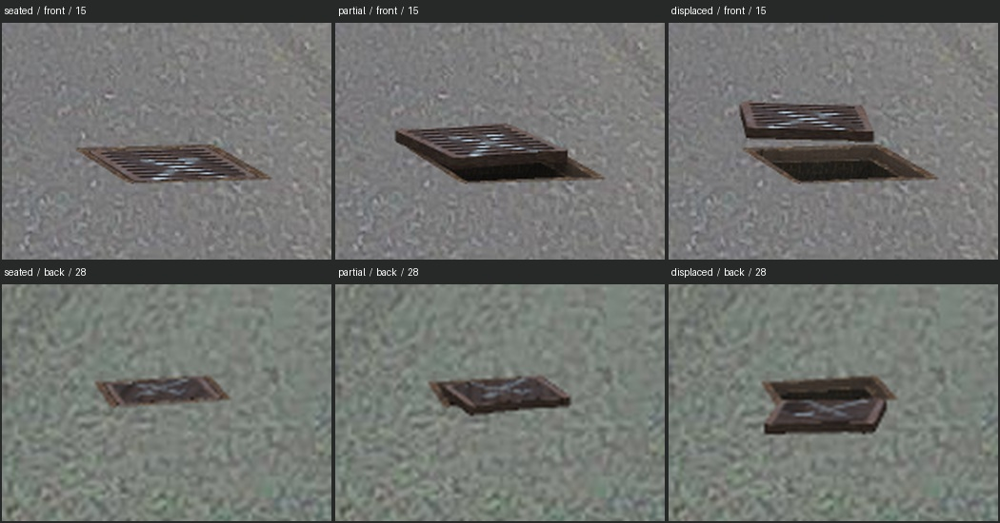
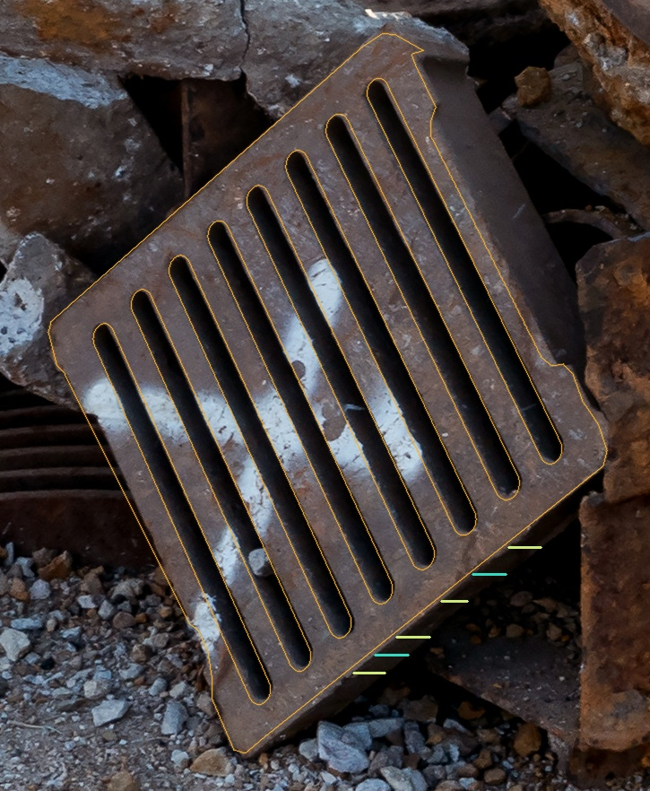
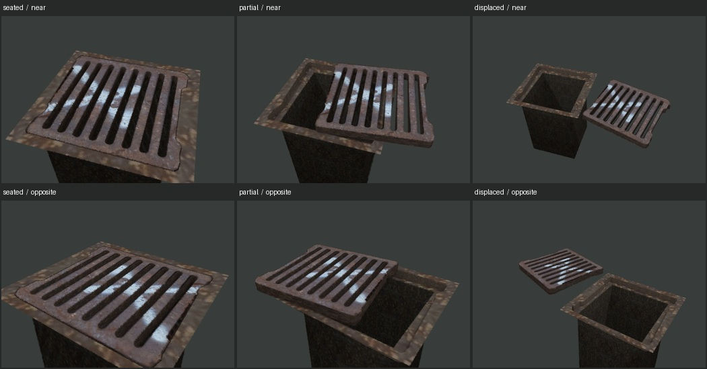
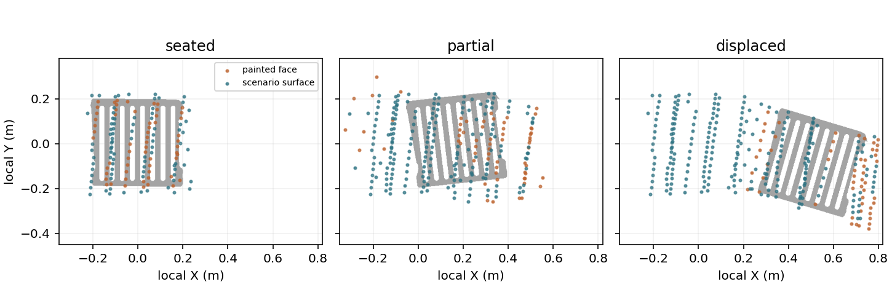

# M589 · 修路现场拆下的白漆八槽排水篦

2018 年，W.carter 在瑞典 Brastad 拍下修路时拆下的一堆井框与盖板。前景的排水篦斜靠在旧铁件上，八个圆头槽、白漆和锈迹清晰可见。这里重建了这块篦板，并为自动驾驶试验配了一个虚拟井座。井座、地下空间和道路安装姿态均为场景设定。原片只记录了拆下的铁件。[现场照片与 CC0 许可](https://commons.wikimedia.org/wiki/File:Scrapped_manholes_and_covers_in_Brastad.jpg) · [全部下载](https://github.com/Vexlc/road-hazard-reconstruction/releases/tag/brastad-grate-v1.0.0)

|安装状态|篦板相对井座的平移与旋转|井口竖直射线穿过的比例|下载|
|---|---|---:|---|
|盖好|中心对齐，篦面齐平|49.1%|[seated](https://github.com/Vexlc/road-hazard-reconstruction/releases/download/brastad-grate-v1.0.0/M589-seated.zip)|
|部分移开|X +17.5 cm、Y +1.4 cm，转 7°|66.1%|[partial](https://github.com/Vexlc/road-hazard-reconstruction/releases/download/brastad-grate-v1.0.0/M589-partial.zip)|
|完全移开|X +51 cm、Y −9 cm，转 −16°|100%|[displaced](https://github.com/Vexlc/road-hazard-reconstruction/releases/download/brastad-grate-v1.0.0/M589-displaced.zip)|

每个 ZIP 含一种道路安装状态的 GLB、高斯 PLY、首交高度场和部件图，另附同一块独立篦板 `models/grate.glb` 和无盖井座 `models/empty.glb`。两件独立网格共用局部坐标，原点位于井座中心的路面高程。网格使用 glTF 的 Y 向上，高斯、断面及下文安装坐标使用 Z 向上。需要完全缺盖时可直接使用无盖井座。使用完全移开版时，独立篦板已放在井旁。

## 哪些细节来自现场

用前景篦板的六对槽端点估计相机位姿和槽长，另两对端点专用于检查。源相机的焦距和焦平面像素密度来自照片元数据。原片经过裁切，光心近似取发布图像中心。原照缺少标尺，采用 **45 mm 的假定槽距**。在这个尺度下，篦板外接尺寸约 42 × 39 cm，槽长 33.49 cm，八个槽的拟合宽度约 19.5–21.8 mm。[像素记录](survey.json) · [拟合实现](casting.py)

篦板右下边能辨出顶面与侧壁下沿。沿这条边取六处横截线，其中四处拟合厚度，另外两处验证。投影厚度约 **32.96 mm**，两处验证下沿分别相差 1.55 和 2.03 像素，六处中误差最大的一处为 6.29 像素。把焦距增减 10%，或把光心分别移到两个备选位置，拟合厚度在 32.50–33.18 mm 之间。这个范围只反映所测相机假设的影响。实际槽距、背部加强筋、刮擦磨损及阴影边界都可能改变对实物厚度的判断。

下图金线为导出网格在原始拍摄视角的顶面轮廓。短横线为厚度观测，蓝绿色标出两处留出位置。四个留出槽端点的最大重投影误差为 2.55 像素。剔除边界后，对顶面内部 116,317 个像素回采，平均 RGB 绝对差为每通道 1.03 个 8 位色阶。此项衡量纹理映射的一致性，不能独立验证深度。[检查数据](validation/quality.json)

顶面保留原片白漆和锈斑。侧壁与井座采用同张照片另一块铁件上的锈蚀纹理作为材料参照。井底设置在路面下 0.55 m，供相机渲染封口。用于感知评测时，高度场的 `unresolved_chamber` 标识模拟井壁与封口；激光文件对缺乏现场约束的替换量程另有 NaN 标记。

## 槽孔、接触与斜视检查

独立篦板是一个闭合定向实体，欧拉特征数为 −14，对应 8 个通孔。对导出的 GLB 实际发射竖直射线，248 条槽内射线全部穿过，217 条篦条射线全部命中。在内口布置相同的 28,223 条竖直射线，用它们得到上表的通过比例。对于部分移开状态，按 2 mm 网格估算，43.6% 的篦板金属投影面积与井座或铺装接触；假定均匀铸铁厚度时，重心投影处于支撑区域凸包内，距边界约 11.9 cm。该结果描述静置几何，未模拟车辆荷载或篦板翻转。

三种姿态各自从网格生成一阶球谐高斯。下图是直接渲染 PLY 的近景和反向视图。六个视图中，高斯与网格在有效部件内部的深度差 P90 为 2.13–3.80 mm。网格及高斯共享同一套篦孔、漆斑和相对位姿。[原生几何与高斯验证](validation/quality.json)

## 从现场照片复现

源码包含两块无损工作图，构建器会校验内容指纹。若需从整幅原照重做裁片，可用以下命令。环境为 Linux、Python 3.9 和 CUDA 12.1；高斯视图检查需要可用的 CUDA GPU。原始 JPEG 的 SHA-256、裁片坐标以及锈蚀样本的四点变换均在 survey.json 内。

~~~bash
git clone --depth 1 --branch brastad-grate-v1.0.0 https://github.com/Vexlc/road-hazard-reconstruction.git
cd road-hazard-reconstruction
python3.9 -m venv .venv
source .venv/bin/activate
export KIT="$PWD/releases/field-chambers"
python -m pip install -r "$KIT/requirements.txt"
python -m pip install torch==2.4.0 torchvision==0.19.0 --index-url https://download.pytorch.org/whl/cu121
python -m pip install gsplat==1.4.0 matplotlib==3.9.4
export PYTHONPATH="$KIT/gen2hole/downstream:$KIT/gen2hole/downstream/sensors:$KIT/gen2hole/recipes/common:$KIT/gen2hole/recipes/series"
export OPENBLAS_NUM_THREADS=1 OMP_NUM_THREADS=2
D=gen2hole/examples/brastad-grate
B=build-brastad
mkdir -p "$B"
wget -O "$B/original.jpg" 'https://upload.wikimedia.org/wikipedia/commons/0/03/Scrapped_manholes_and_covers_in_Brastad.jpg?download=1'
python "$D/source.py" "$B/original.jpg" "$B/re-extracted"
python "$D/build.py" "$B/models"
python "$D/check.py" "$B/models" "$B/views"
python "$D/build.py" "$B/rebuilt"
python "$D/compare_builds.py" "$B/models" "$B/rebuilt" "$B/rebuild.json"
~~~

发布前在独立源码目录重建三种姿态和两个独立模型。17 个原生文件，包括三份 PLY、材质索引和高度场，SHA-256 逐字节相同。[复建指纹](validation/rebuild.json)

## 在同一组车载射线上比较移盖前后

PandaSet 109 提供实录相机、车辆位姿、道路语义和激光扫描。三种状态始终使用同一安装矩阵，每种前摄 5 帧、后摄 11 帧，共 6 段视频、48 帧合成曝光。上方前后摄对照裁取相同的原始像素范围，并核对裁片中的宿主原始像素完全一致。单独使用某个代表帧时，可通过 `placement.json` 的 `crop_xy` 还原到原相机图像坐标。[相机核验](validation/camera.json) · [传感器回放包](https://github.com/Vexlc/road-hazard-reconstruction/releases/download/brastad-grate-v1.0.0/camera-lidar.zip) · [PandaSet 数据入口](https://github.com/scaleapi/pandaset-devkit)

13 个通过交通窗口检查的扫描共有 5,916 条候选回波，来自两台激光。每个包用同一组 `source_row`、发射方向和时间戳保存三种状态。盖好与完全移开相比，**285 条射线的首交部件编号发生改变**，编号 0 表示保留宿主。这个计数包括从道路变为篦板以及从篦板变为井内场景几何的情况。对所有替换的可视量程重新发射射线，重算偏差为 0 m。[逐扫描结果](validation/lidar.json) · [配对射线复算](validation/packets.json)

~~~bash
raw=/path/to/raw/109
masks=/path/to/processed/109/dynamic_masks/all
for state in seated partial displaced; do
  for side in front back; do
    python "$KIT/scripts/render-road-distress.py" "$raw" "$masks" "$B/models/$state" "$B/drive/$state/$side" \
      --shot 15 --pixel 1190 925 --yaw-deg 15 --camera "${side}_camera" \
      --semantic-occlusion --focus-group 5 9 --relief-daylight gen2hole/examples/gervis-rupture/daylight.json M589
  done
  python gen2hole/examples/lane-damage/check_drive.py "$B/models/$state" "$raw" "$B/drive/$state" "$B/drive/$state/check.json" --ids M589
done
python "$D/beams.py" "$B/models" "$B/drive" "$raw" "$B/lidar"
python "$D/check_packets.py" "$B/models" "$B/lidar" "$B/packets.json"
python "$D/figures.py" "$B/models" "$B/drive" "$B/views" "$B/lidar" "$B/figures"
python "$D/pack_release.py" "$B/models" "$B/views" "$B/drive" "$B/lidar" "$B/release"
(cd "$B/release" && sha256sum -c SHA256SUMS)
~~~

`visual_range_m` 供复现光学场景。使用 `plate_constrained_range_m` 做几何对照时，原始道路回波保留宿主距离，命中已配准顶面的替换回波保留模型量程，命中井座、井壁、封口和侧背面的替换回波记作 NaN。已配准顶面的公制量程依赖假定槽距和安装位姿。源照片由 W.carter 以 CC0 1.0 发布，PandaSet 宿主数据适用其原始条款。[摄影来源](https://commons.wikimedia.org/wiki/File:Scrapped_manholes_and_covers_in_Brastad.jpg) · [摄影许可](https://creativecommons.org/publicdomain/zero/1.0/)
