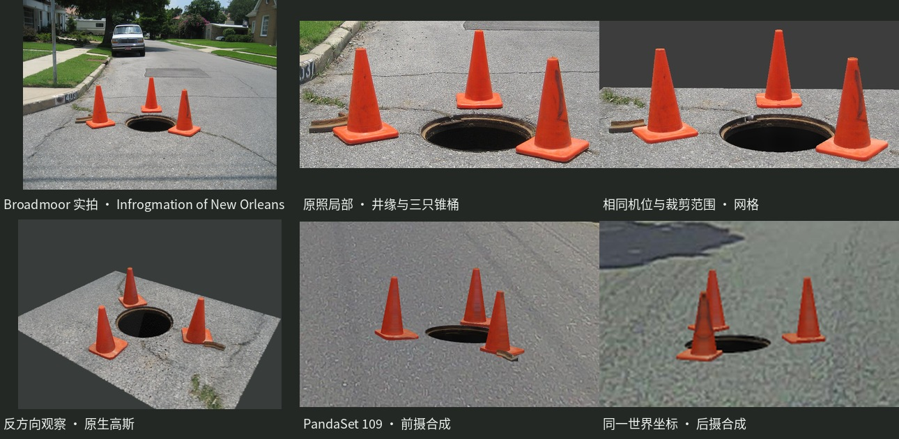

# M571 · Broadmoor 机动车道缺盖井与三只锥桶

2008 年 6 月 23 日，Infrogmation of New Orleans 在美国新奥尔良 Broadmoor 住宅街拍到一处缺盖检查井。作者记录盖板开裂、等待更换。三只交通锥围住井口，左侧锥桶旁有一段锈蚀弧形铁件。原照能确认这段铁件的位置与可见截面，它原来属于哪个零件尚无法确定。[现场照片、EXIF 与授权](https://commons.wikimedia.org/wiki/File:BroadmoorManholeConesJune2008.jpg) · [下载模型、相机与激光回放](https://github.com/Vexlc/road-hazard-reconstruction/releases/tag/broadmoor-opening-v1.0.0)

## 原照怎样变成米制模型

1. 用馆藏的 1920 × 1440 JPEG 取色。在 1280 × 960 图上标注，按原机 EXIF 的 5.8 mm 焦距、每英寸 12,515.56 像素的焦平面分辨率和 2816 px 原始宽度计算工作焦距 1299.04 px。设主点居中，井圈上口直径取 **0.60 m**。现场没有长度标尺，米制结果依赖这个假设。
2. 沿井圈可见弧追踪亮暗边缘，排除远侧破口和前景锥桶遮住的部分。结合锥桶底面与顶部位置拟合相机。23 个交错留出的井缘点距投影边界 RMS 为 **0.82 px**，最大约 1.88 px。内孔半径取 0.279 m；由远侧承托台像素得到台面低于路面约 25 mm，照片里可见的铁套下缘在路面下约 65–72 mm。井圈破口处的网格探针比两旁低约 15.5 mm。
3. 分别拟合三只锥桶的高度、顶底半径、轻微倾斜和圆角底座，模型高度约 **0.434、0.440、0.435 m**。底座用可见外轮廓约束，锈铁与左锥桶相邻处另行分割。三只锥桶在原机位的轮廓与照片橙色掩码的交并比分别为 **0.960、0.961、0.968**。背面颜色借用各自能看到的侧面。地面裂纹和右侧锥桶的深色擦痕均来自现场照片。
4. 沿弧形铁件可见的地面边界扫掠 L 形截面，凸缘与后脊高度由原片估计约 26、47 mm。截面前后宽取 51 mm，锥桶遮住的一端在最后一个可辨位置截断。[标注与尺寸假设](survey.json) · [相机拟合](camera.py) · [材质和几何](build.py)

## 选择渲染或量程文件

|文件|用途|
|---|---|
|`asset.glb` / `asset.ply`|视觉模型含 443,016 个三角形及 409,531 个一阶球谐高斯。为盖住宿主原有的平路，视觉版在路面下 0.85 m 补了一处暗面。照片没有提供井底深度。|
|`observed.glb`|移去深部暗面及向下延伸的虚拟井壁，保留铁套、锥桶、弧形铁件和路面。从井心垂直向下，射线无返回；斜视可能先打到铁套。|
|`surface.npz`|4 mm 网格。`alpha` 标出视觉几何的覆盖范围，`height` 是视觉版垂直首交高度，`observed_depth_valid` 标出射线版可返回的位置。`opening_mask` 对应约 **0.2444 m²** 的直通开口，`cone_mask` 标出最先命中锥桶的位置。|
|`splat_material.npz` / `metadata.json`|逐高斯材质、几何部件、颜色来源、拟合参数和底座误差。GLB 用 Y 轴向上，PLY 和高度场用 Z 轴向上，单位为米。|

从同一个位置移除锥桶重投影，可以数出原本会看见、被锥桶挡住的井内像素。原机位为 **272 / 14,278（1.9%）**。在距井心 3.40 m、高 1.28 m 的三个位置，分别沿三只锥桶所在方向看向井心，遮挡比例变为 **33.0%、31.5%、37.8%**。分母只计算从井口上方进入且先命中井内的像素。三个方向用于比较几何遮挡，属于合成观察。[核验程序](check.py) · [原机位与遮挡结果](validation/quality.json)

## 从原照重建

Linux、Python 3.9、CUDA 12.1 环境下运行。参考照片已随版本固定，打开发布包中的 GLB 可直接查看网格。

~~~bash
git clone --depth 1 --branch broadmoor-opening-v1.0.0 https://github.com/Vexlc/road-hazard-reconstruction.git
cd road-hazard-reconstruction
python3.9 -m venv .venv
source .venv/bin/activate
KIT="$PWD/releases/field-chambers"
python -m pip install -r "$KIT/requirements.txt"
python -m pip install torch==2.4.0 torchvision==0.19.0 --index-url https://download.pytorch.org/whl/cu121
python -m pip install gsplat==1.4.0
export PYTHONPATH="$KIT/gen2hole/downstream:$KIT/gen2hole/downstream/sensors:$KIT/gen2hole/recipes/common:$KIT/gen2hole/recipes/series"
export OPENBLAS_NUM_THREADS=1 OMP_NUM_THREADS=2
D=gen2hole/examples/broadmoor-opening
B=build-broadmoor
python "$D/build.py" "$B/models/model"
python "$D/check.py" "$B/models" "$B/views"
~~~

输出位于 `$B/models/model/series/assets/missing/M571`。第二份独立源码目录从照片起重建，六份资产文件逐字节一致。原生高斯两个新视角与视觉网格的首交深度差 P90 分别约 15.8 和 18.0 mm。需要精确量程时使用网格。[重建指纹](validation/rebuild.json)

## 在实拍宿主中检查锥桶与井口

PandaSet 109 为另一条道路。将 M571 固定在同一世界坐标，前摄 5 帧、后摄 9 帧。代表帧中的资产分别覆盖 10,456 和 2,186 像素。使用原激光发射时间和安装标定，重放两台传感器的候选光束，保留原有前景遮挡。实车实录提供宿主、机位和光束，替换后的量程是模拟结果。[相机核验](validation/camera.json) · [激光报告](validation/lidar.json) · [PandaSet](https://github.com/scaleapi/pandaset-devkit)

~~~bash
raw=/path/to/raw/109
masks=/path/to/processed/109/dynamic_masks/all
for side in front back; do
  python "$KIT/scripts/render-road-distress.py" "$raw" "$masks" "$B/models" "$B/drive/$side" \
    --shot 15 --pixel 1190 925 --yaw-deg 15 --camera "${side}_camera" --semantic-occlusion --focus-part 5 M571
done
python gen2hole/examples/lane-damage/check_drive.py "$B/models" "$raw" "$B/drive" "$B/camera.json" --ids M571
python "$D/lidar.py" "$B/models" "$B/drive" "$raw" "$B/lidar"
~~~

- 11 个完整扫描帧通过交通间距检查，共 5,595 条候选光束。4,511 条保持宿主量程，940 条提前命中新增几何，其中 907 条命中锥桶、32 条命中弧形铁件。
- 另有 144 条原道路回波改为井座或铁套首交。替换要求原点带路面语义、距拟合坡面不超过 4 cm，且射线过零平面的位置及原道路回波均落在井口范围。
- 本次实录的入射方向较浅，符合开口替换条件的光束都先碰到了几何，未知量程计数为零。单独的井心垂直探针验证无返回。包内逐帧 NPZ 保存原点云行号、发射器、局部光束、原始量程、模型量程与状态，可单独筛出两台传感器复查。[光束处理代码](lidar.py)

原照、以原照制作的纹理及 M571 模型按 CC BY-SA 3.0 发布。请署名 Infrogmation of New Orleans，保留原照、许可与改编说明。改编包括摄影配准、局部补全、网格与高斯重建。PandaSet 宿主遵循其数据条款。[原始归属](https://commons.wikimedia.org/wiki/File:BroadmoorManholeConesJune2008.jpg) · [CC BY-SA 3.0](https://creativecommons.org/licenses/by-sa/3.0/)
