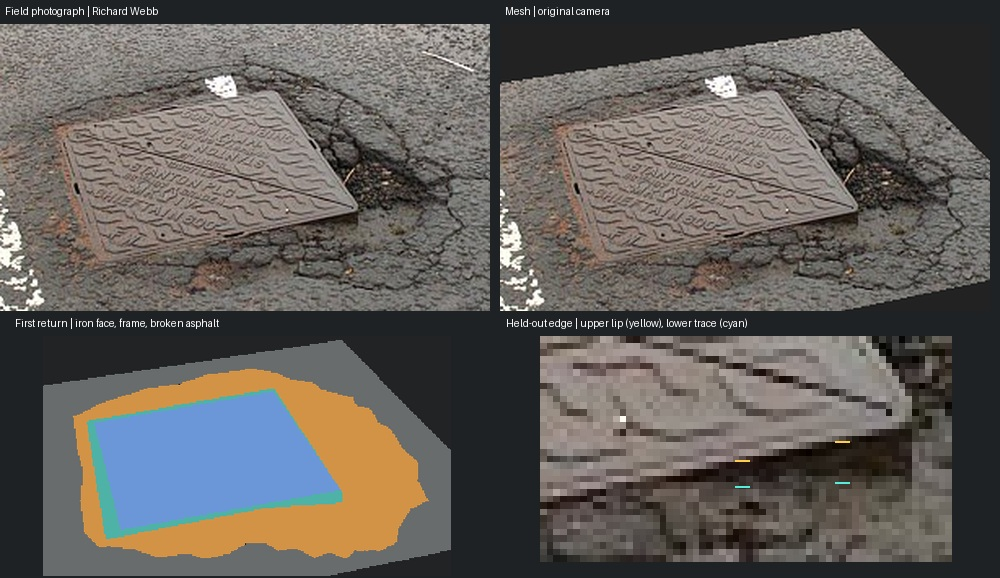
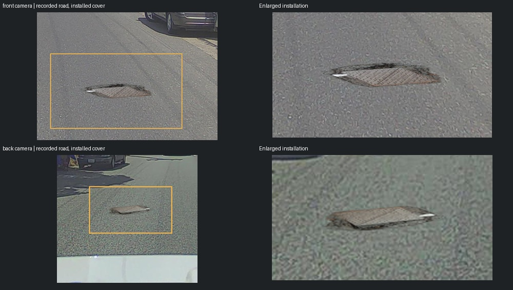

# A580 · Callander Road 冻裂沥青包围的铸铁井盖

2010 年 1 月 22 日，Richard Webb 在苏格兰 Callander Road 拍下这只方形井盖。作者记载井盖周边路面开裂后进水，结冰膨胀又破坏了沥青。盖板留在框内，右前缘能看到深色窄带，右侧和前方可分辨碎块、裂口与露出的粗料。模型保留了原照中的铸字、斜线和路面白色残迹。[现场原照与授权](https://www.geograph.org.uk/photo/1673294) · [模型和传感器回放下载](https://github.com/Vexlc/road-hazard-reconstruction/releases/tag/callander-cover-v1.0.0)

## 如何选择几何

|文件|用途|
|---|---|
|`asset.glb`|将局部暗带解释为外露铁壁。盖面以 z = 0 为基准，向右前角相邻铺装逐渐降低，碎裂路面的建模高程范围约为 −30 至 +4 mm。|
|`flush.glb`|同一盖面、铁框、裂损轮廓与照片纹理全部铺在同一平面上。用于检查仅凭外观能否识别，或与有高差的模型作传感器对照。|
|`asset.ply`、`splat_material.npz`|起伏版的 449,216 个一阶球谐高斯与逐高斯部件索引。两个新视角的高斯与网格首交深度差 P90 分别为 1.2、1.5 mm。|
|`surface.npz`|4 mm 网格，`first_part` 中 1 为外围路面，2 为破碎沥青，5 为铁框，9 为盖面。结合 `alpha` 与 `installation_mask` 读取高度和迁入范围。`view_count` 是每个表面采样点在原机位可见的数量，范围 0–1。|
|`views/source-rays.npz`|640 × 359 原机位逐像素部件与沿单位射线的距离，含两种模型。0 号部件与无穷大距离表示未命中。|

GLB 使用 Y 向上；相机、PLY、高度场使用 Z 向上，长度单位为米。模型限于盖面与可见路表。井筒和盖板底面在原照中不可见。纹理保留现场光照，最适合漫射光或与原照接近的条件。

## 从现场照片复现

以下命令已在 Linux、Python 3.9 和 CUDA 12.1 下执行。原照随源码固定，构建器首先核对 SHA-256。

~~~bash
git clone --depth 1 --branch callander-cover-v1.0.0 https://github.com/Vexlc/road-hazard-reconstruction.git
cd road-hazard-reconstruction
python3.9 -m venv .venv
source .venv/bin/activate
export KIT="$PWD/releases/field-chambers"
python -m pip install -r "$KIT/requirements.txt"
python -m pip install torch==2.4.0 torchvision==0.19.0 --index-url https://download.pytorch.org/whl/cu121
python -m pip install gsplat==1.4.0
export PYTHONPATH="$KIT/gen2hole/downstream:$KIT/gen2hole/downstream/sensors:$KIT/gen2hole/recipes/common:$KIT/gen2hole/recipes/series"
export OPENBLAS_NUM_THREADS=1 OMP_NUM_THREADS=2
D=gen2hole/examples/callander-cover
B=build-callander-cover
python "$D/build.py" "$B/models/model"
python "$D/check.py" "$B/models" "$B/views"
~~~

输出在 `$B/models/model/series/assets/raised/A580`。从独立源码目录重建后，两个 GLB、PLY、部件索引、高度场和元数据六个文件的 SHA-256 均相同。[复建指纹](validation/rebuild.json)

### 哪些尺寸有照片依据

原照 EXIF 为 Canon PowerShot A640、7.3 mm，厂家给出的广角端等效焦距为 35 mm。由于裁切及主点位置无法完整恢复，本例取主点为图像中心，以 648 px 为默认焦距，并测试 565–690 px。四个角点拟合一个矩形，盖面宽度取 **0.60 m 的工作假设**。默认拟合长度为 0.645 m，四角均方根重投影误差为 0.71 px。固定宽度并改变焦距时，长度为 0.589–0.674 m；现场没有独立标尺。[原始角点与假设](survey.json) · [相机规格](https://www.usa.canon.com/support/p/powershot-a640)

沿照片中铁框右前缘，在 x = 356、373、386 px 处各标记暗带上、下沿。将两沿解释为同一平面位置的上下两点，得到 **11.6、22.8、30.7 mm** 的表观高差。另在 x = 365、380 px 留出两条边缘，不参与拟合；导出网格的铁壁下沿在原机位相差约 0.2、0.1 px。暗带还可能含阴影；单张照片无法独立量出实际侧壁高度。右侧碎块间的 12 mm 局部下凹与 4 mm 块面起伏也是建模假设。齐平控制模型保留这些位置在照片中的外观，便于评估这种不确定性。[相机与暗带拟合](camera.py) · [逐项验证](validation/quality.json)

## 迁入实车道路与复算激光

将资产放入 PandaSet 109 的同一个世界位置，以实录姿态、曝光、动态掩码和语义遮挡生成 5 帧前摄、11 帧后摄。右列放大了相应的安装位置。英国照片里的大片外围车道标线留在独立模型中；迁入时保留宿主道路，裂损带内部的小白色残迹随资产迁移。[相机验证](validation/camera.json)

~~~bash
raw=/path/to/raw/109
masks=/path/to/processed/109/dynamic_masks/all
for side in front back; do
  python "$KIT/scripts/render-road-distress.py" "$raw" "$masks" "$B/models" "$B/drive/$side" \
    --shot 15 --pixel 1190 925 --yaw-deg 25 --camera "${side}_camera" \
    --edge-blend-m .018 --semantic-occlusion --focus-part 9 A580
done
python gen2hole/examples/lane-damage/check_drive.py "$B/models" "$raw" "$B/drive" "$B/camera.json" --ids A580
python "$D/beams.py" "$B/models" "$B/drive" "$raw" "$B/lidar"
python "$D/figures.py" "$B" "$B/figures"
python "$D/pack.py" "$B/models" "$B" "$B/release"
(cd "$B/release" && sha256sum -c SHA256SUMS)
~~~

16 个关联扫描中，13 个通过动态交通窗口检查。两台实录激光的发射时刻、起点和方向保持一致。在 1,163 条候选射线中，要求原始回波标注为道路、位于局部路面上下 4 cm 内，原始落点和齐平版射线入口均在安装区，并能命中起伏版。由此得到 **634 条可配对射线**，其余 529 条在两种回放中保留宿主量程。起伏版有 316 条命中破碎沥青、38 条命中框、280 条命中盖面。171 条在两种模型间相差超过 3 mm，配对量程绝对差 P90 为 37.3 mm。量程沿斜射光束计算，不能直接当作竖向坑深。实录道路上没有此英国井盖，这些差值是同束光的几何对照。[逐扫描统计](validation/beams.json) · [逐束数据与回放包](https://github.com/Vexlc/road-hazard-reconstruction/releases/download/callander-cover-v1.0.0/camera-lidar.zip)

现场照片 © Richard Webb（Geograph）。改编包括图像配准、零件和破损区描边、摄影纹理映射、几何假设与渲染。原照及其派生资产按 CC BY-SA 2.0 提供，复用时应保留署名、出处、修改说明和同一许可。PandaSet 宿主影像及激光数据遵循原始数据条款。[原照](https://www.geograph.org.uk/photo/1673294) · [CC BY-SA 2.0](https://creativecommons.org/licenses/by-sa/2.0/) · [PandaSet](https://github.com/scaleapi/pandaset-devkit)
