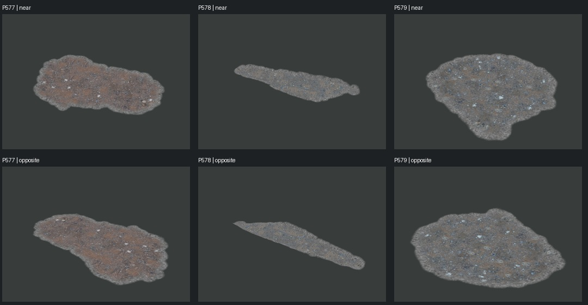
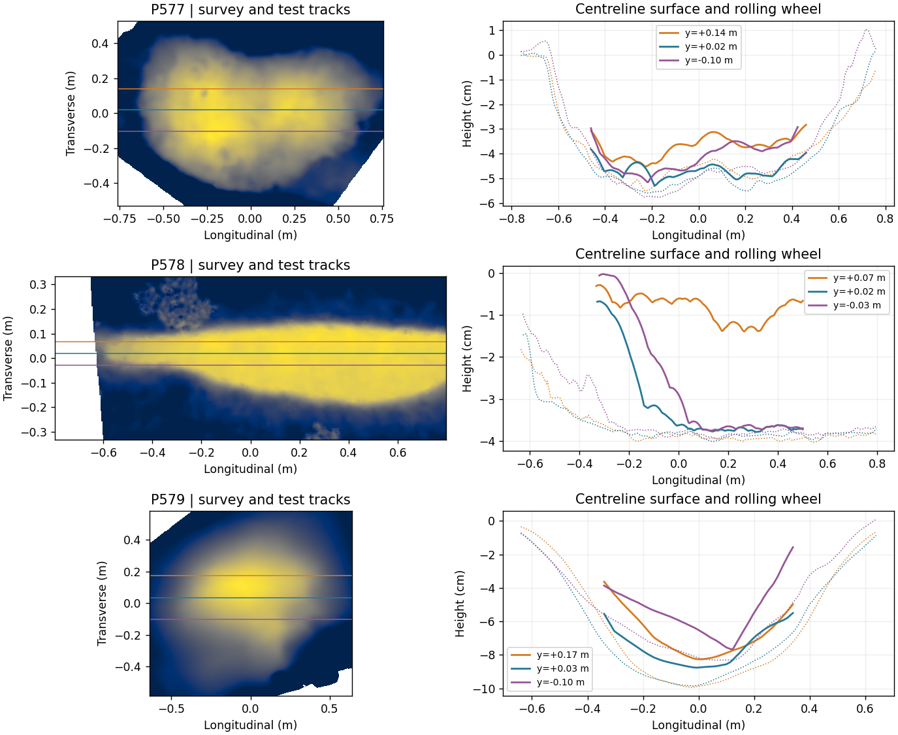
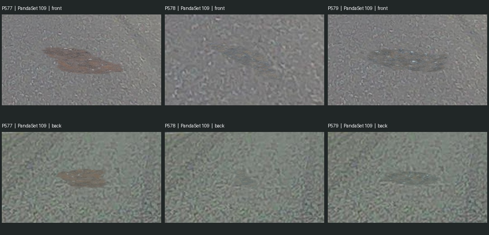

# P577–P579 · 长椭圆坑、纵向浅槽与中央深坑

三件模型分别来自 PointPSSN 的三份原始车道路面点云，每份 5,000 个 XYZ 测点。P577 和 P578 长度接近，宽度相差一倍多。P579 的范围较小，中央坑床更深。每件可单独下载 GLB 网格、一阶球谐高斯 PLY、带有效范围的高度场与轮迹计算结果。[下载区](https://github.com/Vexlc/road-hazard-reconstruction/releases/tag/contact-pits-v1.0.0) · [采集项目](https://github.com/5rexi/PointPSSN/tree/1e4c122811066798db1dc0767a159dce05e48383) · [论文](https://doi.org/10.1016/j.eswa.2025.129833)

|资产与原始记录|标注点长 × 宽|测点深度 P95|留出坑点数|垂直误差 P90|
|---|---:|---:|---:|---:|
|[P577 长椭圆坑](https://github.com/Vexlc/road-hazard-reconstruction/releases/download/contact-pits-v1.0.0/P577.zip) · train/70|1.11 × 0.65 m|5.55 cm|105|1.82 mm|
|[P578 纵向浅槽](https://github.com/Vexlc/road-hazard-reconstruction/releases/download/contact-pits-v1.0.0/P578.zip) · train/25|1.18 × 0.26 m|3.99 cm|40|2.58 mm|
|[P579 中央深坑](https://github.com/Vexlc/road-hazard-reconstruction/releases/download/contact-pits-v1.0.0/P579.zip) · train/383|0.81 × 0.71 m|9.92 cm|57|0.97 mm|

长宽取全部坑内标注点在局部路面上的最小旋转外接矩形。表中深度是这些点相对邻接道路拟合平面的垂直落差。原始坐标按米解释，三处均缺少可独立核验的标尺。原始 XYZ 没有现场颜色；网格与高斯的颜色来自另行拍摄的沥青和骨料材质。[点云与材质指纹](survey.json) · [逐项几何检查](validation/quality.json)

## 从原始点云复现

从作者入口下载 PointPSSN 数据包。下面的命令使用 Linux、Python 3.9 与 CUDA 12.1。构建器对选用的每份 XYZ、标注和材质分别核对 SHA-256。[作者原始数据](https://drive.google.com/file/d/1zmQ3IzpPbuiBKXMo-ttX1bqew8GSZ9to/view)

~~~bash
git clone --depth 1 --branch contact-pits-v1.0.0 https://github.com/Vexlc/road-hazard-reconstruction.git
cd road-hazard-reconstruction
python3.9 -m venv .venv
source .venv/bin/activate
export KIT="$PWD/releases/field-chambers"
python -m pip install -r "$KIT/requirements.txt"
python -m pip install torch==2.4.0 torchvision==0.19.0 --index-url https://download.pytorch.org/whl/cu121
python -m pip install gsplat==1.4.0 matplotlib==3.9.4
export PYTHONPATH="$KIT/gen2hole/downstream:$KIT/gen2hole/downstream/sensors:$KIT/gen2hole/recipes/common:$KIT/gen2hole/recipes/series"
export OPENBLAS_NUM_THREADS=1 OMP_NUM_THREADS=2
D=gen2hole/examples/contact-pits
B=build-contact-pits
mkdir -p "$B"
curl -fL -o "$B/materials.zip" https://github.com/Vexlc/road-hazard-reconstruction/releases/download/lane-damage-v1.0.0/scan-materials.zip
unzip -q "$B/materials.zip" -d "$B/materials"
(cd "$B/materials" && sha256sum -c SHA256SUMS)
python "$D/build.py" /path/to/PointPSSN.zip "$B/materials" "$B/models/scans"
python gen2hole/examples/wheel-track-pits/check.py "$B/models" "$B/views" --survey "$D/survey.json"
python "$D/wheel.py" "$B/models/scans/series/assets/pothole" "$B/views"
~~~

空间分块留出一组测点，剩余点用于拟合邻接道路，并在训练折中选择局部拟合参数。浅槽边上有低于路面却被标为普通铺装的点，重建保留它们的高度。高出拟合路面 6 cm 以上的非病害回波从路面几何中排除。4 mm 网格只导出有邻近测点支撑、且原始 Delaunay 三角形三边均短于支持阈值的部分。局部拟合高度约束在相邻实测高度范围内。该处理避免在扫描缺口造出坡道。[几何实现](build.py)

模型保存在 `$B/models/scans/series/assets/pothole/P编号`。GLB 使用 Y 向上，高斯与高度场使用 Z 向上。`surface.npz` 的 `observed_footprint` 标识表面观测支撑，`defect_mask` 标识坑区。对 202 个留出坑内点发射竖直射线，全部命中导出的网格。用独立源码目录重建，三个模型各自的 GLB、PLY、元数据、高度场、高斯部件索引与轮迹 NPZ 共 18 个文件逐字节相同。[复建 SHA-256](validation/rebuild.json)

## 坑底与车轮轴心的差别

每件取三条平行于标注坑长轴的路径，横向位置为重建病害像素行号的第 25、50、75 百分位。下图实线为刚性圆柱车轮轴心高度减去半径，虚线为同一条中心线的实际网格高度。P578 在 y = +0.068 m 的路径上，轮面一侧仍搭在浅槽边，最大轴心下移约 1.39 cm。向内移约 5 cm 后，下移约 3.78 cm。[九条轮迹的数值](validation/wheel.json)

轮半径取 0.30 m，胎面宽取 0.18 m。对轮下纵向偏移 s、宽度范围内的横向采样点，取 `z + sqrt(R² − s²) − R` 的最大值。完整直径与胎宽范围都落在有观测支撑的网格时才给出轴高；缺测或超出边界以 NaN 保存。模型使用刚性圆柱与静态离散高度面，未包含胎压、胎侧形变、速度、悬挂或冲击载荷。输出适于比较同一几何在不同轮迹下的接触条件。[实现与平地、窄槽、缺测自检](wheel.py)

~~~python
import numpy as np
p = np.load("build-contact-pits/views/P578-wheel.npz")
for y, profile, valid in zip(p["y_m"], p["axle_minus_radius_m"], p["full_support"]):
    print(f"y={y:+.3f} m, maximum drop={-100 * profile[valid].min():.2f} cm")
~~~

## 车道回放与坑缘颜色

三件资产分别放入 PandaSet 109 的同一位置。车道、车辆姿态、曝光和遮挡来自宿主实录，坑洞来自各自的点云。每件前摄 5 帧；后摄依次 11、12、11 帧。发布包内六段视频共 49 帧，还包含代表帧的逐像素部件、射线结果与安装位姿。[车载回放包](https://github.com/Vexlc/road-hazard-reconstruction/releases/download/contact-pits-v1.0.0/road-camera.zip) · [相机检查](validation/camera.json) · [宿主数据](https://github.com/scaleapi/pandaset-devkit)

在实测坑缘内侧 3.5 cm 混合宿主路面颜色。六个代表帧的部件图和原始曝光均与硬边渲染相同。以前摄 P577 为例，坑区边界内两个像素范围的平均绝对 RGB 改变量由 11.66 降至 6.31（8 位色值）。该对照量化拼接边缘的颜色变化。坑内材质仍可与宿主存在色差。[全部边缘和内部对照](validation/edge.json)

~~~bash
raw=/path/to/raw/109
masks=/path/to/processed/109/dynamic_masks/all
for side in front back; do
  for blend in 0 .035; do
    python "$KIT/scripts/render-road-distress.py" "$raw" "$masks" "$B/models" "$B/drive-$blend/$side" \
      --shot 15 --pixel 1190 925 --yaw-deg 15 --camera "${side}_camera" \
      --semantic-occlusion --focus-part 2 --edge-blend-m "$blend" P577 P578 P579
  done
done
python gen2hole/examples/lane-damage/check_drive.py "$B/models" "$raw" "$B/drive-.035" "$B/camera.json" --ids P577 P578 P579
python "$D/compare_edges.py" "$B/drive-0" "$B/drive-.035" "$B/edge.json"
python "$D/package_assets.py" "$B/models" "$B/views" "$B/drive-.035" "$B/release"
(cd "$B/release" && sha256sum -c SHA256SUMS)
~~~

原始点云与逐点标签由 Tingrui Zhang 等作者提供，需从作者数据入口获取。作者仓库未列明独立的数据集许可证。坑底材质来自 Dimitrios Savva，邻接路面材质来自 ambientCG，三种摄影材质均以 CC0 提供。[作者仓库](https://github.com/5rexi/PointPSSN) · [骨料一](https://polyhaven.com/a/road_damaged) · [骨料二](https://polyhaven.com/a/road_damaged_2) · [路面](https://ambientcg.com/a/Asphalt031)
