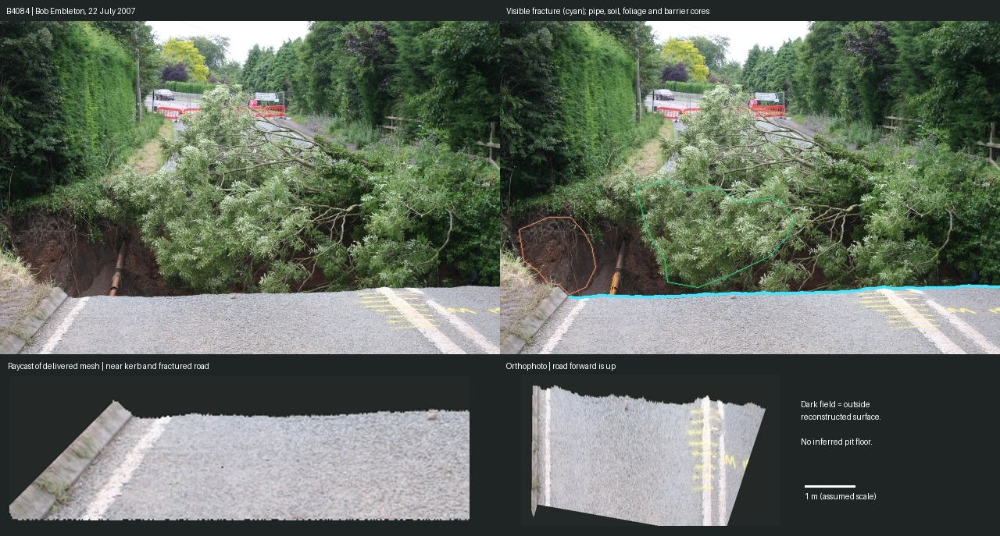

# P572 · Cropthorne 洪水冲毁公路的近侧断边

2007 年 7 月 20 日，英国伍斯特郡 Cropthorne 的 B4084 公路被洪水冲断。县级报告记载约 **15 m 长的路段塌陷**，地下管线外露。两天后的近照能看到双白线随沥青在断面终止，左边的路缘石也断了，倒树枝叶遮住坑底。P572 把这张现场图与同机位的局部三维表面配对，可用于检查系统能否识别车道终止、能否在植被遮挡处保留未知量程。[现场近照](https://www.geograph.org.uk/photo/501704) · [县级报告，印刷页 29](https://archive.wyreforestdc.gov.uk/media/107675/EB064Planning-for-Climate-Change.pdf#page=33) · [发布包](https://github.com/Vexlc/road-hazard-reconstruction/releases/tag/cropthorne-break-v1.0.0)

## 从现场照片重建

以下命令从固定版本仓库内的照片生成模型、原机位量程和正射图。已测试 Linux x86_64、Python 3.9.23、CPU。建模器会先校验五张 JPEG 的 SHA-256。

~~~bash
git clone --depth 1 --branch cropthorne-break-v1.0.0 https://github.com/Vexlc/road-hazard-reconstruction.git
cd road-hazard-reconstruction
python3.9 -m venv .venv
source .venv/bin/activate
python -m pip install numpy==1.26.4 scipy==1.13.1 pillow==11.3.0 trimesh==4.4.9 opencv-python-headless==4.10.0.84 open3d==0.18.0
D=gen2hole/examples/cropthorne-break
python "$D/build.py" build/P572
python "$D/check.py" build/P572
~~~

1. 在原始 640 × 427 像素网格上，用 EXIF 的 39 mm 焦距、焦平面像素密度与原机宽度推算工作焦距 1124.34 px。用近端三条纵向漆线求道路方向，并以画面左侧电杆约束竖直方向。83 个漆线样本中按行交错留出 27 个，留出样本与投影线的垂直误差 RMS 为 0.57 px。
2. 取左侧白线到靠近它的中心白线之间为 **3.20 m**，按局部路面平面反投影，得到拍摄高度约 1.79 m。这是尺度假设。若取 3.0–3.5 m，可见断边横向跨度会从 4.29 变为 5.01 m，相机到断边的道路纵向距离中位数从 8.65 变为 10.10 m。留出误差只检查图像拟合。
3. 在 552 列像素中沿人工导引线搜索沥青与枝叶、土壁交界处的亮度跃迁，逐列恢复不规则断边。仅在照片内可见的近端路面建立三角形，白漆与黄色施工喷记从原片投影。以路缘石底脚的两个可见点估计它的纵向走向，假设其末端截面垂直于此方向，从六个轮廓点反投影出约 9.9 cm 的高差。路缘石表面的草叶颜色保留在纹理中。
4. 现场图中的管线、土壁、倒树和远端路障各有一个局部正标注区域。它们用于测试深度缺失和辨别遮挡。其他视角可核对现场与封路状态，缺少能约束坑底和远侧断面的几何对应。15 m 仅作为事件资料中的纵向长度保存。[坐标、照片校验值与尺度参数](survey.json) · [建模程序](build.py)

## 在原机位和正射视图核验

|文件|内容与使用方法|
|---|---|
| `P572.glb` | 两个可选节点，分别是存留车道与路缘石。使用嵌入式现场纹理。glTF 采用 Y 轴向上。 |
| `edge.npz` | `pixels` 是从左至右的断边像素，`xyz` 是对应的模型坐标，`kerb_profile_xyz` 是路缘石末端截面。单位为米，轴向为右、道路前方、上方。转换到 glTF 时按 `(x,z,-y)` 排列。 |
| `camera.json` | 焦距、主点、相机位置和旋转。用行向量 `[(u-cx)/f,(v-cy)/f,1] @ camera_to_world_row_vectors` 求世界系方向。原点在可见断边各坐标的中位数处。 |
| `range.npz` | 与 501704 原片同尺寸。`range_m` 为相机到网格首交点的欧氏距离（float32）；未建模区域为 NaN。`part_id` 为 0 未知、1 沥青、2 路缘石。量程由模型计算。 |
| `context-cores.png` | 单通道类别值。0 为未标注，1–4 依次为管线、土壁、倒树、远端路障。标注覆盖各物体的一部分。 |
| `orthophoto.png`、`overview.jpg`、`quality.json` | 正射图为每像素 9 mm，顶排像素中心的局部坐标为 x = −2.66 m、y = 0.48 m；向右 x 增大，向下 y 减小。JSON 附断边距离、假设车辙与断边的交点、尺度敏感性和验证计数。 |

验证器重新读入已导出的 GLB，并从原机位投射射线。46,079 个像素命中沥青，2,207 个命中路缘石；四类正标注区内的量程全部为未知。每隔四列检查模型的车道终止位置，136 条检查线与提取断边相差最多 1 px。这个结果验证导出几何和投影的一致性。

在 3.20 m 标定下，取道路纵向平行线、假设轮距 1.60 m，以拍摄位置为中心，左、右两条线到断边的前向距离分别约为 **9.32、9.17 m**。这些是假想轮迹上的几何交点。照片由现场摄影者拍摄，未提供实车轨迹、实测坑深或制动数据。[验证代码](check.py) · [逐项结果](validation/quality.json) · [独立重建指纹](validation/rebuild.json)

## 现场照片与署名

- Bob Embleton，2007-07-22，三张现场照片。其中 501704 用作几何依据与纹理，另外两张用于核对道路两侧与路障。[501695](https://www.geograph.org.uk/photo/501695) · [501704](https://www.geograph.org.uk/photo/501704) · [501713](https://www.geograph.org.uk/photo/501713)
- David Luther Thomas，2007-07-25，从 New Inn 方向看封闭道路，以及附近的致灾溪流。两张补充照片保留原样。[506640](https://www.geograph.org.uk/photo/506640) · [506643](https://www.geograph.org.uk/photo/506643)
- 五张照片均按 CC BY-SA 2.0 授权。依据照片制作的纹理、配准网格、图像标注和预览按同一许可发布。再使用时请保留相应摄影者、作品链接、许可和改编说明。[CC BY-SA 2.0](https://creativecommons.org/licenses/by-sa/2.0/)
