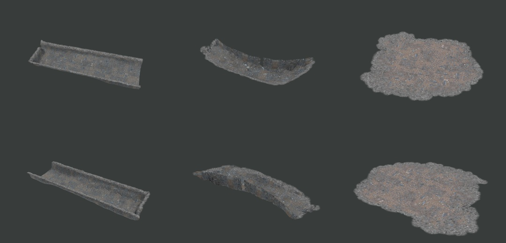
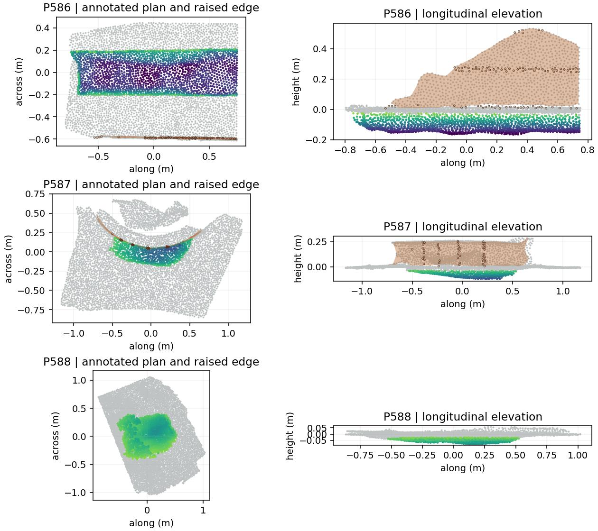
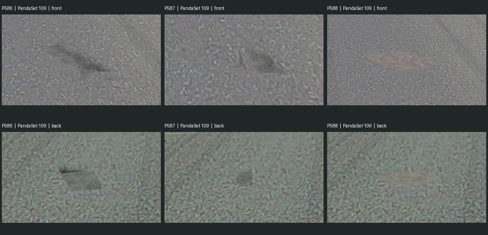

# P586–P588 · 截断深槽、弧缘月牙坑与偏心宽浅坑

三件资产各来自一份独立的 PointPSSN 道路扫描，每份有 5,000 个 XYZ 测点及逐点标注。直接使用时下载对应 ZIP。每包含带材质的 GLB 网格、原生一阶球谐高斯 PLY、4 mm 间隔的高度场、三条纵向断面和源坐标变换。长槽与月牙坑还各附一片可以单独显示的实测凸缘。[下载区](https://github.com/Vexlc/road-hazard-reconstruction/releases/tag/deep-track-pits-v1.0.0) · [来源与文件指纹](survey.json)

|资产|连续坑区长 × 宽|测点深度 P95|留出坑点命中数|命中点垂直误差 P90|
|---|---:|---:|---:|---:|
|[P586 单端截断的长条深槽](https://github.com/Vexlc/road-hazard-reconstruction/releases/download/deep-track-pits-v1.0.0/P586.zip) · train/491|1.49 × 0.42 m|15.34 cm|131 / 132|12.57 mm|
|[P587 凸起弧缘旁的月牙形坑](https://github.com/Vexlc/road-hazard-reconstruction/releases/download/deep-track-pits-v1.0.0/P587.zip) · train/390|1.06 × 0.35 m|10.99 cm|30 / 31|12.58 mm|
|[P588 偏心宽浅坑](https://github.com/Vexlc/road-hazard-reconstruction/releases/download/deep-track-pits-v1.0.0/P588.zip) · train/55|0.98 × 0.83 m|7.34 cm|85 / 86|12.02 mm|

尺寸取标注点最大连通区域的最小旋转外接矩形。深度取全部标注点到邻接路面拟合平面的垂直落差。测量单位按米解释，三份记录均缺少可独立校准尺度的标尺。点云只含几何和类别，坑床骨料及邻接沥青使用另外拍摄的 CC0 材质。[点云采集项目](https://github.com/5rexi/PointPSSN/tree/1e4c122811066798db1dc0767a159dce05e48383) · [论文](https://doi.org/10.1016/j.eswa.2025.129833)

## 现场几何与使用边界

- **P586** 的负 X 端能看到路面逐渐降到坑底。正 X 端直至采集边界仍有连续坑底回波，1.49 m 是可见长度。使用单端开放的网格时应保留这个边界，沿槽贯穿整段的车轮仿真只能计算到有效覆盖末端。旁侧的高立面另存在同坐标的 `raised-edge.glb`。
- **P587** 的坑床沿测得的凸缘弯曲。用未留出的高处回波拟合得到凸缘平面半径约 0.89 m。可将同包内的 `raised-edge.glb` 与 `asset.glb` 置于同一变换下查看。47 个留出立面点到导出网格的最近距离 P90 为 4.07 mm，P586 的 94 个留出立面点为 20.29 mm。附件只覆盖有回波的露出立面，类型和表面颜色未知。
- **P588** 有 1,043 个标注点形成连续主坑，另有 3 个离散标注。把离散点也计入外接矩形，长边会达到 1.98 m。因此模型裁切和表中尺寸按连通主坑计算，误差统计仍包含全部留出坑点。[尺寸、立面与误差](validation/edges.json)

下图左列是俯视，右列是沿坑长轴的侧视。彩点为坑内测点，灰点为其余回波，棕色为独立导出的立面，空心圈为用于检查立面的留出点。没有同期现场彩照可用来判定凸起物的种类。

## 从原始点云复现

从作者入口取得 PointPSSN 压缩包，将下面的 `archive` 指向本地文件。原始包 SHA-256 与六个 XYZ/标签成员的指纹均写入 survey.json，构建器逐个校验所用成员和材质。在 Linux、Python 3.9、CUDA 12.1 环境执行下列命令。构建网格后，原生高斯检查和车载相机回放需要可用的 CUDA GPU。[作者数据入口](https://drive.google.com/file/d/1zmQ3IzpPbuiBKXMo-ttX1bqew8GSZ9to/view)

~~~bash
git clone --depth 1 --branch deep-track-pits-v1.0.0 https://github.com/Vexlc/road-hazard-reconstruction.git
cd road-hazard-reconstruction
python3.9 -m venv .venv
source .venv/bin/activate
export KIT="$PWD/releases/field-chambers"
python -m pip install -r "$KIT/requirements.txt"
python -m pip install torch==2.4.0 torchvision==0.19.0 --index-url https://download.pytorch.org/whl/cu121
python -m pip install gsplat==1.4.0 matplotlib==3.9.4
export PYTHONPATH="$KIT/gen2hole/downstream:$KIT/gen2hole/downstream/sensors:$KIT/gen2hole/recipes/common:$KIT/gen2hole/recipes/series"
export OPENBLAS_NUM_THREADS=1 OMP_NUM_THREADS=2
D=gen2hole/examples/deep-track-pits
B=build-deep-track-pits
archive=/path/to/PointPSSN.zip
mkdir -p "$B"
curl -fL -o "$B/materials.zip" https://github.com/Vexlc/road-hazard-reconstruction/releases/download/lane-damage-v1.0.0/scan-materials.zip
unzip -q "$B/materials.zip" -d "$B/materials"
(cd "$B/materials" && sha256sum -c SHA256SUMS)
python "$D/reconstruct.py" "$archive" "$B/materials" "$B/models/scans"
python gen2hole/examples/wheel-track-pits/check.py "$B/models" "$B/views" --survey "$D/survey.json"
python "$D/check_edges.py" "$B/models/scans" "$B/views"
python "$D/select_parameters.py" "$B/models/scans" "$B/views/training.json"
~~~

在原始扫描坐标上用 28 mm 分块，把第 0 折封存。用其余点拟合局部路面，取最大标注连通区定裁切框。对于两处陡边，先把测点表示为沿坑位置、离中心线的横距与高度。在等高 0.34 m 的虚拟观察线上做扇形投影，在该截面坐标中建三角网，再还原到真实三维位置。宽浅坑直接在 XY 平面建网并使用 16 邻点稳健局部平面抑制噪声。各三角形按实际三维边长和局部测点密度裁切，类别交界在边中点切分。高斯和网格的陡面使用单独展开的骨料纹理，减少侧壁材质拉伸。[截面坐标](sections.py) · [三角网](geometry.py) · [三个训练折的参数对照](validation/training.json)

GLB 为 Y 向上，高斯和高度场为 Z 向上。高度场行序沿局部 Y 递减。用 `observed_footprint` 判断每个位置是否有覆盖，再读 `height`。覆盖外的零是存储填充值。陡边可能在同一 XY 下出现多层表面，4 mm 高度场仅存自上而下首个交点，斜向射线请使用 GLB。路面安装使用 `asset.glb`；可选立面没有装入下方车道回放。

## 和普通高度场对照

运行下列命令可重建同一批点云的普通有界高度场。P586、P587、P588 在该基线中分别命中 130/132、28/31、86/86 个留出坑点，垂直误差 P90 分别为 17.63、31.02、12.64 mm。改用本版网格后，P587 的改善最大；P588 命中数减少一个。留出数较少，尤其 P587 只有 31 个坑点。表中百分位只针对命中点，未命中的数量单独计入。三个模型在两个源码目录分别构建，包括可选立面在内的 17 个原生文件 SHA-256 逐一相同。[基线记录](validation/baseline.json) · [最终记录](validation/quality.json) · [复建指纹](validation/rebuild.json)

~~~bash
python "$D/baseline.py" "$archive" "$B/materials" "$B/baseline/scans"
python gen2hole/examples/wheel-track-pits/check.py "$B/baseline" "$B/baseline-views" --survey "$D/survey.json"
python "$D/reconstruct.py" "$archive" "$B/materials" "$B/rebuilt/scans"
python "$D/compare_builds.py" "$B/models/scans" "$B/rebuilt/scans" "$B/rebuild.json"
~~~

## 实录车道中的前后摄

把三件道路资产分别安装在 PandaSet 109 同一车道位置，使用记录的相机、车辆位姿和动态遮挡。前摄各 5 帧；后摄依次 12、9、11 帧。下图为视频代表帧的局部放大。相机包内有六段视频、全幅合成前后对照、部件掩码、射线结果和安装变换。相机检查从原始曝光和导出的 GLB 重算代表帧，也核对前后摄共用的世界坐标。[下载回放包](https://github.com/Vexlc/road-hazard-reconstruction/releases/download/deep-track-pits-v1.0.0/road-camera.zip) · [逐机位检查](validation/camera.json) · [宿主数据](https://github.com/scaleapi/pandaset-devkit)

~~~bash
raw=/path/to/raw/109
masks=/path/to/processed/109/dynamic_masks/all
for side in front back; do
  python "$KIT/scripts/render-road-distress.py" "$raw" "$masks" "$B/models" "$B/drive/$side" \
    --shot 15 --pixel 1190 925 --yaw-deg 15 --camera "${side}_camera" \
    --semantic-occlusion --focus-part 2 --edge-blend-m .035 \
    --relief-daylight gen2hole/examples/gervis-rupture/daylight.json P586 P587 P588
done
python gen2hole/examples/lane-damage/check_drive.py "$B/models" "$raw" "$B/drive" "$B/camera.json" --ids P586 P587 P588
python "$D/package_assets.py" "$B/models" "$B/views" "$B/drive" "$B/release"
(cd "$B/release" && sha256sum -c SHA256SUMS)
~~~

原始 XYZ 和标注由 Tingrui Zhang 等作者提供，原始数据集的独立许可证未在作者仓库中列明。骨料摄影作者为 Dimitrios Savva，铺装摄影来自 ambientCG。[点云项目](https://github.com/5rexi/PointPSSN) · [骨料一](https://polyhaven.com/a/road_damaged) · [骨料二](https://polyhaven.com/a/road_damaged_2) · [铺装](https://ambientcg.com/a/Asphalt031)
