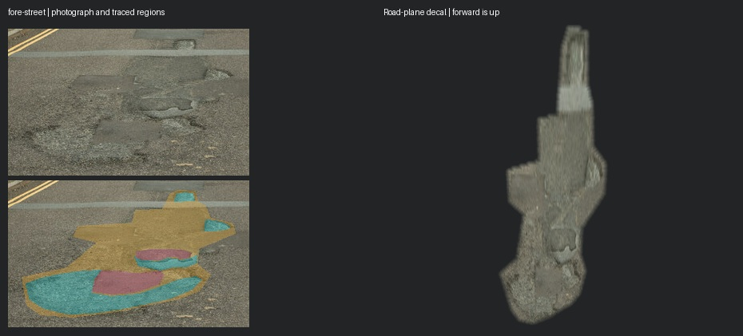
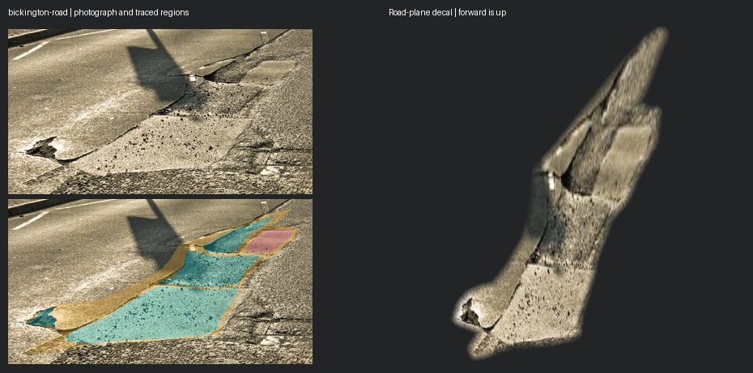

# 德文郡两处行车道连续破损

这两组带透明通道的路面贴图来自 Roger A Smith 拍摄的现场照片。Fore Street 的补丁间留有多块旧面层，四片露出粗料的区域沿行车方向断续分布。A3125 Bickington Road 的破损集中在纵向接缝一侧，可以看到掀起的薄边、粗料和一块较平整的矩形修补面。两组贴图均保留原照里的颗粒和光照。适用于视觉检测、标注投影和相机合成；深度、悬空唇厚度及接触力学在这批材料中未知。

|路段与拍摄日期|原照与标注对照|可直接使用的文件|
|---|---|---|
|Fore Street，2023-04-19|[现场照片](https://www.geograph.org.uk/photo/7459581) · [反向街景](https://www.geograph.org.uk/photo/7459578)|[透明贴图](assets/fore-street/decal.png) · [区域标签](assets/fore-street/regions.png) · [坐标变换](assets/fore-street/mapping.json)|
|A3125 Bickington Road，2024-06-09|[现场照片](https://www.geograph.org.uk/photo/7794657)|[透明贴图](assets/bickington-road/decal.png) · [区域标签](assets/bickington-road/regions.png) · [坐标变换](assets/bickington-road/mapping.json)|

## 如何读标签

`regions.png` 是 8 位单通道整数图。0 表示选区以外；1（图示黄色）表示选中的连续破损与修补带中尚未细分的面；2（青色）表示可辨的裸露粗料或破碎边缘；3（粉色）表示仍然连成片的面层或平整补丁。相邻的修补面和粗糙面分别标注，可单独选用。两幅图各有四片类别 2 区域，边缘为原照分辨率下的人工判读。前后视角的街景提供环境参照，建模只用表格中每行的第一张照片。当前照片间的路面匹配不足以用双目估计坑深。

`decal.png` 的 RGB 为现场颜色，alpha 是用于拼接的一小圈软边。类别 0 包含这圈过渡路面，用于检测时请读取 `regions.png`。Bickington Road 的灯杆阴影已经进入 RGB；需要接入另一种照明时可在原照中检查阴影位置。两处均没有实测尺寸。

## 将贴图对准车道

`mapping.json` 内的矩阵作用于像素中心的列向量 `[u, v, 1]`，变换后除以最后一项。`source_xy_to_atlas_xy` 从现场照片映射至贴图，`atlas_xy_to_road_xy` 从贴图映射至局部路面。路面 x 向相机右侧，y 朝相机前方，原点是相机在地面的垂足。每单位等于假设的拍摄相机离地高度。给定宿主希望使用的尺寸，可将两个路面轴乘同一个比例，再旋转、平移到车道。采样 RGB 和 alpha 时可用双线性插值，采样标签时用最近邻。

`traces.json` 保存原图上的边界、独立检查像素及假设的视平线和焦距。两张原图均为 640 × 427。构建器按局部平路、零横滚解算单应矩阵。每组 `mapping.json` 还保存九种组合下的横纵跨度，方便判断更换相机假设的影响。

|路段|默认焦距 / 视平线，像素|默认横 × 纵跨度，单位为相机高度|焦距 ±10%、视平线 ±8 像素时的纵跨度|
|---|---|---|---|
|Fore Street|720 / 100|1.37 × 3.96|3.26–4.81|
|Bickington Road|560 / 70|1.62 × 2.55|2.16–3.01|

## 复现与核验

从仓库根目录运行。以下版本已在 Linux、Python 3.9 下执行。脚本先核对两张原照的 SHA-256，随后生成所有 PNG、检查图及投影矩阵。最终校验八个派生文件。

~~~bash
python3.9 -m venv .venv
source .venv/bin/activate
python -m pip install numpy==1.26.4 Pillow==11.3.0 opencv-python==4.10.0.84
D=gen2hole/examples/devon-road-patches
python "$D/build.py" /tmp/devon-road-patches
(cd /tmp/devon-road-patches && sha256sum -c "$OLDPWD/$D/SHA256SUMS")
~~~

检查项包括有效像素有原图覆盖、每组 6 个标签检查点，以及把贴图标签逆投影回现场照片后三类选区各自的交并比。最低交并比分别为 0.99895 和 0.99941。这衡量重采样对人工轮廓的保真度；拍摄尺度、凹陷深度和真实边界位置仍依赖现场测量。

## 授权与修改说明

Roger A Smith 摄影，原照 © Roger A Smith，通过 Geograph 发布。两张原照以及据此制作的裁剪、透视矫正、轮廓贴图和检查图按 CC BY-SA 2.0 提供。复用时请保留作者、对应照片的来源链接、许可链接，并注明所作修改。[Fore Street 原始出处](https://www.geograph.org.uk/photo/7459581) · [Bickington Road 原始出处](https://www.geograph.org.uk/photo/7794657) · [CC BY-SA 2.0](https://creativecommons.org/licenses/by-sa/2.0/)
