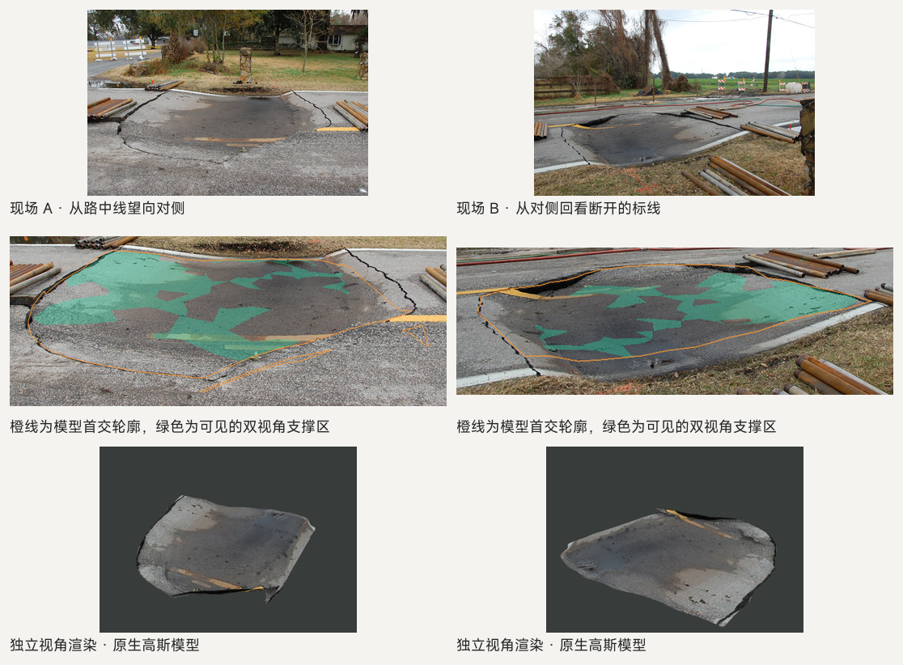
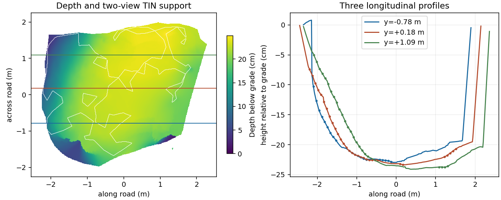
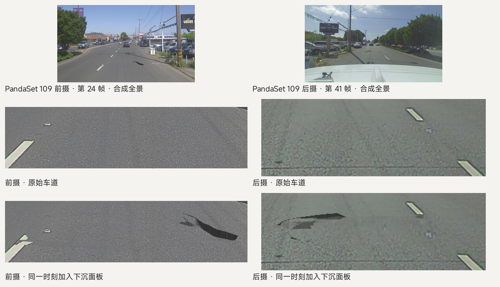

# P590 · 佛罗里达 Dover 车道塌陷

2010 年 1 月佛罗里达 Dover 冻害期间，USGS 从车道两侧拍下同一片下沉的沥青。断开的黄色中线、白色边线和斜对面的暗色裂口可以在两张照片中相互辨认。资产保留整片滑落的路面与一侧张开的断口，适合测试车辆接近大面积负障碍、驶过后回看，以及低仰角激光扫过下沉面板时的距离变化。[现场原照 A](https://www.usgs.gov/media/images/sinkholes-west-central-florida-freeze-event-2010-5) · [反向原照 B](https://www.usgs.gov/media/images/sinkholes-west-central-florida-freeze-event-2010-6) · [下载模型与现场资料](https://github.com/Vexlc/road-hazard-reconstruction/releases/download/dover-collapse-v1.0.0/P590.zip)

## 哪些尺寸有依据

|项目|本次结果|解释|
|---|---:|---|
|下沉面在道路纵横轴上的跨度|4.55 × 3.97 m|按完整边线到中线的名义间距 3.30 m 定标。现场没有尺标。|
|下沉深度第 95 百分位|24.1 cm|以模型面板的俯视面积加权，基准为坑外拟合路面。|
|尺度敏感性|21.7–26.0 cm|把名义间距改为 3.00–3.60 m 重新求解后，训练特征深度第 95 百分位的范围。|
|现场双视角支撑|363 个面板训练点，覆盖 34.6% 的面板面积|只保留三条边均短于 0.40 m 的匹配点三角形。其余面板为插值和轮廓补全。|
|留出点跨视角误差中位数|A→B 2.13 px，B→A 2.70 px|使用 2256 × 1496 原图像素。对应的平路基线为 122.33、184.67 px。|

两张相机分别估计焦距和姿态，以坑外两条标线和画面内的竖直线约束解。1,162 对候选点在估计基础矩阵前按固定顺序留出 232 对。488 对训练内点参与相机拟合。留出集合中有 155 对落在剔除设备遮挡后的面板区域，其中 89 对通过极线筛选；从 A、B 沿首交点落到面板的分别有 88 和 87 对。表中重投影误差在各自命中的射线上计算。89 对从正上方均击中面板，与留出点三角化高度的绝对差中位数为 2.0 mm，第 90 百分位为 8.6 mm。两组检验共用同一对相机与照片，只衡量内部一致性。现场绝对高程仍缺少独立测量。[核验数据、分位数和尺度试验](validation/quality.json)

上缘用两张照片里的断口轮廓求交。下缘来自 B 中的暗带底线，并假设该短段断面近似竖直。模型把可见暗带做成侧壁。地下空腔和塌陷成因所需的地质参数均未知。周边增加约 22 cm 的接地过渡，形状受局部边界约束。光学侧壁和过渡区在使用激光对照时单独处理。

## 从现场照片复现

在 Linux、Python 3.9 上执行。高斯渲染使用 CUDA GPU。图板脚本用 fontconfig 选择中文字体。原照、标注、匹配点和模型构建代码均包含在标签中。

~~~bash
git clone --depth 1 --branch dover-collapse-v1.0.0 https://github.com/Vexlc/road-hazard-reconstruction.git
cd road-hazard-reconstruction
python3.9 -m venv .venv
source .venv/bin/activate
KIT="$PWD/releases/field-chambers"
python -m pip install -r "$KIT/requirements.txt"
python -m pip install torch==2.4.0 torchvision==0.19.0 --index-url https://download.pytorch.org/whl/cu121
python -m pip install gsplat==1.4.0 matplotlib==3.9.4
export PYTHONPATH="$KIT/gen2hole/downstream:$KIT/gen2hole/downstream/sensors:$KIT/gen2hole/recipes/common:$KIT/gen2hole/recipes/series"
export OPENBLAS_NUM_THREADS=1 OMP_NUM_THREADS=2
D=gen2hole/examples/dover-collapse
B=build-dover
python "$D/build.py" "$B/models/model"
python "$D/check.py" "$B/models" "$B/views"
python - "$D" "$B" <<'PY'
from pathlib import Path
import hashlib, json, sys
guide, build = map(Path, sys.argv[1:])
asset = build / "models/model/series/assets/pothole/P590"
for name, expected in json.loads((guide / "validation/rebuild.json").read_text()).items():
    assert hashlib.sha256((asset / name).read_bytes()).hexdigest() == expected, name
PY
~~~

六个模型产物均已从独立源码目录复建并逐字节核对。不同版本的求解器、图像编解码器或几何库可能改变文件指纹。[模型指纹](validation/rebuild.json) · [原始下载地址、SHA-256 与像素标注](survey.json)

若要从原照重新提取匹配，将两个视角重投影到公共道路平面，分五个裁区运行 SuperPoint 和 LightGlue，合并原图坐标后保存评分、极线误差及留出掩码。当前环境重新提取的六个数组与提交版本完全一致。

~~~bash
git clone https://github.com/cvg/LightGlue.git "$B/LightGlue"
git -C "$B/LightGlue" checkout 5a650c444718caffc2669dc0094cde908f42dd73
python -m pip install 'kornia>=0.6.11' packaging
PYTHONPATH="$B/LightGlue:$PYTHONPATH" python "$D/match.py" "$B/reextracted.npz"
python - "$D/matches.npz" "$B/reextracted.npz" <<'PY'
import sys, numpy as np
with np.load(sys.argv[1]) as a, np.load(sys.argv[2]) as b:
    assert a.files == b.files and all(np.array_equal(a[k], b[k]) for k in a.files)
PY
~~~

## 选择适用的资产

|文件|用法|
|---|---|
| `asset.glb` |完整模型，55,502 个三角形，带现场照片纹理和接地过渡。GLB 使用 Y 向上。|
| `observed.glb` |仅导出 363 个训练匹配点构成的短边三角形。适合限定几何证据范围，空缺处保留为空。|
| `asset.ply`、`splat_material.npz` |760,000 个高斯及辅助材质。PLY 为道路局部 Z 向上。两个独立视角中，核心像素高斯与网格深度差第 90 百分位分别为 5.9、7.4 mm。|
| `surface.npz` |12 mm 栅格。height 为相对道路高度（米），first_part 的 0/1/2/3 分别为空、过渡、面板、光学侧壁。stereo_valid 是严格短边三角网在面板上的投影。observed_footprint 和 installation_mask 均指完整网格的俯视覆盖。|
| `metadata.json`、`views/profiles.npz` |前者记录局部原点、相机与尺度；后者为三条纵剖面的 X、横向偏移、首交高度和部件编号。|

## 在实录自驾道路上回放

PandaSet 109 的前后摄共用一个安装点。按各帧的相机标定，将光线与面板首交的位置映回原道路平面，采样该帧原有的沥青、道路反光钉和标线，再按局部法线、场景日照和网格自遮挡调光。交通框、动态掩码、前景激光与车体遮挡用于筛选。完整输出有前摄 7 帧、后摄 8 帧。平面供色会拉伸断口边缘的道路细节，暗带的明暗为渲染设定。照片中的黄线保存在原生模型。两处道路并非同一地点。[PandaSet 数据入口](https://github.com/scaleapi/pandaset-devkit) · [相机核验](validation/camera.json) · [下载视频与逐束量程](https://github.com/Vexlc/road-hazard-reconstruction/releases/download/dover-collapse-v1.0.0/camera-lidar.zip)

~~~bash
raw=/path/to/raw/109
masks=/path/to/processed/109/dynamic_masks/all
for side in front back; do
  python "$D/host_replay.py" "$raw" "$masks" "$B/models" "$B/host/$side" "$side"
done
python gen2hole/examples/lane-damage/check_drive.py "$B/models" "$raw" "$B/host" "$B/camera.json" --ids P590
python "$D/beams.py" "$B/models" "$B/host" "$raw" "$B/lidar"
python "$D/figures.py" "$B/models" "$B/views" "$B/host" "$B/figures"
python "$D/pack_release.py" "$B/models" "$B/views" "$B/host" "$B/lidar" "$B/release"
(cd "$B/release" && sha256sum -c SHA256SUMS)
~~~

激光包保留原始扫描行号、传感器、发射时间、原始量程、局部射线与语义。12 个通过交通筛选的扫描窗口中有 17,325 条候选光束；要求原始回波有道路语义、距拟合路面 4 cm 以内，且新表面可见。3,472 条满足完整面板的替换条件，对应 visual_range_m。仅替换双视角支撑区时使用 supported_range_m，共 845 条。只命中推断暗壁的 442 条保留原始量程。支撑区内沿光束的量程相对平路中位增加 1.70 m，斜射角会放大沿光束的距离变化。两列回放均保存未替换光束的宿主实录值。[逐扫描报告](validation/lidar.json)

USGS 将两张现场原片标为 Public Domain。这里的修改包括手工标注、相机估计、三角化、边界补全、贴图与高斯导出。PandaSet 画面和扫描数据的再利用遵循其原始条款。
