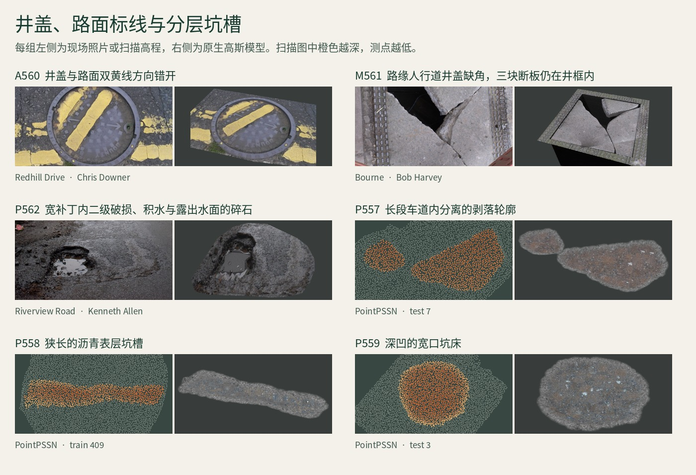

# 错向漆线井盖、残板缺口和分层坑槽

六个道路资产各自对应独立的现场照片或一条原始点云记录。每件提供 GLB、原生一阶球谐 Gaussian PLY、安装高度场和材质索引。可直接打开 GLB 检查几何，也可按下列步骤重新构建。[井盖与补丁积水坑](https://github.com/Vexlc/road-hazard-reconstruction/releases/download/field-rims-v1.0.0/paint-and-breaks.zip) · [扫描坑槽](https://github.com/Vexlc/road-hazard-reconstruction/releases/download/field-rims-v1.0.0/scan-pairs.zip) · [车载短片](https://github.com/Vexlc/road-hazard-reconstruction/releases/download/field-rims-v1.0.0/road-camera.zip)

## 选择场景

| 编号 | 观测与重建 | 适合检查的现象 |
|---|---|---|
| P557 | 同一次扫描中的两块分离坑区，整体标注外接矩形约 1.16 × 0.50 m，深度 P95 4.2 cm | 资产在一处，两块缺损之间仍有路面 |
| P558 | 狭长沥青槽约 0.83 × 0.16 m，深度 P95 3.2 cm | 接近时长度可见，宽度在远处较难分辨 |
| P559 | 宽口坑床约 0.62 × 0.57 m，深度 P95 7.6 cm | 与 P558 尺度接近，横向占用和深度不同 |
| A560 | 井盖仍在井框内，盖面和路上双黄线在原照平面相差 52.7° | 盖内漆线有清晰边界，不能直接当成道路标线的切向 |
| M561 | 狭窄人行道上的电信井盖，一角缺失，三块断板仍在井框内 | 从斜视相机区分真实开口、残板和承座 |
| P562 | 河景路上的补丁再次剥落，坑壁分级，水面中露出五块石头 | 外补丁长轴按 2.20 m 建模，只有其中一部分是深坑和积水 |

扫描尺寸采用原始坐标并假定单位为米。P95 是坑内标注测点深度的第 95 百分位。照片组采用单张图像约束，A560 的井框直径按 0.70 m、M561 井内深度按 0.43 m、P562 水面按低于路面 6.7 cm 建模。现场都没有独立尺度测量。P562 的设定补丁长度与积水范围分别记录。M561 下缘被施工围栏遮挡，重建时保留可见裂缝，用同件材质补全被挡部分。[照片参数](covers.json) · [补丁、坑缘、水线和石块标注](riverview.json) · [扫描索引](scans.json)

## 从输入重建

以下命令从仓库根目录运行。完整依赖固定在仓库中，共用材质可直接下载上版的 CC0 输入包。

~~~bash
git clone --depth 1 --branch field-rims-v1.0.0 https://github.com/Vexlc/road-hazard-reconstruction.git
cd road-hazard-reconstruction
python3.9 -m venv .venv
source .venv/bin/activate
python -m pip install -r releases/field-chambers/requirements.txt
export KIT="$PWD/releases/field-chambers"
export PYTHONPATH="$KIT/gen2hole/downstream:$KIT/gen2hole/downstream/sensors:$KIT/gen2hole/recipes/common:$KIT/gen2hole/recipes/series"
export OPENBLAS_NUM_THREADS=1 OMP_NUM_THREADS=2
D=gen2hole/examples/field-rims
B=build-rims
mkdir -p "$B"
python "$D/build_covers.py" "$B/models/covers"
curl -fL -o "$B/materials.zip" https://github.com/Vexlc/road-hazard-reconstruction/releases/download/lane-damage-v1.0.0/scan-materials.zip
unzip -q "$B/materials.zip" -d "$B/materials"
(cd "$B/materials" && sha256sum -c SHA256SUMS)
python "$D/build_scans.py" /path/to/PointPSSN.zip "$B/materials" "$B/models/points"
~~~

三张照片已随仓库提供。扫描组从作者的数据包读取 XYZ 和标签，检查成员指纹，留出空间块后，用相邻道路拟合局部坐标系，再从训练点恢复坑缘和高程。扫描纹理来自另行拍摄的路面材质。A560 用椭圆标注矫正盖圈，在相邻路面提取磨损黄漆。M561 以井框四角建立平面单应变换，分别描出三块破片并挤出断面。P562 的各级轮廓先在照片中剖分，再放到对应高度，以保留近侧坑唇在低视角下的遮挡关系。[扫描数据来源](SOURCES.md) · [井盖代码](build_covers.py) · [分层坑壁代码](riverview.py)

## 核验与车辆视角

~~~bash
python -m pip install torch==2.4.0 torchvision==0.19.0 --index-url https://download.pytorch.org/whl/cu121
python -m pip install gsplat==1.4.0
python "$D/inspect_models.py" "$B/models" "$B/views"
~~~

六件均从原生 PLY 渲染两个相反视角，并在原生 GLB 上发射射线检查。P557、P558、P559 分别采用 115、81、113 个留出坑内点，平均绝对高度误差为 0.99、0.93、1.12 mm。A560 盖外黄漆的模型掩码与照片掩码交并比为 0.961。M561 缺角内 17,314 个现场参照像素都先命中井内，三块残板各自的内部像素则先命中板面。P562 五块石头的中心射线全部先命中石块，积水区连同石块的投影交并比为 0.916。原生高斯和网格的逐角度差异随报告提供。[逐件检查](validation/quality.json) · [两次构建一致的 30 个文件指纹](validation/rebuild.json)

车载合成使用 PandaSet 034，四件坑洞分别放到同一条实拍道路上，前后摄共 8 段、100 帧。下面的程序会复核前后摄世界锚点、代表帧前景、解码帧数以及逐像素命中距离。A560 适于有双黄线的路缘，M561 的现场位于人行道，这两件以独立三维视图展示。[车载核验](validation/camera-check.json)

~~~bash
raw=/path/to/raw/034
masks=/path/to/processed/034/dynamic_masks/all
for side in front back; do
  render() {
    python "$KIT/scripts/render-road-distress.py" "$raw" "$masks" "$B/models" "$B/034/$side" \
      --shot 15 --pixel 1090 925 --camera "${side}_camera" --semantic-occlusion "$@"
  }
  render --yaw-deg 42 P557 P558 P559
  render --yaw-deg 84 P562
done
python gen2hole/examples/lane-damage/check_drive.py "$B/models" "$raw" "$B/034" "$B/camera-check.json" --ids P557 P558 P559 P562
python "$D/pack.py" "$B/models" "$B" "$B/release"
~~~

迁入其他宿主时，GLB 为 Y 向上，原生高斯和高度场为 Z 向上，局部零高对应道路。先按 surface.npz 的 installation_mask 裁开路面，使负高度坑壁和井内可见。A560 的黄色漆线有独立的路面部件。M561 的 opening_mask 可定位断板间的开口。P562 的 substrate_height 保留水下坑床，环境反射需由支持 IOR 的 PBR 渲染器提供。每个压缩包解压后可用 `sha256sum -c SHA256SUMS` 核验。[原作者和许可](SOURCES.md)
