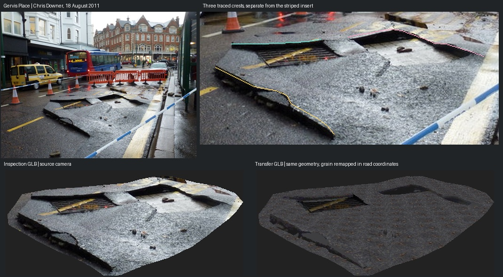
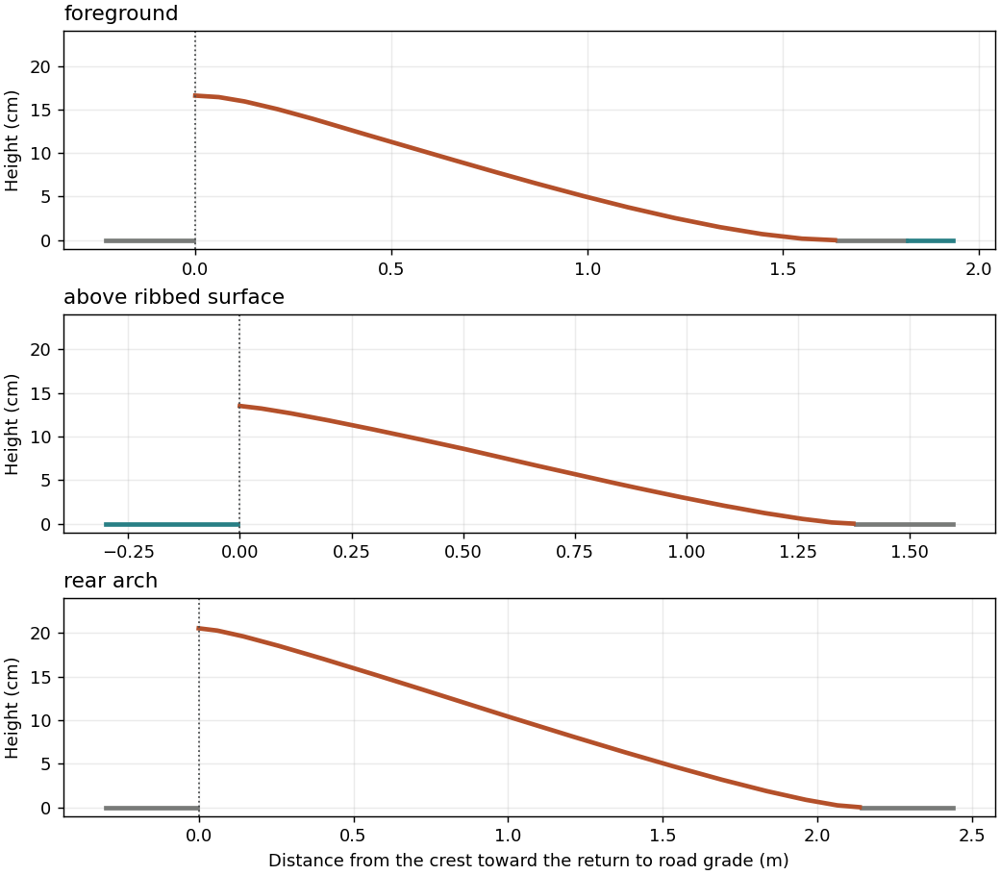
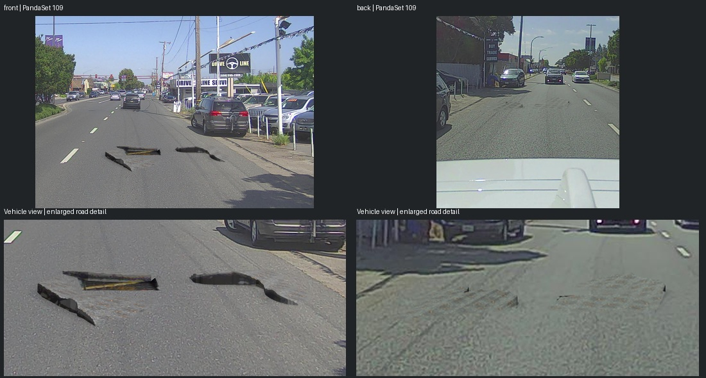

# P581 · Gervis Place 公交车道隆起与断裂

2011 年 8 月 18 日，Chris Downer 在英格兰伯恩茅斯 Gervis Place 公交站拍下暴雨后的道路。作者记载地下主管破裂，公交站旁的路面被顶起。照片可辨出前景断边、条纹嵌件后方的短断边和右后方拱起的长断边。P581 重建这三处可见破口及它们之间的路表；照片中的公交车、围栏、锥桶和警戒带只作现场参照。[现场照片](https://www.geograph.org.uk/photo/2559905) · [模型与传感器回放下载](https://github.com/Vexlc/road-hazard-reconstruction/releases/tag/gervis-rupture-v1.0.0)

|工作尺度下的断边|沿人工控制点的三维折线长|已标注位置的最大表观抬升|
|---|---:|---:|
|前景不规则断边|2.40 m|16.6 cm|
|条纹嵌件后方|1.81 m|13.5 cm|
|右后方拱起段|3.25 m|20.5 cm|

**尺度由锥桶高度假设决定。** 表中以锥桶高 0.75 m、焦距 520 px 计算。现场没有独立标尺；如果同样的锥桶高 0.50 m，前景段的模型长度约 1.60 m，最大表观抬升约 11.1 cm。这里的长度是沿断边的长度，不能解读为一个大坑的直径。斜面回到原路面的连接位置、暗带下沿是否贴地，也会影响三维形状。验证记录给出了两种锥高和四种焦距组合下的结果。[角点、断边与控制点](survey.json) · [全部尺度组合与逐项验证](validation/quality.json)

## 选择资产

|文件|适用情形|
|---|---|
|`inspection.glb`|比对历史现场。颜色和湿路反光从原机位照片投影，适合核对轮廓、表层碎纹及黄色标线。|
|`asset.glb`|安装到另一条路。使用同一几何，在路面物理坐标中取样原照前景六处沥青，并在照片能分辨两个方向细节的位置叠加裂纹。断面使用单独的纹理条，平整路段可接回宿主。在源码中可分别调整颗粒尺度、断面亮度及回接宽度。|
|`asset.ply` 与 `splat_material.npz`|行车版一阶球谐高斯与逐高斯部件索引。在两个新视角中，高斯深度与网格首交距离的 P90 差约 6.7 和 7.9 mm。|
|`surface.npz`|12 mm 间距的垂直首交高度。结合 `alpha` 使用。行车版部件 1 是外围或段间路面，13 是翘起的铺装，14 是断面，175 是带条纹的嵌件。`unknown_beneath_sheet` 标记从上方先命中铺装的位置，底下结构未采得。|
|`views/source-rays.npz`、`views/sections.npz`|原机位的逐像素量程与两版部件图，以及三条通过断边的实单位断面。NaN 或无穷大分别标出断面或射线缺测。|

嵌件按照片可见的带纹表面建模，条纹下方是否贯通、管道位置、断板背面的形状均未知。照片版和行车版在原机位给出相同的有效射线范围，使用不同的路表材质和部件分组。GLB 为 Y 轴向上，PLY、局部坐标及高度场为 Z 轴向上。[材质与取样实现](material.py)

## 从现场照片复现

原图随源码固定，构建器核对 SHA-256。以下组合已在 Linux、Python 3.9、CUDA 12.1 下执行。模型生成使用 Shapely 裁切原照可见范围，并将断板覆盖或遮住的位置从段间地面裁出。

~~~bash
git clone --depth 1 --branch gervis-rupture-v1.0.0 https://github.com/Vexlc/road-hazard-reconstruction.git
cd road-hazard-reconstruction
python3.9 -m venv .venv
source .venv/bin/activate
export KIT="$PWD/releases/field-chambers"
python -m pip install -r "$KIT/requirements.txt"
python -m pip install torch==2.4.0 torchvision==0.19.0 --index-url https://download.pytorch.org/whl/cu121
python -m pip install gsplat==1.4.0 shapely==2.0.7 matplotlib==3.9.4
export PYTHONPATH="$KIT/gen2hole/downstream:$KIT/gen2hole/downstream/sensors:$KIT/gen2hole/recipes/common:$KIT/gen2hole/recipes/series"
export OPENBLAS_NUM_THREADS=1 OMP_NUM_THREADS=2
D=gen2hole/examples/gervis-rupture
B=build-gervis-rupture
python "$D/build.py" "$B/models/model"
python "$D/check.py" "$B/models" "$B/views"
~~~

将前两只锥桶的底部投到共同路面，按假设高度竖直提升，再与照片中的尖端匹配。另用五条建筑立边约束竖向。第三只锥桶未参与拟合，默认模型在其尖端的投影误差为 3.43 px。对每条断边，用上下沿的像素对估计表面高差；近水平机位会放大下沿误差，所以仅对下沿施加很小的梯度修正。前景三个预留位置排除了邻近列的梯度修正，导出网格与标注下沿分别相差约 0.0、0.8、0.1 px。该检查验证照片对齐；真实高程缺少独立测量。[相机拟合](camera.py) · [几何与可见域裁切](build.py)

两份 GLB、高斯 PLY、高度场、部件索引和元数据都从独立源码目录重建，六个文件的 SHA-256 逐一相同。若替换尺度，可调整 `survey.json` 中的 `working_cone_height_m`，选择新的输出目录重新运行。固定版本的指纹对应上表默认值。[复建指纹](validation/rebuild.json)

## 前后摄与实录激光束

把三片路面共同安装至 PandaSet 109，保留实录车辆姿态、曝光与语义遮挡。前摄 4 帧，后摄 6 帧。以宿主太阳方向和背阴／日照路面的亮度比照亮行车版，将接近原路面高度的斜面逐渐混入宿主沥青，并用半球采样估计断边旁的遮光。图中为另一条街道上的合成场景。[实录相机检查](validation/camera.json) · [宿主光照参数](daylight.json) · [PandaSet 数据入口](https://github.com/scaleapi/pandaset-devkit)

~~~bash
raw=/path/to/raw/109
masks=/path/to/processed/109/dynamic_masks/all
for side in front back; do
  python "$KIT/scripts/render-road-distress.py" "$raw" "$masks" "$B/models" "$B/drive/$side" \
    --shot 15 --pixel 1050 890 --yaw-deg -110 --camera "${side}_camera" \
    --semantic-occlusion --focus-part 14 --relief-daylight "$D/daylight.json" P581
done
python gen2hole/examples/lane-damage/check_drive.py "$B/models" "$raw" "$B/drive" "$B/camera.json" --ids P581
python "$D/beams.py" "$B/models" "$B/drive" "$raw" "$B/lidar"
python "$D/figures.py" "$B/views" "$B/drive" "$B/figures"
python "$D/pack_release.py" "$B/models" "$B/views" "$B/drive" "$B/lidar" "$B/release"
(cd "$B/release" && sha256sum -c SHA256SUMS)
~~~

激光回放沿用两台实录传感器各自的发射时刻、起点和方向。7 个交通窗口通过检查，共 13,955 条候选射线。要求原始回波标注为近路面的道路点，且新表面没有被原回波挡住，得到 3,638 条配对射线，其中 2,520 条先见路面顶面、1,118 条先见断面。相对同束射线与拟合平路面的交点，模拟回波提前的距离中位数为 0.44 m。这个数值沿光束方向计算；竖向抬升见上表。其他候选射线保留原始量程。[逐扫描统计](validation/lidar.json) · [逐束回放与视频](https://github.com/Vexlc/road-hazard-reconstruction/releases/download/gervis-rupture-v1.0.0/camera-lidar.zip)

原照 © Chris Downer，通过 Geograph 发布。改编包括描边、相机配准、几何假设、纹理重采样与渲染；原图及其派生资产按 CC BY-SA 2.0 提供，复用时请保留署名、原始出处、修改说明与相同许可。PandaSet 宿主另遵循其原数据条款。[原照与授权](https://www.geograph.org.uk/photo/2559905) · [CC BY-SA 2.0](https://creativecommons.org/licenses/by-sa/2.0/)
