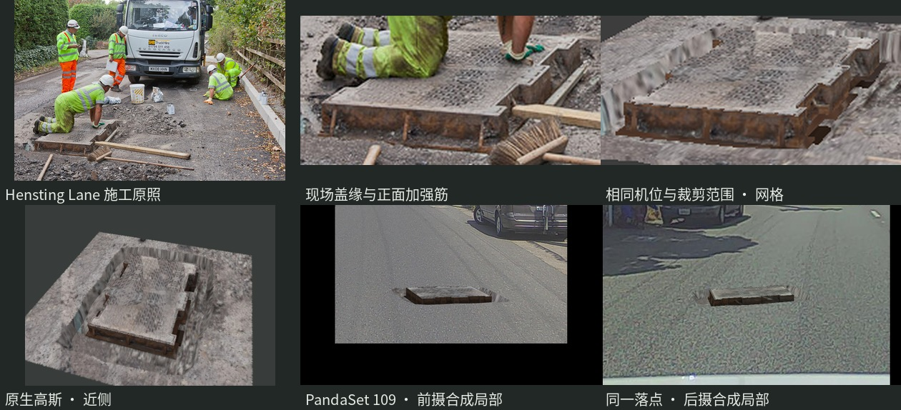

# A565 · Hensting Lane 铣刨路面中的调高井盖

Peter Facey 于 2011 年 10 月 7 日在英国 Hampshire 的 Hensting Lane 拍到一组工人调整车道中的铸铁井盖。作者记录旧路面已铣去约 **30 mm**，随后计划铺筑 **45 mm** 沥青。照片里可以看见阶梯状盖缘、锈蚀的前壁和三道向底部伸出的加强筋。A565 重建的是施工中的这一个状态。[作者现场照片](https://www.geograph.org.uk/photo/2636262) · [下载模型、原照和核验文件](https://github.com/Vexlc/road-hazard-reconstruction/releases/download/roadworks-track-pits-v1.0.0/A565.zip)

## 照片里能量到什么

- **盖面尺寸**。用拍摄文件的 46 mm EXIF 焦距、假设的 36 mm 传感器宽度，以及前缘、后缘和右侧阶梯的两组正交边拟合相机姿态。假设相机高出盖面 1.55 m，盖面近边宽约 0.750 m，纵长约 1.122 m。若相机高度改为 1.40 或 1.70 m，在同一姿态下，宽度相应为 0.677 或 0.822 m。这项假设直接决定横向尺度。[像素标注与假设](survey.json) · [相机计算](camera.py)
- **三个容易混淆的高度**。模型以铣刨后的路面为零。盖顶按下一层计划厚度设为 +45 mm。将三处可见筋脚的像素光线与前壁外侧 19 mm 的竖面相交，得到它们分别位于盖顶以下约 **119、129、136 mm**。建模使用的是施工设计值和单张照片估计值，现场没有成品标高测量记录。切坑底和四处垫块的位置采用了补全几何；原作者仅确认使用了调平垫块。[截面与逐点数据](validation/quality.json)
- **遮挡**。前壁和右侧壁从同一照片分面投影，盖顶被工人身体和手套遮住的位置使用同一块盖上可见的防滑纹理补全。按盖顶正射图像素统计，约 52% 达到原照采样权重 0.9 以上。包内的 `top-source-weight.png` 以亮色表示直接来自原照的位置。远侧被挡住的阶梯用可见右侧轮廓镜像；地下井室超出照片范围。
- **核验**。12 个未参与姿态估计的盖缘像素距导出网格投影边界的 RMS 为 0.65 px，最大为 1 px。7 个原机位射线分别命中预期的盖面、前壁、开挖面和铣刨路面。半高处横穿每道筋的三个探针中，中间的先命中加强筋，两侧先命中前壁，相差约 9.6–9.7 mm。后一个数值用于检验导出几何。[核验程序](check.py)

## 从原照重建

在 Linux、Python 3.9、兼容 CUDA 12.1 的 NVIDIA 驱动和 CUDA 工具链下执行。直接打开下载包中的 GLB 即可查看网格。原生高斯构建需要 CUDA PyTorch，两个视角的 PLY 回放需要 gsplat。

~~~bash
git clone --depth 1 --branch roadworks-track-pits-v1.0.0 https://github.com/Vexlc/road-hazard-reconstruction.git
cd road-hazard-reconstruction
python3.9 -m venv .venv
source .venv/bin/activate
python -m pip install -r releases/field-chambers/requirements.txt
python -m pip install torch==2.4.0 torchvision==0.19.0 --index-url https://download.pytorch.org/whl/cu121
python -m pip install gsplat==1.4.0
export KIT="$PWD/releases/field-chambers"
export PYTHONPATH="$KIT/gen2hole/downstream:$KIT/gen2hole/downstream/sensors:$KIT/gen2hole/recipes/common:$KIT/gen2hole/recipes/series"
export OPENBLAS_NUM_THREADS=1 OMP_NUM_THREADS=2
D=gen2hole/examples/hensting-cover
B=build-roadworks
python "$D/build.py" "$B/models/cover"
python "$D/check.py" "$B/models" "$B/views"
~~~

输出目录为 `$B/models/cover/series/assets/raised/A565`。五份核心文件分别为带 PBR 材质的 GLB、SH1 原生 Gaussian PLY、安装高度场、逐高斯材质索引和元数据。GLB 的上方向为 Y，PLY 与高度场为 Z，单位均为米。相同输入在第二个源码目录里从头构建，五个文件逐字节一致。[重建指纹](validation/rebuild.json)

## 前后摄回放

在 PandaSet 109 中将网格固定于同一个世界位置。前摄录得 5 帧合成画面，后摄 11 帧。代码会核对实拍曝光、网格哈希、前后摄安装变换、视频帧数和代表帧的命中距离。真实宿主为另一条道路，施工人员与工具只出现在英国原照中。[前后摄数据](validation/camera.json) · [下载五件资产的十段回放](https://github.com/Vexlc/road-hazard-reconstruction/releases/download/roadworks-track-pits-v1.0.0/road-camera.zip)

~~~bash
raw=/path/to/raw/109
masks=/path/to/processed/109/dynamic_masks/all
for side in front back; do
  python "$KIT/scripts/render-road-distress.py" "$raw" "$masks" "$B/models" "$B/drive/$side" \
    --shot 15 --pixel 1190 925 --yaw-deg 15 --camera "${side}_camera" --semantic-occlusion --focus-part 9 A565
done
python gen2hole/examples/lane-damage/check_drive.py "$B/models" "$raw" "$B/drive" "$B/camera.json" --ids A565
~~~

现场照片、由它制作的纹理及 A565 模型按 CC BY-SA 2.0 提供。改编包括摄影配准、局部遮挡补全、截面与几何恢复及渲染。请保留 Peter Facey 的署名、原照链接、改编说明和相同许可。PandaSet 宿主影像遵循其原始数据条款。[现场授权](https://www.geograph.org.uk/photo/2636262) · [CC BY-SA 2.0](https://creativecommons.org/licenses/by-sa/2.0/) · [PandaSet](https://github.com/scaleapi/pandaset-devkit)
