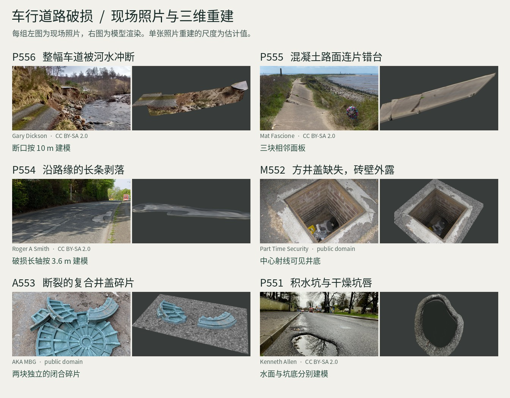
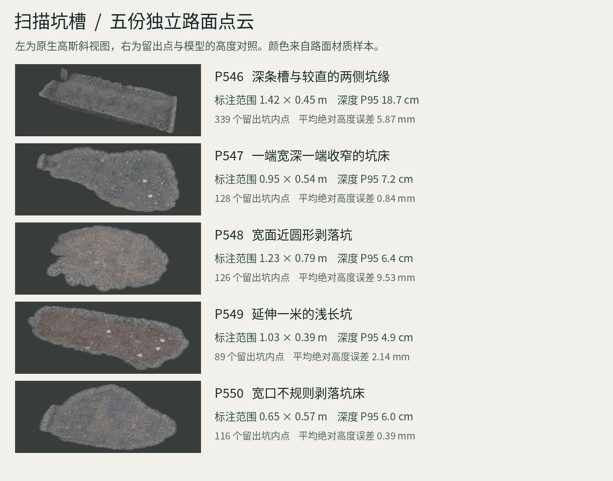

# 车行道坑槽、井盖损坏与大范围路基破坏

11 件资产来自五份独立点云和六张现场照片。每件提供带纹理的 GLB、原生一阶球谐高斯 PLY、安装高度场、材质索引和元数据。下载后可直接查看模型。用于传感器合成时，请先读下文的尺度和路面裁切说明。[GitHub Release](https://github.com/Vexlc/road-hazard-reconstruction/releases/tag/lane-damage-v1.0.0) · [来源、作者与许可](SOURCES.md)

## 选择资产

| 编号 | 可见特征 | 尺度或检验 |
|---|---|---|
| P546 | 深条槽，两侧坑缘较直 | 扫描标注范围 1.42 × 0.45 m，深度 P95 18.7 cm |
| P547 | 一端收窄的坑床 | 0.95 × 0.54 m，深度 P95 7.2 cm |
| P548 | 宽面近圆形剥落 | 1.23 × 0.79 m，深度 P95 6.4 cm；范围包含外围标注点 |
| P549 | 浅长坑 | 1.03 × 0.39 m，深度 P95 4.9 cm |
| P550 | 宽口不规则剥落坑 | 0.65 × 0.57 m，深度 P95 6.0 cm |
| P551 | 积水坑，边缘露出干沥青 | 长轴按 1.35 m 建模，水面在路面下 2.9 cm |
| M552 | 整块方井盖缺失，井圈、两面砖墙和井底可见 | 假定口宽 0.76 m，拟合口长约 0.77 m、深约 1.17 m |
| A553 | 两块松动的复合井盖碎片，弧筋、网格筋和折断面 | 两个独立闭合实体，模型最高约 3.4 cm |
| P554 | 沿路缘的长条剥落，中间留有完整的沥青舌 | 长轴按 3.60 m 建模，模型深度 P95 4.9 cm |
| P555 | 海岸混凝土路面成片错台 | 三块相邻面板、两条横断缝，重建段约 7 m，面板顶角高低差 0.31 m |
| P556 | 洪水冲走整幅车道，两端余下铺装，路基向河岸敞开 | 中心断口按 10 m 建模，135 个采样位置的坑床低于路面 0.50–1.70 m |

点云长宽取全部标注点投影后的最小外接矩形。深度 P95 表示坑内 95% 测点的深度在该值以内。五份点云采用原始坐标并假定单位为米；源文件没有每件独立的比例尺。照片组的材质、缺损轮廓或部件来自照片，绝对尺寸、遮住的井壁、浑水下的坑床和被冲掉的路基剖面均需估计。P555 的 7 m 是整段长度。P556 的 10 m 是两个断口中点之间的设定距离，原照未提供现场测量。[点云记录与文件指纹](points/survey.json) · [照片标注和建模参数](photos.json)

## 下载与使用

选择 [扫描坑槽](https://github.com/Vexlc/road-hazard-reconstruction/releases/download/lane-damage-v1.0.0/point-pits.zip)、[井盖与积水坑](https://github.com/Vexlc/road-hazard-reconstruction/releases/download/lane-damage-v1.0.0/cover-and-water.zip) 或 [大范围路损](https://github.com/Vexlc/road-hazard-reconstruction/releases/download/lane-damage-v1.0.0/large-road-failures.zip)。每包内均附 SHA256SUMS，在解压目录运行 `sha256sum -c SHA256SUMS` 可校验每个文件。[18 段实拍宿主合成短片与两段模型接近视图](https://github.com/Vexlc/road-hazard-reconstruction/releases/download/lane-damage-v1.0.0/driving-views.zip)

- 在 Blender 或 glTF 查看器导入编号下的 asset.glb。GLB 使用 glTF 的 Y 向上坐标，高斯 PLY 和高度场使用局部 Z 向上坐标。模型单位为米，安装时以局部零高对齐道路。PLY 包含旋转、尺度、透明度和球谐系数，须用支持 3D Gaussian Splatting 的渲染器打开。
- 安装时先按 surface.npz 的 installation_mask 裁开宿主路面，再插入模型。把完整宿主路面留在井口或坑口会遮住负高度几何。水坑的 substrate_height 给出水下估计坑床，水面为独立几何。GLB 水材质可接环境光反射，独立高斯预览里的水面颜色较暗。
- P555、P556 包含现存路面的局部片段，适合接到终止或错断的道路上。驾驶眼高短片使用 1.45 m 相机接近后停在边缘；背景灰色处表示重建范围以外。P556 的河流和对岸植被仅在现场照片中可见。

## 从原始输入重建

以下命令从仓库根目录执行，使用本次发行标签和 Linux / Python 3.9。几何与 PLY 导出使用 NumPy、Open3D、trimesh 等依赖。原生高斯渲染检查另需兼容的 NVIDIA GPU。建议将所有输出写到新建的 build-lane 目录。

~~~bash
git clone --branch lane-damage-v1.0.0 --depth 1 https://github.com/Vexlc/road-hazard-reconstruction.git
cd road-hazard-reconstruction
python3.9 -m venv .venv
source .venv/bin/activate
python -m pip install -r releases/field-chambers/requirements.txt
export KIT="$PWD/releases/field-chambers"
export PYTHONPATH="$KIT/gen2hole/downstream:$KIT/gen2hole/downstream/sensors:$KIT/gen2hole/recipes/common:$KIT/gen2hole/recipes/series"
export OPENBLAS_NUM_THREADS=1 OMP_NUM_THREADS=2
D=gen2hole/examples/lane-damage
B=build-lane
mkdir -p "$B"
python "$D/build_photos.py" "$B/models/photos"
~~~

照片组的六张原照都随仓库提供。程序先验证原照 SHA-256，再读取照片上的像素标注。P551 单独建水面。M552 用口角、井底角和焦距约束相机。A553 把两块碎片分别挤出并补全断面。P555 单独建相邻板块，P556 分别建立两端残路、断面和侧向降低的裸露路基。[照片建模入口](build_photos.py)

扫描组需从作者处取得原始 PointPSSN ZIP，程序逐件验证数据和标签。下面第一条命令下载与本次构建相同的 CC0 材质，包内保留源文件路径和哈希。[作者数据集](https://drive.google.com/file/d/1zmQ3IzpPbuiBKXMo-ttX1bqew8GSZ9to/view)

~~~bash
curl -fL -o "$B/materials.zip" https://github.com/Vexlc/road-hazard-reconstruction/releases/download/lane-damage-v1.0.0/scan-materials.zip
unzip -q "$B/materials.zip" -d "$B/materials"
(cd "$B/materials" && sha256sum -c SHA256SUMS)
python "$D/points/build.py" /path/to/PointPSSN.zip "$B/materials" "$B/models/points"
~~~

每件点云以周围道路拟合局部平面，在 4 mm 网格上重建高差。训练前按原始坐标划分空间块，保留约十一分之一的块只用于最终检验；其余点再交叉选择局部平面拟合邻域。纹理使用实拍材质样本。复用到其他扫描时，修改 survey.json 中的成员路径、索引和哈希，同时重新核查点数、坐标单位、道路标注和足够的路肩支撑。[扫描入口](points/build.py) · [坐标、空间划分和拟合](points/scan.py)

## 验证与车辆回放

~~~bash
python -m pip install torch==2.4.0 torchvision==0.19.0 --index-url https://download.pytorch.org/whl/cu121
python -m pip install gsplat==1.4.0
python "$D/inspect_assets.py" "$B/models" "$B/views"
python "$D/approach.py" "$B/models/photos" "$B/approach"
~~~

核验从已导出的 GLB 发射射线，另从 PLY 渲染 22 张斜视图。五件扫描的留出坑内点平均绝对高度误差依次为 5.87、0.84、9.53、2.14、0.39 mm。P548 的误差最大，使用它做毫米级评估时应结合误差分布。P551 轮廓和水面回投的交并比分别为 0.971 和 0.990，P554 的轮廓交并比为 0.955。M552 井底远角在 800 像素宽工作图上的偏差为 1.62 像素。A553 两件碎片通过闭合性检查。P556 的 135 条断口射线全部先命中坑床，两端对照射线先命中铺装。独立输出目录二次构建所得 11 件 GLB、PLY、高度场、材质索引和元数据与发布文件逐字节一致。[逐件几何与渲染检查](validation/quality.json) · [重复构建指纹](validation/rebuild.json)

已有 PandaSet 109 原始相机、激光、标签及预处理的动态遮挡掩码时，可重建九件局部路损的 18 段前后摄回放。相机位姿、时间戳及背景来自原始采集，损坏为后插入。前后摄共 148 帧，复核了两摄的世界锚点、视频帧数、代表帧的原照片、遮挡外像素和网格射线距离。两个大范围断路场景单独使用上面的模型接近视角。[相机核验记录](validation/drive-check.json) · [相机核验程序](check_drive.py)

~~~bash
raw=/path/to/raw/109
masks=/path/to/processed/109/dynamic_masks/all
for side in front back; do
  render() {
    python "$KIT/scripts/render-road-distress.py" "$raw" "$masks" "$B/models" "$B/109/$side" \
      --shot 15 --camera "${side}_camera" --semantic-occlusion "$@"
  }
  render --pixel 1090 925 --yaw-deg 32 P546 P547 P548 P549 P550
  render --pixel 1090 925 --yaw-deg 78 P551 M552 A553
  render --pixel 1350 915 --yaw-deg 85 P554
done
python "$D/check_drive.py" "$B/models" "$raw" "$B/109" "$B/drive-check.json"
python "$D/pack.py" "$B/models" "$B/views" "$B/materials" "$B/release"
~~~
