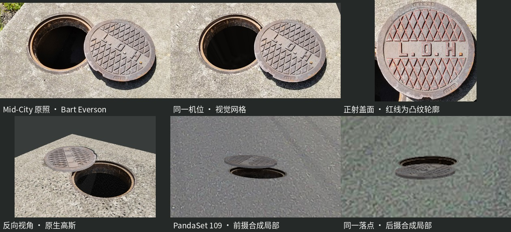

# M570 · 新奥尔良移盖后部分敞开的井口

2019 年 5 月 14 日，Bart Everson 在新奥尔良 Mid-City 拍到一块圆盖向右挪开，盖板左缘仍遮住井口。原照为 3484 × 1960 像素，井座位于混凝土铺面，画面左上可见植被，现场车道归属未知。下面右下两幅把同一件模型装进 PandaSet 109，用于检查车辆接近及驶离时的可见性。[原作者照片](https://www.flickr.com/photos/editor/48728796337/) · [馆藏、日期与许可](https://commons.wikimedia.org/wiki/File:Open_Manhole_and_Cover_Mid-City_New_Orleans.jpg) · [下载模型和回放](https://github.com/Vexlc/road-hazard-reconstruction/releases/tag/midcity-cover-v1.0.0)

## 原照能约束的几何

|量|本例结果|如何使用|
|---|---:|---|
|上下两圈在图上的位置|井圈留出点 RMS 0.63 px，盖板 1.49 px|在 960 × 540 标注坐标系中，从可见边缘交错留出 12 和 15 个点，再量到重投影圆边的最近距离。两组最大值分别为 1.33 和 4.44 px。|
|盖板中心偏移|0.501 m|设井座上口直径为 0.60 m、盖面平行于铺面、厚 24 mm。相机焦距一并拟合。尺寸随选定标尺变化；照片没有现场卷尺。|
|立面和露口|承托台面低于铺面约 21 mm，内孔半径约 0.274 m|台面前后弧共同拟合。远侧铁套下缘八处重建在铺面以下 140–155 mm，套筒其他方向按周向插值。|
|净开口|平面约 0.223 m²|盖板遮住内孔面积的 5.86%。用导出 GLB 做 4 mm 网格垂直投射，得到 0.22278 m²。单幅图上的遮挡比例会随观察方向改变。|
|铸纹和缺口|66 个防滑凸块、3 个字符和 3 个分隔点|将盖面正射校正，对各凸块在相邻像素内搜索倒角边缘。边缘缺口跟随实拍缺损收进。凸纹高度 3.5 mm 为建模值，7 条独立竖直探针检查凸字、字孔与平面高度。|

三维视觉模型含 327,204 个三角形及 349,634 个原生高斯。盖面、承托台面、锈蚀套筒和混凝土取色自同一原照。井壁被挡住的方向借用可见弧段，地面保留当时的接触阴影，照片外的地面以可见混凝土补全。焦距分别固定为 660 和 990 px 再拟合，偏移为 0.502 和 0.501 m；这个范围只检查当前平面、标尺和主点假设下的稳定性。[标注与参数](survey.json) · [相机与拟合](calibration.py) · [核验结果](validation/quality.json)

## 选择视觉模型或射线模型

- **画面合成**用 `asset.glb` 或 `asset.ply`。照片只能看见套筒的一部分，井底深度未知。视觉版在 0.78 m 设置暗色封底，以便合成时正确遮住宿主路面。该数值来自画面补全。
- **量程和开口测试**用 `observed.glb`。该版移除了深井壁补全和暗色封底。原机位穿过开口的两条指定射线无返回，另外八条分别命中盖面、铁套或铺面。模型仍包含单视图推定的盖厚、凸纹高度、遮挡面的延拓。
- **高度场**的 `height` 是视觉版首交高度。用 `alpha` 限定网格覆盖范围，再用 `observed_depth_valid` 限定有几何支撑的高度；`opening_mask` 标出视觉版有填充、射线版直通的区域。GLB 的上方向为 Y，PLY 和高度场的上方向为 Z，单位为米。[导出逻辑](build.py) · [实测与补全的射线检查](check.py)

## 从原照重建

以下命令在 Linux、Python 3.9 和 CUDA 12.1 环境运行。仓库内保存了带指纹的原始 JPEG，重建无需从图库再次下载。仅查看网格可直接解压发布附件中的 GLB。

~~~bash
git clone --depth 1 --branch midcity-cover-v1.0.0 https://github.com/Vexlc/road-hazard-reconstruction.git
cd road-hazard-reconstruction
python3.9 -m venv .venv
source .venv/bin/activate
KIT="$PWD/releases/field-chambers"
python -m pip install -r "$KIT/requirements.txt" shapely==2.0.7
python -m pip install torch==2.4.0 torchvision==0.19.0 --index-url https://download.pytorch.org/whl/cu121
python -m pip install gsplat==1.4.0
export PYTHONPATH="$KIT/gen2hole/downstream:$KIT/gen2hole/downstream/sensors:$KIT/gen2hole/recipes/common:$KIT/gen2hole/recipes/series"
export OPENBLAS_NUM_THREADS=1 OMP_NUM_THREADS=2
D=gen2hole/examples/midcity-cover
B=build-midcity
python "$D/build.py" "$B/models/model"
python "$D/check.py" "$B/models" "$B/views"
~~~

成品目录为 `$B/models/model/series/assets/missing/M570`。相同版本输入在另一份源码目录重建后，两份 GLB、PLY、两份 NPZ 和元数据均逐字节相同。核验程序另输出原机位网格及两个角度的原生高斯图。[六个文件的 SHA-256](validation/rebuild.json) · [凸纹与缺口建模](casting.py)

## 从车内检查移盖井口

准备 PandaSet 109 实拍帧、内外参、点云和前景掩码后执行。两台相机使用第 15 帧同一世界锚点，模拟安装位置可在 `placement.json` 查看。前摄 5 帧、后摄 11 帧，代表帧中资产分别覆盖 5,557 和 1,386 个像素。这两段视频是实拍宿主上的合成回放。[核验记录](validation/camera.json) · [PandaSet](https://github.com/scaleapi/pandaset-devkit)

~~~bash
raw=/path/to/raw/109
masks=/path/to/processed/109/dynamic_masks/all
for side in front back; do
  python "$KIT/scripts/render-road-distress.py" "$raw" "$masks" "$B/models" "$B/drive/$side" \
    --shot 15 --pixel 1190 925 --yaw-deg 15 --camera "${side}_camera" --semantic-occlusion --focus-part 5 M570
done
python gen2hole/examples/lane-damage/check_drive.py "$B/models" "$raw" "$B/drive" "$B/camera.json" --ids M570
~~~

原照、基于原照的纹理和 M570 模型使用 CC BY 2.0。请署名 Bart Everson (Editor B)，保留原照、许可和改编说明。改编内容包括相机拟合、纹理投影、遮挡补全、网格和高斯重建。PandaSet 实拍宿主遵循其数据条款。[作者与照片](https://www.flickr.com/photos/editor/48728796337/) · [CC BY 2.0](https://creativecommons.org/licenses/by/2.0/)
