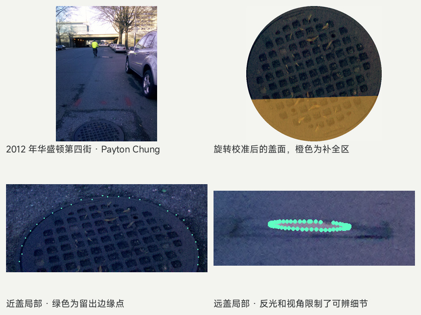
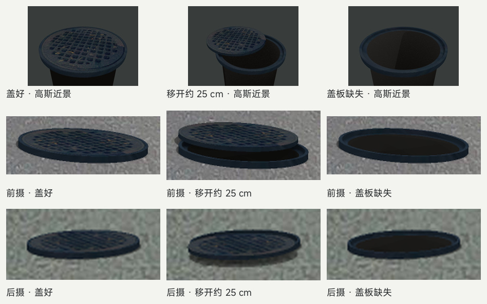
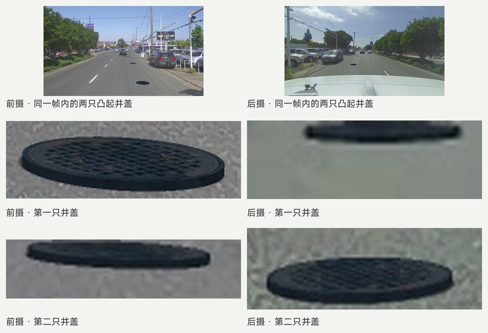

# A591 · 华盛顿第四街凸起井盖

2012 年 1 月，Payton Chung 在华盛顿特区第四街西南段北向车道拍到一列凸起的公用管线井盖，并描述它们比路面高约 1–2 英寸。前景井盖能辨认方格防滑纹和圆周，远处一只井盖可辨圆形轮廓。此例提供保留两只盖面相对位置的摄影网格、可单独移动的前景盖板，以及同一井座的盖好、移开和缺失三种安装状态。原照记录的是盖好状态。[现场照片与许可记录](https://commons.wikimedia.org/wiki/File:Pepco_utility_trench_(6682171139).jpg) · [全部下载](https://github.com/Vexlc/road-hazard-reconstruction/releases/tag/pepco-trench-v1.0.0)

|状态|几何设置|竖直方向露出的净井口面积比例|下载|
|---|---|---:|---|
|盖好|盖面高于路面 38.1 mm，落在井座承托面上|0%|[raised](https://github.com/Vexlc/road-hazard-reconstruction/releases/download/pepco-trench-v1.0.0/A591-raised.zip)|
|移开|向局部 X、Y 分别移动 +24、−6 cm，盖底搭在井圈上缘，顶面高 64.1 mm|39.0%|[offset](https://github.com/Vexlc/road-hazard-reconstruction/releases/download/pepco-trench-v1.0.0/A591-offset.zip)|
|缺失|保留原井圈、承托台和井腔|100%|[open](https://github.com/Vexlc/road-hazard-reconstruction/releases/download/pepco-trench-v1.0.0/A591-open.zip)|

38.1 mm 取自摄影者估计范围的中值。井盖名义直径选为 72 cm，情景盖厚 26 mm，净口半径 32.7 cm。原照未见井内，63 cm 深的暗色封底只作为渲染边界。盖面的格纹保留在摄影纹理及材质贴图中，几何和激光回放将格纹区视为连续顶面。两个迁移状态用于同一车辆、同一井位的反事实比较。

## 从现场照片复现

需要 Linux、Python 3.9；高斯渲染使用 CUDA。图板使用 fontconfig 与中文字体。原始 JPEG 含方向标记，代码先校验 SHA-256，再转为 1936 × 2592 的竖幅坐标。

~~~bash
git clone --depth 1 --branch pepco-trench-v1.0.0 https://github.com/Vexlc/road-hazard-reconstruction.git
cd road-hazard-reconstruction
python3.9 -m venv .venv
source .venv/bin/activate
KIT="$PWD/releases/field-chambers"
python -m pip install -r "$KIT/requirements.txt"
python -m pip install torch==2.4.0 torchvision==0.19.0 --index-url https://download.pytorch.org/whl/cu121
python -m pip install gsplat==1.4.0
export PYTHONPATH="$KIT/gen2hole/downstream:$KIT/gen2hole/downstream/sensors:$KIT/gen2hole/recipes/common:$KIT/gen2hole/recipes/series"
export OPENBLAS_NUM_THREADS=1 OMP_NUM_THREADS=2
D=gen2hole/examples/pepco-trench
B=build-pepco
python "$D/build.py" "$B/models"
python "$D/check.py" "$B/models" "$B/views"
python - "$D" "$B" <<'PY'
from pathlib import Path
import hashlib,json,sys
guide,build=map(Path,sys.argv[1:])
for name,sha in json.loads((guide/'validation/rebuild.json').read_text()).items():
    assert hashlib.sha256((build/'models'/name).read_bytes()).hexdigest()==sha,name
PY
~~~

1. 沿两个手工初始椭圆法向搜索亮度边缘，保留可信梯度。近、远盖分别有 158、304 个训练边缘点，另外留出 27、50 个点。用共平面圆的透视投影同时估计路面倾角、相机焦距、两盖位置及远盖半径。
2. 在名义尺度下，两盖中心相隔 **11.40 m**，远盖直径约 70.9 cm。近盖直径改为 65 或 80 cm，中心距随之变为 10.29 或 12.66 m。近、远两圈留出点到联合投影的中位误差分别为 2.20、0.17 原图像素。这些数值检查同一张照片的内部一致性。留出点来自相邻轮廓采样，照片也没有独立尺标。
3. 近盖 72.1% 的理想圆盘可从原照直接取色；其余转用同一块盖板可见侧的旋转纹样。旋转后在可见区的一部分搜索水平和垂直平移，使格纹对齐。另一区域的高频灰度相关系数从 −0.03 升至 0.30，补全区细节仍有不确定性。可迁移模型按旁侧沥青估计色偏，现场网格沿用原照颜色。
4. 将仅含照片可采样区域的三角形导出为 observed-pair.glb。剔除边缘不完整的三角形后，两个圆盘实际覆盖约 70.5%、98.4%。从导出的 glTF 顶点和纹理坐标重新投影，核验每块盖面使用了对应的照片位置。远盖在照片中约 132 × 13 像素，细小结构无法辨认。[拍摄输入、标注和参数](survey.json) · [相机与颜色核验](validation/registration.json) · [几何和纹理投影检验](validation/geometry.json)

## 文件与坐标

每个模型包包含一个完整安装状态及共用的源数据，三态共用标识 A591。模型产品均从独立源码目录复建，20 个 SHA-256 一致。[复建指纹](validation/rebuild.json)

|文件|用途|
|---|---|
|models/observed-pair.glb|原始摄影布局中从照片可取样的两块盖面。近盖中心为局部原点，盖顶在设定路面上方 38.1 mm，未观察区域留空。|
|models/loose-cover.glb|完整可移动盖板，顶面为自身坐标的零高程。补全区域、侧面、背面使用了建模假设。|
|models/observations.npz、casting.png、registration.json|原图边缘点、留出点、641 × 641 直接取色掩码、补全纹理及相机解。|
|models/状态/model/series/assets/raised/A591/asset.glb 和 asset.ply|各安装状态的米制网格和约 27 万高斯。GLB 为 Y 向上，PLY 与道路计算为 Z 向上。|
|surface.npz|3 mm 栅格。height 为相对宿主道路高度，first_part 为首交部件，source_face 标识直接取色的盖顶，receiver_sky_blocked 描述井盖对邻近路面半球天空光的遮挡比例。|
|splat_material.npz、metadata.json|材质索引、来源、局部变换和场景参数。|

## 实车相机与逐束激光

使用 PandaSet 109 的本地原始相机、激光、时间戳、目标框、语义与动态掩码。掩码目录使用仓库现有约定 `帧号三位_相机编号.png`。三态共用实录道路上的一个井位；每态有 5 帧前摄、11 帧后摄。完整相机包保存显示用视频、代表帧前后对照、部件图、原始分辨率射线量程和锚点。[PandaSet](https://github.com/scaleapi/pandaset-devkit) · [逐态相机检查](validation/camera.json) · [相机与激光下载](https://github.com/Vexlc/road-hazard-reconstruction/releases/download/pepco-trench-v1.0.0/camera-lidar.zip)

~~~bash
raw=/path/to/raw/109
masks=/path/to/processed/109/dynamic_masks/all
bash "$D/drive.sh" "$raw" "$masks" "$B/models" "$B/drive"
python "$D/beams.py" "$B/models" "$B/drive" "$raw" "$B/lidar"
python "$D/check_packets.py" "$B/models" "$B/lidar" "$B/packets.json"
python "$D/corridor.py" "$raw" "$masks" "$B/models" "$B/drive" "$B/corridor"
python "$D/check_corridor.py" "$raw" "$B/models" "$B/corridor" "$B/corridor-check.json"
python "$D/figures.py" "$B/models" "$B/views" "$B/drive" "$B/corridor" "$B/figures"
python "$D/pack_release.py" "$B/models" "$B/views" "$B/drive" "$B/lidar" "$B/corridor" "$B/release"
(cd "$B/release" && sha256sum -c SHA256SUMS)
~~~

13 个扫描窗口共保留 7,740 条候选原始光束，来自两个传感器。在盖好和移开状态中，分别有 221、246 条替换回波落在直接取色的盖面。盖好与移开之间有 378 条候选光束改变首交部件。包内保留原始索引、发射时刻、语义和原始量程，可沿同一条射线对比三态。[逐扫描统计](validation/lidar.json) · [独立重投射结果](validation/packets.json)

- visual_range_m 用完整场景几何替换符合路面语义、宿主量程与可见性条件的回波。
- plate_constrained_range_m 保留直接取色盖面的替换量程；命中补全区、试验井腔或侧壁的替换记为 NaN。未替换的回波保持宿主原值。这里的约束指照片范围，公制尺度仍受名义直径和高度设定影响。
- rise_bracket_range_m 将井圈顶升分别取 1 和 2 英寸，再对同一条光束重新求交。两个端点均命中直接取色区才给出区间。盖好、移开分别有 151、137 条这样的光束，沿光线的区间宽度中位数为 18.0、18.8 cm。

## 同一路段连续出现两只井盖

双井演示沿 PandaSet 车辆行驶方向以 11.40 m 的条件尺度铺设两只同型盖板。近、远锚点分别用宿主分割出的道路激光拟合，局部面残差 RMS 为 8.4 和 9.0 mm。远处细纹使用前景盖板的实例；还原原照远盖可见颜色时使用 observed-pair.glb。两只盖板共同参与交通净距筛选，按原始曝光、动态遮挡和逐像素首交距离合成。前摄 8 帧、后摄 4 帧能同时看到两只。代表帧分别对两个实例重新投射，共核对 7,310 个病害像素。[双井核验报告](validation/corridor.json)

现场照片 © Payton Chung，按 CC BY 2.0 发布。摄影派生内容按相同许可提供。修改包括方向校正、裁片、边缘拟合、透视矫正、色偏校正、局部纹理补全、几何重建及车载合成。复用时保留作者、来源、许可及修改说明。PandaSet 宿主画面与扫描适用原始数据条款。[照片许可全文](https://creativecommons.org/licenses/by/2.0/)
