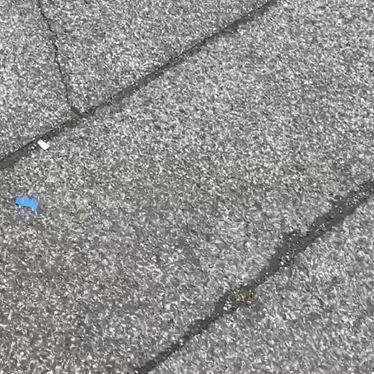

# 从一次克隆重建 P103 路面裂缝

**先核对资产。** P103 是下图中的并行与交汇裂缝。GitHub 发布索引当前没有 `A103`。项目里的 `A` 前缀用于盖板状态，数字可以与其他类型重复。交接时请对照照片和完整编号。若需要一件井盖，可凭原始 GLB 文件名、配方编号或截图找到对应记录。[逐资产发布索引](../../../catalog/reconstruction-index.json)

## 用普通电脑生成 GLB

以下命令在 Linux、Python 3.11 上验证过。输入随 Git 提供。CPU 即可运行，所需的五个 Python 包用于图像处理、网格导出和几何核验。先从公开仓库克隆，在仓库根目录执行后续命令。

~~~bash
git clone https://github.com/Vexlc/road-hazard-reconstruction.git
cd road-hazard-reconstruction
python3.11 -m venv work/envs/cracks
py=work/envs/cracks/bin/python
"$py" -m pip install -r gen2hole/examples/photo-cracks/requirements-mesh.txt
"$py" scripts/configure-gen2hole.py --mesh-python "$py" --compute-python "$py" \
  --output work/envs/cracks/config.json

"$py" gen2hole/gen2hole.py locate p103
"$py" gen2hole/gen2hole.py --config work/envs/cracks/config.json \
  build P103 --mesh-only --out runs/p103-mesh
"$py" gen2hole/gen2hole.py --config work/envs/cracks/config.json verify --run runs/p103-mesh
"$py" scripts/check-crack-assets.py --run runs/p103-mesh
~~~

用 Blender 或其他 glTF 查看器打开 `runs/p103-mesh/series/assets/pothole/P103/asset.glb`。这里的 `pothole` 是管线对路面凹陷的目录分类。随附的 `metadata.json` 用 `surface_class=crack` 标识裂缝，`surface.npz` 保存米制高度和掩膜。重跑时请换一个新的 `--out` 路径，保留上一次结果。

在上述依赖版本下，预期网格有 **816,642 个三角面**，缝迹包含 **20,811 个掩膜像素**。独立核验器将 GLB 顶点解码回原图，检查它与高度场和标注的一致性。本例内部缝迹的交并比为 1.0，最低点约为 −0.022 m。可直接校验模型字节。

~~~bash
echo '49759ba9e543495993f33a23896c7ead3bc83f2c42f6d0c47d6100ca3ccc5f38  runs/p103-mesh/series/assets/pothole/P103/asset.glb' | sha256sum -c -
~~~

## 输入来自哪里，尺寸如何得到

| 输入 | 来源与作用 |
| --- | --- |
| [路面照片](references/P103.png) | Rossini 等人的沥青裂缝数据集，原图为 `test/images/B_00524.jpg`。发布的 640 × 640 裁切保留了原始纹理。 |
| [配准掩膜](calibration/P103_outline.png) | 裁自对应的 `test/masks/B_00524.png`，非零像素标出两组连通缝迹。两份原文件的 SHA-256、裁切坐标与 CC BY 4.0 署名见[来源记录](sources.json)。 |
| [P103 配方](calibration/designs.json) | `span=1.6` m 决定图幅，`wall_slope=1.7` 和 `depth=0.022` m 决定 V 形沟槽的侧壁及深度上限。平面缝迹来自实拍标注，深度是设计值。[几何实现](../../recipes/series/crack_surface.py) |

## 还需要 Gaussian PLY 时

按[计算环境安装手册](../../../docs/03-environment-and-relocation.md)准备项目的 NVIDIA/CUDA 计算环境，保留上一步已安装的网格解释器。两个环境分别承担网格导出和高斯采样。以下命令沿用仓库根目录，单独保存完整构建的配置。

~~~bash
py=work/envs/cracks/bin/python
"$py" scripts/configure-gen2hole.py --mesh-python "$py" \
  --compute-python work/envs/streetcrafter/bin/python --output work/envs/cracks/full.json
"$py" gen2hole/gen2hole.py --config work/envs/cracks/full.json build P103 --out runs/p103-full
"$py" gen2hole/gen2hole.py --config work/envs/cracks/full.json verify --run runs/p103-full
"$py" scripts/check-crack-assets.py --run runs/p103-full
echo '74ef85289fc5379c1e137eb54feb97c08f7ad52e6564f7d764e76b72338f44c3  runs/p103-full/series/assets/pothole/P103/asset.ply' | sha256sum -c -
~~~

历史发布与本次克隆复建都得到 **257,360 个高斯**。车载场景 `034_103` 是 P103 在 PandaSet 034 道路中的一次放置。独立构建资产使用本目录中的原图、掩膜和配方，回放该场景另需道路数据。[历史几何与放置记录](../../../validation/photo-cracks.json)
