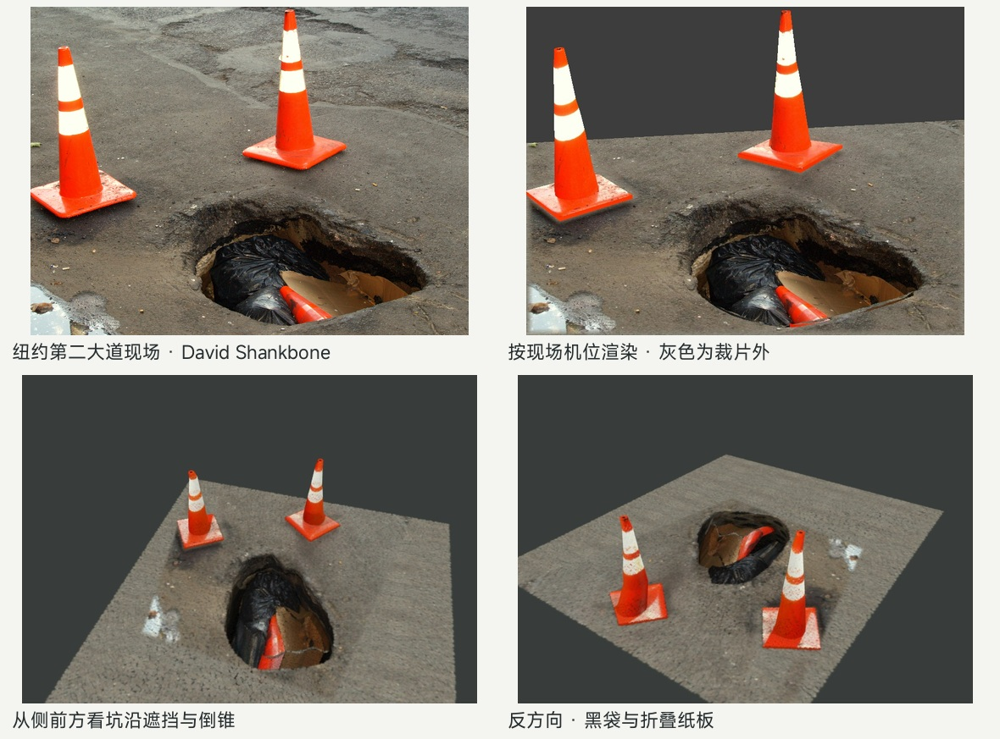
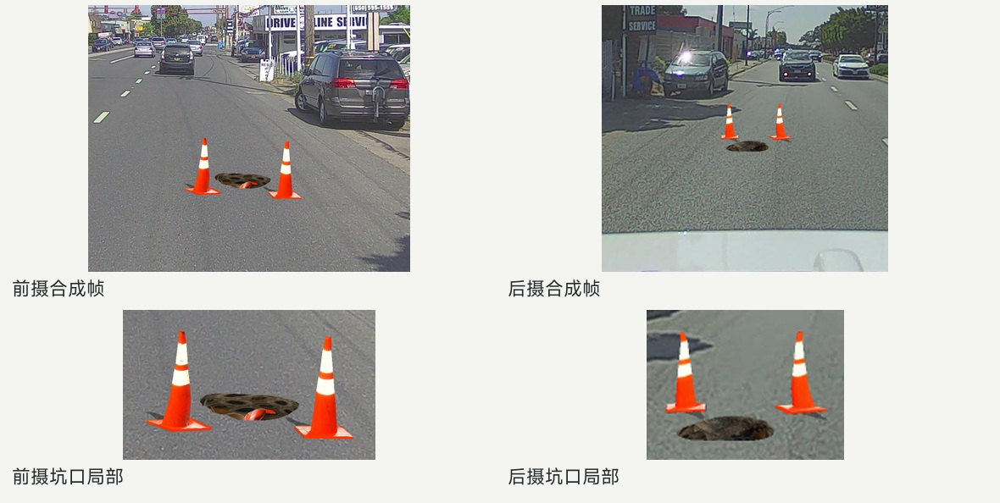

# P584 · 纽约第二大道坑洞、倒锥与坑内杂物

2008 年 8 月，David Shankbone 在纽约东村第二大道拍下这处路面破损。两只交通锥立在坑口外，另一个橙色锥体的一部分从坑里露出。近侧坑沿切断了倒锥、黑袋和纸板的轮廓，远侧可以看到破裂沥青和下面颜色较浅的土层。下载包包括三维网格、3D 高斯、原图、像素标注和相机回投结果。[现场原片与作者说明](https://commons.wikimedia.org/wiki/File:Large_pot_hole_on_2nd_Avenue_in_New_York_City.JPG) · [下载 P584.zip](https://github.com/Vexlc/road-hazard-reconstruction/releases/download/second-avenue-v1.0.0/P584.zip)

## 从现场照片复现

1. 校验随仓库提供的 3264 × 2448 原图。标注使用 820 × 615 图像坐标，原点在左上方。以两只锥桶各自的顶端和方形底座四角拟合路面姿态。取 EXIF 焦距 40 mm、名义成像宽度 17.3 mm、主点位于图像中心，以直立锥高 0.71 m 确定米制尺度。允许底座边长和直角存在拟合残差。八个额外图像行上的十六个锥身边缘都在模型轮廓的 2 像素以内。[像素标注](survey.json) · [相机求解](camera.py)
2. 将 49 个坑口点投到路面并切除对应多边形。名义尺度下，最小外接矩形为 **1.16 × 0.83 m**。改变锥高至 0.65、0.71、0.76 m，分别将像素焦距乘以 0.95、1、1.05，九次重拟合所得长边为 1.05–1.26 m，短边为 0.75–0.89 m。这是尺度假设的敏感性，现场没有尺读数。[九组结果](validation/quality.json)
3. 对远侧 24 组上下边缘点，求下缘视线到上缘竖线的最近点。沿该方向估计的**可见壁段**从路面向下约 7.6–14.0 cm。按照摄影中露出的沥青、土层和阴影为壁面着色。照片里的坑底被遮挡，总深度未知。视觉网格在路面下 0.52 m 设置封闭面，使从另一方向查看时坑内仍可成像。该数值仅控制视觉闭合。
4. 按像素轮廓建立独立的黑袋、折叠纸板与倒锥表面。正面纹理取自照片。单图重建假定了袋面的鼓起、纸板折线和锥面的弧度，并对朝向坑沿的截断处向遮挡后方延伸。反向视角、背面花纹及三者的埋入深度属于推测。两只路面锥桶用不同的锥身截面、方底和顶口重建。车载迁移时保留宿主路面颗粒，并按宿主日照在路面投下锥桶阴影。[构建程序](build.py)
5. 从原机位投射射线，与手工描边比较。坑口交并比为 0.993，黑袋为 0.960，纸板为 0.955，倒锥为 0.903。这项检查检验原机位的轮廓吻合度。两处新机位另行检查高斯与网格的前景内部深度差，P90 分别约 33 和 27 mm。独立源码目录复建后，六个核心文件的 SHA-256 完全相同。[检查程序](check.py) · [模型指纹](validation/rebuild.json)

直接查看可打开包内的 `P584/asset.glb`。从源码复建请在 Linux、Python 3.9 下运行以下命令。高斯视图核验使用 CUDA。

~~~bash
git clone --depth 1 --branch second-avenue-v1.0.0 https://github.com/Vexlc/road-hazard-reconstruction.git
cd road-hazard-reconstruction
python3.9 -m venv .venv
source .venv/bin/activate
KIT="$PWD/releases/field-chambers"
python -m pip install -r "$KIT/requirements.txt"
python -m pip install torch==2.4.0 torchvision==0.19.0 --index-url https://download.pytorch.org/whl/cu121
python -m pip install gsplat==1.4.0
export PYTHONPATH="$KIT/gen2hole/downstream:$KIT/gen2hole/downstream/sensors:$KIT/gen2hole/recipes/common:$KIT/gen2hole/recipes/series"
export OPENBLAS_NUM_THREADS=1 OMP_NUM_THREADS=2
D=gen2hole/examples/second-avenue
B=build-second-avenue
python "$D/build.py" "$B/models/model"
python "$D/check.py" "$B/models" "$B/views"
~~~

## 选择网格和量程

|文件|适用范围|
|---|---|
|`asset.glb`|完整视觉网格，265,006 个三角形。含外推背面、侧壁和视觉封底。GLB 为 Y 向上，单位米。|
|`asset.ply`、`splat_material.npz`|279,685 个一阶球谐高斯及材质。局部坐标 Z 向上。|
|`bounded.glb`|路面、两只路面锥和能在照片上配对上下边缘的远侧壁段。移除了坑内三件杂物、外推壁及封底。这里仍沿用单图尺度和竖壁假设。|
|`surface.npz`|5 mm 间距的俯视首交高度、部件号、场景覆盖和推测面掩码。表中高度包含视觉补全。|
|`views/field-rays.npz`|原机位每个像素的完整网格首交部件和米制量程。另附单独对有约束网格求交的距离，未命中为无穷大。|
|`metadata.json`|原片来源和校验值、相机位置、名义尺寸、24 组壁段高度及部件列表。|

构建结果在 `$B/models/model/series/assets/pothole/P584`。部件 1 为宿主平面，25 为直立锥桶，180 为带上下缘约束的壁段，181 为补全壁面或封底，182–184 依次为黑袋、纸板和倒锥。仅对 `bounded.glb` 投射一条射线有时会穿过已移除的杂物，看见更远的坑壁。评估量程时，应先检查完整模型的首交部件，再决定是否保留该距离。

## 在车载道路上复现

以下使用 PandaSet 109 的原始相机、激光、语义和动态掩码。宿主是另一条实录道路。前后摄像机共用同一世界坐标安装点，各 4 帧和 5 帧。代表前摄帧看到倒锥和纸板，代表后摄帧看到黑袋上沿及远侧坑壁。相机附件提供视频、代表帧的射线、部件图和安装变换。[PandaSet 数据入口](https://github.com/scaleapi/pandaset-devkit) · [相机核验](validation/camera.json) · [下载相机与激光附件](https://github.com/Vexlc/road-hazard-reconstruction/releases/download/second-avenue-v1.0.0/camera-lidar.zip)

~~~bash
raw=/path/to/raw/109
masks=/path/to/processed/109/dynamic_masks/all
for side in front back; do
  python "$KIT/scripts/render-road-distress.py" "$raw" "$masks" "$B/models" "$B/drive/$side" \
    --shot 15 --pixel 1140 915 --yaw-deg 62 --camera "${side}_camera" --semantic-occlusion \
    --allow-hidden-focus --focus-group 25 180 182 --relief-daylight gen2hole/examples/gervis-rupture/daylight.json P584
done
python gen2hole/examples/lane-damage/check_drive.py "$B/models" "$raw" "$B/drive" "$B/camera.json" --ids P584
python "$D/beams.py" "$B/models" "$B/drive" "$raw" "$B/lidar"
python "$D/figures.py" "$B/views" "$B/drive" "$B/figures"
python "$D/pack_release.py" "$B/models" "$B/views" "$B/drive" "$B/lidar" "$B/release"
(cd "$B/release" && sha256sum -c SHA256SUMS)
~~~

在通过交通间距检查的 6 个扫描窗口中，有 18,934 条候选光束。只有原始回波位于路面附近、具有道路语义且通过前景遮挡检查时才允许替换。完整模型产生 1,875 条替换量程。其中 787 条命中直立锥，10 条命中有上下缘约束的壁段。另有 1,078 条命中补全或推测表面，受约束量程列将其标作未知。[逐扫描计数和摘要](validation/lidar.json)

`host_range_m` 保存原回波，`visual_range_m` 保存完整模型量程，`bounded_range_m` 在首交为推测面时写入 NaN。其余宿主回波沿用原值。筛选 `unresolved` 可直接取得这些歧义射线。`inserted_part`、原始行号、传感器、时间和局部方向可用于逐条复查。[激光回放程序](beams.py)

现场照片 © David Shankbone。本项目选用 CC BY-SA 3.0 发布原片及摄影派生资产。修改包括相机拟合、描边、投影贴图、遮挡后方补全及合成视图。复用时保留作者、出处、许可链接与修改记录。PandaSet 宿主数据另循其原始条款。[摄影许可](https://creativecommons.org/licenses/by-sa/3.0/) · [原片](https://commons.wikimedia.org/wiki/File:Large_pot_hole_on_2nd_Avenue_in_New_York_City.JPG)
