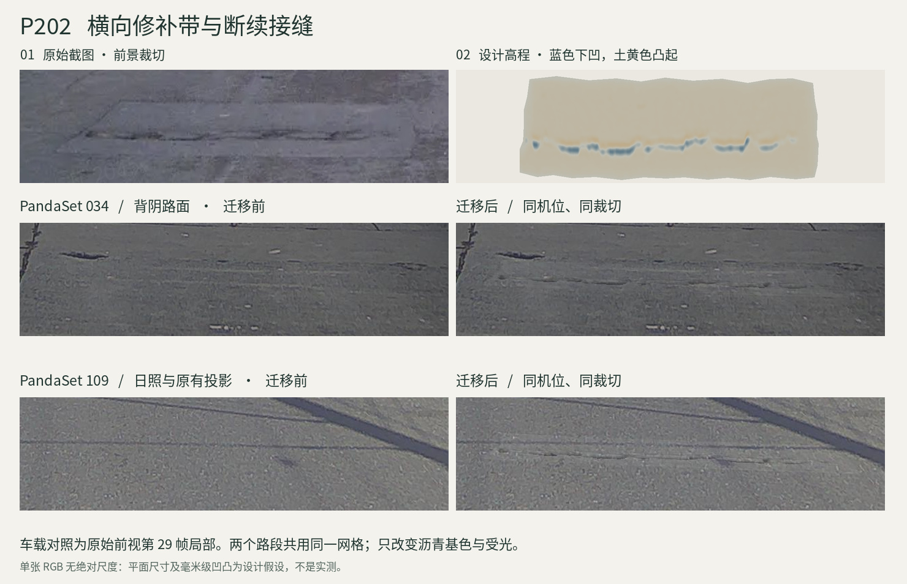

# P202 · 横向沥青修补带

取用户截图前景完整可见的一块补丁，不把后方路面、卡车或井篦一起切出来。原图没有标定和深度：外缘及断续缝的位置来自照片；2.50 × 0.94 m 是校正平面的设计范围，不是现场量尺；相对路面约 −10.5 至 +6.5 mm 的起伏也不是实测。

## 重建

从仓库根目录运行，使用项目已有的 mesh/compute 环境及本机配置。照片需与 `P202.json` 的哈希和像素坐标一致。另做一块补丁时，换照片和标注文件，并指定新的输出目录。

~~~bash
out=outputs/road-repair/P202
compute=work/envs/streetcrafter/bin/python
mesh=work/envs/assets/bin/python
"$compute" gen2hole/repair_patch.py build /path/to/original.jpg "$out" --splats
"$compute" scripts/review-repair-transfer.py "$out"
~~~

省略 `--splats` 可仅用 CPU 重建 GLB。实拍复核另需本地 PandaSet 034、109 的前视图、位姿、内参、原始 LiDAR、语义和动态遮挡掩膜。`anchors.json` 使用这两段道路已有的 01 号位置。

## 迁到另一种沥青

在目标位置旁选没有车道线、接缝、车辆的沥青，取代表性的 sRGB 中位数（0–255）。以下三通道仅是示例：

~~~bash
"$mesh" gen2hole/repair_patch.py mesh "$out" "$out/custom/asset.glb" --rgb 110 106 101
"$compute" gen2hole/repair_patch.py splats "$out" "$out/custom/asset.ply" --rgb 110 106 101
~~~

- **形状**：从标注四边形校正路面，沿手绘中心线在窄带内寻找暗缝；局部对比控制槽深与唇边的断续，边界平滑回到路面。网格裁到补丁轮廓，不输出整块矩形背景。GLB 为 Y 向上，高斯 PLY 为 Z 向上，单位均为米。
- **材质**：`field.npz` 将 `height`（米）、`defect_mask`、`alpha`、`joint` 与单通道 `log_gain` 分开。后者只保留有限的局部亮度残差和缝内明暗，不含原图 RGB。新 GLB 只替换材质；新 PLY 只调球谐颜色，不重新采点。
- **落地**：原点放在目标路面，按其法线旋转，局部 X 横跨车道。不应把模型整体抬高以躲避穿插：真实渲染器需在轮廓内裁掉原路面，否则地下的缝会被原面遮住。
- **复核**：两个路段各取 25、29 号前视帧，每段用近帧补丁外侧一圈沥青取色一次。用实际 GLB 射线交点采样材质，保留原帧光照、阴影和部分骨料颗粒，对前景遮挡不作修改。这里交付的是标定机位的合成对照，不是改写后的整段场景 checkpoint。

`comparison.jpg` 展示同帧同裁切，`trace.jpg` 标出原图选区和缝线。`transfer.json` 记录逐帧补丁主体相对同像素原路面的 ΔE76 中位数、缝芯亮度比、保护区改动数，以及各版本几何指纹。相机对照使用 GLB；PLY 单独做非颜色属性的一致性检查。
