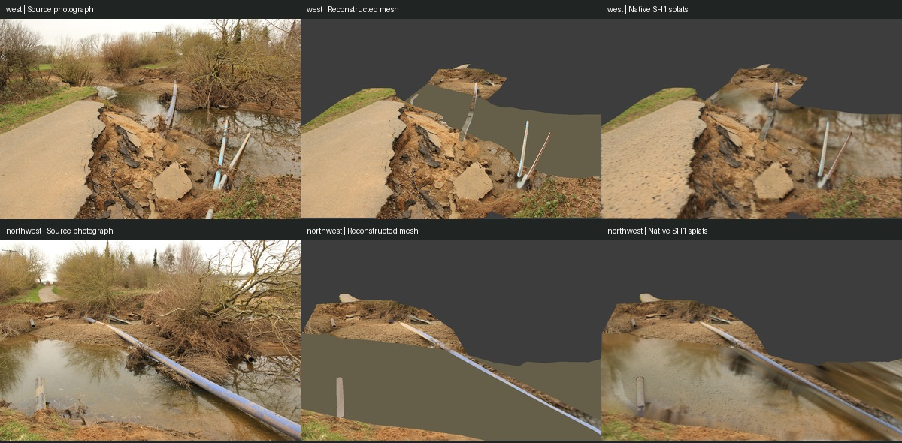

# P564 · Carlton Ferry Lane 洪水冲断乡道

2021 年 3 月 22 日，Richard Croft 从两个方向拍下英国诺丁汉郡 Carlton Ferry Lane 退水后的断口。沿道路向西看，近端沥青沿不规则边缘剥落；走到岸边向西北看，可以分辨对岸、横跨水面的粗蓝管和两岸的短管。这一件资产适合检查前视感知能否区分残存路面、断边和水面，以及管段如何遮挡其下的水面。[沿路原照](https://www.geograph.org.uk/photo/6785038) · [侧面原照](https://www.geograph.org.uk/photo/6785040) · [下载 P564.zip](https://github.com/Vexlc/road-hazard-reconstruction/releases/download/trent-washout-v1.0.0/P564.zip)

图中灰底表示资产边界。模型包含两段尚存的铺面、五块分离的破碎路面、两岸、水面、水下基底及五段可分别命中的管体。树木、远景及两张照片都看不见的沟岸超出重建范围。保留这条边界，便于把裸资产放在自己的道路背景中。

## 从两张原照复现

准备 Python 3.9、CUDA GPU、兼容驱动和 CUDA 12.1 工具链。模型包可直接下载并打开 GLB。生成原生高斯需要 PyTorch，回放需要 gsplat。这里使用 RTX 4070 Ti SUPER、PyTorch 2.4.0+cu121、gsplat 1.4.0。

~~~bash
git clone --depth 1 --branch trent-washout-v1.0.0 https://github.com/Vexlc/road-hazard-reconstruction.git
cd road-hazard-reconstruction
python3.9 -m venv .venv
source .venv/bin/activate
python -m pip install -r releases/field-chambers/requirements.txt
python -m pip install torch==2.4.0 torchvision==0.19.0 --index-url https://download.pytorch.org/whl/cu121
python -m pip install gsplat==1.4.0
export KIT="$PWD/releases/field-chambers"
export PYTHONPATH="$KIT/gen2hole/downstream:$KIT/gen2hole/downstream/sensors:$KIT/gen2hole/recipes/common:$KIT/gen2hole/recipes/series"
export OPENBLAS_NUM_THREADS=1 OMP_NUM_THREADS=2
D=gen2hole/examples/trent-washout
B=build-trent
mkdir -p "$B"
python "$D/stereo.py" > "$B/cameras.json"
python "$D/build.py" "$B/trent"
A="$B/trent/series/assets/pothole/P564"
python "$D/check.py" "$A" "$B/views"
~~~

另一个源码目录用相同输入、软件和 GPU 从头构建，GLB、PLY、高度场、材质索引和元数据五个文件的 SHA-256 逐项一致。解压发布包后，可在解压目录运行 `sha256sum -c SHA256SUMS` 检查所有随包文件。[重建指纹](validation/rebuild.json) · [标注、照片指纹及尺寸假设](survey.json)

## 相机、尺度与断口

- **相对机位**。两张工作图均为 1024 × 683。四组裁剪覆盖整景及远岸细节，SuperPoint 和 LightGlue 提供匹配候选。先合并邻近重复点，再以极线和静态区域筛到 92 对。避开 6 个人工现场标志在任一张照片上 9 px 内的点，剩余 85 对参与相机拟合。主点固定在图心，焦距带先验，最终两机位的等效像素焦距为 722 和 702 px。训练点的 Sampson 距离中位数为 0.66 px。[固定匹配点](correspondences.json) · [相机解算](stereo.py)
- **误差的含义**。6 个标志三角化后，在两张图上的 12 个重投影误差为 0.18–5.80 px。标志没有参与相机拟合，其中的管口和蓝管位置随后用于建模。图像吻合程度和绝对尺寸分别记录。[逐点三维坐标与误差](validation/quality.json)
- **比例**。把西向相机设在参考路面以上 1.60 m，以同一处远岸路面接草边的位置定标，假设西向图中地平线在第 121 行。此时相机基线约 8.94 m，水面设在参考路面下 1.40 m，俯视第一命中为水面的模型面积约 **72.2 m²**。面积受相机高度、水位和裁剪边界影响。现场照片没有标尺，真实水深和洪水造成的全部冲刷范围未知。
- **表面**。分别描出近岸断边、远岸断边、碎块、水线和管轴。粗蓝管用两个视角的轴线及侧面三个位置的可见半宽拟合；右侧两根浅色细管主要由向西照片约束。坡面在锚点间插值，遮挡处的管段延伸和水下基底按假设补全。管材与用途未辨识。[几何与外观生成](build.py)
- **水色**。网格水面使用统一基色和 1.333 折射率。原生高斯对水面逐点发射两条相机射线；通过可见性和水区遮罩的样本，按观测角度拟合一阶球谐颜色。低权重区域回落至中性水色。在两个原机位，可见水面 RGB 平均绝对通道误差分别为网格 40.4 / 46.9 和高斯 17.9 / 23.7（0–255）。这两个机位参与了水色拟合。新角度的树影可能拉伸，近岸陡面也会受原照片纹理分辨率影响。[水色拟合](water.py)

### 重新提取匹配点

仓库内固定的对应点足以复建。若要在自己的图像上借鉴配准流程，可用以下命令重新提取这组输入的对应点。首次运行需要联网取得匹配模型权重，固定版本和当前两张原图在上述环境中复得同一份 JSON。

~~~bash
git clone https://github.com/cvg/LightGlue.git "$B/LightGlue"
git -C "$B/LightGlue" checkout 5a650c444718caffc2669dc0094cde908f42dd73
python -m pip install kornia==0.8.2 matplotlib==3.9.4
PYTHONPATH="$B/LightGlue:$PYTHONPATH" python "$D/match.py" "$B/rematched.json"
cmp "$D/correspondences.json" "$B/rematched.json"
~~~

移用到其他路段时，先替换四组裁剪窗口、静态区域和水区，再选择在两个视角都能辨认的管口、碎块或断边转折点。若有已测长度或标定基线，可用它替换相机高度先验。重复纹理、树影和水面反光应从机位估计中排除。[特征提取脚本](match.py) · [LightGlue 上游代码](https://github.com/cvg/LightGlue/tree/5a650c444718caffc2669dc0094cde908f42dd73)

## 检查遮挡与接近过程

`views/` 里有两个机位的网格图和原生高斯图、逐像素首命中部件和量程，以及 36 帧高斯接近短片。短片中相机离地 1.45 m，前移 2.41 m，停在距最近已描断边约 1.00 m 的位置。36 个相机位置垂直向下都命中残存铺面。它展示的是隔离资产的合成相机运动，现场照片记录的是静态路况。

1. 两幅照片上共 15 个位置用于检查铺面、碎块、砾岸、水面及管体，网格首命中均与标注相符。部件码 13 为铺面，14 为断面，146 为可见碎块顶，2 为土石或草岸，4 为水，16 为基底，59 为管体。
2. 沿粗蓝管中段投下 5 条垂直射线，均先碰到管体。去除管体后，一条碰到砾岸，四条碰到水；再去除水面，这四条均碰到更低的基底。这项检查验证导出资产的遮挡和层次。
3. `surface.npz` 包含最高首命中高度、去除水和管体后的基底高度、可见水面掩码及有效范围。以 `alpha` 区分范围外的零填充。GLB 使用 Y 向上，PLY 与高度场使用 Z 向上。相机和标志坐标减去元数据中的 `asset_world_origin_m` 即可进入资产局部坐标。[核验与回放代码](check.py) · [机器可读结果](validation/quality.json)

原始两张照片版权属 Richard Croft；原照、派生纹理、模型和本文中的对照图均按 CC BY-SA 2.0 发布。改编包括配准、描边、三维补全、去除纹理里的部分重复管影、水色拟合和渲染。复用时请保留作者、来源、改编说明及相同许可。[署名-相同方式共享 2.0](https://creativecommons.org/licenses/by-sa/2.0/)
