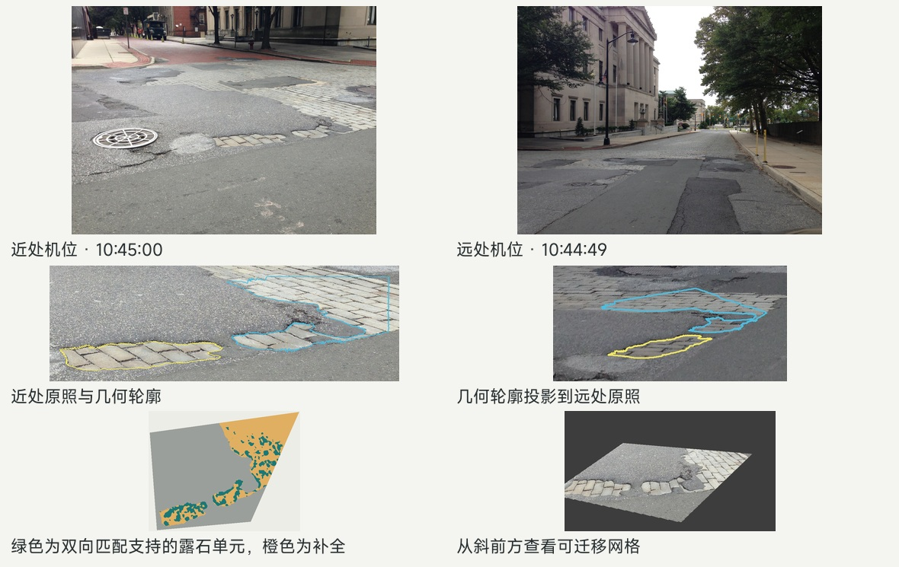
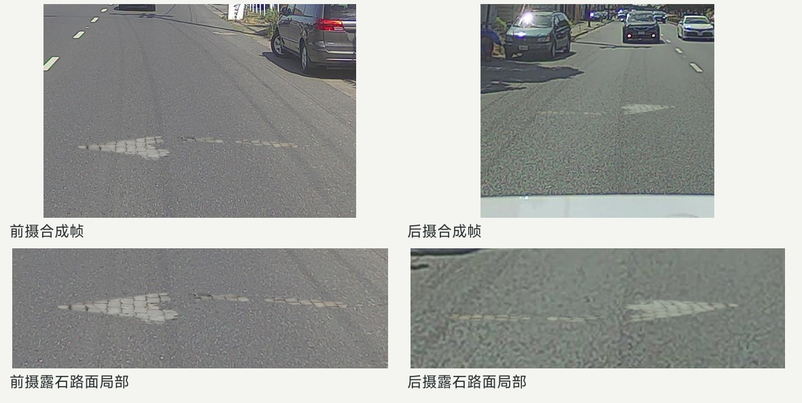

# P583 · 特伦顿路口沥青剥失、露石与残留面层

2014 年 8 月 30 日，Famartin 在美国新泽西州特伦顿 Barrack Street 与 West Front Street 的交叉口，从两个机位记录了同一片路面。两张照片相隔 11 秒，都能辨认前景的圆形井篦、沥青边缘及若干相同的石缝。一个露石区四周被沥青包围；另一个绕过残留的沥青舌，经一条窄带接入更大的石铺面。包中保留了这条连接。右上方是取景截边，石铺面在现场继续延伸。[近处原照](https://commons.wikimedia.org/wiki/File:2014-08-30_10_45_00_The_intersection_of_Barack_Street_and_West_Front_Street_in_Trenton,_New_Jersey,_with_asphalt_potholes_revealing_a_sett_surface_beneath.JPG) · [远处原照](https://commons.wikimedia.org/wiki/File:2014-08-30_10_44_49_View_south_along_Barack_Street_at_West_Front_Street_in_Trenton,_New_Jersey,_with_a_partial_sett_surface.JPG) · [下载资产](https://github.com/Vexlc/road-hazard-reconstruction/releases/download/trenton-setts-v1.0.0/P583.zip)

## 尺度、可见面积与高差

设圆形井篦外径为 **0.60 m**。原照没有现场尺读数。网格外接范围约 2.46 × 1.96 m，包含不规则取景边界外的空白。下表面积是近机位参考平面上、裁片以内的露石投影；高差统计只使用通过双向视差检查的格点。负数表示低于旁边完整面层。

|原片部位 / 首交编号|裁片内面积|通过双向检查的格点|占本区比例|相对路面高差 P10 / 中位 / P90|
|---|---:|---:|---:|---:|
|左侧独立露石区 / 178|0.191 m²|5,737|48.1%|−6.3 / −2.4 / +0.4 mm|
|右侧连通石铺面 / 179|0.924 m²|11,332|19.6%|−18.4 / −6.7 / +0.4 mm|

这是一处面层剥失、旧石料裸露的浅损伤。石缝有阴影和颗粒的真实摄影纹理。照片不足以给每条缝分配实测深度。模型在缺少视差的单元向相邻已知表面平滑补全，超过支持范围时逐渐回到路面高程。做几何对照时可用 `stereo_valid` 掩码筛出有观测支持的区域。[照片标注、外径假设与原图摘要](survey.json) · [核验数据](validation/quality.json)

## 从现场照片复现

1. 读取两张 3264 × 2448 原图，用 EXIF 35 mm 等效焦距 33 mm 估算像素焦距，主点取图像中心。在两个视角拟合同一圆形井篦，并以井篦旁的路面位置给出初始朝向。近照井篦交错留出的边缘点，投影残差中位数为 0.36 px。[相机初始化](cameras.py)
2. 用校正到地面的图块匹配原片，固定 793 对候选点的坐标与分数。按序号预留约五分之一，经过边界与匹配分数筛选还剩 150 对预留点。用训练点中的 394 对约束远机位姿态，井篦内的匹配约束平移尺度。名义尺度下机位间距约 5.28 m。用邻近沥青上的 58 个控制点估计局部坡面。[匹配程序](match.py) · [固定输入](correspondences.npz) · [双机位求解](stereo.py)
3. 以 4 mm 间距采样参考平面，在两机位间分别正扫、反扫高度。候选高度间隔 1.5 mm，以局部归一化互相关匹配碎石、接缝和沥青纹理。筛选纹理强度、主峰与竞争峰的差异、4.5 mm 以内的往返高度一致性，并要求附近训练匹配的三角化高度相容。网格间距和搜索间隔是算法参数。重复的铺石、反光或弱纹理区域可能没有可靠对应。[高度恢复](surface.py)
4. 在实际水平位置重采样。现场版保留坡度和相邻路面的起伏；迁移版以相邻完整路面为零，取景截边处在 7.5 cm 内渐变。视觉网格 99,297 个三角形，另附 479,893 个一阶球谐高斯。两处斜视检查中，高斯对网格前景内部深度差 P90 约 2.0、2.5 mm；这个差值比较两种表达。[模型生成](build.py) · [检查程序](check.py)

62 对预留匹配落在有网格覆盖的露石区。按匹配点自身三角化回投误差小于 2.5 px 检查，其中 45 对可用。从近照沿射线取现场版网格首交点，再投到远照，误差中位数 2.43 px，P90 为 5.61 px。对同一批射线改用相邻路面高度，中位数为 2.77 px，P90 为 7.19 px。留出的是特征对，密集视差仍使用同一对原片。

以下命令从仓库根目录运行。Linux、Python 3.9，原生高斯的检查使用 CUDA。制作中文图版使用 fontconfig 和中文字体。只使用 GLB 时可直接打开下载包内的模型。

~~~bash
git clone --depth 1 --branch trenton-setts-v1.0.0 https://github.com/Vexlc/road-hazard-reconstruction.git
cd road-hazard-reconstruction
python3.9 -m venv .venv
source .venv/bin/activate
KIT="$PWD/releases/field-chambers"
python -m pip install -r "$KIT/requirements.txt"
python -m pip install torch==2.4.0 torchvision==0.19.0 --index-url https://download.pytorch.org/whl/cu121
python -m pip install gsplat==1.4.0
export PYTHONPATH="$KIT/gen2hole/downstream:$KIT/gen2hole/downstream/sensors:$KIT/gen2hole/recipes/common:$KIT/gen2hole/recipes/series"
export OPENBLAS_NUM_THREADS=1 OMP_NUM_THREADS=2
D=gen2hole/examples/trenton-setts
B=build-trenton
python "$D/build.py" "$B/models/model"
python "$D/check.py" "$B/models" "$B/views"
~~~

如需重新提取匹配点，以下版本及权重在本次环境中重新产生了完全相同的 793 行坐标和分数。常规复建直接使用仓库固定的输入。

~~~bash
git clone https://github.com/cvg/LightGlue.git "$B/LightGlue"
git -C "$B/LightGlue" checkout 5a650c444718caffc2669dc0094cde908f42dd73
python -m pip install 'kornia>=0.6.11' packaging
PYTHONPATH="$B/LightGlue:$PYTHONPATH" python "$D/match.py" "$B/reextracted.npz"
python -c 'import numpy as np,sys; assert np.array_equal(*(np.load(p)["pairs"] for p in sys.argv[1:]))' "$D/correspondences.npz" "$B/reextracted.npz"
~~~

## 文件和坐标

|文件|内容|
|---|---|
|`field.glb`|摄影配准和高程核验用。保留现场坡度。将 metadata 中的 `model_offset_xyz_m` 加到 Z 向上的局部坐标，得到相机求解的世界坐标。|
|`asset.glb`、`asset.ply`、`splat_material.npz`|可迁移的道路网格和高斯。GLB 为 Y 向上，PLY 为 Z 向上，单位均为米。|
|`surface.npz`|4 mm 规则网格，含宿主相对高度、现场绝对高程、覆盖、首交部件和经过筛选的视差支持掩码。 `stereo_valid & (first_part == 179)` 可选出连续石铺面上可用于量程对照的格点。|
|`stereo.npz`|近机位参考平面坐标下的原始匹配高差、正反扫一致性、相关峰值、局部路面高度、支持掩码以及训练和留出索引。读取原始高差时使用 `accepted` 筛选。|
|`metadata.json`|相机位置、名义尺度、坐标变换、建筑与路面图片来源、各部件和网格信息。|

输出位于 `$B/models/model/series/assets/pothole/P583`。在独立源码目录中重建，上述七个文件逐字节一致。[SHA-256 指纹](validation/rebuild.json)

## 车载相机和激光回放

PandaSet 109 提供另一条实录道路、前后摄标定、激光发射时刻及原始回波。合成时保留宿主沥青和前景遮挡。前摄 5 帧、后摄 10 帧共用同一世界安装位置。[PandaSet](https://github.com/scaleapi/pandaset-devkit) · [相机逐帧检查](validation/camera.json)

~~~bash
raw=/path/to/raw/109
masks=/path/to/processed/109/dynamic_masks/all
for side in front back; do
  python "$KIT/scripts/render-road-distress.py" "$raw" "$masks" "$B/models" "$B/drive/$side" \
    --shot 15 --pixel 1090 910 --yaw-deg 62 --camera "${side}_camera" --semantic-occlusion \
    --focus-group 178 179 --edge-blend-m .075 P583
done
python gen2hole/examples/lane-damage/check_drive.py "$B/models" "$raw" "$B/drive" "$B/camera.json" --ids P583
python "$D/beams.py" "$B/models" "$B/drive" "$raw" "$B/lidar"
python "$D/figures.py" "$B/models" "$B/views" "$B/drive" "$B/figures"
python "$D/pack_release.py" "$B/models" "$B/views" "$B/drive" "$B/lidar" "$B/release"
(cd "$B/release" && sha256sum -c SHA256SUMS)
~~~

12 个扫描窗口通过交通间距筛选。4,548 条候选光束中，773 条满足原道路语义、原回波距拟合路面 4 cm 以内、前景遮挡和新网格首交条件。119 条命中独立露石区，654 条命中连通区。其中 173 条命中双向视差支持的单元；这些光束相对同方向平路交点的量程变化中位数为 +2.9 cm。它是沿光束的距离变化，竖向高差见表格。

激光 NPZ 提供两列回放量程：`visual_range_m` 可用全部 773 次几何替换，`supported_range_m` 只替换有视差支持的 173 次。其他射线保留实录值。原始行号、传感器、时间、射线、道路标签与原始量程随包保存。[逐扫描报告](validation/lidar.json) · [下载前后摄视频及双激光对照](https://github.com/Vexlc/road-hazard-reconstruction/releases/download/trenton-setts-v1.0.0/camera-lidar.zip)

两张原照 © Famartin，按 CC BY-SA 4.0 发布。摄影派生资产包括几何、纹理、裁片和原照对照图，依相同许可提供。修改包括摄影配准、标注、双向视差重建、孔隙补全与车载合成。复用时保留作者、出处、许可和修改说明。PandaSet 宿主另循原数据条款。[许可全文](https://creativecommons.org/licenses/by-sa/4.0/)
