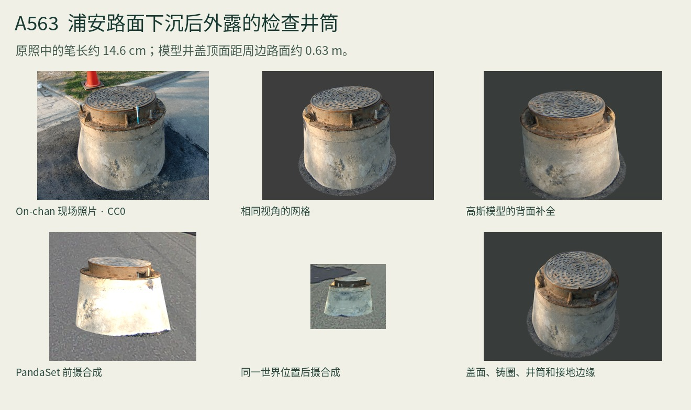

# A563 浦安路面下沉后外露的检查井筒

2011 年 4 月 1 日，On-chan 在日本千叶县浦安市明海拍摄了这个井筒，并在井盖与法兰旁放置了一支约 14.6 cm 长的笔。模型按这件参照物恢复尺度，分开重建混凝土筒体的两段、铸铁承座、井盖、可见锚栓和铸造加强筋。井盖顶面高于局部路面约 **0.626 m**，盖面外径约 **0.618 m**。这些数值来自单照拟合。[作者原照与 CC0 授权](https://commons.wikimedia.org/wiki/File:Manhole_shows_subsidence_occurred_by_2011_Sendai_earthquake.jpg) · [GLB、原生 3DGS 及核验包](https://github.com/Vexlc/road-hazard-reconstruction/releases/download/urayasu-shaft-v1.0.0/A563.zip)

## 尺度与误差

相机使用照片 EXIF 的 29 mm 等效焦距，从工作图的对角线换算为像素焦距。以井盖为基准，对井盖、法兰、混凝土接缝和底缘四圈的像素标注拟合姿态、半径、高差与轴线的横向偏移。十个圈缘点预先留出。最后分别将笔的两端与井盖、法兰的高度平面相交，用 0.146 m 约束比例。相机拟合、几何标注和留出点均在仓库中。[标注和假设](urayasu.json) · [标定代码](calibration.py)

- 在 900 × 675 工作图中，10 个留出点到投影圈缘的均方根误差为 4.75 px，最大偏差为 12.28 px。另行描出的井体轮廓与导出网格轮廓的交并比为 0.968。
- 若将笔两端的假定接触高度分别上下移动 5 mm，其他拟合参数保持不变，井盖顶面估计高度落在 0.591–0.650 m。这个范围只反映该项假设的影响。
- 背面不可见的材质从可见井筒正面分段补全。低处接地线以圆形断面近似，原照上真实路面有局部起伏。模型从纹理中去除了测量用笔，交通锥也留在原照中。GLB 使用 Y 向上、高斯及高度场使用 Z 向上，米为单位，局部 Z=0 对应周围路面。[逐项检查](validation/quality.json)

## 从原照重建

~~~bash
git clone --depth 1 --branch urayasu-shaft-v1.0.0 https://github.com/Vexlc/road-hazard-reconstruction.git
cd road-hazard-reconstruction
python3.9 -m venv .venv
source .venv/bin/activate
python -m pip install -r releases/field-chambers/requirements.txt
export KIT="$PWD/releases/field-chambers"
export PYTHONPATH="$KIT/gen2hole/downstream:$KIT/gen2hole/downstream/sensors:$KIT/gen2hole/recipes/common:$KIT/gen2hole/recipes/series"
export OPENBLAS_NUM_THREADS=1 OMP_NUM_THREADS=2
D=gen2hole/examples/uplifted-shafts
B=build-urayasu
python "$D/calibration.py" "$B/calibration.json"
python "$D/build.py" "$B/models/urayasu"
~~~

构建输出在 models/urayasu/series/assets/raised/A563，包含 asset.glb、asset.ply、surface.npz、splat_material.npz 和 metadata.json。两个独立输出目录的全部五个文件逐字节相同。单独查看模型只需解压 A563.zip。运行包内的 `sha256sum -c SHA256SUMS` 可检查每个文件。[重复构建指纹](validation/rebuild.json)

## 车辆与激光核验

~~~bash
python -m pip install torch==2.4.0 torchvision==0.19.0 --index-url https://download.pytorch.org/whl/cu121
python -m pip install gsplat==1.4.0
python "$D/check.py" "$B/models" "$B/views"
raw=/path/to/raw/109
masks=/path/to/processed/109/dynamic_masks/all
for side in front back; do
  python "$KIT/scripts/render-road-distress.py" "$raw" "$masks" "$B/models" "$B/109/$side" \
    --shot 15 --pixel 1190 925 --yaw-deg 15 --camera "${side}_camera" --semantic-occlusion --focus-part 102 A563
done
python gen2hole/examples/lane-damage/check_drive.py "$B/models" "$raw" "$B/109" "$B/camera.json" --ids A563
python "$D/check_lidar.py" "$B/models" "$B/109" "$raw" "$B/lidar"
~~~

在 PandaSet 109 的同一世界位置合成前摄 5 帧、后摄 10 帧。激光核验使用与相机一致的网格、锚点和朝向，并按实录激光发射时间和传感器重建光束。12 个满足交通间距条件的整帧提供了 5,781 条穿过候选包围盒的实录方向。插入几何后，其中 3,412 条在井体上得到较短的模拟量程，另有 19 条先碰到接地裙边。原测量中更近的遮挡保留。结果反映合成几何效果，现场原始数据来自另一条道路。[相机核验](validation/camera.json) · [两台激光和逐帧记录](validation/report.json) · [命中部件与量程变化](validation/parts.json)

原照由 On-chan 以 CC0 1.0 发布，改编包括比例约束、纹理展开、隐藏面补全、井盖和井筒网格及高斯导出。道路宿主为 Hesai Technology 与 Scale AI 的 PandaSet，使用须遵循该数据集条款。[CC0 1.0](https://creativecommons.org/publicdomain/zero/1.0/) · [PandaSet](https://github.com/scaleapi/pandaset-devkit)
