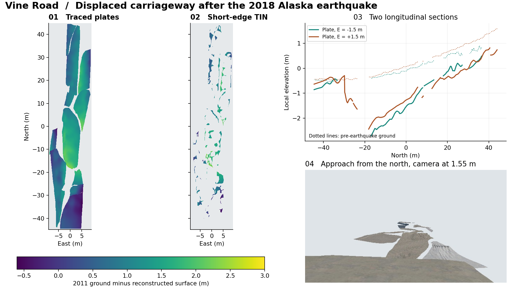
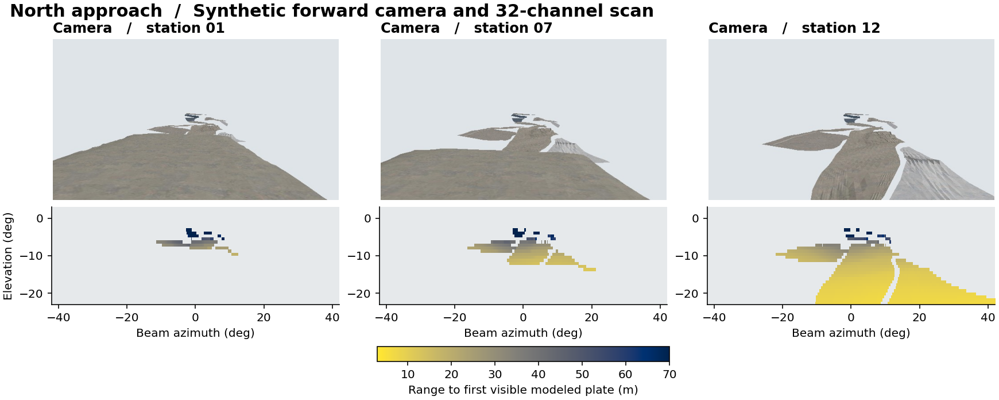

# P592 · 阿拉斯加 Vine Road 震后错断车道

2018 年 11 月 30 日阿拉斯加地震后，Vine Road 的沥青面层碎裂成多块，部分路面下降、倾斜，相邻板块间留下空隙。P592 按三张早期航拍重建了照片可辨的 10 块板面，南北跨度约 89 米。可用它观察车辆接近大范围路基破坏时，哪些板面先进入视野，哪些激光束能够获得有照片支撑的回波。[现场工程简报，第 37 页](https://dot.alaska.gov/stwddes/research/assets/documents/trb2019_annual_meeting-ppt.pdf) · [第三视角，第 5 页](https://lfestorage.s3.us-east-2.amazonaws.com/images/Damage_to_Alaska_DOT_PF_Infrastructure_.pdf)

| 下载 | 内容与用途 |
|---|---|
| [P592.zip](https://github.com/Vexlc/road-hazard-reconstruction/releases/download/vine-road-v1.0.0/P592.zip) | 完整板面、仅含短边三角形的支撑区、95 万个高斯、逐点部件、10 cm 栅格及模型参数。可先在 glTF 查看器打开 `P592/asset.glb`。 |
| [approach-rays.zip](https://github.com/Vexlc/road-hazard-reconstruction/releases/download/vine-road-v1.0.0/approach-rays.zip) | 从北侧完好路段驶近的 12 个合成机位。包含车载高度图像、标定、北侧引道路面、相机首交距离和两套激光首交量程。 |
| [SHA256SUMS](https://github.com/Vexlc/road-hazard-reconstruction/releases/download/vine-road-v1.0.0/SHA256SUMS) | 在两个 ZIP 的下载目录执行 `sha256sum -c SHA256SUMS`，每个 ZIP 内也有逐文件清单。 |

## 几何依据和精度

1. **三张早期航拍决定断块形状。** A、B 来自第一份简报，C 来自第二份。以三组照片的同名点、周边稳定地物控制点、裂带两端的完好路面共同求解相机位置、方向和焦距。照片的原始分辨率、手描轮廓、遮挡椭圆、相机初值和地理原点随源码发布。同名点使用原始像素，手描标注统一在 A 图等比缩放至 720 像素宽时读取。[观测定义和来源指纹](survey.json)
2. **两期地面测量提供高程参照。** 2011 年 Mat-Su 地面激光点云给出震前路面，2018 年 12 月 5 日的正射影像及 12 月 9–14 日的激光数据用于稳定地物配准和高程对照。抢修阶段的路心地形不用于填补早期断裂。2011 年按项目元数据以 Alaska State Plane Zone 4、美制测量英尺解码，平面及高程乘以 1200/3937，平面转到 NAD83 / UTM 6N。两期高程均标作 NAVD88，分别使用 GEOID09、GEOID12B。[DGGS 正射影像及原作者](https://doi.org/10.14509/30283) · [测量数据门户](https://elevation.alaska.gov/)
3. **逐块恢复路面。** 在粗配准图上提取 SuperPoint + LightGlue 匹配，再以 8 cm 高程步长做局部归一化相关搜索。从 A 图轮廓内部筛点，剔除人物、车辆和留出点附近的匹配。每块用稳健平面和 0.9 m 尺度的局部残差恢复弯曲。11 个候选中有 10 块通过几何筛选，细长的 `east-splinter` 拟合坡度过陡而被剔除。南端板块止于照片边缘。板名中的 east/west 是图上标注名，方位分析请使用 UTM 坐标。[相机求解](camera.py) · [板面拟合](plates.py)
4. **证据较密的部分单独导出。** `asset.glb` 在各块手描边界内插值，共 29,184 个三角形。`supported.glb` 直接连接筛选后的三维观测，只保留三边均短于 1.5 m、完全位于同一板块且避开遮挡椭圆的 1,288 个三角形。10 cm 俯视采样下，完整板面覆盖 794.69 m²，同块支撑区覆盖 95.37 m²，约占 12.0%。裂隙底部和遮住的侧壁保留空缺。光线穿过空缺时返回无命中。[构建代码](build.py) · [验证数据](validation/quality.json)

**高差的含义。** 对短边网覆盖、震前地面点足够近的 9,537 个栅格，按同一平面位置计算「2011 年地面高程减去早期板面高程」，中位数为 **1.07 m**，第 95 百分位为 **1.99 m**。该统计比较两个时期的表面；板块发生水平移动时，同一坐标可对应不同材质点。裂隙深度仍未知。

| 留出检查 | 样本 | 中位数 | 第 90 百分位 |
|---|---:|---:|---:|
| A、B 三角化后在 C 上的重投影误差 | 94 组 | 1.04 px | 2.55 px |
| 完好道路留出点与两期地面均值的垂直偏差 | 5 点 | 0.12 m | 0.22 m |
| `central-pivot` 上板面与留出三角化结果的垂直偏差 | 17 项 | 0.30 m | 1.02 m |
| `west-wedge` 同项 | 3 项 | 0.92 m | 1.20 m |

留出检查仍共用相机和地理基准。个别板块约束较弱，`south-step`、`west-upper` 没有通过筛选的板内留出点。每块的拟合点数、支撑范围、留出样本数和垂直偏差均见模型内的 `metadata.json → panels`。上表中的 0.12 m 只描述完好道路控制点。

**外观。** 材质使用 Dimitrios Savva 的 CC0 沥青扫描，以 2.2 m 为周期逐块旋转，按现场照片中每块路面的 RGB 中位数调色。四段可辨浅色边线用手描折线复原，线宽和亮度取建模近似值。回放中的浅灰表示该视线没有场景几何。原航拍可从简报抽取，发布包内仅含重建产物、观测坐标和替代材质。[沥青扫描及作者](https://polyhaven.com/a/road_damaged) · [颜色和边线标注](survey.json)

## 从现场照片复现

在仓库根目录执行以下命令。验证环境为 Linux、Python 3.9、CUDA 12.1 版 PyTorch 2.4.0。生成高斯需要 NVIDIA GPU，几何求解和射线检查使用 CPU。Git 标签已包含全部匹配表、地理控制表、地面高程栅格和缩小的材质图。本段安装依赖后可离线构建。

~~~bash
git clone --depth 1 --branch vine-road-v1.0.0 https://github.com/Vexlc/road-hazard-reconstruction.git
cd road-hazard-reconstruction
python3.9 -m venv .venv
source .venv/bin/activate
KIT="$PWD/releases/field-chambers"
python -m pip install -r "$KIT/requirements.txt" shapely==2.0.7 matplotlib==3.9.4
python -m pip install torch==2.4.0 --index-url https://download.pytorch.org/whl/cu121
export PYTHONPATH="$KIT/gen2hole/downstream:$KIT/gen2hole/downstream/sensors:$KIT/gen2hole/recipes/common:$KIT/gen2hole/recipes/series"
export OPENBLAS_NUM_THREADS=1 OMP_NUM_THREADS=2
D=gen2hole/examples/vine-road
B=build-vine
python "$D/build.py" "$B/model"
python "$D/replay.py" "$B/model" "$B/replay"
python "$D/check.py" "$B/model" "$B/replay" "$B/validation"
python "$D/pack_release.py" "$B" "$B/release"
(cd "$B/release" && sha256sum -c SHA256SUMS)
~~~

最后的打包命令先检查 10 个输入及 24 个输出的 SHA-256，再写两个 ZIP。独立源码目录重建所得的网格、高斯、射线、图板等 24 个文件已逐字节比对。字体、库、GPU 和图片编码器版本会影响部分文件指纹；跨平台复核可以先看几何指标和逐束量程。打包时间戳随本次运行生成。[输入指纹](validation/inputs.json) · [产物指纹](validation/rebuild.json) · [几何核验代码](check.py)

### 从原始航拍和点云核对输入

`sources.py photos` 通过 Poppler 的 `pdfimages` 从两份简报提取图像，并验证 PDF 及 JPEG 的 SHA-256。网络受限时也可把原 PDF 放入 `$B/raw/source-1.pdf` 和 `source-2.pdf`。以下命令重算稀疏匹配和高程搜索。首次使用 LightGlue 需要获取官方权重。

~~~bash
# 安装系统软件包 poppler-utils，沿用上一节 D、B 和虚拟环境。
python "$D/sources.py" photos "$B/raw"
git clone https://github.com/cvg/LightGlue.git "$B/LightGlue"
git -C "$B/LightGlue" checkout 5a650c444718caffc2669dc0094cde908f42dd73
python -m pip install torchvision==0.19.0 --index-url https://download.pytorch.org/whl/cu121
python -m pip install kornia==0.8.2 packaging
PYTHONPATH="$B/LightGlue:$PYTHONPATH" python "$D/match.py" "$B/raw" "$B/reextracted"
python "$D/sweep.py" "$B/raw" "$B/reextracted"
~~~

两份 LAZ 文件的下载查询、区域、文件名与 SHA-256 位于 `survey.json` 的 `lidar_downloads` 和 `lidar_file_sha256`。下载并解压后运行下列命令。2011 年采用每格最近 6 个分类地面点，2018 年用 7 个，各自取中位数，同时存储最远入选点距离。每格间距 0.4 m，重建输出的 0.1 m 栅格仅作采样。

~~~bash
python -m pip install 'laspy[lazrs]==2.5.4' pyproj==3.6.1
python "$D/sources.py" ground /path/to/CA_020_NW_PtCl.laz /path/to/6VUP610280.laz "$B/reextracted/dated-fields.npz"
python - "$D/inputs" "$B/reextracted" <<'PY'
from pathlib import Path
import sys, numpy as np
canonical, rebuilt = map(Path, sys.argv[1:])
for name in ('ab','ac','cb','ab-patches','ac-patches','dated-fields'):
    with np.load(canonical/(name+'.npz')) as a, np.load(rebuilt/(name+'.npz')) as b:
        assert set(a.files)==set(b.files) and all(np.array_equal(a[k],b[k]) for k in a.files), name
PY
~~~

这六组数据已从原始 JPEG 或 LAZ 重算，所有数组均一致。三份 `*-control.npz` 保存经筛选的地物像素、对应三维坐标与留出标记，作为可编辑的配准输入。它们分别有 24、679 和 520 行，对应 A、B、C；原始正射 WMS 请求和范围也已登记。若要迁移到新地点，先重新建立当地稳定地物与震前地面的对应关系，再重画板块轮廓、车辆遮挡和完好路段锚点。必须随地点更新坐标原点及地面测量日期。[配准输入](inputs) · [数据来源和请求范围](survey.json)

## 在自驾场景中使用

北侧引道路面使用 2011 年地面高度，两期高程之差小于 0.4 m、且邻近测点在 2.5 m 以内的三角形参与回放。12 个机位沿完好路段向南接近，镜头离地 1.55 m，在断裂前结束。相机与 32 线激光均为同原点的仿真传感器。129,408 条激光束中，完整板面命中 11,738 条，短边网命中 3,521 条，两套结果命中同一块板的有 3,283 条。工程检查可按两列部件编号及量程分别筛选。[回放实现](replay.py) · [逐项核验](validation/quality.json)

| 文件和字段 | 使用约定 |
|---|---|
| `asset.glb`、`supported.glb`、`approach.glb` | 原点相同，单位为米。glTF 为 Y 向上，局部道路坐标为东、北、上，转换成 glTF 的公式为 `(east, up, -north)`。前两个文件为灾后板面，引道路面单独存于回放包。 |
| `asset.ply`、`splat_material.npz` | 95 万个表面高斯，道路坐标 Z 向上。按高斯顺序使用 `part` 索引该文件的 `part_names`。 |
| `surface.npz` | `x` 向东递增、`y` 从北到南递减。局部 Z 零点为模型中心的震前地面高程。`installation_mask` 表示网格首交存在，掩码外 `height=0` 为填充值。`plate_id` 依 `included_panels` 从 1 起编，0 表示无命中。 |
| `before_grade`、`before_radius_m`、`supported_height`、`stereo_valid` | 震前地面、震前第六近点距离、短边网的首交高度、两套射线首交属于同块板的掩码。比较支撑处高差可取 `(before_grade-supported_height)[stereo_valid & (before_radius_m<2.5)]`。`drop_from_before` 对应完整模型。 |
| `metadata.json`、`survey.json` | 模型局部东、北、上加 `local_origin_utm6n_navd88_m` 得到投影坐标与高程。相机求解在另一组相邻原点下进行，原点差为 `survey_to_model_subtract_m`。 |
| `replay/camera.json`、`rays.npz` | 每帧包含内参、光心、右/下/前三轴。所有距离为沿单位射线的米数。`camera_part`、`model_part`、`supported_part` 以 0 表示无命中，1 表示北侧引道，2 起为独立板块，映射见 `plate_codes`。距离的无命中值为 `+inf`。 |

本项目对地测部门公开成果进行了重投影、地面点筛选和配准，模型为独立重建。正射控制来源为 Salisbury、Herbst 与 Wikstrom Jones 的 Alaska DGGS RDF 2019-10M。工程简报中的照片保留原署名和权利归属，替代扫描纹理适用其 CC0 条款。[DGGS 原始数据与元数据](https://dggs.alaska.gov/pubs/id/30283) · [材质来源](https://polyhaven.com/a/road_damaged)
