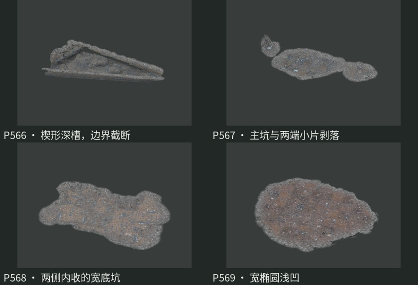
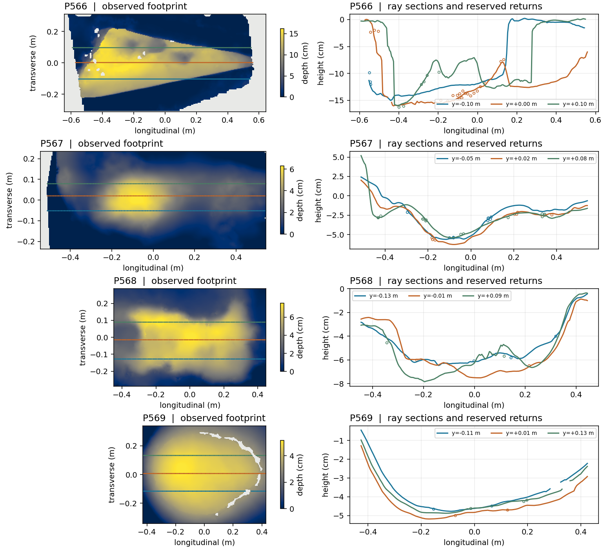

# P566–P569 · 四处点云坑槽与纵向断面

这四件资产取自 PointPSSN 中四份不同的道路采集记录，每份含 5,000 个 XYZ 测点及逐点坑区标签。几何来自各自的测点，颜色来自另行拍摄的沥青和骨料材质。尺度按原始坐标单位为米解释，四个样本均无独立标尺。每件可下载原生 GLB、SH1 高斯 PLY、安装高度场、材质索引、三条纵向断面和相反方向的回放图。[模型与断面下载](https://github.com/Vexlc/road-hazard-reconstruction/releases/download/roadworks-track-pits-v1.0.0/wheel-track-pits.zip) · [原始数据与代码](https://github.com/5rexi/PointPSSN/tree/1e4c122811066798db1dc0767a159dce05e48383) · [论文](https://doi.org/10.1016/j.eswa.2025.129833)

| 编号 | 原始记录 | 标注外接长 × 宽 | 坑内深度 P95 | 适合检查的现象 |
|---|---|---:|---:|---|
| P566 | train / 493 | 1.13 × 0.45 m | 15.6 cm | 楔形深槽在一侧被采集边界截断，底部与陡壁有不同的可见性 |
| P567 | test / 66 | 1.02 × 0.50 m | 6.0 cm | 中部主坑较深，两端可见分开的浅剥落 |
| P568 | train / 478 | 0.75 × 0.42 m | 7.4 cm | 宽底中段两侧收窄，偏离长轴后经过的坑深改变 |
| P569 | train / 395 | 0.63 × 0.56 m | 5.1 cm | 宽椭圆浅凹，长宽接近且底部缓变 |

长宽为全部已标注测点的最小旋转外接矩形，包含标注离岛和岛间空隙。深度 P95 取所有标注点距拟合路面的第 95 百分位。P566 的真实总长和边界外形未知。[记录编号、成员 SHA-256 和输入来源](survey.json)

## 从采集记录重建

先按同批井盖指南建立 Python 3.9 / CUDA 环境，并设置 `KIT`、`PYTHONPATH`、`OPENBLAS_NUM_THREADS` 与 `OMP_NUM_THREADS`。再安装画断面图的依赖，取得作者原始 ZIP 和我们的 CC0 材质包。下列命令从仓库根目录运行。作者的 ZIP 保持原有目录结构，程序按成员路径验证指纹。[固定版本环境命令](https://github.com/Vexlc/road-hazard-reconstruction/blob/roadworks-track-pits-v1.0.0/gen2hole/examples/hensting-cover/README.md#从原照重建) · [作者原始 ZIP](https://drive.google.com/file/d/1zmQ3IzpPbuiBKXMo-ttX1bqew8GSZ9to/view)

~~~bash
python -m pip install matplotlib==3.9.4
D=gen2hole/examples/wheel-track-pits
B=build-roadworks
mkdir -p "$B"
curl -fL -o "$B/materials.zip" https://github.com/Vexlc/road-hazard-reconstruction/releases/download/lane-damage-v1.0.0/scan-materials.zip
unzip -q "$B/materials.zip" -d "$B/materials"
(cd "$B/materials" && sha256sum -c SHA256SUMS)
python "$D/build_scans.py" /path/to/PointPSSN.zip "$B/materials" "$B/models/scans"
python "$D/check.py" "$B/models" "$B/scans"
~~~

五个核心文件在 `$B/models/scans/series/assets/pothole/P编号`。GLB 使用 Y 向上，高斯和局部高度场使用 Z 向上。用相同软件、GPU 和输入，在独立源码目录重复构建，这四件资产的 20 个核心文件全部逐字节一致。解压发布包后可运行 `sha256sum -c SHA256SUMS` 核对附件。[逐文件指纹](validation/rebuild.json)

## 如何保留陡壁与缺测区域

每份采集先在原扫描坐标上划分约 2.8 cm 的空间块，保留其中一折作最终检验。其余点用于拟合周围路面的局部坐标系。P567–P569 以局部邻域平面拟合高程。三角形三个顶点都要落在采集凸包及近邻支持范围内。无测点支持的区域在掩码内标为空，GLB 同处亦留空。[重建入口](build_scans.py)

P566 的陡壁在相近的水平位置有不同深度的返回。使用八邻点法向及经一致化的方向做三维 Poisson 重建，保留距训练点不超过 31 mm、落在采集范围且法向与观测相容的面。陡面纹理沿壁面高度展开。GLB 保留倾斜面；安装高度场记录垂直向下的第一命中。严格裁剪留下的空缺在斜视时可见，表示局部几何欠约束。[陡壁重建与纹理展开](steep.py)

| 编号 | 垂直命中 / 留出坑内点 | 命中点垂直高度平均绝对误差 | 垂直误差 P90 | 到三维网格最近距离 P90 |
|---|---:|---:|---:|---:|
| P566 | 200 / 204 | 17.44 mm | 57.63 mm | 13.70 mm |
| P567 | 106 / 108 | 2.89 mm | 4.39 mm | 4.69 mm |
| P568 | 37 / 37 | 1.45 mm | 3.62 mm | 3.32 mm |
| P569 | 52 / 52 | 0.29 mm | 0.58 mm | 0.58 mm |

最近距离统计包含全部留出坑内点。垂直统计仅计有网格首命中的光线。P566 的竖直误差最大，尤其在陡边；用它估计精细轮胎接触高度时，应同时查看剖面和留出点。导出网格、安装掩码和裁剪外探针均另行核对。[逐件结果](validation/quality.json)

## 读取轮迹位置的几何断面

对每件资产，在训练坑点横向坐标的 20%、50%、80% 分位处沿长轴每隔 5 mm 发射垂直射线。图左为相对于局部路面的深度和三条采样线，右侧实线为网格首命中高度，空心圆为附近 12 mm 内的独立留出测点。曲线中断处表示没有命中。断面是路面几何量，轮胎变形、载荷和车辆动力学需另行建模。

~~~python
import numpy as np
p = np.load("build-roadworks/scans/P566-sections.npz")
x = p["x_m"]                 # 沿坑长轴的局部位置（米）
offset = p["offset_y_m"]     # 三条断面的横向偏移（米）
z = p["z_m"]                 # 3 × N，NaN 表示缺测
part = p["first_part"]       # 0 无命中，1 路面，2 坑区
~~~

## 用实拍道路检查前后视角

在 PandaSet 109 的同一处落点分别合成四件坑槽，每件有前摄 5 帧，后摄依次为 12、12、10、12 帧。加上同批井盖，共 10 个视频、82 帧。下载包内按方向和编号分目录，附相机定位和代表帧的深度、部件图。真实道路影像来自 PandaSet，插入的坑槽来自上述独立记录。[下载车载回放](https://github.com/Vexlc/road-hazard-reconstruction/releases/download/roadworks-track-pits-v1.0.0/road-camera.zip) · [逐件核验](validation/camera.json)

~~~bash
raw=/path/to/raw/109
masks=/path/to/processed/109/dynamic_masks/all
for side in front back; do
  python "$KIT/scripts/render-road-distress.py" "$raw" "$masks" "$B/models" "$B/drive/$side" \
    --shot 15 --pixel 1190 925 --yaw-deg 15 --camera "${side}_camera" --semantic-occlusion --focus-part 2 P566 P567 P568 P569
done
# 仅生成坑槽时运行以下检查；若同目录也有 A565，在 --ids 后再加 A565。
python gen2hole/examples/lane-damage/check_drive.py "$B/models" "$raw" "$B/drive" "$B/camera.json" --ids P566 P567 P568 P569
~~~

两份指南都执行完后，可以运行 `python "$D/pack.py" "$B/models" "$B" "$B/release"` 打包；先把两组相机联合核验到同一个 `$B/camera.json`（`--ids A565 P566 P567 P568 P569`）。附件采用逐文件 SHA-256 校验。[打包脚本](pack.py)

PointPSSN 数据由 Tingrui Zhang 等作者发布，原库未列明独立的数据集许可证，原始 XYZ 和标签从作者入口获取。坑底材质使用 Dimitrios Savva 的 Poly Haven 摄影材质，邻接道路使用 ambientCG Asphalt031，均为 CC0。原始点云没有现场 RGB；模型色彩只用于视觉仿真。[road_damaged](https://polyhaven.com/a/road_damaged) · [road_damaged_2](https://polyhaven.com/a/road_damaged_2) · [Asphalt031](https://ambientcg.com/a/Asphalt031) · [PandaSet](https://github.com/scaleapi/pandaset-devkit)
