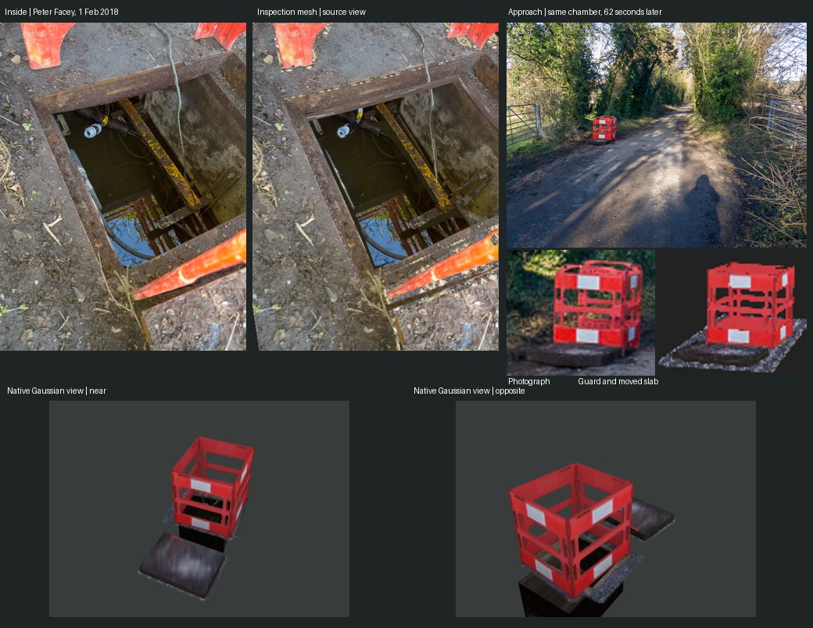
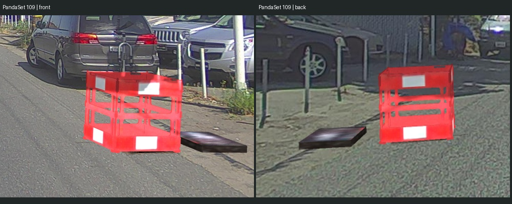

# M576 · Whites Hill 移开盖板的积水通信井

2018 年 2 月 1 日，Peter Facey 在英格兰汉普郡 Whites Hill 拍下同一处施工中的通信井。道路全景里，红色围栏和移开的盖板位于窄路边；62 秒前的近照里，能看到敞开的矩形井口、锈蚀黄漆横梁、接头和积水中的倒影。摄影者记载现场正在接续通信子管，原有电缆浸在水下。[道路全景](https://www.geograph.org.uk/photo/5710915) · [井内近照](https://www.geograph.org.uk/photo/5710912) · [模型和回放下载](https://github.com/Vexlc/road-hazard-reconstruction/releases/tag/whites-hill-v1.0.0)

## 选择模型

|文件|场景与使用方式|
|---|---|
|`asset.glb`|用于从车道驶近和经过。四面镂空围栏、红色内侧、外侧反光片、接地支脚和移开盖板来自远照的布局。水面使用中性的低粗糙度材质，便于接入宿主照明。|
|`inspection.glb`|用于对照 480 × 640 的近照。共用井圈、井壁、横梁、支架与管口几何，保留这次曝光中看得见的三片红色围栏、盖板一角和水面倒影。围栏没有拍全，两次曝光间的铰链状态无法从照片恢复。这个版本适合原机位。|
|`asset.ply`、`splat_material.npz`|行车版的一阶球谐高斯和逐高斯部件索引。两个独立角度中，高斯与网格的首交深度差 P90 约为 8–9 mm。|
|`surface.npz`|6 mm 网格，单位为米。`opening_mask` 为井口平面，`first_part` 为垂直首交部件，`water_mask` 为从上方先看到水的位置。`solid_range_m` 是从局部 z = 2 m 向下、排除水面后的首交距离，无固体几何时为 NaN。`height` 应结合 `alpha` 使用。|
|`metadata.json`、`views/*-rays.npz`|分别记录尺寸假设、机位、盖板和水面拟合，以及两个原机位逐像素的部件和沿射线的距离。GLB 采用 Y 轴向上，PLY、相机和 NPZ 采用 Z 轴向上。|

## 从两张现场照片复现

参考照片已随版本固定，建模前逐一验证 SHA-256。已测试 Linux、Python 3.9 和 CUDA 12.1。从仓库根目录运行以下命令。

~~~bash
git clone --depth 1 --branch whites-hill-v1.0.0 https://github.com/Vexlc/road-hazard-reconstruction.git
cd road-hazard-reconstruction
python3.9 -m venv .venv
source .venv/bin/activate
KIT="$PWD/releases/field-chambers"
python -m pip install -r "$KIT/requirements.txt"
python -m pip install torch==2.4.0 torchvision==0.19.0 --index-url https://download.pytorch.org/whl/cu121
python -m pip install gsplat==1.4.0
export PYTHONPATH="$KIT/gen2hole/downstream:$KIT/gen2hole/downstream/sensors:$KIT/gen2hole/recipes/common:$KIT/gen2hole/recipes/series"
export OPENBLAS_NUM_THREADS=1 OMP_NUM_THREADS=2
D=gen2hole/examples/whites-hill
B=build-whites-hill
python "$D/build.py" "$B/models/model"
python "$D/check.py" "$B/models" "$B/views"
~~~

成品位于 `$B/models/model/series/assets/missing/M576`。第二个独立源码目录从照片重新生成了六份文件，两次的 SHA-256 全部相同。[重建指纹](validation/rebuild.json)

1. 近照中沿井口四边标记像素，按每四点留出一点，估计径向畸变和两组消失方向，再把矩形井口恢复到局部平面。留出点距拟合边线 RMS 为 **1.87 px**。远照用七个围栏角点求位姿，重投影 RMS 为 **1.96 px**。用两个机位均能定位的三个支脚估计相似变换，它们的平面配准偏差约 2.7–3.8 cm。[图像坐标与来源](survey.json) · [相机拟合](cameras.py)
2. 取围栏高 **0.95 m** 作为唯一绝对尺度。名义工作焦距为 480 px，得到井口 **0.727 × 0.634 m**。焦距取 435–525 px 重新配准，短边约 0.634–0.647 m。在同一假设下，将五个可辨水线点投到右壁，名义水面低于路面约 **0.602 m**。现场缺少标尺；水下井底深度未知。[尺度敏感性与水线样本](validation/field.json)
3. 在远照里拟合盖板的四个角和前缘厚度，同时约束两边能搭接井口。模型盖板约 **0.920 × 0.667 × 0.094 m**，四角的投影 RMS 为 1.10 px。厚度对远照中一两个像素的选择敏感。围栏窗洞贯通，反光片只贴在外侧。内侧遮挡部分、铰链细节和厚度按可见截面近似。[几何与材质](build.py)
4. 近照里用接头端面的椭圆约束管轴方向。沿原片追踪锈黄横梁、固定件与灰线；横梁高度、线缆下垂和背后的墙面延伸包含假设。近照的 13 个检查像素分别命中水面、右壁、横梁、管口和支架。图像边缘的围栏碎片只延展到实际拍到的位置。[近照局部恢复](inspection.py) · [导出后核验](check.py)

## 检查从车里能看到多少水

将相机固定在井中心前方 2.20 m、横向偏移 0.15 m、高 1.65 m，分别保留和隐藏围栏。相同机位下可见水面从 **3,379 px 减到 982 px**，围栏遮住约 71%。向后退到 3.60 m 时，即使移去围栏，可见水面也是零。程序把开口之外的宿主路面作为遮挡体，避免射线从局部网格的外边缘穿到地下。另在井口中取三个位置垂直投射，光学首交位于模型水面，排除水面后均无固体返回。[原机位与模拟机位记录](validation/field.json)

## 在实拍宿主回放相机和激光

将行车版固定在 PandaSet 109 右侧道路边缘，前摄 6 帧、后摄 21 帧。代表帧中可见资产分别占 56,237 和 12,559 像素。照片提供英国现场的外观与布局，PandaSet 提供另一条街道的宿主、相机和激光束，插入后的结果为仿真。[相机记录](validation/camera.json) · [PandaSet](https://github.com/scaleapi/pandaset-devkit)

~~~bash
raw=/path/to/raw/109
masks=/path/to/processed/109/dynamic_masks/all
for side in front back; do
  python "$KIT/scripts/render-road-distress.py" "$raw" "$masks" "$B/models" "$B/drive/$side" \
    --shot 15 --pixel 1510 875 --yaw-deg 18 --camera "${side}_camera" \
    --semantic-occlusion --focus-part 174 M576
done
python gen2hole/examples/lane-damage/check_drive.py "$B/models" "$raw" "$B/drive" "$B/camera.json" --ids M576
python "$D/lidar.py" "$B/models" "$B/drive" "$raw" "$B/lidar"
python "$D/pack.py" "$B/models" "$B" "$B/release"
~~~

23 个通过交通净空检查的激光扫描中，共 29,924 条候选束。21,569 条保持原量程，8,319 条提前命中，36 条原道路回波被开口中的几何替换。**7,486 条命中围栏，806 条命中盖板**。每个扫描包保存两种假设的完整结果：水面产生首回波，或水面无回波而继续寻找已建模的固体。这组三维入射方向下没有光束先到达水面，两种假设得到相同量程；上述三个垂直探针提供了能区分两者的对照。水面的反射强度和水底位置没有现场观测。[逐束计算](lidar.py) · [扫描报告](validation/lidar.json)

两张照片署名 Peter Facey，按 CC BY-SA 2.0 提供。照片纹理、M576 网格和高斯及相关改编图按相同许可发布，改编包括摄影配准、局部补全、建模与渲染。复用时请保留摄影者、作品链接、许可和改编说明。PandaSet 宿主影像依其数据条款使用。[近照原件](https://www.geograph.org.uk/photo/5710912) · [远照原件](https://www.geograph.org.uk/photo/5710915) · [CC BY-SA 2.0](https://creativecommons.org/licenses/by-sa/2.0/)
